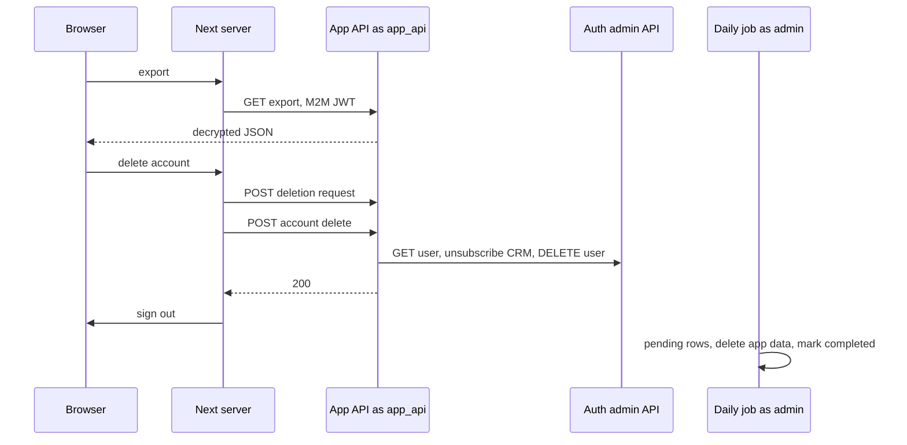

# Account export, auth deletion, and a deferred data wipe

Export and the auth-user delete run on the request path, as `app_api`, scoped to the JWT `sub`. The wipe of every application row runs later, on the admin connection, because that job reads `auth.users` for other work and deletes rows for a user who can no longer sign in. `app_api` is `NOBYPASSRLS` with `USING (TRUE)`. It can see every row. The handler's `WHERE` clause is the authorization. RLS is not.



The model comment says the wipe is weekly. The timer invokes it daily. The comment is stale.

## Who the user is (P13, P14)

Take the user id from `request.user_id` (the verified `sub`). Reject a missing id before `UUID()`. `UUID(None)` raises `TypeError`, and a handler that catches only `ValueError` turns that into a 500.

```python
user_id = getattr(request, "user_id", None)
if not user_id:
    return Response({"error": "Authentication required"}, status=401)
try:
    user_uuid = UUID(str(user_id))
except (ValueError, TypeError):
    return Response({"error": "Invalid user_id format"}, status=400)
user_id = str(user_uuid)
```

On the deletion-request route the reference also reads `user_id` from the body and returns 403 when `str(body_user_id) != str(request.user_id)`. Prefer the subject alone. If you still accept the body field, compare it to the subject and then store the subject. A mismatch is 403. Export and account-delete already ignore the body and use the subject. The reference's `UUID()` calls catch `ValueError` only.

These routes are not auth-exempt. An exempt path leaves `user_id` as `None`.

## Export

`GET /api/user-data-export/` with the M2M header. Load rows with `user_id` equal to the subject. Decrypt before putting text in the JSON (`aes-gcm-field-encryption`). Return one JSON object. There is no pagination and no emailed file.

| Key | What is included |
| --- | --- |
| `exported_at` | UTC timestamp of the response. |
| `user_id` | The subject. |
| `items` | Non-deleted rows, newest first. `days=None` means no time cutoff. Fields: id, title, content, datetime, sentiment, topics, keywords, people, created_at, updated_at. |
| `goals` | Decrypted title, description, and analysis JSON, plus category, dates, status. |
| `profiles` | Memberships: profile id, name, metadata, created_at. |
| `threads` | Each thread plus its messages in created order. Message content and metadata are decrypted. |
| `chat_embeddings` | Decrypted question, answer, and raw JSON. The vector is omitted. |
| `item_summary` | Decrypted summary JSON, or null. |
| `subscriptions` | status, price id, period start, period end, timestamps. Provider customer and subscription ids are omitted. |
| `support_tickets` | subject, category, message, status, timestamps. Stored as written. |
| `consents` | type, version, accepted_at, withdrawn_at, metadata. |

The item query uses the repository's non-detailed read. That decrypts title, content, topics, keywords, and people, and it does not load comments. The response also drops the analysis object and the embedding even though the entity has them. Soft-deleted items are excluded here and hard-deleted later.

Also absent: comments, profile likes, preference fields (name, theme), the activity clock, and graph-memory rows. The wipe removes those. A complete export includes every table the wipe deletes, except rows you intentionally retain.

Dates become ISO strings. UUIDs become strings.

## Close the account

The browser server action, in order:

1. Require a session user.
2. `POST /api/deletion-requests/` with `{ "user_id": "<subject>", "reason": "<optional text>" }`.
3. If the status is not 201 and not 409, stop. The auth user stays.
4. `POST /api/account-delete/` with an empty body.
5. On success, `signOut()` the browser session and clear the signed-in cookie (`maxAge: 0`).

409 means a `pending` row already exists. The client treats that as success and continues. A `completed` row does not block a new request. `processing` and `failed` also do not block, because the duplicate check is `status = 'pending'` only. Reason is optional.

```python
existing = await DeletionRequest.objects.filter(
    user_id=user_id, status="pending"
).afirst()
if existing:
    return Response({"error": "A pending deletion request already exists"}, status=409)
await DeletionRequest.objects.acreate(user_id=user_id, reason=reason or None, status="pending")
```

Schema: `id` uuid, `user_id` text (indexed), `reason` text null, `status` text indexed, `error_message` text null, `processed_at` timestamptz null, `created_at`, `updated_at`. Status values: `pending`, `processing`, `completed`, `failed`. `authenticated` may `SELECT` its own row (`auth.uid()::text = user_id`). Inserts go through `app_api`.

Account delete, still as `app_api`:

1. Reject a missing or non-UUID subject (P13).
2. If `SUPABASE_URL` or `SUPABASE_SERVICE_ROLE_KEY` is empty, return 500. Do not call the auth API.
3. `GET {SUPABASE_URL}/auth/v1/admin/users/{user_id}` with `Authorization: Bearer <service role>` and `apikey: <service role>`. Timeout 30 seconds. Status >= 400 returns 502 and stops. The email comes from this payload, not from the client.
4. If the email is non-empty, unsubscribe the CRM contact. A missing `LOOPS_API_KEY` logs and continues. HTTP 404 continues. Any other status >= 400 raises, and the auth user is not deleted. The PUT is `https://app.loops.so/api/v1/contacts/update` with `{ email, userId, subscribed: false }` and a 20-second timeout.
5. Set `crm_subscribed = false` on the activity row when one exists. An update of zero rows is fine.
6. `DELETE` the same auth-admin URL. Status >= 400 is returned as that status. Transport errors are 502.
7. Return 200 `{ "message": "Account deleted" }`.

Application rows are still there. The daily job deletes them.

If step 4 or 6 fails, the reference leaves the `pending` row in place. The person is still signed in (the client signs out only after 200), and the next job will wipe their data. On failure of the CRM call or the auth delete, set that row to `cancelled` before returning the error. The job selects `pending` only, so a cancelled row is left alone. The reference does not do this.

The current Loops update OpenAPI says a missing contact is created and does not list 404. Keep the 404 branch so "nothing to update" does not abort deletion. A created contact with `subscribed: false` is also acceptable.

> NOTE: 404 is what the handler treats as "no contact". It is not in the current update response list.

## What the request path does not do

The reference does not cancel the payment subscription. The provider keeps billing after the auth user is gone, and the job later deletes the local subscription row, including the provider customer id. The client already has an immediate cancel: `DELETE /subscriptions/{id}`, used when a customer refund should end the subscription. Account close never calls it. After the deletion row exists and before the auth user is deleted, call that for each stored provider subscription id. If the call fails, mark the deletion row `cancelled` and do not delete the auth user.

The reference does not delete object-storage keys. Avatars and other uploads survive both the auth delete and the row wipe. After the row deletes, delete keys owned by that user (`r2-presigned-uploads`) and record a failure on the request row if the object delete fails.

## Daily wipe (P31)

Same admin connection as the CRM scan: `SUPABASE_DB_ADMIN_*`, `sslmode` `verify-full`, CA file required, session pooler port, no default host. See `loops-crm` for the connection helper. Run it from the timer, or from a CLI that calls the same function and returns exit code 1 on failure. Production uses the timer.

One connection for the whole batch. Claim each row, commit, delete, then commit the outcome. A failure of one user rolls back that user's deletes and continues with the next.

```python
pending = conn.execute(
    """
    SELECT id, user_id FROM deletion_requests
    WHERE status = 'pending'
    ORDER BY created_at
    """
).fetchall()
```

For each row:

1. `UPDATE deletion_requests SET status = 'processing', updated_at = NOW() WHERE id = %(id)s`, then `commit`.
2. Inside `conn.transaction()`, delete that user's data.
3. On success, set `status = 'completed'`, `processed_at` and `updated_at` to UTC now, and `commit`.
4. On exception, `rollback`, set `status = 'failed'`, `error_message` to the exception text truncated to 2000 characters, `commit`, and increment `failed`.

If `failed` is non-zero, raise after the loop. Completed users stay completed. The timer records the failure and still attempts the other daily job.

The reference selects only `pending`. A crash after the processing commit and before completed or failed leaves the row in `processing` forever. Also select `processing` rows whose `updated_at` is older than the job's maximum runtime, and select `failed` when you want a retry. The reference does not.

`user_id` is stored as text. Columns in the rest of the schema are mixed `uuid` and `text`. Cast each comparison to the column type. A mismatch raises `operator does not exist` and fails that user.

### Delete order

Load thread ids first: `SELECT id::text FROM threads WHERE user_id::text = %(user_id)s`.

Graph tables, only if `pg_tables` lists them in `public`. Delete `store_vectors` then `store` (older installs have no cascade from `store` to `store_vectors`). Prefixes are the dot-joined namespace from `langgraph-postgres-persistence`: `(user_id, subject_id, "L2_memory")` and `(thread_id, "L1_memory")`.

```sql
DELETE FROM store_vectors
WHERE prefix = %(user_id)s
   OR prefix LIKE %(user_like)s          -- user_id || '.%'
   OR prefix LIKE ANY(%(thread_likes)s)  -- each thread_id || '.%'
```

Repeat for `store`. Then, when thread ids exist, delete `checkpoint_writes`, `checkpoint_blobs`, and `checkpoints` with `thread_id = ANY(%(thread_ids)s)`. Do this before deleting `threads`.

Then the application tables. Children first. The reference's foreign keys on these are deferred and do not cascade, so deleting the parent first fails at commit:

1. `item_comments` for the user's items.
2. `item_goals` linked to the user's items or the user's goals.
3. `messages` and `agent_runs` for the user's threads.
4. `items`, `goals`, `profile_memberships`, `profile_likes`, `app_user_preferences`, `threads`, `app_subscriptions`, `chat_embeddings`, `item_summaries`, `support_tickets`, `app_user_activity`.

### Shared profiles

A custom profile another person still uses is anonymized, not dropped. "Still used" means another user's membership, thread, comment, like, or embedding points at it. The item's `user_id` in the reference is text. The profile's `created_by_user_id` is uuid. Cast explicitly.

```sql
UPDATE profiles
SET created_by_user_id = NULL,
    is_deleted = TRUE,
    is_published = FALSE,
    is_paused = FALSE,
    updated_at = NOW()
WHERE is_custom = TRUE
  AND created_by_user_id = %(user_id)s::uuid
  AND ( /* another user still references this profile */ );
```

Then `DELETE FROM profiles WHERE is_custom AND created_by_user_id = %(user_id)s::uuid`. Anonymized rows have a null creator, so they survive. Catalog profiles (`is_custom` false) are never deleted. The reference does not delete the profile's object in storage.

### Retained on purpose

`consent_records` is not in the delete list. The job comment calls it the legal record. The export does include it. Whether you may keep it is a product decision. The code keeps it.

`deletion_requests` is not deleted. The completed row still holds `user_id`, the free-text `reason`, and any `error_message`. The reference does not purge the reason after completion.

## Env

| Name | Where |
| --- | --- |
| `SUPABASE_URL` | API. Auth admin base. No trailing path. |
| `SUPABASE_SERVICE_ROLE_KEY` | API. Auth admin only. Never a `NEXT_PUBLIC_` name. |
| `LOOPS_API_KEY` | API. Empty skips unsubscribe and continues. |
| `SUPABASE_DB_ADMIN_USER` | Timer. Required. |
| `SUPABASE_DB_ADMIN_PASSWORD` | Timer. Required. |
| `SUPABASE_DB_ADMIN_HOST` | Timer. Required. |
| `SUPABASE_DB_ADMIN_PORT` | Timer. Session pooler. |
| `SUPABASE_DB_SSLMODE` | Timer. Default `verify-full`. |
| `SUPABASE_DB_SSLROOTCERT` | Timer. Required when the mode verifies the chain. |

The field-encryption key is the one the export already uses to decrypt. Do not add a second key.

## Setup

1. Confirm export, deletion-request, and account-delete are behind the JWT middleware and are not auth-exempt.
2. Grant `authenticated` SELECT on its own deletion-request rows. Leave inserts to `app_api`.
3. Set `SUPABASE_URL` and `SUPABASE_SERVICE_ROLE_KEY` on the API only.
4. Set `LOOPS_API_KEY` on the API if signup creates contacts. An empty key must skip unsubscribe and still delete the auth user.
5. Put `SUPABASE_DB_ADMIN_*` on the timer, with `verify-full` and a CA file. Keep those off the request process.
6. Teach the client the 409-continue rule, the sign-out, and the cookie clear.
7. Add provider-subscription cancel and object-key delete around the auth delete. The reference has neither.
8. Run the wipe once a day. Reclaim stale `processing` rows.

## Failure prevention

- **P14.** Scope every request-path query by the JWT subject. `app_api` can read other users' rows. The admin role is the one that deletes a user who no longer has a session, and it is not the request login.
- **P13.** Reject a missing subject before `UUID()`. Catch `TypeError` as well as `ValueError`.
- **P31.** The wipe and any `auth.users` read use `SUPABASE_DB_ADMIN_*` over TLS from the timer. Require the host and the CA file. Do not point `app_api` at this job.
- Insert the deletion row before deleting the auth user. If the auth delete or the CRM unsubscribe fails, mark the row `cancelled` so the job does not wipe a person who is still signed in. The reference leaves it `pending`.
- Treat deletion-request 409 as "already queued" and continue. Do not continue on any other error.
- Unsubscribe Loops before the auth delete. A configured Loops error aborts the delete. A missing key does not. 404 does not.
- Cancel the payment subscription and delete owned object keys. The reference does neither.
- Delete graph rows while thread ids still exist. Delete non-cascading children before parents.
- Cast `user_id` to the column type.
- Reclaim stale `processing` rows. The reference never selects them again.
- Keep consent rows only if the product means to. Purge a free-text deletion reason if you do not need it.
- Log auth-admin status codes. Do not log the service-role key or the response body.
- Export decrypts text and omits vectors and provider customer ids.

## Tests

Deletion request: 201 with a reason, 201 without a reason, 400 when `user_id` is missing, 403 when the body id is not the subject, 409 when a pending row exists, 201 when the only existing row is `completed`.

Export: the JSON contains the subject's item id and the keys for goals, threads, and consents. A second user's item is absent.

Account delete: the auth admin DELETE URL contains the subject, 200 on upstream 200, and the upstream status is passed through on failure (502 stays 502). Unsubscribe is invoked. A missing `LOOPS_API_KEY` does not raise.

Wipe: the statement list includes the application tables, the five graph tables, the anonymize update (`created_by_user_id` null, `is_deleted`, not published), and a final delete of custom profiles still owned by the user. `consent_records` is absent. A forced exception sets `failed` and leaves the other user's rows. A crash-window test reclaims a stale `processing` row if you add that select.

## Checklist

- [ ] Export and both delete routes use the JWT subject. Missing ids are 401 before `UUID()`.
- [ ] Export is decrypted JSON, without vectors or provider customer ids, and covers the tables the wipe deletes.
- [ ] A pending request returns 409. The client still calls account delete. Any other create error stops the flow.
- [ ] Auth delete looks up the email, unsubscribes Loops, then deletes the auth user. Failure cancels the pending row.
- [ ] The payment subscription is cancelled and owned object keys are deleted. The reference skips both.
- [ ] The daily job uses the admin connection with TLS. It does not use `app_api`.
- [ ] Graph rows go first. Children go before parents. Shared custom profiles are anonymized.
- [ ] Consent retention and the deletion-request reason are an explicit decision.
- [ ] `processing` and `failed` rows are retried. A non-zero failure count fails the invocation.
