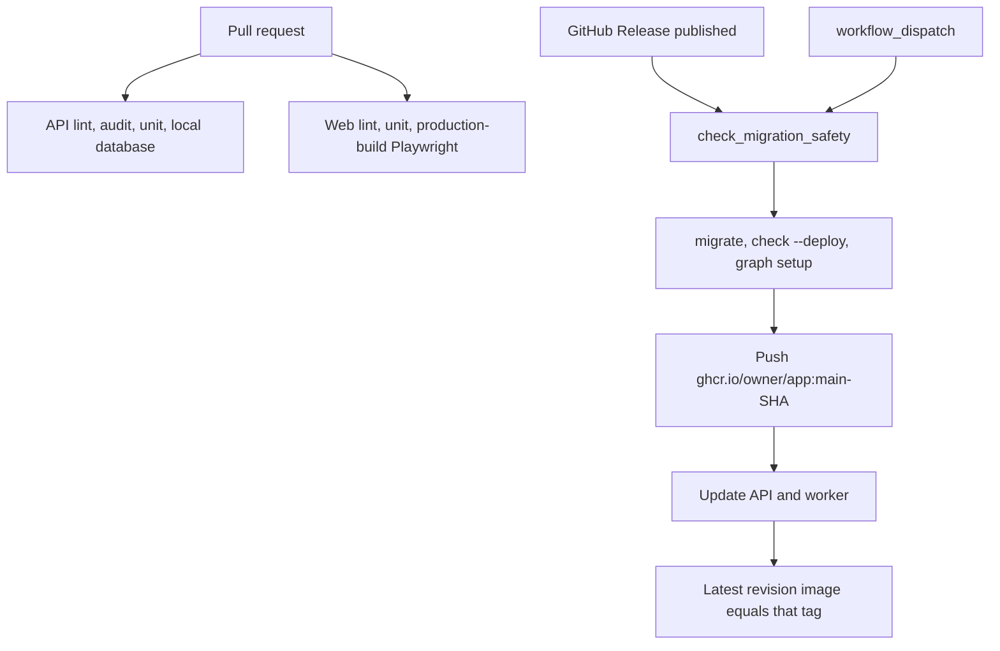

# Container Apps release with GitHub OIDC

One image runs two processes. The API is Uvicorn. The worker is Dramatiq (`dramatiq-redis-workers`). A third app in the same environment is only the outbound tunnel. Schema changes run on the GitHub runner before either app is updated. The rules for which migrations may run are `migration-safety`. This module is the image, the Azure resources, and the workflows around that command.

The web app has its own pull-request workflow. The reference web repo does not deploy it from these workflows. There is no `vercel.json` and no frontend release job.



`workflow_dispatch` stops after the migrate job. It does not build and it does not call `az containerapp update`. That is the contract path in `migration-safety`.

## Processes

| App | Command | Ingress | Scale |
| --- | --- | --- | --- |
| API | `uvicorn app.asgi:application --host 0.0.0.0 --port 8000 --timeout-graceful-shutdown 30` | Internal, port 8000. Not reachable on the public `azurecontainerapps.io` name | HTTP, 50 concurrent requests. Min 1, max 3. 1 vCPU, `2Gi` |
| Worker | `python -m dramatiq run_workers --processes 1 --threads 8` | None. No HTTP probes | Redis list `dramatiq:default`, length `8`. Min 2, max 4. 1 vCPU, `2Gi` |
| Tunnel | `cloudflared tunnel --no-autoupdate run` | None | Min 2, max 2. 0.25 vCPU, `0.5Gi`. Image tag pinned in Terraform |

The variable comments require 2 GiB of memory per vCPU on Consumption. The API and the worker are 1 vCPU and `2Gi`. The tunnel is 0.25 vCPU and `0.5Gi`. The HTTP scale-rule variable describes Azure's implicit rule as 10 concurrent requests. The API sets 50 in its place.

Revision mode is `Single`. Ingress traffic weight is `latest_revision = true` at 100 percent. A successful update deactivates the previous revision. `max_inactive_revisions` is 5. Microsoft's default keeps 100 inactive revisions; leaving the field unset retains that history.

The API command replaces the image `CMD`. The image `CMD` is the same Uvicorn line, so a missing override still serves port 8000. The worker override is required. Without it the worker container runs Uvicorn.

Termination grace on the app is 35 seconds. Uvicorn's graceful shutdown is 30. The platform grace stays longer than the process timeout so in-flight requests finish before the container is killed.

## Image

Python 3.13, the same version as API CI. The timer function is 3.11 (`azure-functions-timer`). Do not rebuild this image on 3.11 to "match" the function.

The runtime stage copies `manage.py`, the worker module, the database CA file, and the application packages. It does not copy `.env*`, tests, or Terraform. The process user is a non-root `appuser`. `EXPOSE` and the Docker `HEALTHCHECK` use `http://localhost:8000/health/`. Migrations are not an entrypoint. The release job has already migrated.

`docker/build-push-action` uses `target: application`. GitHub Actions cache is `type=gha` with `mode=max`.

GHCR repository names are lowercase. Set `IMAGE_NAME` to the lowercased `owner/app`. `github.repository` keeps the owner's real casing and is the wrong image path when that casing has capitals. The OIDC subject below keeps the real casing. Those two strings are different on purpose.

Tags pushed on every release:

```yaml
tags: |
  type=raw,value=main
  type=sha,prefix=main-
  type=raw,value=latest
```

`prefix=main-` replaces the default `sha-` prefix. `docker/metadata-action` v5 `format=short` is 7 characters unless `DOCKER_METADATA_SHORT_SHA_LENGTH` is set. The deploy job uses `${GITHUB_SHA::7}`. Those lengths have to be the same number. The v5 major once published a 12-character default for a single patch and then returned to 7. Pin the action to a release whose short SHA is 7, and change the slice in the same commit if the length changes. The reference workflow floats `@v5` and does not set the length variable.

The deploy tag is `main-<7 char sha>`. `:main` and `:latest` are pushed and are never the argument to `az containerapp update`.

## What a revision sees

Microsoft documents revision-scope changes (the container template, including the image) as the changes that create a revision. Secret values and ingress are application-scope: they apply without a new revision. The image field is the tag string, not the bytes behind the tag.

Pushing a new blob to `:main` leaves that string the same. Container Apps does not start a revision, and the old template keeps serving (P30). A new `--revision-suffix` does not fix a repeated tag. The suffix names the revision that a template change creates. Pass an image string that has never been deployed, plus a suffix unique to the workflow run (`r` + `GITHUB_RUN_ID`).

After `az containerapp update`, read `properties.latestRevisionName`, then that revision's `properties.template.containers[0].image`. Fail the job when it is not the tag just pushed. The reference job stops there. It does not read the revision's running state.

Single mode has already moved traffic. Probes can still fail the new replica after that move. Startup allows 24 failures at a 5 second interval, so a slow boot has about 120 seconds before it is failed. Liveness is every 20 seconds, 3 failures. Readiness is every 10 seconds, 3 failures, 1 success. Treat the release as done only when the latest revision is healthy, and roll back by updating to the previous `main-<sha>` with a new suffix if it is not. The reference does not poll health and does not roll back.

```bash
short_sha="${GITHUB_SHA::7}"
image="${REGISTRY}/${IMAGE_NAME}:main-${short_sha}"
suffix="r${GITHUB_RUN_ID}"
az containerapp update \
  --name "$APP_NAME" \
  --resource-group "$RESOURCE_GROUP" \
  --image "$image" \
  --revision-suffix "$suffix"
revision="$(az containerapp show \
  --name "$APP_NAME" \
  --resource-group "$RESOURCE_GROUP" \
  --query "properties.latestRevisionName" -o tsv)"
image_now="$(az containerapp revision show \
  --name "$APP_NAME" \
  --resource-group "$RESOURCE_GROUP" \
  --revision "$revision" \
  --query "properties.template.containers[0].image" -o tsv)"
test "$image_now" = "$image"
```

Run that for the API and the worker. A green `update` that left the previous image in place is a failed release.

Terraform ignores `template[0].container[0].image`. The first apply needs an image that already exists. Later applies must not reset the running tag to that bootstrap tag. Removing `ignore_changes` makes the next apply a deploy of the bootstrap tag.

```hcl
lifecycle {
  ignore_changes = [
    template[0].container[0].image,
  ]
}
```

Key Vault ids are versionless (`${vault_uri}/secrets/${name}`), so they name the current version rather than a pinned one. Secret values are application-scope and do not by themselves create a revision. After a rotation, confirm the running process sees the new value. The reference pipeline does not roll a revision only to refresh a secret.

## Network and probes

API ingress is `internal`: `external_enabled` is false. Clients reach the API through the tunnel. The tunnel's origin `Host` is the internal FQDN. The public `azurecontainerapps.io` name is not a client `Host`.

`GET /health/` and `GET /` return `{"status": "healthy"}`. Both paths are auth-exempt and rate-limit exempt. Probes are HTTP on port 8000, path `/health/`, with header `Host: localhost`. Django answers 400 when that host is missing from `ALLOWED_HOSTS`.

The production settings module always includes `localhost` and `127.0.0.1`, then the public hostname and the internal FQDN, then every token in `DJANGO_ALLOWED_HOSTS`. The reference file inlines the public and internal names. Terraform's hostname list defaults to empty and is only appended. A second environment replaces the inlined names. Production boot rejects an `ALLOWED_HOSTS` entry of `*`.

Browser CORS is not how the web server calls this API. `CORS_ALLOW_ALL_ORIGINS` is false. The reference list is a placeholder origin. Opening it does not fix a server-to-server call.

The tunnel token is a Container App secret on that app only. It is not an environment variable on the API or the worker. The tunnel image is a pinned release tag, updated by Terraform, not by the release workflow. The API app is a dependency so the internal name exists before the connector starts. Replicas stay at 2.

## Identity and secrets

The resource group and the Key Vault already exist. Terraform reads them. It does not create the vault and it never reads secret values.

Two user-assigned identities:

| Identity | Plane | Grant |
| --- | --- | --- |
| App | Data | Key Vault Secrets User on the vault. Used by the API, the worker, and the tunnel |
| GitHub | Control | Contributor on the resource group. Federated credentials only. No client secret |

Role assignment is eventually consistent. A `time_sleep` of 60 seconds sits between the Key Vault role and the apps that reference the secrets. The apps depend on that sleep.

`azurerm` 4.x needs `subscription_id` or `ARM_SUBSCRIPTION_ID`. `resource_provider_registrations` is `none`, so apply does not register every provider. Terraform `>= 1.5`, `azurerm ~> 4.0`, `time ~> 0.12`.

The environment resource includes the built-in Consumption workload profile. The app sets `workload_profile_name = "Consumption"`. Omitting the profile makes apply clear the one Azure is already reporting. Log Analytics is `PerGB2018`, retention 30 days, and is the workspace id on the environment.

GitHub's OIDC issuer is `https://token.actions.githubusercontent.com`. The audience on the federated credential is `api://AzureADTokenExchange`. The deploy job requests a token with `permissions: id-token: write` and `azure/login` using `AZURE_CLIENT_ID`, `AZURE_TENANT_ID`, and `AZURE_SUBSCRIPTION_ID`. No client secret.

The subject for a job that names the `production` environment is:

```text
repo:ORG/REPO:environment:production
```

GitHub's docs: repositories created after 2026-07-15, and any repository that opts into immutable subject claims, use:

```text
repo:ORG@ORG_ID/REPO@REPO_ID:environment:production
```

`@` separates the name from the numeric id because `@` cannot appear in an owner or repository name. The reference registers both subjects. The name-only credential did not match the assertion the API repository sends. Read `ORG_ID` and `REPO_ID` from that repository. A colon inside a customized claim value is encoded as `%3A`. The default environment subject is not encoded that way.

The migrate job also selects the `production` environment, so environment protection rules and the admin password apply to it. It does not set `id-token: write`. Only the deploy job can exchange a token for Azure. The build job is not in that environment. It has `packages: write` and pushes with `GITHUB_TOKEN`.

Registry pull uses a separate credential: Key Vault secret `ghcr-pull-token`, a personal access token that can read packages, as the registry password. The registry username is a machine user, not the image path. `server` is `ghcr.io`.

Secret names on the app are lowercase and hyphenated. Environment names stay upper snake case. One map feeds the sync script and Terraform.

| Env name | Vault secret | Mounted as |
| --- | --- | --- |
| `DJANGO_SECRET_KEY` | `django-secret-key` | API and worker env |
| `SUPABASE_SERVICE_ROLE_KEY` | `supabase-service-role-key` | API and worker env |
| `SUPABASE_DB_PASSWORD` | `supabase-db-password` | API and worker env. This is the `app_api` password |
| `REDIS_URL` | `redis-url` | API and worker env |
| `M2M_JWT_PUBLIC_KEY` | `m2m-jwt-public-key` | API and worker env |
| `FIELD_ENCRYPTION_KEY` | `field-encryption-key` | API and worker env |
| `STRIPE_SECRET_KEY` | `stripe-secret-key` | API and worker env |
| `STRIPE_WEBHOOK_SECRET` | `stripe-webhook-secret` | API and worker env |
| `AZURE_OPENAI_API_KEY` | `azure-openai-api-key` | API and worker env |
| `AZURE_COMMUNICATION_CONNECTION_STRING` | `azure-communication-connection-string` | API and worker env |
| `LANGFUSE_PUBLIC_KEY` | `langfuse-public-key` | API and worker env |
| `LANGFUSE_SECRET_KEY` | `langfuse-secret-key` | API and worker env |
| `BETTERSTACK_SOURCE_TOKEN` | `betterstack-source-token` | API and worker env |
| `R2_ACCESS_KEY_ID` | `r2-access-key-id` | API and worker env |
| `R2_SECRET_ACCESS_KEY` | `r2-secret-access-key` | API and worker env |
| `LOOPS_API_KEY` | `loops-api-key` | API env, and the same secret on the timer |
| `GHCR_PULL_TOKEN` | `ghcr-pull-token` | Registry password. Not a process env var |
| `REDIS_PASSWORD` | `redis-password` | KEDA `password` trigger. Not a process env var |
| `CLOUDFLARE_TUNNEL_TOKEN` | `cloudflare-tunnel-token` | Tunnel env `TUNNEL_TOKEN` only |
| `SUPABASE_DB_ADMIN_PASSWORD` | `supabase-db-admin-password` | Timer and the GitHub Environment. Not on the API or the worker |

The reference mounts the same app-secret map on both containers. Required for a first boot: `DJANGO_SECRET_KEY`, `SUPABASE_DB_PASSWORD`, `REDIS_URL`, `M2M_JWT_PUBLIC_KEY`, `FIELD_ENCRYPTION_KEY`, and `GHCR_PULL_TOKEN`.

Plain env (not secrets), set in Terraform:

| Name | Value |
| --- | --- |
| `DJANGO_SETTINGS_MODULE` | Production settings module |
| `DJANGO_ALLOWED_HOSTS` | Comma-separated hostnames, no scheme |
| `AZURE_OPENAI_ENDPOINT` | Foundry endpoint URL |
| `AZURE_EMBEDDING_DEPLOYMENT` | Deployment name |
| `LLM_PROVIDER` | `azure` or `gemini` |
| `AZURE_EMAIL_SENDER_ADDRESS` | Verified sender |
| `SUPPORT_INBOX_EMAIL` | Ticket inbox |
| `FRONTEND_URL` | Public web origin |
| `R2_ENDPOINT_URL` | Object-storage API endpoint |
| `R2_BUCKET_NAME` | Bucket |
| `R2_PUBLIC_BASE_URL` | Public read origin |
| `BETA_TESTING` | `true` or `false` |
| `LANGFUSE_SAMPLE_RATE` | Omitted when empty, so the app default stands |

The worker scaler address is `host:port`, not a URL. Metadata is `listName=dramatiq:default`, `listLength=8`, `enableTLS=true` when the broker is TLS. The password is the userinfo from `REDIS_URL`, stored as `redis-password`. KEDA does not read `REDIS_URL`.

When `SUPABASE_DB_ADMIN_USER` is unset, the reference production settings hardcode the `app_api` user, the pooler host, and port `6543`. That path does not read `SUPABASE_DB_HOST` or `SUPABASE_DB_PORT`. A reusable settings module reads the host, port, and user from the environment. The password still comes only from `SUPABASE_DB_PASSWORD`. The release job is the path that sets the admin user. Port `5432`, `verify-full`, and the bundled CA for that job are specified in `migration-safety`. The container does not get `SUPABASE_DB_ADMIN_USER` or `SUPABASE_DB_ADMIN_PASSWORD`.

That settings module also assigns the log ingest host in code, before the base settings import. Put `BETTERSTACK_INGESTING_HOST` in the environment instead (`langfuse-and-log-ingest`). One host in the file sends every environment to the same collector.

## Release job order

The workflow runs on `release: published` and on `workflow_dispatch`.

1. Environment `production`. Python 3.13. Install the lockfile.
2. `check_migration_safety`, then `migrate --noinput`, `check --deploy`, and `setup_langgraph_persistence`. Inputs, the admin port, and the allow flag are `migration-safety`. On a release the allow flag is empty (P11).
3. If the event is a release: build and push the three tags. `permissions` are `contents: read` and `packages: write`.
4. If the event is a release: Azure login and the image check above. `permissions` are `contents: read` and `id-token: write`. The job `needs` migrate and build.

GitHub Environment secrets, names only:

| Secret | Source |
| --- | --- |
| `AZURE_CLIENT_ID` | Terraform output, the GitHub identity's client id |
| `AZURE_TENANT_ID` | Terraform output |
| `AZURE_SUBSCRIPTION_ID` | Terraform output |
| `DJANGO_SECRET_KEY` | Same value as the vault. Required to import production settings |
| `M2M_JWT_PUBLIC_KEY` | Same value as the vault. Required to import production settings |
| `SUPABASE_DB_ADMIN_PASSWORD` | Admin login. Not the `app_api` password |

`FIELD_ENCRYPTION_KEY` is not a release-job secret. The migrate commands do not encrypt a field.

Order for a new environment: create the resource group and the vault, write secret values with the CLI, push the bootstrap image, `terraform apply`, copy the three Azure outputs into the GitHub Environment, then publish a release. Applying before the image exists fails the app. Applying before the vault secrets exist fails the secret references.

## API pull-request CI

Trigger: pull request to `main`. Python 3.13.

| Job | What it runs |
| --- | --- |
| Lint | `black==26.10.1 --check`, `isort==8.0.1 --check-only`, `flake8` with `--select=E9,F63,F7,F82` only |
| Migration safety | `migration-safety` `--names` path. Checkout `fetch-depth: 0` |
| Security | `pip-audit -r requirements.txt --strict`, then `bandit -r` on the application packages at high severity and high confidence (`-ll -ii`) |
| Unit | `pytest tests/unit/ -m "unit and not slow"`, coverage of the application packages, `--cov-fail-under=70` |
| Integration | Needs unit. Same-repository heads only. Redis, local Supabase, `migrate`, `setup_langgraph_persistence`, then `pytest tests/integration/` |

`pytest.ini` sets the test settings module and adds `--reuse-db --no-migrations --maxfail=5 --strict-markers`. The integration job migrates first. Pytest then reuses that database. The unit job does not start Postgres. A test that needs a database is an integration test.

The unit job supplies a throwaway `FIELD_ENCRYPTION_KEY` (64 hex characters) and a throwaway `M2M_JWT_PUBLIC_KEY`. Generate them for CI. They are not the production secrets and they are not pasted into this module.

The k6 harness is not a job in this workflow or in the release workflow (`k6-backend-load`). The integration job is skipped when `github.event.pull_request.head.repo.full_name` is not this repository, so a fork pull request does not start the local stack. `supabase stop --no-backup` is `if: always()`. The CLI action in the reference uses `version: latest`. Pin a CLI version so a new release does not change the database under the tests.

`pip-audit` may carry a temporary `--ignore-vuln` while a dependency pin blocks the fix. The advisory id and the pin that forces it belong in a comment on that step. Remove the ignore when the pin lifts. Coverage upload uses `fail_ci_if_error: false`.

The lockfile must compile cleanly (P36). `requirements.txt` is the output of `pip-compile` on `requirements.in` with Python 3.13. Generate it from that input. A hand-edited pin that contradicts another extra fails the next compile. The reference CI installs the committed lock and does not run `pip-compile`. Add a job that compiles from `requirements.in` and fails when the lockfile would change.

## Web pull-request CI

Trigger: pull request to `main`. Node 20. `pnpm/action-setup` runs before `actions/setup-node` with `cache: pnpm`. Install with `pnpm install --frozen-lockfile`.

Workflow env:

```yaml
NODE_VERSION: "20"
NODE_OPTIONS: --max-old-space-size=4096
```

The hosted runner heap is about 2 GB. `next build` and the Playwright web server die there on a Next 16 typecheck (P26). The variable is on the workflow so lint, unit, the build job, and Playwright all inherit it. The Playwright web server also sets `NODE_OPTIONS` to the same value in its own `env`, because that build is a child of Playwright.

Jobs, with lint and build independent of the test chain:

| Job | Command |
| --- | --- |
| Unit | `pnpm exec jest --coverage --ci` |
| Integration | Needs unit. `playwright install --with-deps chromium`, then `pnpm run test:integration` |
| Lint | `pnpm run lint` |
| Build | `pnpm run build` |

The build job evaluates third-party clients at import. Set these names to non-secret placeholders that satisfy those clients' shape checks, and point the site URL at `http://localhost:3000`: `STRIPE_SECRET_KEY`, `STRIPE_WEBHOOK_SECRET`, `NEXT_PUBLIC_STRIPE_PUBLISHABLE_KEY`, `NEXT_PUBLIC_SUPABASE_URL`, `NEXT_PUBLIC_SUPABASE_ANON_KEY`, `SUPABASE_URL`, `SUPABASE_ANON_KEY`, `NEXT_PUBLIC_SITE_URL`. Use a URL on `example.invalid` for the Supabase settings. Do not point the build at a real project.

Playwright is offline. One mock API, one mock auth server, and `page.route()` for browser calls. No real backend and no third-party network.

```ts
export default defineConfig({
  fullyParallel: true,
  forbidOnly: !!process.env.CI,
  retries: process.env.CI ? 0 : 1,
  workers: process.env.CI ? 1 : undefined,
  webServer: [
    { command: "node tests/integration/servers/mock-backend.mjs", timeout: 30_000 },
    { command: "node tests/integration/servers/mock-supabase.mjs", timeout: 30_000 },
    {
      command: "rm -rf .next/cache && pnpm run build && pnpm run start",
      timeout: 300_000,
      reuseExistingServer: !process.env.CI,
    },
  ],
})
```

`fullyParallel: true` with more than one worker runs specs against one in-memory mock. Specs then delete rows another spec is reading, and a cached miss sticks for the cache TTL (P27). CI sets `workers` to 1. A local parallel run needs a fixture store per worker. `reuseExistingServer` is false when `CI` is set, so CI always boots a new stack.

The web server command is `next build` then `next start`. `next dev` compiles routes on first hit and the suite times out under load (P26). `.next/cache` is removed first. The Data Cache from a previous run would otherwise replay for the production revalidate window and hide fresh mock data. Two projects (desktop and a phone device) depend on a setup project that writes a storage state. They still share the one mock process. One worker keeps those projects serial.

The integration web server needs a throwaway signing key in its env because CI has no local env file. The mock does not verify the signature. Generate that key in the harness. It is not the production private key.

Integration HTML report and failure screenshots are uploaded with `if: always()` and `if: failure()`. Codecov upload does not fail the job.

## Failure prevention

- **P11.** A release runs `check_migration_safety` with no allow flag, then migrates, then builds. Dispatch with the flag migrates and does not update a container. Applied files stay in place. The rest of the rule is `migration-safety`.
- **P26.** `NODE_OPTIONS=--max-old-space-size=4096` on the web workflow and on the Playwright web server. Integration starts `pnpm run build && pnpm run start` after deleting `.next/cache`.
- **P27.** CI Playwright `workers` is 1 while `fullyParallel` is true. One mock process holds the rows. Local parallel runs isolate that store per worker.
- **P30.** Deploy `main-` plus the 7-character SHA and a new revision suffix. Fail the job when the latest revision's image string differs. Confirm that revision is healthy before calling the release done. `:main` and `:latest` are not deploy tags. Terraform ignores later image changes.
- **P36.** The lockfile must compile cleanly from `requirements.in`.

## Tests

- A workflow fixture that deploys `:main` fails the image comparison when the latest revision stays on the previous tag.
- The same fixture passes when the revision image is `registry/owner/app:main-` plus the first 7 characters of `GITHUB_SHA`.
- Terraform plan keeps `ignore_changes` on the container image and sets `workload_profile_name` to `Consumption`.
- The federated credentials include the name subject and the `ORG@ORG_ID/REPO@REPO_ID` subject, audience `api://AzureADTokenExchange`.
- The worker module has `ingress_mode = none` and probes off. The API probe path is `/health/` and the `Host` header is `localhost`.
- `pip-compile` on `requirements.in` with Python 3.13 produces no diff against `requirements.txt`.
- With `CI=1`, the Playwright config reports `workers === 1`, and the web server command contains `pnpm run build && pnpm run start` and does not contain `next dev`.
- A web CI step that unsets `NODE_OPTIONS` is a failed review. The workflow env sets `--max-old-space-size=4096`.

## Checklist

- [ ] Pull-request API CI runs format, the narrow flake8 select, `--names` migration safety, `pip-audit --strict`, bandit high/high, hermetic unit tests at 70 percent, and same-repo integration against a local database.
- [ ] `requirements.txt` is produced by `pip-compile` from `requirements.in` on Python 3.13, and CI fails when that compile would change the lock (P36).
- [ ] Web CI sets `NODE_OPTIONS=--max-old-space-size=4096`, installs with a frozen lock, and runs Playwright against `pnpm run build && pnpm run start` with `workers: 1` (P26, P27).
- [ ] A GitHub Release migrates as admin on port `5432` before pushing `main-<7 char sha>` (P11).
- [ ] `workflow_dispatch` can migrate and cannot build or update a container app.
- [ ] Deploy updates the API and the worker with that immutable tag and a new revision suffix, then fails unless the latest revision's image matches (P30).
- [ ] The job also waits until that revision is healthy, and rolls back to the previous tag if it is not.
- [ ] Terraform ignores the container image. The Consumption profile is set on the environment and on each app.
- [ ] Both OIDC subjects are registered. Only the deploy job has `id-token: write`.
- [ ] `SUPABASE_DB_ADMIN_PASSWORD` and the tunnel token are absent from the API and worker env. `REDIS_PASSWORD` is the scaler secret, not an app env var.
- [ ] Probes send `Host: localhost` to `/health/`. `ALLOWED_HOSTS` includes `localhost` and the tunnel's internal FQDN, and rejects `*`.
- [ ] The bootstrap image exists before the first apply. Secret values are written to Key Vault before apps reference them. A `time_sleep` follows the Key Vault role assignment.
