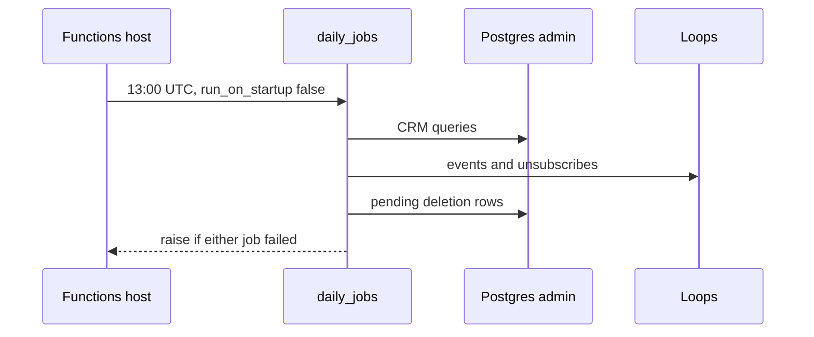

# Daily timer on Azure Functions Flex Consumption

One Python function runs both jobs. The CRM scan is `loops-crm`. The wipe is `account-deletion-and-export`. This module is the host, the package, and the connection those jobs share. The request process never sees `SUPABASE_DB_ADMIN_PASSWORD`.

The schedule is the six-field NCRONTAB `0 0 13 * * *`: second, minute, hour, day, month, day-of-week. That is 13:00:00 UTC every day. NCRONTAB numbers are a clock time, not an interval. The default zone is UTC.



## Orchestrator

`run_on_startup` is false so a deploy does not run the jobs. A `past_due` timer is logged and still runs. Being late is not a reason to skip a wipe.

Each job has its own `try`. A CRM failure is logged, then the wipe still runs. The function raises after both attempts when either name is in the error list. Swallowing that raise makes a failed scan look successful. The CRM job itself raises when its failure count is non-zero, including a missing `LOOPS_API_KEY`. That raise is caught here. Deletion still runs.

```python
import logging
import azure.functions as func

from jobs.crm import run_inactive_crm
from jobs.deletion import process_deletion_requests

app = func.FunctionApp()
logger = logging.getLogger(__name__)


@app.function_name(name="daily_jobs")
@app.timer_trigger(schedule="0 0 13 * * *", arg_name="timer", run_on_startup=False)
def daily_jobs(timer: func.TimerRequest) -> None:
    if timer.past_due:
        logger.warning("daily_jobs timer is past due")
    errors: list[str] = []
    try:
        run_inactive_crm()
    except Exception:
        logger.exception("inactive CRM job failed")
        errors.append("crm")
    try:
        process_deletion_requests()
    except Exception:
        logger.exception("deletion job failed")
        errors.append("deletion")
    if errors:
        raise RuntimeError(f"daily jobs failed: {', '.join(errors)}")
```

`host.json` is version `2.0`, `functionTimeout` `00:30:00`, extension bundle `[4.*, 5.0.0)`, and Application Insights sampling enabled. Both jobs share that 30-minute budget. A kill after a deletion row has been set to `processing` leaves it stuck: the wipe selects only `pending`. Keep the scan inside the timeout, and reclaim stale `processing` rows in the deletion module.

Log the job name and the user id. Do not log `LOOPS_API_KEY`, the database password, or the email. The reference CRM error includes up to 300 characters of the Loops body, which can echo the address. The reference labels the wipe `dsar` in the final message. The label is arbitrary. Both attempts and one raise are the contract.

> NOTE: whether the host retries a failed timer invocation before the next 13:00 UTC is platform behavior. This function only raises. Idempotency belongs in the two job modules. Sampling is enabled; confirm a forced failure is visible in the linked workspace before you rely on the trace.

## Admin connection (P31)

The jobs join `auth.users` and delete another user's rows. `app_api` is `NOBYPASSRLS` and has no grant on `auth.users`. This process uses a separate admin login. Do not put `SUPABASE_DB_ADMIN_*` on the API or the worker. Release-time migrate uses the same variable names from the CD environment, not from the function app.

```python
import os
from contextlib import contextmanager
from pathlib import Path

import psycopg
from psycopg.rows import dict_row

# jobs/db.py: parents[1] is the function root, next to certs/.
_CERT = Path(__file__).resolve().parents[1] / "certs" / "db-root.crt"


def connect_kwargs() -> dict:
    sslmode = os.environ.get("SUPABASE_DB_SSLMODE", "verify-full")
    host = os.environ.get("SUPABASE_DB_ADMIN_HOST", "").strip()
    if not host:
        raise RuntimeError("SUPABASE_DB_ADMIN_HOST is required")
    kwargs = {
        "dbname": os.environ.get("SUPABASE_DB_NAME", "postgres"),
        "user": os.environ["SUPABASE_DB_ADMIN_USER"],
        "password": os.environ["SUPABASE_DB_ADMIN_PASSWORD"],
        "host": host,
        "port": os.environ.get("SUPABASE_DB_ADMIN_PORT", "5432"),
        "sslmode": sslmode,
        "connect_timeout": 10,
        "row_factory": dict_row,
    }
    if sslmode in ("verify-ca", "verify-full"):
        cert = os.environ.get("SUPABASE_DB_SSLROOTCERT") or str(_CERT)
        if not Path(cert).is_file():
            raise RuntimeError("database CA file is missing")
        kwargs["sslrootcert"] = cert
    return kwargs


@contextmanager
def admin_connection():
    with psycopg.connect(**connect_kwargs()) as conn:
        yield conn
```

Port `5432` is the session pooler. The production Django settings fall through to `6543` when an admin user is set and `SUPABASE_DB_ADMIN_PORT` is omitted. `6543` is the transaction pooler. This function does not set `prepare_threshold`. Keep `5432`. If you point it at the transaction pooler, set `prepare_threshold=None` on the connection or prepared statements fail.

The reference defaults the host to a pooler hostname and attaches `sslrootcert` only when the file exists. A missing file then uses the system trust store and can fail the TLS handshake, or, worse, someone "fixes" it by setting `sslmode` to `require`. Require the host and the CA file instead. Terraform sets the host, the port `5432`, the database name, and `verify-full` as plain app settings, and the password as a Key Vault reference. Production does not depend on the code default when those settings are present.

Bundle the provider root CA inside the package (`certs/db-root.crt` above; the reference file is the vendor CA under `certs/`). `verify-full` checks the hostname against that certificate. Do not downgrade the mode.

## Package

Flex Consumption only runs a zip that is already built. `remoteBuild` is false. Wheels must be Linux wheels for the function runtime, which is Python 3.11. The API and its CI use 3.13. Do not zip that virtualenv.

```bash
python3 -m pip install \
  --platform manylinux2014_x86_64 \
  --implementation cp \
  --python-version 3.11 \
  --only-binary=:all: \
  --target .python_packages/lib/site-packages \
  -r requirements.txt
```

`requirements.txt` is `azure-functions`, `httpx>=0.27`, and `psycopg[binary]>=3.2`. `--only-binary=:all:` fails the build when a package has no wheel, which is what you want. A macOS `.so` will not load on the host.

Run that script before `terraform apply`. The archive is the function directory. It excludes `.venv`, `__pycache__`, `local.settings.json`, the example settings file, `.funcignore`, and the packaging script. It includes `.python_packages` and `certs/`. `.funcignore` also excludes `.python_packages`. Core Tools publish would drop the wheels. The path that matches this layout is the wheel script, then Terraform. There is no Terraform edge from the archive to the script. Skipping the script ships a zip that imports nothing.

`local.settings.json` is for `func start` only (`AzureWebJobsStorage=UseDevelopmentStorage=true`, empty secrets). It is not in the zip.

## Flex app

Linux, SKU `FC1`, Python `3.11`, `https_only`, storage account TLS 1.2, LRS, private container `function-packages`. The storage account name needs a random suffix. Deployment storage is `storage_container_type=blobContainer`, `storage_authentication_type=StorageAccountConnectionString`, and the account key as a sensitive attribute. Do not log that key. Do not also invent an `AzureWebJobsStorage` setting for production; the Flex arguments are the deployment storage.

System-assigned identity. Role `Key Vault Secrets User` on the vault. These two settings are versionless Key Vault references, not plaintext:

| App setting | Vault secret name |
| --- | --- |
| `LOOPS_API_KEY` | `loops-api-key` |
| `SUPABASE_DB_ADMIN_PASSWORD` | `supabase-db-admin-password` |

```
@Microsoft.KeyVault(SecretUri=<vault uri>/secrets/<secret name>)
```

Plain settings: `SUPABASE_DB_ADMIN_USER`, `SUPABASE_DB_ADMIN_HOST`, `SUPABASE_DB_ADMIN_PORT` (`5432`), `SUPABASE_DB_NAME` (`postgres`), `SUPABASE_DB_SSLMODE` (`verify-full`). Also `AzureWebJobsFeatureFlags=EnableWorkerIndexing` so the host loads the v2 decorators, and `APPLICATIONINSIGHTS_CONNECTION_STRING` plus the same string on `site_config`. Insights uses the same Log Analytics workspace as the API.

`HASH` is the zip sha256. The Functions host does not read it. Changing it updates the function app resource. A `terraform_data` deploy step uses the same sha as `triggers_replace` and depends on the function app and the role assignment. Role creation does not wait for data-plane propagation. A first run can 403 on Key Vault until the assignment is visible; restart after it is.

Do not set `WEBSITE_TIME_ZONE` or `TZ` (P29). Microsoft's timer binding docs: on Linux Flex Consumption and Consumption, those settings are not supported and can cause SSL failures and stop metrics. Write the clock in the function docstring as 13:00 UTC.

## Deploy

Flex package deployment stores `released-package.zip` in the deployment container and runs from that package. Uploading the blob without calling OneDeploy does not deploy it. Microsoft's docs say push tools send the package to the deployment endpoint; a raw upload to the container is not enough. The reference does both: upload the blob, then PUT OneDeploy.

1. Build the Linux wheels, then apply so the zip exists.
2. Upload the zip to container `function-packages`, blob name `released-package.zip`, overwrite.
3. Build a read-only, HTTPS-only SAS that expires in one hour.
4. PUT `https://management.azure.com/subscriptions/{sub}/resourceGroups/{rg}/providers/Microsoft.Web/sites/{app}/extensions/onedeploy?api-version=2022-03-01` with `packageUri`, `type` `zip`, and `remoteBuild` false.
5. Poll `.../functions?api-version=2023-12-01` until `daily_jobs` is listed.

The reference lists storage account keys and passes the key on the `az` command line, writes the JSON body under `/tmp`, polls 12 times with a 5-second sleep, and exits 0 when the list stays empty. Exit non-zero if `daily_jobs` is absent so apply fails. Keep the key out of logs. Prefer an identity that can write the container so the key is not in the process list.

> NOTE: Microsoft's current Bicep sample uses api-version `2022-09-01` and the same `packageUri` plus `remoteBuild: false`. The reference uses `2022-03-01` and also sets `type` to `zip`. Change the version only with a deploy check.

Terraform local-exec env: `JOBS_ZIP`, `JOBS_RESOURCE_GROUP`, `JOBS_FUNCTION_APP`, `JOBS_STORAGE_ACCOUNT`, `JOBS_STORAGE_CONTAINER`, `JOBS_SUBSCRIPTION_ID`. The blob name defaults to `released-package.zip`.

## Env

| Name | Where |
| --- | --- |
| `LOOPS_API_KEY` | Key Vault reference. Required. Empty fails the CRM job. |
| `SUPABASE_DB_ADMIN_USER` | Plain setting. Required. |
| `SUPABASE_DB_ADMIN_PASSWORD` | Key Vault reference. Required. |
| `SUPABASE_DB_ADMIN_HOST` | Plain setting. Required. No baked-in host. |
| `SUPABASE_DB_ADMIN_PORT` | Plain setting. `5432`. |
| `SUPABASE_DB_NAME` | Plain setting. `postgres`. |
| `SUPABASE_DB_SSLMODE` | Plain setting. `verify-full`. |
| `SUPABASE_DB_SSLROOTCERT` | Optional override of the bundled CA path. |
| `AzureWebJobsFeatureFlags` | `EnableWorkerIndexing`. |
| `APPLICATIONINSIGHTS_CONNECTION_STRING` | Insights resource. Not a secret you paste into git. |

Absent on purpose: `WEBSITE_TIME_ZONE`, `TZ`, and every API secret (`FIELD_ENCRYPTION_KEY`, the app-role password, the service-role key).

## Setup

1. Create the vault secrets `loops-api-key` and `supabase-db-admin-password`.
2. Vendor Python 3.11 manylinux wheels into `.python_packages`.
3. Bundle the database CA. Point `verify-full` at it.
4. Apply the Flex app, the identity role, and the OneDeploy provisioner together.
5. Confirm the function list contains `daily_jobs` and the app settings do not include a timezone variable.
6. Trigger the function once in a non-production database and confirm a CRM failure still attempts deletion, and that either failure fails the invocation.

## Failure prevention

- **P29.** Schedule in UTC. Do not set `WEBSITE_TIME_ZONE` or `TZ` on Flex. Document 13:00 UTC in the function docstring.
- **P31.** Admin connection only inside this process, TLS `verify-full`, CA file required, host required. Request handlers stay on `app_api`.
- `run_on_startup` false. `past_due` still runs both jobs.
- Isolate the two jobs. Raise one error at the end if either failed.
- Build 3.11 Linux wheels before the zip. Do not publish with a tool that honors an ignore rule for `.python_packages`.
- Call OneDeploy after the blob upload. Fail the script when `daily_jobs` never appears.
- Keep the storage key and the vault values out of logs and out of the zip.
- Stay on port `5432` unless `prepare_threshold` is disabled.
- Finish inside `00:30:00`. A timeout mid-wipe sticks a `processing` row.

## Tests

The reference unit tests assert the CRM SQL and the deletion statement list. They do not import `function_app`. Add these:

- The decorator schedule is `0 0 13 * * *` and `run_on_startup` is false.
- A `past_due` timer still calls both jobs.
- When the CRM callable raises, the deletion callable is still called, and the function raises `daily jobs failed: crm`.
- When both raise, the message lists both names and deletion was attempted.
- `connect_kwargs` raises when the host is empty, and raises when `verify-full` is set and the CA path is missing.
- With a real CA file, `sslrootcert` is set and `sslmode` stays `verify-full`.
- Rendered app settings contain no `WEBSITE_TIME_ZONE` and no `TZ`.
- The zip file list contains `.python_packages/` and `certs/`, and does not contain `local.settings.json`.

## Checklist

- [ ] NCRONTAB is `0 0 13 * * *`. No `WEBSITE_TIME_ZONE` and no `TZ`.
- [ ] `run_on_startup` is false. `past_due` does not skip work.
- [ ] CRM and deletion each have a `try`. The function raises if either failed.
- [ ] `SUPABASE_DB_ADMIN_*` exists only on this app and in the migrate job. `app_api` is the request login.
- [ ] Host is required. Port is `5432`. `sslmode` is `verify-full`. The CA file is in the zip and missing-file fails closed.
- [ ] Wheels are manylinux Python 3.11, built before apply. The zip includes them.
- [ ] OneDeploy runs with `remoteBuild` false. The script fails if `daily_jobs` is not listed.
- [ ] Password and `LOOPS_API_KEY` are versionless Key Vault references. The identity has Secrets User.
- [ ] `EnableWorkerIndexing` is set. Insights is connected. `HASH` is only the deploy trigger.
- [ ] Logs have user ids and job names, not keys, passwords, or emails.
