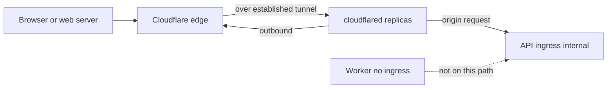

# Outbound Cloudflare Tunnel to an internal Container App

The API process listens inside the Container Apps environment. Its ingress is internal, so the environment's public name does not route to it. A third app in that environment runs `cloudflared`. That process opens connections out to Cloudflare. Cloudflare holds the public hostname and forwards HTTP to the API's internal name. The worker has no ingress and is not on this path.

Image builds, the release job, and the Key Vault role wait are `azure-container-apps-and-cicd`. This module is only the connector and the reason the API stays internal. The connector's own size is below. API and worker CPU, memory, scale rules, and probe headers are `aca-performance-tuning`.

## Architecture



The connector resource has no `ingress` block. Nothing on the environment accepts a connection to that app. Cloudflare's docs describe the connector as proxying from their network to the origin without an inbound hole on the origin. The public route is not a Terraform resource in this repo. `api_fqdn` is a Terraform output (`<api app name>.<environment domain>`). The connector file does not pass it to Cloudflare. The hostname route is created on the Cloudflare side and pointed at that internal name.

## API ingress stays internal

`ingress_mode = "internal"` sets `external_enabled` false on the shared module. `target_port` is 8000 and transport is `http`. The worker sets `ingress_mode = "none"`, which omits the ingress block.

Opening the API to `external` would publish it on the environment domain and bypass the tunnel. Clients, including the web server, are expected to use the public name that Cloudflare terminates. The client-facing name and the origin request's `Host` may differ; verify the route configuration rather than inferring the origin header from the public URL.

## Connector

| Setting | Value |
| --- | --- |
| Revision mode | `Single` |
| Inactive revisions kept | 5 |
| Workload profile | `Consumption` |
| Replicas | min 2, max 2 |
| CPU / memory | 0.25 vCPU, `0.5Gi` |
| Image | `cloudflare/cloudflared:2026.10.2` |
| Command | `cloudflared tunnel --no-autoupdate run` |
| Ingress | omitted |
| Probes | none |

Min equals max, so this app does not scale with HTTP concurrency. Both replicas receive the same token. The image tag is pinned in Terraform. The release workflow that retags the API and the worker does not update this app. A new connector binary is a Terraform apply of a new pin.

The command replaces the image entrypoint. Cloudflare's docs: `--no-autoupdate` disables the binary's self-update (`NO_AUTOUPDATE` is the matching environment variable). Their Docker example uses the same flag. A package-manager install ignores the flag; this container runs the binary directly, so the flag applies. The process does not pull a newer `cloudflared` out from under the pin.

`depends_on` is the Key Vault role sleep and the API module, so the internal name exists before the connector starts.

## Token

Remotely managed tunnels take the token as `cloudflared tunnel run --token`, or as the environment variable `TUNNEL_TOKEN`. Cloudflare's docs list that variable for the token. This spec uses the variable and does not put `--token` on the command. The value then stays out of the process arguments.

```hcl
# Not merged into the API/worker secret map.
connector_secrets = {
  CLOUDFLARE_TUNNEL_TOKEN = "cloudflare-tunnel-token"
}

resource "azurerm_container_app" "tunnel" {
  identity {
    type         = "UserAssigned"
    identity_ids = [azurerm_user_assigned_identity.app.id]
  }

  secret {
    name                = local.connector_secrets["CLOUDFLARE_TUNNEL_TOKEN"]
    key_vault_secret_id = "${local.vault_uri}/secrets/${local.connector_secrets["CLOUDFLARE_TUNNEL_TOKEN"]}"
    identity            = azurerm_user_assigned_identity.app.id
  }

  template {
    container {
      command = ["cloudflared", "tunnel", "--no-autoupdate", "run"]
      env {
        name        = "TUNNEL_TOKEN"
        secret_name = local.connector_secrets["CLOUDFLARE_TUNNEL_TOKEN"]
      }
    }
  }
}
```

The vault id is versionless, same as the other apps, so it names the current secret version. Terraform does not read the value. `all_secrets` merges the API/worker map, the registry pull token, and the Redis scaler password. It does not include `connector_secrets`. The API module mounts `all_secrets` only. The token is therefore not an environment variable on the API or the worker.

The secret name in Key Vault is `cloudflare-tunnel-token`. The container environment name is `TUNNEL_TOKEN`.

## Host header

The reference production settings expect the internal ingress hostname as the tunnel's origin `Host` and describe Azure's certificate for that name. The route configuration lives outside this Terraform, so the source alone does not prove the deployed header. Inspect the service URL and any `httpHostHeader` override. Cloudflare distinguishes that HTTP header from `originServerName`, the expected origin certificate hostname; check TLS and HTTP routing separately for an HTTPS origin. See [Cloudflare origin parameters](https://developers.cloudflare.com/cloudflare-one/networks/connectors/cloudflare-tunnel/configure-tunnels/origin-parameters/).

Production `ALLOWED_HOSTS` must accept the host Django actually receives. Keep probe names `localhost` and `127.0.0.1`; API probes send `Host: localhost` (`aca-performance-tuning`). The current production overlay replaces the imported base list with those probe names and inline approved public/internal names, then appends stripped, nonblank entries from `DJANGO_ALLOWED_HOSTS`. The env extension still works. Terraform no longer declares `custom_hostnames`, constructs an extra-host list, injects `DJANGO_ALLOWED_HOSTS`, or exports that list.

For reuse, replace the deployment literals with an env-driven approved list and explicitly provision `DJANGO_ALLOWED_HOSTS` in each environment. That is an adaptation; the current Terraform does not wire it. Changing the env list in the reference adds names but cannot remove its inline names. Keep exact approved hosts, reject `*`, and verify the final production overlay (`django-settings-and-env`). [Django ALLOWED_HOSTS](https://docs.djangoproject.com/en/5.2/ref/settings/#allowed-hosts) describes host matching and `get_host()` validation.

Intermittent resets after idle reuse have a separate timer/retry diagnostic in `http-keepalive-econnreset` (P45). Host rejection and TLS failures require the routing checks above.

## Setup

1. Create a remotely managed tunnel. Set the public hostname's origin to the API's internal FQDN (`api_fqdn`). That route lives in Cloudflare, not in this Terraform.
2. Store the tunnel token in Key Vault as `cloudflare-tunnel-token`. Do not copy the value into Terraform, a workflow, or the API secret map.
3. Apply the API app first (`ingress_mode = "internal"`), then the connector. The connector `depends_on` the API module.
4. Inspect the Cloudflare origin URL, HTTP Host override and HTTPS certificate settings. Allow the observed origin host on the API and retain probe names. For an env-driven adaptation, explicitly wire `DJANGO_ALLOWED_HOSTS`; there is no current Terraform extra-host input. Confirm the tunnel request succeeds and the API remains unreachable directly from outside the environment.
5. Leave the worker at `ingress_mode = "none"`.

## Failure prevention

- Keep API ingress internal. The public name is the Cloudflare route. The environment's public FQDN is not a client `Host`.
- Mount `TUNNEL_TOKEN` only on the connector. Leave `CLOUDFLARE_TUNNEL_TOKEN` out of `all_secrets`.
- Pass the token as the environment variable. Leave `--token` off the command so the value is not in the process arguments.
- Pin `cloudflare/cloudflared:<tag>` and pass `--no-autoupdate`. The release job does not roll this app.
- Keep min and max replicas at 2. Do not attach an HTTP scale rule to an app that has no ingress.
- Allow the internal origin name and `localhost`. Reject `*`.
- Inspect the final production list: it replaces the base list, then still appends env entries. Current Terraform does not supply those entries; an env change cannot remove inline approvals.
- Changing the API app name changes `api_fqdn`. Update the Cloudflare origin to match. Terraform will not do that by itself.

## Tests

`terraform plan` for the connector shows image `cloudflare/cloudflared:2026.10.2`, command `cloudflared tunnel --no-autoupdate run`, min and max replicas 2, no ingress, and one secret whose env name is `TUNNEL_TOKEN`. The API plan shows `external_enabled` false. The worker plan has no ingress. A static check fails if `connector_secrets` is merged into `all_secrets` or if the API `secret` blocks reference `cloudflare-tunnel-token`.

Settings: use a synthetic `DJANGO_ALLOWED_HOSTS` list with whitespace and blank entries. The current overlay replaces a sentinel base list, retains its inline approvals and probe names, and appends only stripped nonblank env entries. Its guard raises on `*`. An env-driven adaptation instead contains only probe names plus approved env entries, with no inline deployment names. Do not import real dotenv credentials to test either policy.

Static Terraform review finds no removed extra-host variable, host-list output or host env injection; connector-only token mounting and internal API ingress still hold. Deployment acceptance separately checks the configured origin URL/TLS/Host, a probe request, a tunneled request and external direct-origin isolation. These cannot be proved from Terraform text alone.

## Checklist

- [ ] API `ingress_mode` is `internal`. Worker `ingress_mode` is `none`. The connector has no ingress block.
- [ ] The public hostname's origin is the internal FQDN, configured on the Cloudflare side.
- [ ] `TUNNEL_TOKEN` comes from Key Vault secret `cloudflare-tunnel-token` and is not on the API or the worker.
- [ ] The command is `cloudflared tunnel --no-autoupdate run` with no `--token` argument.
- [ ] The image tag is pinned. Replica min and max are 2.
- [ ] `ALLOWED_HOSTS` includes `localhost` and the internal origin name, and rejects `*`.
- [ ] The route's HTTP Host and HTTPS certificate settings were inspected. The final production overlay accepts that Host; an env-driven adaptation explicitly provisions its host list without retaining deployment literals.
