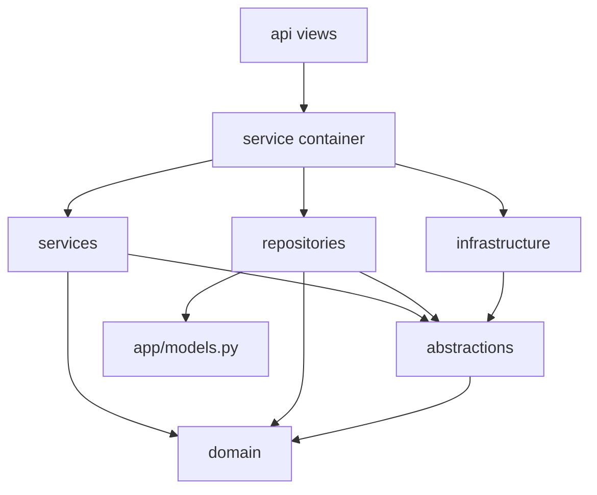

# One Django app split into bounded contexts

One Django project, one installed app, two feature contexts plus a thin support package. The app is not split into Django apps per feature. ORM models for every context live in a single `models` module at the app root. Migrations live next to that module. Contexts do not grow their own `models.py`.

The records context is the write path for items, goals, catalog profiles, and derived lists. The chat context is the streaming graph. Support is export, deletion, and consent views. A folder README inside the chat context still lists `protocols/`, `services/`, `tools/`, and `views/`. Those directories are not on disk. Follow the tree below, not that README.

## Tree

```
project/
  urls.py
  settings.py
app/
  models.py
  middleware.py
  records/
    api.py
    domain/            # dataclasses and value objects
    abstractions/      # repository and service ports
    services/          # workflows, plus container.py
    repositories/      # async ORM, mapping to domain
    infrastructure/    # LLM, object storage, mail, payments
    utils/             # parsing and serializers for this context
  chat/
    api.py
    domain/
    repositories/
    infrastructure/    # chat model factory, Redis
    agent/             # graph, nodes, checkpointer, stream
  support/
    api.py             # cross-aggregate reads, no domain package
```

HTTP entrypoints are async views (`adrf.decorators.api_view`). The project `urls` module imports each context's `api` module and registers paths. There is no per-context `urls.py` on the records side. The chat package still has a `urls` module; the project `urls` module is the list that is actually mounted.

## Dependency direction



Allowed imports, inward only:

| Layer | May import | Must not import |
| --- | --- | --- |
| `domain` | stdlib, its own value objects | Django, vendors, services, repositories |
| `abstractions` | `domain` | ORM models, vendor SDKs |
| `services` | `abstractions`, `domain`, other services through the container | `models`, vendor SDKs |
| `repositories` | ports, `domain`, `models`, the field-encryption helper | vendor HTTP clients |
| `infrastructure` | the port it implements, vendor SDKs | views |
| `api` | the container, serializers, request parsing, service exceptions | `models`, repositories, vendor SDKs |

Domain types are dataclasses. Invariants (a required title, a non-empty owner id) live in `__post_init__`. The ORM row is a different type. Repositories map between them and never return the ORM instance to a service.

Repositories are async and use the async ORM (`aget`, `aupdate`, async querysets). A service `await`s the port. Do not call the sync ORM on the event-loop thread.

The records container is a process-wide singleton. Getters construct a repository, an infrastructure adapter, or a service once and cache it. Services receive ports in `__init__`. Views call `container.get_<service>()` and then a method. They read `request.user_id` from the JWT middleware (`m2m-jwt-service-auth`) and pass that id in. They do not trust an id in the body.

Not every records class has a port. The main write and query workflows do. A few read models (charts, the subscription lookup, a recommendation assembly) are concrete classes the container still constructs. A new write workflow gets a port and a fake in the unit test. Do not add a vendor call to one of the concrete classes to avoid writing the port.

## Where a new feature goes

1. A new noun with invariants goes in `domain` as a dataclass or a value object.
2. Persistence methods go on the repository port, then on the Django repository. The query filters on the caller-supplied user id (`django-models-and-queries`).
3. The workflow (validation, a completion, a quota check, which repository calls run) goes on the service. The service depends on the port, not on the Django class.
4. A vendor call (model provider, object storage, mail, payments) goes in `infrastructure` behind a port. The service sees `complete` or `embed`, not the provider SDK.
5. Register the concrete types in the container getter. Do not construct them inside the view.
6. Add an async view that parses the request, calls one service method, and serializes the domain object. Map service exceptions to status codes in the view.
7. Add the path in the project `urls` module.

A change that is only a prompt or a parse rule stays in the service or in the context `utils` module that the service already calls. It does not go in the view, and it does not go in the repository.

A new table is a model on `app/models.py` plus a migration (`migration-safety`). The repository is the only reader of that model. Encrypted columns stay ciphertext in the row; the repository decrypts into the domain object (`aes-gcm-field-encryption`).

## Chat context

The chat context has domain entities, repositories, infrastructure, and an `agent` package (graph, nodes, checkpointer, stream). It has no `abstractions` package and no container. `api.py` builds one repository at import time and calls it.

Put a new chat behavior in a graph node or in the chat view. Put a new stored field in the chat repository, which maps the ORM row to the chat domain entity. The model factory and the Redis client stay in chat infrastructure. Streaming and checkpoints stay in `langgraph-streaming-chat` and `langgraph-postgres-persistence`. This module is only the folder rule.

The chat view also asks the records subscription lookup for memory limits, and graph nodes import a records repository and the records LLM adapter. Those edges already exist. A new records feature does not import a chat node. A new chat feature reads another aggregate through that aggregate's repository, not through `models`.

## Support views

Export, deletion, and consent are views in `support/api.py`. They read several ORM models and one records repository, decrypt, and return one payload. That bypass is the cross-aggregate dump. It is not the template for a new endpoint.

A new single-aggregate route goes through the records container. If a support view needs a new column, add the repository method and call that, instead of widening the ORM query in the view.

## Edges the reference already crosses

Copy the direction, not these shortcuts:

- The chat view constructs its repository at import, so a test cannot swap a port without patching the module global.
- Graph nodes import records repositories and the records LLM adapter directly.
- The records service imports a token counter from the chat package.
- Support views import ORM models.
- The chat package README describes directories that were never added.

A new file that needs one of those shortcuts is a sign the port or the container getter is missing.

## Failure prevention

- A view that imports `models` skips the user-id filter and the decrypt step the repository owns.
- A service that imports a vendor SDK cannot be tested without the network, and a provider change edits business rules.
- A domain type that imports Django cannot be constructed in a unit test without settings.
- A second `models.py` inside a context splits migrations and hides the table from the other context's repository.
- Constructing a repository inside a view (the chat module does this) bypasses the container. New records views use the container.
- Calling the sync ORM inside an `async def` repository blocks the loop. Use the async ORM.
- Treating the stale chat README as the layout creates empty packages and a second URL conf nobody mounts.

## Tests

- A service unit test passes fakes of the ports. It does not load Django settings and does not subclass the Django repository.
- A repository test is the integration test that hits the database and asserts the row is filtered by `user_id` and that ciphertext is not returned on the domain object.
- An API test sets `request.user_id` the way the middleware would and asserts the view calls the service rather than `models`.
- An import test, or a review check, fails if `records/services` imports `models` or a vendor client, and if `records/domain` imports Django.
- The project URL list resolves the new path. The chat package's unused URL module is not required to.

## Checklist

- [ ] The new table is on the app-root `models` module, with a migration. No context-local `models.py`.
- [ ] Domain types do not import Django. Services depend on ports. Repositories map ORM rows to domain objects and filter on the caller-supplied user id.
- [ ] Vendor calls live in `infrastructure`. The view calls the container, then one service method.
- [ ] The path is registered on the project `urls` module.
- [ ] Chat changes stay in the chat package. They read other aggregates through repositories.
- [ ] Support views are not the pattern for a single-aggregate route.
- [ ] The chat README's extra directories were not created.
