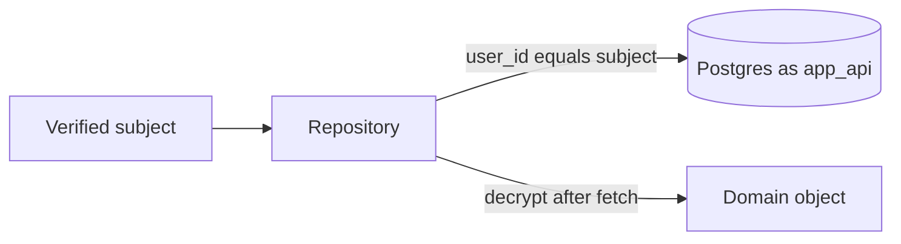

# Owner-scoped Django queries, denormalized filters, and a stored streak

The API login is `NOBYPASSRLS` and its policy is allow-all. Isolation is the `user_id` predicate on every query. Policy shape and `auth.uid()` casts are `supabase-rls-client-reads`. Ciphertext layout is `aes-gcm-field-encryption`. This module is the ORM: which column is the filter, how relations are loaded, and which counters are stored.

Owner columns are mixed. Item rows and the per-user summary store the subject as text. Goals, threads, preferences, likes, and the profile's creator store it as uuid. Pass `str(subject)` into a text column and a `UUID` into a uuid column. A raw comparison across the two casts explicitly. Deletion SQL that does those casts is `account-deletion-and-export`.

## Architecture



Lookups that take an id also take the subject in the same query (`id=item_id, user_id=subject`). A foreign id is a miss. Several reference methods add `user_id` only when the argument is present. The service always passes the subject. Omitting it reads any row the API role can see, which is every row.

A generic `filter(**kwargs)` helper does not add an owner predicate and does not call `select_related`. Callers pass the owner themselves.

## What is safe to filter

| Column | Use in SQL |
| --- | --- |
| `user_id`, status, `is_deleted`, dates, integer scores, indexed labels | Yes. These are plaintext and indexed or cheap to scan per user |
| Title, body, comment text, goal title and description, message content | No. They are ciphertext. A fresh IV means the same text is a different string |
| Keys inside an encrypted JSON blob | No. The database cannot see them |
| A vector column | Distance only, and only on rows already limited by `user_id`. See `pgvector-similarity-search` |

Mood and date filters use the integer score and the timestamp, not the analysis JSON. The score is a denormalized plaintext column kept beside the encrypted blob so a page can filter without decrypting.

Unique titles are checked in Python. Load that user's active rows (the `user_id` filter is what keeps this off other users), decrypt, and compare. A SQL `title=` against ciphertext never matches a second insert of the same words.

Like and unlike adjust a stored counter with `F("likes_count") ± 1`, guarded so the decrement does not run at zero. The catalog page orders on that column. It does not count like rows per card.

## Relations

`select_related` for a foreign key the serializer reads in the same response: a thread with its profile, a run with its thread, an unread note with its item and its profile. One query.

`prefetch_related` for a reverse set the page needs: an item with its notes and goals. Put the subset in `Prefetch`, including `select_related` on that queryset when the child also has a foreign key.

Django's queryset docs: a later `filter()` or `exclude()` on the related manager ignores the prefetch cache and issues a new query per parent. The reference goal loader calls `prefetch_related("item_set")` and then `item_set.filter(is_deleted=False)`. That second filter is a query per goal. Prefetch the filtered set:

```python
from django.db.models import Prefetch

items = Item.objects.filter(is_deleted=False).order_by("-datetime")
goals = (
    Goal.objects.filter(user_id=user_uuid, status=status)
    .order_by("target_date")
    .prefetch_related(Prefetch("item_set", queryset=items))
)
```

Comment totals are one grouped query, not a count per item:

```python
async for row in (
    Note.objects.filter(item_id__in=item_ids)
    .values("item_id")
    .annotate(c=Count("id"))
):
    counts[row["item_id"]] = row["c"]
```

Home facts use `acount()` and `values_list("datetime", flat=True)`. Bodies stay unread. Membership is three owner-scoped queries (selected rows with `select_related`, rows this user created, like ids), returned together. It is not one query per card.

Thread lists call `select_related("profile")` and `filter(user_id=...)`. A run lookup is `select_related("thread")` plus `thread__user_id=subject` in the same `aget`.

## Paging

Item pages are a keyset, newest first. The cursor is `"<datetime iso>|<id>"`. A bad cursor is ignored and the first page is returned.

```python
qs = Item.objects.filter(user_id=str(subject), is_deleted=False, datetime__isnull=False)
if cursor_dt is not None:
    qs = qs.filter(Q(datetime__lt=cursor_dt) | Q(datetime=cursor_dt, id__lt=cursor_id))
qs = qs.order_by("-datetime", "-id")
rows = [row async for row in qs[: limit + 1]]
```

Fetch `limit + 1`. The extra row means there is another page. The next cursor is the last returned row's timestamp and id. The model indexes `user_id`. It does not declare a composite index on `(user_id, datetime, id)`. A large history will sort more rows than the page.

The catalog page is offset. The handler rejects `page < 1` and a page size outside 1–48 (default 8). Sort `name` orders by name, then id. Sort `popular` orders by `-likes_count`, name, id. Label filters are one `Q`: a row matches if its category is in the category list **or** its function is in the function list. Empty lists apply no label filter. Visibility (not paused, not deleted, and either shared or published) is a separate filter. `acount()` then slice `[offset:offset + page_size]`.

## Denormalized filter columns (P41)

A catalog page that filtered two labels stored only inside `metadata` could not use an index. Promote such filter fields into indexed columns. For an existing populated table, the reusable migration pattern is expand, copy, verify, then switch readers/writers; retain old JSON keys until older processes are gone. The historical additive migration followed that pattern. It has since been removed from the reference graph.

The current three-file graph creates the indexed labels directly in its table snapshot. Both fields are `CharField(max_length=255, blank=True, default="", db_index=True)`. There is no `RunPython` label copy in that graph. Fresh rows use column defaults or explicit writes. Existing JSON-only labels are not copied by rewriting or faking the snapshot; an already-recorded snapshot does not rerun its added fields either. Schema/history transition checks belong to `migration-safety` (P11).

For a separate backfill on a legacy database, this generic example copies normalized values and preserves JSON. It is a migration pattern, not code that still runs in the reference graph. Run it after adding the columns and before relying on them for filtering; use historical models and the schema editor's database alias as [Django RunPython](https://docs.djangoproject.com/en/5.2/ref/migration-operations/#runpython) requires:

```python
def backfill_labels(apps, schema_editor):
    Profile = apps.get_model("items", "Profile")
    profiles = Profile.objects.using(schema_editor.connection.alias)
    batch = []
    for row in profiles.all().iterator(chunk_size=200):
        meta = row.metadata if isinstance(row.metadata, dict) else {}
        category = str(meta.get("category") or "").strip()[:255]
        function = str(meta.get("function") or "").strip()[:255]
        if row.category == category and row.function == function:
            continue
        row.category = category
        row.function = function
        batch.append(row)
        if len(batch) >= 200:
            profiles.bulk_update(batch, ["category", "function"])
            batch = []
    if batch:
        profiles.bulk_update(batch, ["category", "function"])
```

Attach this function to a new `RunPython` after the `AddField` operations (or a later controlled data step). A no-op reverse keeps copied data; it does not restore a pre-copy state. The example assumes JSON is authoritative and writes are paused or compatible during the copy. It is repeatable with unchanged input, but can overwrite newer column values if run after independent column writes. For large tables, plan bounded transactions, restart checkpoints and write coordination rather than assuming batches remove locking or race risks.

The list query filters `category__in` and `function__in`. It does not use `metadata__contains`. Current writes copy the labels onto the columns and pop those two keys out of the JSON before insert. An update still reads a leftover JSON value when the column argument is omitted, then pops the keys before save. The response serializer pops them again and returns the columns. Prompt assembly copies the columns into an in-memory metadata dict so a reader that still looks up the keys sees the column value. That copy is not a write.

Dropping the JSON keys while old readers or writers still depend on them breaks compatibility. The historical copy retained them; the current snapshot contains no copy or cleanup. The application pop happens on a write path that already knows the columns. A rolling adaptation needs compatible/dual writes or a coordinated switch before enabling cleanup. An update fallback does not repair untouched rows used by column-only filters.

## Stored streak (P40)

The preference row, primary key `user_id` (uuid), holds:

| Column | Default | When it moves |
| --- | --- | --- |
| `current_streak` | `0` | A newly created item |
| `longest_streak` | `0` | When `current_streak` exceeds it |
| `last_write_time` | null | That same create, unless the new timestamp is before the stored day |
| `first_write_time` | null | The first create only |

The current table snapshot creates these four columns with zero/null defaults. The former additive migration also used defaults without scanning existing items, but that file is gone. Current migrations contain no historical streak reconstruction. A newly created preference starts at those defaults until a create advances it; existing populated counters are not reset by a history rewrite. An older database missing the columns needs a reviewed forward schema change, not a fake declaration that they exist (`migration-safety`).

Advance rules, using the stored clock digits. `tzinfo` is stripped and never converted:

- No previous write: current becomes 1, and both timestamps become this item's time.
- The new day is before `last_write_time`: return the stored values unchanged.
- The new day equals `last_write_time`: keep the count, and move `last_write_time` to this item.
- The new day is the next calendar day: add 1.
- Any wider gap: current becomes 1.
- `longest_streak` is `max(longest, current)` on every path that accepts the write.

Display is separate from storage. If `last_write_time` is null, the current streak reads as 0. If the client-local today is the stored day or the next day, show the stored count. A wider gap reads as 0 and does not write that 0 back. The next create applies the advance rules to the stored count.

Delete refills all-time counts and the activity grid (the last 21 calendar dates, flagged from item timestamps in a 22-day window). It does not read or write the streak columns. Days since the first write is the calendar-day delta from `first_write_time` to the client-local today, and 0 when that timestamp is null.

`compute_streaks(date_keys, today)` still exists. It zeros the current run when today itself has no item, including when yesterday does. The home path does not call it. Display uses `displayed_current_streak`. The date-key scan is the wrong source for the number the client shows.

## Setup

1. Confirm the API role's policy is allow-all (`supabase-rls-client-reads`) and that every repository method receives the subject.
2. Match `user_id` to the column type. Text columns get `str(subject)`. UUID columns get `UUID(str(subject))` after a parse that returns 400 on failure (`m2m-jwt-service-auth`).
3. Keep filterable facts in columns. On an existing table, expand columns/indexes, coordinate writes, backfill JSON, verify values, then switch filters. Retain old keys until compatible readers/writers are deployed. On a fresh install, create columns directly; do not claim that this copies legacy data.
4. Create the streak columns with defaults when no historical reconstruction is intended. Preserve existing counters during upgrades; repair missing schema explicitly. Call the advance function only from the create path.
5. Load relations with `select_related` or `Prefetch`. Count with `values().annotate()`, not a query per parent.

## Failure prevention

- **P40.** Store current, longest, last write, and first write. Advance them only when a new item is created. A display of 0 after a gap is not written back. Delete leaves the four columns alone. Date keys use the stored clock digits. Do not serve `compute_streaks` as the displayed current streak: a missing item today zeros it even when yesterday has one.
- **P41.** Page and filter on indexed columns. A live JSON-to-column transition needs an explicit copy and compatibility plan; a default empty string and a rewritten initial snapshot supply neither. Keep JSON keys until compatible readers/writers are the only processes. The list query uses `category__in` / `function__in`, so legacy JSON alone cannot satisfy it.
- **P11 / P40.** Current columns are part of a three-file creation graph; the removed additive files and label `RunPython` do not execute. Compare actual schema, stored counters and label data before aligning history. Do not reset counters or infer a backfill from a fake (`migration-safety`).
- The API role sees every row. Put `user_id` in the same query as the primary key.
- Decrypt after the fetch. Uniqueness of a private title is a per-user Python compare.
- A `filter()` on a prefetched related manager is a new query per parent. Put the filter inside `Prefetch`.
- Owner text and owner uuid are different types. Cast in SQL. Re-apply policies when a column changes type (`supabase-rls-client-reads`).

## Tests

Streak unit tests, no database: the first write is 1; the same day keeps the count and moves `last_write`; the next day adds 1; a wider gap resets to 1; a back-dated day changes nothing; display of a stored 5 is 5 for today and yesterday and 0 for two days ago; a null last write displays 0. Assert the display helper does not require a write.

Query tests: a goal list uses one prefetch for non-deleted items (assert the query count, and that `filter()` is not chained on the related manager). An item page with a cursor returns rows strictly older than the cursor pair. A catalog page with both label lists uses OR. A second user cannot read the first user's item when `user_id` is in the lookup. Two users may store the same goal title; one user may not have two active goals whose decrypted titles match. Encrypting the same title twice does not make the ciphertext equal.

Migration acceptance: the fresh snapshot creates indexed label columns with empty defaults and preference counters/timestamps with zero/null defaults; it has no `RunPython` label copy or item scan. A fixture with legacy JSON labels and empty columns remains unchanged by fake alignment, so filtering cannot be declared repaired. Rehearse existing-schema upgrades separately (`migration-safety`).

For the proposed backfill, test dict and non-dict metadata, missing/empty labels, whitespace and length bounds, more than one batch, unchanged-row skipping, a second run with unchanged inputs, retention of JSON keys, and the selected database alias. Verify the JSON-authoritative assumption before running it against rows with newer column values. These tests validate the example pattern; they are not evidence that the deleted migration ran on a deployed database.

## Checklist

- [ ] Every API query includes the token subject, in the same lookup as the id.
- [ ] Text owner columns receive `str(subject)`. UUID owner columns receive a `UUID`.
- [ ] Filters and sorts use plaintext columns. Private text is decrypted after the fetch.
- [ ] Label columns are indexed. Existing JSON data has an explicit verified copy path and compatible writes; old keys remain until old processes are gone (P41).
- [ ] Fresh creation, historical backfill and existing-database history alignment are distinguished. Current graph has no label `RunPython`; stored counters are preserved (P11/P40).
- [ ] Streak columns advance only on create. A gap displays 0 without writing 0. Delete does not touch them.
- [ ] Relations use `select_related` or `Prefetch`. Counts use one grouped query.
- [ ] Item pages are a `(datetime, id)` keyset. The catalog page bounds page size and orders by a stored counter or by name.
