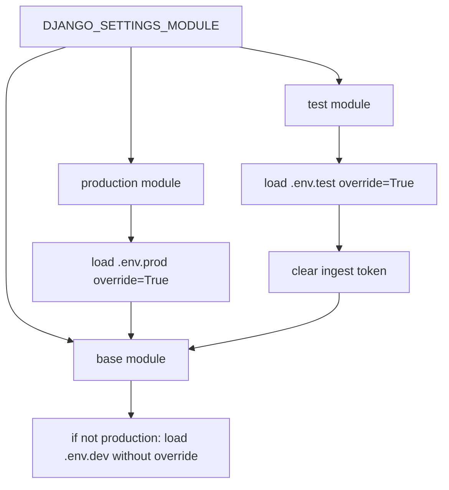

# Django settings modules, env boundaries, and the database pool

One Django project. Three modules. `DJANGO_SETTINGS_MODULE` picks the file. The base module holds knobs that are the same in every environment. The production module and the test module load their dotenv file, then `import` the base module, then overlay hosts, TLS, and guards.

`manage.py`, the ASGI entry, the WSGI entry, and the worker default to the base module. Local compose uses that default. The release workflow sets the production module. Pytest, the load server, and CI set the test module. A production or load process that forgets the variable boots the dev module.

Role grants and `search_path` are in `supabase-rls-client-reads`. This module only chooses which login the process uses and how the connection is pooled. Log-handler capture of the ingest host is the same bug as P34 in `langfuse-and-log-ingest`; the fix for the assignment is here.

## Which module loads what



The base module sets `ENV` to `production` only when `DJANGO_SETTINGS_MODULE` ends with the production module name. Otherwise it sets `ENV` to `dev`, then loads `.env.dev` if that flag is false. The production module sets `ENV = "production"` again after the import. The test module sets `ENV = "test"` after the import.

That order matters. During the base import under the test module, `ENV` is still `dev`, because the module name does not end with the production name. Code that reads `ENV` at import time inside the base module does not see `test`. The URL mount and `is_test_env()` run after the test module assigns `ENV`, so they do see `test`.

Dotenv file names are `.env.dev`, `.env.prod`, and `.env.test`. `ENV` values are `dev`, `production`, and `test`. A loader that opens `.env.` plus `ENV` looks for `.env.production` in production and misses `.env.prod`. The speech adapters do that at import. Do not add another one. Read settings from `django.conf.settings` after the selected module has finished.

Test loads `.env.test` with `override=True` before the import, then the base load of `.env.dev` does not override, so test values win and dev fills gaps. Production loads `.env.prod` with `override=True` and skips `.env.dev`.

## What is env, and what the reference hardcodes

For reuse, read secrets and deployment hosts from the environment. The reference still hardcodes some hosts, as described below. Plan caps, delay distributions, and rank weights are code constants in the base module. Do not copy those caps here; `subscription-entitlements` owns them.

| Name | Where it belongs |
| --- | --- |
| `DJANGO_SECRET_KEY` | Env. Required when debug is off. |
| `DJANGO_DEBUG` | Env on the base module. Production forces false. |
| `DJANGO_ALLOWED_HOSTS` | Comma-separated. Base reads it or falls back to `*`; production resets the list to inline approvals/probe names, then appends env entries. Prefer env-only deployment names. |
| `M2M_JWT_PUBLIC_KEY` | Env PEM. Newlines may be the two-character escape. |
| `FIELD_ENCRYPTION_KEY` | Env. Required when debug is off. See `aes-gcm-field-encryption`. |
| `SUPABASE_URL` | Env in every module. No host literal (P42). |
| `SUPABASE_DB_PASSWORD` | Env. |
| `SUPABASE_SERVICE_ROLE_KEY` | Env. |
| `SUPABASE_DB_USER`, `SUPABASE_DB_HOST`, `SUPABASE_DB_PORT` | Env. Port default `6543` only as a fallback, not a baked-in user or host. |
| `SUPABASE_DB_ADMIN_USER` and the matching admin host, port, password, sslmode | Env, and only together. See below. |
| `BETTERSTACK_SOURCE_TOKEN` | Env. Empty means no ingest handler. |
| `BETTERSTACK_INGESTING_HOST` | Env, set before the handler is built (P34). No host literal. |
| `CORS_ALLOWED_ORIGINS` | Env when any browser origin is allowed. |
| `REDIS_URL`, provider keys, `LANGGRAPH_DATABASE_URL` | Env. Empty string is "not configured." |

**P42.** The base module assigns `SUPABASE_URL` in source, and the production module assigns it again, then copies that assignment onto `os.environ`. An environment value for the same name cannot win: the literal overwrites it. The pooler host and the application login are hardcoded the same way when `SUPABASE_DB_ADMIN_USER` is unset. Read `SUPABASE_URL` from the environment in every module. Do not assign a host literal, and do not copy a literal back onto the environment.

Copying a value onto `os.environ` is legitimate only when that value was just read from the environment. The checkpointer still reads `SUPABASE_DB_*` from the process env (`langgraph-postgres-persistence`). Write the env-derived fields after `DATABASES` is built. Do not write a source literal.

**P34.** The log handler keeps the ingest host it was constructed with. A later assignment does not retarget it. The production module assigns a host literal onto `os.environ` before importing the base module, so the handler captures the literal and an env value cannot win. The base module also falls back to a host literal when the variable is empty. Read `BETTERSTACK_INGESTING_HOST` from the environment. Do not assign a host literal. The test module clears `BETTERSTACK_SOURCE_TOKEN` before the import so the handler is never attached.

The reference also assigns the trace-backend host in source and copies it onto `os.environ`. That overwrite is covered in `langfuse-and-log-ingest`. Same rule: no host literal.

```python
def required_env(name: str) -> str:
    value = os.environ.get(name, "").strip()
    if not value:
        raise ValueError(f"{name} must be set")
    return value

SUPABASE_URL = required_env("SUPABASE_URL")
# Do not follow this with os.environ["SUPABASE_URL"] = "<host>".
```

Issuer and audience for the service JWT are shared constants, not secrets. The public key is the env value. Details of verification are in `m2m-jwt-service-auth`.

## Database connection

The process uses the transaction pooler, port `6543`. The reference project's direct database host is IPv6-only, so the pooler is the path that answers. `CONN_MAX_AGE` is `0` because a persistent Django connection fights the pooler (`dramatiq-redis-workers`, P02). `CONN_HEALTH_CHECKS` is true.

Django's psycopg pool sits in `OPTIONS["pool"]`. `min_size` is `0` so an idle worker can drop to zero sockets. `max_size` is `10`. `timeout` is `10` seconds. `connect_timeout` is `10`. `statement_timeout` is `30000` milliseconds, passed as the startup option `-c statement_timeout=30000`.

| Module | sslmode | statement_timeout | Login |
| --- | --- | --- | --- |
| Base | `require` | 30 seconds | env user, not the owner |
| Production | `verify-full` unless admin sslmode overrides | 30 seconds | app role, or admin role when the admin user is set |
| Test | `disable` on local Postgres | omitted | local superuser is acceptable only here |

Production adds the bundled CA file to `sslrootcert` when the mode is `verify-ca` or `verify-full`. The test options drop `statement_timeout` and `connect_timeout`, and set `TEST["NAME"]` to the same database so pytest can run `--reuse-db --no-migrations`.

The request path logs in as the application role from `supabase-rls-client-reads`, not as the owner and not as a role that bypasses RLS. A release job may set `SUPABASE_DB_ADMIN_USER`. Only then does the process use `SUPABASE_DB_ADMIN_HOST`, `SUPABASE_DB_ADMIN_PORT`, `SUPABASE_DB_ADMIN_SSLMODE`, and `SUPABASE_DB_ADMIN_PASSWORD` (falling back to `SUPABASE_DB_PASSWORD` when the admin password is unset). Do not apply the admin password unless the admin user is also set. The reference gets that pairing right and still hardcodes the non-admin user and host. Those two belong in the environment as well.

## Allowed hosts and overlay order

Probe hosts `localhost` and `127.0.0.1` may be literals: the platform health check sends `Host: localhost`. Deployment hostnames should come from `DJANGO_ALLOWED_HOSTS`. The current source has two distinct stages:

1. Base parses the comma-separated env value, stripping whitespace and dropping blank tokens. An empty/whitespace value uses the laptop `*` fallback. A nonblank commas-only value produces an empty list.
2. Production imports base, then **replaces** `ALLOWED_HOSTS` with inline approved public/internal names and the two probe names. It then calls `ALLOWED_HOSTS.extend(...)` with the stripped nonblank env entries. It does not retain the imported list object or its fallback `*`, but it does reread and append env values, including `*` if explicitly supplied. The later production guard rejects that wildcard.

Terraform removed `custom_hostnames`, its derived host list/output and `DJANGO_ALLOWED_HOSTS` injection. The production env extension remains implemented, but the current Terraform supplies no entries. An env-only adaptation needs both a settings change that removes inline deployment names and explicit env provisioning. An env change alone cannot remove the reference's inline approvals.

Recommended production overlay after the base import (an adaptation, not the current implementation):

```python
import os

def production_hosts(raw: str) -> list[str]:
    hosts = [host.strip() for host in raw.split(",") if host.strip()]
    if not hosts or any(
        "*" in host or ":" in host or "/" in host or host.startswith(".")
        or any(char.isspace() for char in host)
        for host in hosts
    ):
        raise ValueError("DJANGO_ALLOWED_HOSTS must list exact deployment hostnames")
    return list(dict.fromkeys(["localhost", "127.0.0.1", *hosts]))

ALLOWED_HOSTS = production_hosts(os.environ.get("DJANGO_ALLOWED_HOSTS", ""))
```

This policy accepts exact DNS names or IPv4 hosts without schemes, ports or subdomain wildcards; extend it deliberately if IPv6 or wildcard matching is required. It is a configuration guard, not a full DNS syntax validator. [Django ALLOWED_HOSTS](https://docs.djangoproject.com/en/5.2/ref/settings/#allowed-hosts) documents host matching and validation through `get_host()`. Supply the origin host Django receives through the tunnel, which may differ from the client-facing hostname; routing/TLS verification belongs to `cloudflare-tunnel`.

Setup order: provision the approved env list, choose the production module explicitly, apply the env-driven overlay, then inspect its final list and test probe/tunnel requests. Leave P42 and the other production guards in place.

## Middleware

Order is the security boundary. JWT runs first so later middleware can read `request.user_id`.

1. JWT auth middleware. Sets `request.user_id` from the verified token. Exempt paths default to `/health/`, `/`, and the billing webhook path.
2. Rate limit middleware. Uses `request.user_id`. Default budget is 100 requests per 60 seconds with a burst of 20. `TRUSTED_PROXY_COUNT` is 1: the client IP is that many hops from the right of `X-Forwarded-For`.
3. Security-headers middleware.
4. `corsheaders.middleware.CorsMiddleware`.
5. `django.middleware.common.CommonMiddleware`.

Session, auth, messages, and CSRF middleware are not installed. `django.contrib.admin` and `django.contrib.auth` are not installed. DRF uses `UNAUTHENTICATED_USER = None`, an empty authentication class list, and `AllowAny`, because the JWT middleware already rejected the request. Do not add DRF authentication that expects `django.contrib.auth`.

The browser does not call this API. The web server does. CORS is a backstop for an accidental browser call. Production sets `CORS_ALLOW_ALL_ORIGINS` false. The reference allowlist is a placeholder, not an origin to copy. Set `CORS_ALLOWED_ORIGINS` from the environment when a browser origin must be allowed.

Body limit is 20 MiB on `DATA_UPLOAD_MAX_MEMORY_SIZE` and `FILE_UPLOAD_MAX_MEMORY_SIZE`, aligned with the edge body cap.

## Logging

Dramatiq's worker wrapper redirects `sys.stdout` and `sys.stderr` to a pipe the master drains to stderr, and the platform labels that stream as errors. Handlers bind `sys.__stdout__` and `sys.__stderr__` instead.

- A stdout handler accepts records below `ERROR`.
- A stderr handler accepts `ERROR` and above.
- `logging.basicConfig(..., force=True)` replaces a handler the worker already installed. Without `force=True`, `basicConfig` no-ops once any root handler exists.
- structlog renders a console only when `ENV` is `dev` and the ingest token is empty. Every other case is JSON.
- `ExceptionRenderer` uses `show_locals=False`.
- Noisy client libraries (`httpx`, `urllib3`, `botocore`, the LLM SDK, the anonymizer) sit at `WARNING`. The anonymizer's logger name uses a hyphen; an underscore name stays silent.
- The ingest handler is appended only when `BETTERSTACK_SOURCE_TOKEN` is set, and it closes over the host at that moment (P34).

`LOGGING_LEVEL` is `DEBUG` when `ENV` is `dev`, otherwise `INFO`.

## Production guards

The base module's "debug is false" guard does not run on the production import. Production imports the base module while `DEBUG` is still the dev default, then sets `DEBUG = False` and runs its own guard. Do not rely on the base guard for a deploy.

Production refuses to boot when any of these are true:

- `DEBUG` is true.
- `ALLOWED_HOSTS` contains `*`.
- `DJANGO_SECRET_KEY` is empty or starts with `django-insecure`.
- `CORS_ALLOW_ALL_ORIGINS` is true.
- `M2M_JWT_PUBLIC_KEY` is missing.

It then forces PII masking on and copies that flag onto the environment, so a later reader of the process env cannot turn masking off. The base module, when `DEBUG` is false, also requires `FIELD_ENCRYPTION_KEY`, a non-default secret, the JWT public key, an explicit host list, and an explicit CORS list. Keep both guards. The production module is the one that actually runs in deploy.

The base module's laptop fallback for `SECRET_KEY` is a `django-insecure` literal. That is only legal while debug is on. Production never uses it.

## Test short-circuits

`ENV=test` is the switch for doubles. It is not a second production.

- The URL conf mounts a mock chat stream and the OpenAPI schema only when `ENV` is `test`. Those routes do not exist in dev or production. The test module adds the schema path to the auth-exempt and rate-limit-exempt lists.
- Search embeddings return a constant vector of the same dimension as the column, so cosine search still hits the database and the embedding provider is not called.
- Rate limits are raised (100000 requests per 60 seconds, burst 5000) so a load tool is not the thing under test.
- Provider credentials for mail and the fallback LLM are cleared.
- The database points at local Postgres with `sslmode=disable`.
- The module installs a deterministic JWT keypair used only in this process. Do not reuse it anywhere else, and do not paste it into a module or a log. CI should generate the keypair in the job when it can; the reference checks one in so local pytest and the load server match.

`is_test_env()` reads `django.conf.settings.ENV` at call time. Call it from the service, not at import of the base module.

## Failure prevention

- **P42.** `SUPABASE_URL` is read from the environment in the base, production, and test modules. No host literal is assigned, and no literal is copied back onto `os.environ`.
- **P34.** `BETTERSTACK_INGESTING_HOST` is read from the environment before the log handler is constructed. The test module clears `BETTERSTACK_SOURCE_TOKEN` before the import.
- **P02.** `CONN_MAX_AGE` is `0` and the pool `min_size` is `0` on every module, including test.
- Production's own guard runs after `DEBUG = False`. The base guard does not see the production import.
- Admin password is applied only when `SUPABASE_DB_ADMIN_USER` is set.
- `ENV` during the base import is not `test` yet. Short-circuits that must see `test` run after the test module assigns it.
- Speech-style `load_dotenv(".env." + ENV)` does not name `.env.prod`. Read `django.conf.settings`.
- Base settings alone do not establish production hosts. The reference resets the list, then extends it from env; Terraform no longer supplies that env. Remove inline approvals in the adaptation and verify the final overlay.

## Tests

- Importing the production module with an empty `DJANGO_SECRET_KEY`, a `django-insecure` key, `DEBUG` forced true, a `*` host, or `CORS_ALLOW_ALL_ORIGINS` true raises `ValueError`.
- A `SUPABASE_URL` present in the environment is the value on `settings.SUPABASE_URL` after each module loads. A host literal in the module is a failure.
- The ingest host on the constructed handler equals `BETTERSTACK_INGESTING_HOST` from the environment, and a later assignment does not change the handler.
- With the test module, `ENV` is `test`, the mock stream route resolves, the schema route resolves, and the same paths do not resolve under the base module.
- `is_test_env()` is false under the base module and true under the test module. The search embed path returns the constant vector only when it is true.
- `DATABASES["default"]["CONN_MAX_AGE"]` is `0` and `OPTIONS["pool"]["min_size"]` is `0` in all three modules.
- Production `sslmode` is `verify-full` and `sslrootcert` is set. Test `sslmode` is `disable`.
- Isolate the reference host assignments with synthetic env input: empty env leaves inline approvals/probes, whitespace and blank tokens are stripped, a sentinel base list is replaced, and an explicit `*` reaches the production guard. This records source behavior, not the env-only goal.
- For the recommended `production_hosts`, two reserved example hostnames with blanks/duplicates yield probe names plus distinct exact hosts. Empty, commas-only, wildcard, scheme, port and leading-dot entries raise. No deployment literals survive. Inject env directly; do not load real dotenv credentials in these tests.

## Checklist

- [ ] `DJANGO_SETTINGS_MODULE` is explicit for production and for test. The default base module is the laptop only.
- [ ] `SUPABASE_URL` and the database user and host come from the environment. Nothing copies a host literal onto `os.environ` (P42).
- [ ] The ingest host is an env value captured once, before the handler exists (P34). Test clears the ingest token first.
- [ ] `CONN_MAX_AGE` is `0`, pool `min_size` is `0`, `statement_timeout` is 30 seconds on base and production (P02).
- [ ] The request login is the application role. The admin login is used only when `SUPABASE_DB_ADMIN_USER` is set (`supabase-rls-client-reads`).
- [ ] Middleware order is JWT, rate limit, security headers, CORS, common. No Django auth middleware.
- [ ] Production refuses debug, `*` hosts, an empty or `django-insecure` secret, open CORS, and a missing JWT public key.
- [ ] `ENV=test` is what mounts the mock stream and skips the embedding provider. Those routes are absent otherwise.
- [ ] The reusable production overlay takes deployment hosts from `DJANGO_ALLOWED_HOSTS`, retains probe names and rejects missing/overbroad input. Env provisioning is explicit; the current Terraform has no host-list input.
- [ ] Reference behavior is distinguished from that adaptation: production replaces base, still appends env entries, and cannot remove inline approvals through env alone.
