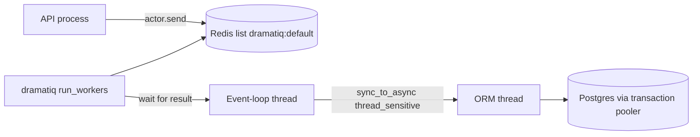

# Dramatiq workers on Redis with a per-actor database release

HTTP handlers enqueue work and return. A separate process runs `python -m dramatiq run_workers`. Actors are `async def`. One event-loop thread per process runs the coroutines. Worker threads only wait for those results, so concurrency per process equals `--threads`, not the number of awaiting tasks.

Django's ORM is synchronous. `sync_to_async(..., thread_sensitive=True)` runs it on one shared thread. Database connections are thread-local. Cleanup that runs on the event-loop thread or on a Dramatiq worker thread does not see that connection.

## Architecture



The API and the worker import the same actor module. Both need `REDIS_URL`. The worker refuses to boot when that variable is empty. The API import does not raise: if the variable is empty, `set_broker` never runs and a later `send` uses Dramatiq's default broker, so the job never appears on the Redis list.

Schema commands import the actor module and have no queue. Raise on a missing `REDIS_URL` only when `sys.argv` shows this process is the worker (`dramatiq` and `run_workers` both present).

## Process boot

Do this before importing models.

1. Point `sys.stdout` at `sys.__stdout__` and `sys.stderr` at `sys.__stderr__`. The worker wrapper replaces `sys.stdout` and `sys.stderr` with a pipe that the parent drains to stderr. Log records then all look like errors. Send levels below `ERROR` to the real stdout and `ERROR` and above to the real stderr.
2. `setdefault` `DJANGO_SETTINGS_MODULE` for a bare local run. Production and test runners set the variable explicitly before the process starts. Each settings module loads its own env file.
3. Call `django.setup()`.
4. Import actors, then build the broker.

```python
import os
import sys

sys.stdout = sys.__stdout__
sys.stderr = sys.__stderr__
os.environ.setdefault("DJANGO_SETTINGS_MODULE", "app.settings")

import django

django.setup()
```

Start the process with an explicit width. The CLI default of 8 threads is easy to miss. One process and 8 threads is the production starting point. A local compose file may use 4. One thread serializes the whole queue, which is wrong for I/O-bound actors.

```bash
python -m dramatiq run_workers --processes 1 --threads 8
```

There is no file watcher. A new actor body is unused until this process is replaced and the new process is the one consuming `dramatiq:default` (P04).

After the event loop is up, a boot hook may open other clients (the graph pool in `langgraph-postgres-persistence`) on that loop. Log a warmup failure and keep consuming. The first job then pays the cold start. Do not `sys.exit` from the hook: in-flight messages still need a consumer.

Scale copies of the process by the length of the Redis list `dramatiq:default` (Dramatiq's key for the default queue). A depth of about 8 is a reasonable target per busy replica. The Container Apps rule that sets that target is `aca-performance-tuning`. Give the worker no HTTP ingress.

## Broker

`middleware=` on `RedisBroker` replaces the default list. Anything omitted is gone, including the middleware that implements `time_limit`. Build the default set, cap retries, then `add_middleware` for the extras. Add `TimeLimit` before relying on the actor option.

```python
redis_broker = RedisBroker(
    url=redis_url,
    middleware=[
        dramatiq.middleware.AgeLimit(),
        dramatiq.middleware.TimeLimit(),
        dramatiq.middleware.ShutdownNotifications(),
        dramatiq.middleware.Callbacks(),
        dramatiq.middleware.Pipelines(),
        dramatiq.middleware.Retries(max_retries=2),
    ],
)
redis_broker.add_middleware(ConnectionCleanupMiddleware())
redis_broker.add_middleware(dramatiq.middleware.AsyncIO())
redis_broker.add_middleware(WarmupMiddleware())
dramatiq.set_broker(redis_broker)
```

`AsyncIO` starts one event-loop thread per process (`before_worker_boot`). Without it, `async def` actors raise at runtime. `Retries(max_retries=2)` is the first run plus two redeliveries, then the message is dropped. Leave backoff at the middleware default. Only `max_retries` is overridden.

`TimeLimit` (Dramatiq 2.2) injects `TimeLimitExceeded` into the worker thread. That thread is blocked in `future.result`. The event-loop helper catches the interrupt, cancels the task, and waits up to one second for the coroutine to finish its `finally`. The default limit is 600_000 ms. A long actor passes `time_limit=90_000`. The exception does not interrupt a syscall that never releases the GIL. Put connection release in `finally` so the one-second cancel window still returns the ORM connection.

## Database connections

| Setting | Value |
| --- | --- |
| `HOST` / `PORT` | Transaction pooler, port `6543`. |
| `CONN_MAX_AGE` | `0`. |
| `CONN_HEALTH_CHECKS` | `True`. This does not replace the close below. |
| `OPTIONS.connect_timeout` | `10`. |
| `OPTIONS.options` | `-c statement_timeout=30000`. |
| `OPTIONS.pool` | `{"min_size": 0, "max_size": 10, "timeout": 10}`. |

`CONN_MAX_AGE` is `0` so Django does not keep a persistent connection across idle time (P02). Django 5.1+ can pool through psycopg when `OPTIONS["pool"]` is a dict. With that pool, `connections.close_all()` returns the connection (`putconn`) instead of closing the TCP socket. `min_size: 0` lets an idle worker drop to zero open sockets. A non-zero `CONN_MAX_AGE` on a session pooler (port `5432`) holds a server backend between jobs until the pooler runs out of clients.

`CONN_HEALTH_CHECKS` does not save a worker. Django pings from the request path, at most once, and `connect()` marks the check already done. `close_old_connections()` does not ping a healthy-looking connection: it closes only when `close_at` has passed or a previous error left the connection unusable. Workers have no request, so those hooks never run. With `CONN_MAX_AGE` `0`, `close_at` is the connect timestamp, and the age path closes without a ping. Calling `close_old_connections()` on the wrong thread is a no-op, because that thread's connection is `None` (P03).

`DISABLE_SERVER_SIDE_CURSORS` must be `True` on the database config (the same dict as `ENGINE`, not inside `OPTIONS`) when `PORT` is the transaction pooler. Server-side cursors belong to one server session, and the next statement may land on another. `QuerySet.iterator()` opens one.

> NOTE: the reference settings use port `6543` and do not set `DISABLE_SERVER_SIDE_CURSORS`. Set it on a new deployment. Unverified whether current queries open a server-side cursor.

### Close on the ORM thread

`thread_sensitive=True` is required. `connections.close_all` on the event-loop thread leaves the ORM thread holding the socket.

```python
from asgiref.sync import sync_to_async
from django.db import connections

async def reset_db_connections() -> None:
    await sync_to_async(connections.close_all, thread_sensitive=True)()


def with_db_connection(fn):
    @functools.wraps(fn)
    async def wrapper(*args, **kwargs):
        try:
            return await fn(*args, **kwargs)
        finally:
            await reset_db_connections()

    return wrapper
```

Apply it under the actor decorator so the body that runs is the wrapper:

```python
@dramatiq.actor
@with_db_connection
async def refresh_item_summary(item_id: str, user_id: str) -> None:
    ...
```

That is `actor(with_db_connection(fn))`. The wrapper's `finally` runs on success, on `OperationalError`, and when the time-limit interrupt cancels the task.

A middleware `after_process_message` and `after_skip_message` repeats the same reset for messages that never entered the wrapper. Hop to the event-loop thread with `get_event_loop_thread().run_coroutine(reset_db_connections())`. If that thread is missing, `connections.close_all()` on the current thread is only correct for a synchronous actor. Log and swallow a cleanup failure so it does not hide the actor's own exception.

A socket error is not a cue to reuse the connection. The wrapper does not retry internally. It closes, then re-raises. The broker redelivers, and the next attempt checks out a new connection. An in-actor retry is valid only after `close_all` on that same ORM thread, and only once. The reference tests expect `OperationalError("the connection is closed")` to propagate and `reset_db_connections` to be awaited once.

The LangGraph pool is a different client (`langgraph-postgres-persistence`). Do not close it from this middleware. Its `statement_timeout` is 15 seconds. The Django option above is 30 seconds. They are not the same session.

## Actors

| Actor | Wrapper | Notes |
| --- | --- | --- |
| Probe | No | Writes a short-lived Redis key. No ORM. |
| Summary, comment generation, comment insert | Yes | Re-raise after logging. A swallowed exception is not retried. |
| Draining no-op | No | Empty body, still registered, so old messages do not hit a missing actor or a dropped column. |
| Chat run | Yes, `time_limit=90_000` | Status rules are `langgraph-streaming-chat`. |

Enqueue from the API with `actor.send(...)`. Delay is milliseconds: `send_with_options(args=(...), delay=int(seconds * 1000))`. Arguments must be JSON-serializable. Pass ids as strings, not model instances.

Comment generation logs and re-raises. That is what makes the two broker retries happen. Do not catch `Exception` and return.

## Environment

| Name | Notes |
| --- | --- |
| `REDIS_URL` | Redis URL. Use `rediss://` when the server requires TLS. No default in the worker. |
| `DJANGO_SETTINGS_MODULE` | Set by the process supervisor in production. |
| `SUPABASE_DB_PASSWORD` | Password only. Host, port, name, and user live in settings, not in the URL baked into an image. |
| `SUPABASE_DB_HOST` | Pooler host. |
| `SUPABASE_DB_PORT` | `6543` for the transaction pooler. |

Do not log the URL. It contains the password.

## Failure prevention

- **P02.** `CONN_MAX_AGE` is `0`. `OPTIONS.pool.min_size` is `0`. Return the connection at the end of every actor on the ORM thread. Do not point this process at the session pooler and then leave the session checked out between jobs.
- **P03.** `close_all` goes through `sync_to_async(..., thread_sensitive=True)`. Do not call it on the worker thread or the event-loop thread and assume the ORM socket closed. Do not treat `CONN_HEALTH_CHECKS` or `close_old_connections()` as that close. On `OperationalError`, let the exception out after `finally` so the broker retries on a new checkout.
- **P04.** Restart the worker after actor changes. Confirm the new process is consuming `dramatiq:default`. There is no hot reload.
- Set `DISABLE_SERVER_SIDE_CURSORS` when `PORT` is `6543`.
- Register a no-op under the old actor name until the queue no longer contains that name. Then delete it.
- `REDIS_URL` is required in the API process even though only the worker raises at import.

## Tests

- The wrapper returns the actor's value and awaits the reset once.
- The wrapper awaits the reset once when the actor raises `OperationalError`, and the error still propagates.
- The reset callable is invoked with `thread_sensitive=True`.
- Broker middleware includes `TimeLimit` and `Retries`, and `max_retries` is `2`.
- Importing the module with an empty `REDIS_URL` and `sys.argv` of a schema command does not raise. The worker argv does.
- `DATABASES["default"]["CONN_MAX_AGE"]` is `0` and `OPTIONS["pool"]["min_size"]` is `0`.

## Checklist

- [ ] Worker command is `python -m dramatiq run_workers` with explicit `--processes` and `--threads`.
- [ ] `django.setup()` runs before model imports. Logs use `sys.__stdout__` and `sys.__stderr__`.
- [ ] `REDIS_URL` is set on the API and the worker. The worker raises when it is missing.
- [ ] Broker `middleware=` includes `AgeLimit`, `TimeLimit`, `ShutdownNotifications`, `Callbacks`, `Pipelines`, and `Retries(max_retries=2)`, then `AsyncIO`.
- [ ] ORM actors use `@dramatiq.actor` above `@with_db_connection`. `finally` calls `close_all` on the sensitive thread (P03).
- [ ] `CONN_MAX_AGE` is `0`, the Django pool `min_size` is `0`, and the host is the transaction pooler (P02).
- [ ] `DISABLE_SERVER_SIDE_CURSORS` is `True`.
- [ ] The long actor sets `time_limit=90_000`. Other actors keep the middleware default.
- [ ] Failures re-raise. A deploy restarts the worker and checks that the new process consumes the queue (P04).
- [ ] A removed actor stays as an empty function until its messages are gone.
