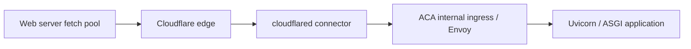

# HTTP idle connection resets and bounded read retries

A warm connection can close between a pool selecting it and sending the next request. A server fetch then throws a transport error rather than returning an HTTP status. The application may never receive the request, so a clean application log does not identify the failing hop. A successful retry is recovery evidence, not proof of which connection reset.

## Architecture and data flow



Each arrow is a separate transport segment. The web server's socket ends at the edge; it is not the socket accepted by Uvicorn. The connector pools toward the ingress, which can separately pool toward the ASGI server. Record protocol, connection owner, idle expiry and reuse policy on each segment. Do not assume an HTTP/2 session, an HTTP/1.1 pool and the tunnel transport share one timer.

The request path is: authenticate on the web server, build one read request, fetch through the proxies, optionally repeat that fetch once on a classified thrown failure, then return the Response. Status handling and body decoding belong to the caller. The second fetch rejection propagates to the page's fallback boundary.

For the deployment and connector setup, search for `aca-performance-tuning` and `cloudflare-tunnel`. Authentication is `m2m-jwt-service-auth`. Their setup is independent of the retry policy here.

## Timer and policy shape

| Timer or field | What it controls |
| --- | --- |
| Upstream idle reuse window | How long a pool may reuse an inactive connection to its next hop |
| Server HTTP keepalive | How long the next hop keeps an HTTP connection open between requests |
| Request / read / stream timeout | How long active work or an active response may take; identify whether the limit measures total time or inactivity |
| TCP keepalive interval | Transport liveness probes; does not configure the HTTP pool's idle lifetime |
| Graceful shutdown / termination grace | Drain time after shutdown begins; separate from ordinary idle reuse |
| `maxRetries`, `retryDelayMs`, `signal` | Retry count, short wait, and the caller's shared cancellation/deadline budget |

Uvicorn's documented `--timeout-keep-alive` default is 5 seconds. Its graceful shutdown flag instead limits shutdown draining. CLI arguments override the corresponding `UVICORN_*` environment settings. [Uvicorn settings](https://uvicorn.dev/settings/)

Cloudflare documents `keepAliveTimeout` as idle connection expiry toward the origin, default `1m30s` (90 seconds). `tcpKeepAlive` is a separate probe interval, and `keepAliveConnections` limits idle pooled connections rather than total concurrency. These are vendor defaults, not a readout of a particular tunnel's settings. [Cloudflare origin parameters](https://developers.cloudflare.com/cloudflare-one/networks/connectors/cloudflare-tunnel/configure-tunnels/origin-parameters/)

ACA documents a 240-second HTTP request timeout. That figure does not establish the idle reuse window of Envoy's connections to Uvicorn. [ACA ingress overview](https://learn.microsoft.com/en-us/azure/container-apps/ingress-overview)

For each adjacent HTTP pool and server, aim for:

```text
server idle lifetime > upstream maximum idle reuse window + measured margin
```

Alternatively shorten that upstream pool's reuse window. Check how both sides measure idleness, allow scheduling/network margin, and verify with repeated requests around the boundary. This reduces a systematic mismatch; restarts, connection recycling and network failures still need handling.

The reference image CMD and Terraform API override both configure 120 seconds for Uvicorn. Comparing 120 seconds to cloudflared's documented 90-second default is a configuration example. Envoy sits between them: this comparison alone proves neither adjacent hop is aligned. Source comments and the historical diagnosis supply no packet trace or measured Envoy idle reuse setting. Keep that setting unknown until independently verified.

## Server configuration and setup order

1. Draw the actual route and identify which processes terminate each connection. Capture request correlation ids, thrown error codes, approximate prior idle duration and revision changes without logging tokens or bodies.
2. Read the effective pool/origin configuration, including remotely managed tunnel settings. Record unknown timers explicitly. A blank dashboard field can mean a default; inspect its effective meaning.
3. Set the ASGI keepalive above the adjacent upstream reuse window with a measured margin, or lower that pool. Change the image default and the deployment command override together.
4. Roll the configuration through the normal deployment flow. Inspect the effective running command and health; a changed Dockerfile alone cannot replace a platform command override.
5. Add one GET retry at the shared server transport boundary. Keep status/body handling outside it and preserve authentication, cache controls and cancellation.
6. Choose an explicit page fallback for a second failure, then test both transport recovery and failure presentation.

Generic command, using the reference timings:

```text
uvicorn app.asgi:application --host 0.0.0.0 --port 8000 --timeout-keep-alive 120 --timeout-graceful-shutdown 30
```

`UVICORN_TIMEOUT_KEEP_ALIVE` is the environment alternative when no CLI override is present. `BASE_URL` names the server-only API origin; no new retry environment variable is required. Tunnel authentication remains `TUNNEL_TOKEN` on the connector. Keep timeout policy in one explicit configuration layer rather than duplicating conflicting env and CLI values.

## Reference retry contract

The implemented wrapper normalizes the method and retries **GET only**, once, after 150ms. It classifies an Error by `cause.code`: `ECONNRESET`, `ECONNREFUSED`, `ETIMEDOUT`, `EPIPE`, `EAI_AGAIN`, `UND_ERR_SOCKET`, `UND_ERR_CONNECT_TIMEOUT`, `UND_ERR_HEADERS_TIMEOUT`, or `UND_ERR_BODY_TIMEOUT`. It also accepts a TypeError with message `fetch failed`. That generic message covers more than an idle race, so keep the retry bound and retain diagnostic context.

- A completed Response, including 401, 404, 429 and 5xx, is returned unchanged. Retrying statuses requires a separate policy.
- POST, PATCH, PUT, DELETE and even HEAD are outside this reference retry contract. Replaying a write requires a separate server-enforced idempotency design. A GET endpoint must itself tolerate repetition; audit incidental provisioning as well as the method label.
- `response.json()`, body streaming and application validation run after the wrapper returns. Their failures are not caught or replayed. Listing a body-timeout error code does not move body decoding into the retry boundary.
- The same URL, normalized method, signed auth headers and extra headers are used on both attempts. Options such as `cache: "no-store"`, framework cache settings and `signal` survive the spread. In the reference, auth plus a dedicated extra-header argument replaces `init.headers`; callers must use that argument for extra headers.
- Signing happens once, before the try/catch. Signing failures do not trigger a network retry. A refreshed token is a separate concern.
- The reference does not create a total deadline or cancel its 150ms sleep. Preserving an optional signal is not a guarantee of bounded wall time. An adaptation should use one total budget for both attempts, the delay and body consumption, and stop when cancellation arrives.

## Generic bounded read example

This Node server example adds cancellation during the delay to the reference behavior. Auth headers are constructed by the caller. Use it only for replay-safe GETs; keep other methods on their own transport path. The same signal is passed through both attempts and remains active while the caller reads the body.

```js
import { setTimeout as pause } from "node:timers/promises";

const transportCodes = new Set([
  "ECONNRESET", "ECONNREFUSED", "ETIMEDOUT", "EPIPE", "EAI_AGAIN",
  "UND_ERR_SOCKET", "UND_ERR_CONNECT_TIMEOUT",
  "UND_ERR_HEADERS_TIMEOUT", "UND_ERR_BODY_TIMEOUT",
]);

function transientFetchFailure(error) {
  if (!(error instanceof Error)) return false;
  return transportCodes.has(error.cause?.code) ||
    (error.name === "TypeError" && error.message === "fetch failed");
}

export async function fetchRead(url, init, signal) {
  const method = (init.method ?? "GET").toUpperCase();
  if (method !== "GET" || init.body != null) {
    throw new Error("Expected a replay-safe GET without a body");
  }
  const options = {
    ...init, method, signal, headers: new Headers(init.headers),
  };
  signal.throwIfAborted();
  try {
    return await fetch(url, options);
  } catch (error) {
    if (signal.aborted || !transientFetchFailure(error)) throw error;
    await pause(150, undefined, { signal });
    signal.throwIfAborted();
    return await fetch(url, options);
  }
}
```

At the call site, create the budget once before authentication/fetching, use the constructed auth headers, and decode outside the retry helper:

```js
const signal = AbortSignal.timeout(2_000); // Example total budget; choose per route.
const headers = await makeAuthHeaders(appUserId);
signal.throwIfAborted();
const response = await fetchRead(apiUrl, { cache: "no-store", headers }, signal);
if (!response.ok) throw new Error(`Read failed: ${response.status}`);
const items = await response.json(); // A failure here does not replay the request.
```

If the request already has a cancellation signal, combine it with the deadline rather than replacing it. Node supplies `AbortSignal.any`, `timeout` and `throwIfAborted`; an uninterruptible auth operation still needs its own cancellation support to bound the whole operation. [Node globals](https://github.com/nodejs/node/blob/main/doc/api/globals.md) Promise-based timers accept an abort signal for the retry wait. [Node timers](https://github.com/nodejs/node/blob/main/doc/api/timers.md)

## Fallback and observability

The reference list loader catches non-OK responses and thrown errors and returns an empty pagination shape. That keeps rendering alive but cannot distinguish an outage from zero matching rows. Prefer a separate unavailable state or stale data plus a retry action when correctness depends on the distinction. Preserve existing pagination/cursor semantics on success.

The detail loader returns null on HTTP 404 (and in the reference also on other non-OK statuses), while transport failure propagates. Its page boundary handles a failed load. Avoid presenting a dropped connection as proof that the item was deleted. The dashboard bootstrap keeps `cache: "no-store"` and throws on non-OK responses; its outer fallback can seed empty client state without deleting persisted data.

Measure first-attempt failures, successful retries, exhausted retries and fallback renders separately. Log a safe route label, attempt count, status or error code, and correlation id. A recovery rate can hide a persistent timeout mismatch if only final successes are counted.

## Failure prevention (P45)

- Tune adjacent connections. Lowering only the web server's edge pool lifetime leaves connector/ingress/origin pooling unchanged.
- Keep the 240-second request timeout, HTTP idle reuse, TCP probes, active stream timeouts and shutdown grace separate. Raising keepalive does not lengthen an active stream's budget.
- Keep image CMD and the platform override consistent. Review the effective command, not only the image build.
- Bound retry count and total time; do not give each attempt a fresh full deadline. Abort during the delay must prevent another fetch in the bounded adaptation.
- Retry only classified thrown fetch failures for replay-safe GETs. Return HTTP statuses unchanged and propagate the second rejection. Keep body reads and writes outside this loop.
- Preserve the scoped auth identity, extra headers and cache options. Never reuse a request carrying another user's token.
- Report fallback as availability loss when an empty snapshot could mislead the user. A healthy backend log alone cannot locate the reset.

## Tests

These are adaptation acceptance cases, not a claim that the reference has a dedicated retry test suite:

1. A GET throws an Error with `cause.code = "ECONNRESET"`, then succeeds: exactly two fetch calls, same URL/options/auth/cache policy, one short wait. Two transport failures propagate the second error with no third attempt.
2. A TypeError `fetch failed` retries once. An unrelated Error or a non-Error throw propagates immediately. Check the other configured codes with the deployed runtime's error shape.
3. A returned 401/404/429/503 Response is the same object and uses one fetch. A network-failed write uses one attempt on its separate transport path; the generic read helper rejects writes before sending.
4. A successful fetch whose `json()` or body reader later fails uses one fetch. Stream interruption does not restart the response.
5. An already-aborted signal sends nothing in the bounded example. Abort during the wait prevents the second fetch. A single deadline covers both attempts; preserving an existing caller cancellation signal is also tested.
6. With injected failures, a list's unavailable/empty distinction, detail 404 versus network error, and bootstrap fallback behave as designed without changing persisted data.
7. In an isolated environment, send repeated requests after idle gaps around the measured expiry, correlate proxy and origin logs, and observe socket reuse/close behavior. Compare first-attempt reset rates before/after configuration; ordinary successful fresh requests do not test the race. Do not infer Envoy's idle policy from request duration.
8. A deployment configuration check compares the image default and API override for `--timeout-keep-alive 120`. Shutdown remains 30 seconds with a longer platform termination allowance; those settings have a different purpose.

## Checklist

- [ ] Every transport segment has an owner and an observed/configured reuse policy; unknown Envoy settings stay explicit (P45).
- [ ] Server HTTP idle lifetime exceeds the adjacent upstream reuse window with a measured margin, or that pool was shortened.
- [ ] Image and platform commands both include the selected keepalive value; running revision health is checked.
- [ ] Exactly one GET transport retry, same auth/cache/options, no completed-status or body-read replay, and no automatic write retry.
- [ ] One cancellation/deadline budget includes both attempts and the wait; reference limitations are not described as implemented guarantees.
- [ ] Fallbacks preserve availability context, and retry recovery/exhaustion is observable without tokens or content.
