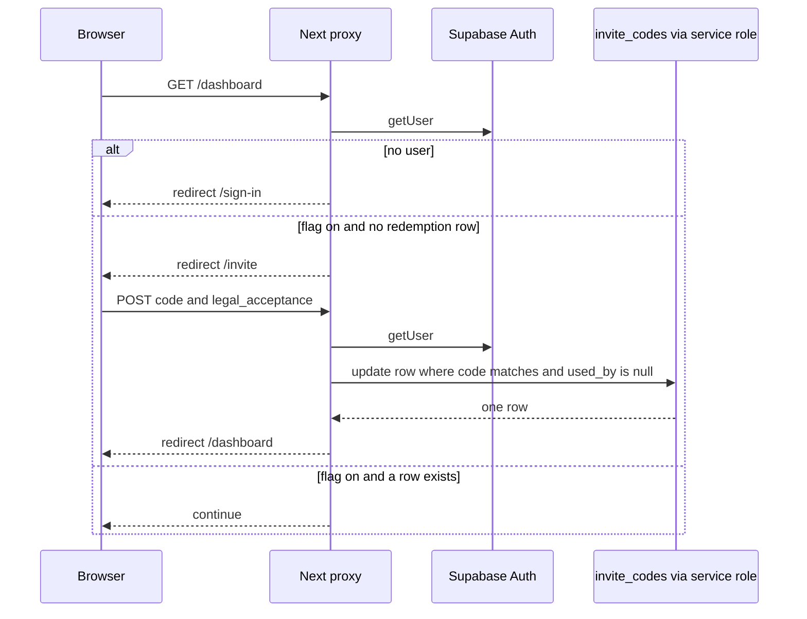

# Closed-beta invite code gate

Sign-in is not enough while the public flag is on. The proxy sends an authenticated person with no redemption row to `/invite`. The form posts a code and an agreement acceptance. The server claims one unused row with the service-role key, then redirects to the app shell. A person who already owns that code can submit it again and is not asked to consume a second row.

Load `supabase-magic-link-auth` for the session. This gate runs only after `getUser()` returns a user. It does not replace that session.

The agreement stored here is a version string on the invite row. It is a different record from the terms and privacy consent in `versioned-legal-consent`.

`NEXT_PUBLIC_BETA_TESTING` and the API flag `BETA_TESTING` are independent. The gate reads only the public flag, and only the exact string `true`. The API flag, described in `subscription-entitlements`, returns the paid tier for every signed-in person when it is on. Set both when a closed beta should gate the shell and grant paid caps. One flag leaves the shell and the API in disagreement. The API accepts `1`, `true`, `yes`, and `on`. The public flag does not. `NEXT_PUBLIC_BETA_TESTING=1` leaves the gate off.

## Architecture



`/` never reaches this lookup. The proxy answers `/` with a local session-cookie check and, when that cookie looks signed in, redirects to `/dashboard`. The gate then runs on `/dashboard`.

## Flag

```ts
const betaTesting = process.env.NEXT_PUBLIC_BETA_TESTING === "true"
```

| Flag | `/invite` page | Redeem action | Proxy |
| --- | --- | --- | --- |
| off | `notFound()` | `redirect` to the app shell, posted code ignored | no lookup |
| on | form | claim a row, then `redirect` to the app shell | lookup on the app shell and on `/invite` |

The agreement page (`/beta-testing` in the reference) also calls `notFound()` when the flag is off. It sits outside the proxy matcher, so it is reachable without a session while the flag is on. Keep the legal text there. Do not put the code table on that page.

When the flag is off, an unsigned request to `/invite` still redirects to sign-in. The page-level 404 runs only after `getUser()` succeeds.

## Session gate

The proxy matcher is `/`, `/dashboard`, `/dashboard/:path*`, `/invite`, and `/invite/:path*`. Other paths, including `/api`, never enter it.

After `getUser()`:

- App-shell or `/invite` paths with no user redirect to `/sign-in` and clear the non-httpOnly hint cookie from `supabase-magic-link-auth`.
- With a user and the flag on, look up a redemption only for the app shell and `/invite`.
- A thrown lookup (missing `SUPABASE_URL` or `SUPABASE_SERVICE_ROLE_KEY`) is logged and treated as not redeemed.
- A query error inside the lookup returns false. It does not throw. The dashboard then redirects to `/invite`. A person who already redeemed is sent back to `/invite` for the outage. That is fail-closed for access.

```ts
function resolveGate(pathname: string, redeemed: boolean): "/invite" | "/dashboard" | null {
  const onInvite = pathname === "/invite" || pathname.startsWith("/invite/")
  const onApp = pathname.startsWith("/dashboard") || pathname === "/"
  if (!redeemed && onApp) return "/invite"
  if (redeemed && onInvite) return "/dashboard"
  return null
}
```

The helper treats `/` as an app path. The proxy does not call the helper for `/`, and the lookup block does not include `/` either. Marketing paths, `/sign-in`, and the agreement page return null, so a missing redemption does not redirect them.

`/api` is outside the matcher. The user-scoped route handlers there (item save, avatar upload, agent send, agent stream) call `getUser()` and mint the service JWT from `m2m-jwt-service-auth`. None of them read invite rows. The cache-revalidate route uses a shared secret, not a user. The API does not read invite rows either. A signed-in person who never redeemed can call the user-scoped handlers directly. When the flag is on, run this redemption check inside those handlers. A server action whose page is outside the matcher needs the same check. The reference checks only the proxy paths above.

P13: this check needs a user id. Resolve the session first. A missing user is a redirect or `"Sign in again, then enter your invite code."` Do not parse a null id, and do not mount redemption on an auth-exempt API. The reference action returns that sign-in message when `getUser()` fails. The proxy redirects before the lookup.

## Table

The server reads and writes these columns. No migration in the application repos creates the table. A grants migration names it and, only when `to_regclass` finds it, revokes `INSERT`, `UPDATE`, `DELETE`, and `TRUNCATE` from `authenticated`. It does not revoke `SELECT`, it does not touch `anon`, and it does not enable RLS. A table created after that migration has run never receives the revoke.

> NOTE: unverified against a live catalog. Column types, the primary key, and indexes are not in the repos. The columns below are the ones the server selects and updates.

| Column | Use |
| --- | --- |
| `code` | Lookup key after normalization. |
| `used_at` | ISO timestamp set on a successful claim. |
| `used_by` | Auth user id, null while the code is unused. |
| `used_email` | Auth email, or null when the user has none. |
| `agreement_version` | Fixed version string. The reference stores `2026-08-23`. |
| `agreement_accepted_at` | Same timestamp as `used_at`. |

Create the table in a migration you own, then lock it down in that same migration:

```sql
create table public.invite_codes (
  code text primary key,
  used_at timestamptz,
  used_by uuid,
  used_email text,
  agreement_version text,
  agreement_accepted_at timestamptz
);

revoke all on table public.invite_codes from anon, authenticated;
alter table public.invite_codes enable row level security;
```

No policy for `anon` or `authenticated`. Codes are secrets. `SELECT` in the browser lists every unused code. Give the service role the writes. `used_by` must use the same type as the auth user id. The server compares them as strings.

`used_email` is personal data. The action does not return it. Do not log it, and do not log the raw code. The reference logs `error.message` only.

## Admin client

Server-only. The reference throws when `SUPABASE_URL` or `SUPABASE_SERVICE_ROLE_KEY` is empty. Session persistence and auto-refresh are off. Never import this client into a client component. The form does not query the table.

The service role bypasses RLS. That is why the revoke above still matters: a leaked anon key must not see the table, and a bug that uses the user-scoped client must not update it.

## Normalize and availability

```ts
function normalizeInviteCode(raw: string): string {
  return raw.trim().toUpperCase().replace(/\s+/g, "")
}

function isInviteAvailable(
  row: { used_by: string | null } | null,
  userId?: string | null,
): boolean {
  if (!row) return false
  if (!row.used_by) return true
  return Boolean(userId && row.used_by === userId)
}
```

Whitespace is removed, not turned into hyphens. `ab cd` becomes `ABCD`. Hyphens stay, so `AB-CD` and `ABCD` are different codes. There is no charset or length check. An empty result is rejected before the query.

A missing row is unavailable. A null `used_by` is available. The same user id is available (idempotent retry). Any other `used_by` is unavailable. Unknown codes and codes owned by someone else share one message, so the client cannot tell them apart.

## Redeem

The action is a server action.

1. Flag off: redirect to the app shell.
2. `legal_acceptance` must be the string `"true"`. Otherwise `"Please agree to the Beta Testing Agreement."` The checkbox is UI. The server trusts the hidden field.
3. Normalize the posted code. Empty: `"Enter a valid invite code to continue."`
4. `getUser()`. Failure: `"Sign in again, then enter your invite code."` Use `user.id` and `user.email` from that result. Do not accept an email from the form.
5. Select `code, used_at, used_by, used_email` where `code` equals the normalized value, `maybeSingle`. A query error: `"Could not verify the invite code. Please try again."`
6. If the row is not available to this user: `"This invite code is invalid or already used."`
7. If `used_by` is already this user: return success. Do not write.
8. Otherwise update `used_at`, `used_by`, `used_email`, `agreement_version`, and `agreement_accepted_at` where `code` matches and `used_by` is null. `maybeSingle` the returning `code`. Zero rows, or an error: the same invalid-or-used message.

The `.is("used_by", null)` filter is the compare-and-set. Two people claiming one code: one update returns a row, the other gets the invalid message. Two requests from the same person, both of which read `used_by` null before either write: one update wins and the other shows the invalid message even though the winner was themselves. The next submit hits step 7 and succeeds.

The reference does not check whether this user already holds a different code. A second unused code is consumed. Before the update, if any row has this `used_by`, return success and do not write.

There is no attempt counter. Add a per-user failure cap so guessing stops. The reference has none. Issue long random codes. The UI placeholder is not a format validator.

Store the agreement version from a constant next to the normalizer, and show that same date on the agreement page. The reference constant is `2026-08-23`. A repeat accept of a code this user already owns does not refresh the version. A new version requires a new column write you do not have yet. This gate does not re-prompt after the version changes.

## Page

Client form: agreement checkbox, code field (`autoComplete="off"`), submit disabled until the box is checked, the code is non-blank, and the action is idle. Show `message` when `success` is false. Offer a sign-out control that posts the sign-out action from `supabase-magic-link-auth`.

Copy and the agreement body belong to the product. The reference page is a static markdown document, not a CMS fetch. Keep it out of the indexed public paths. The reference lists `/invite` with the other private robot paths.

## Failure prevention

- The public flag is the exact string `true`. Do not treat `1` as on.
- Pair it with `BETA_TESTING` only when paid caps should follow. See `subscription-entitlements`. The gate does not read the API flag.
- Resolve `getUser()` before any lookup (P13). A missing user does not become a parsed id.
- Redeem with the service role. Revoke all grants from `anon` and `authenticated`, and enable RLS with no client policy, in the migration that creates the table.
- Compare-and-set on `used_by is null`. One code has one owner. A user who already redeemed does not consume another code.
- Unknown and already-used codes share one error string.
- A lookup error fail-closes the app shell. A missing service-role key throws. The proxy treats that throw as not redeemed. The action does not catch it, so fix the key rather than swallowing the throw into a false "not redeemed" on the write path.
- Check redemption in route handlers, not only in the proxy. `/api` is outside the matcher.
- Do not log codes or `used_email`.

## Tests

Pure helpers, no network:

- `normalizeInviteCode("  ab-12  ")` is `AB-12`. Internal spaces are removed, hyphens stay.
- `isInviteAvailable(null)` is false. `{ used_by: null }` is true. The same user id is true. A different id, or a missing id on a used row, is false.
- `resolveGate("/dashboard", false)` and `resolveGate("/dashboard/chat", false)` and `resolveGate("/", false)` are `/invite`.
- `resolveGate("/invite", false)`, `resolveGate("/sign-in", false)`, and `resolveGate("/beta-testing", false)` are null.
- `resolveGate("/invite", true)` is `/dashboard`. `resolveGate("/dashboard", true)` is null.

Action, with the admin client stubbed:

- Flag off redirects to the app shell and does not update.
- Missing `legal_acceptance=true` returns the agreement message.
- No user returns the sign-in message and does not update.
- Empty code returns the valid-code message.
- A lookup error returns the verify message.
- `used_by` set to someone else returns the invalid message and does not update.
- `used_by` set to this user returns success and does not update.
- An unused row updates with this user id, the auth email or null, the version constant, and a null filter on `used_by`.
- An update that returns no row returns the invalid message.

Proxy: unsigned `/dashboard` and `/invite` redirect to sign-in. Flag on, lookup false, `/dashboard` redirects to `/invite`. Flag on, lookup true, `/invite` redirects to `/dashboard`. A thrown admin client leaves the person on the invite redirect for `/dashboard`. Flag off does not call the lookup.

## Checklist

- [ ] `NEXT_PUBLIC_BETA_TESTING` is `true` or unset. It is not `1`.
- [ ] `BETA_TESTING` is set to the same intent, knowing it changes paid caps rather than this gate.
- [ ] `invite_codes` is created in a migration. `anon` and `authenticated` have no grants. RLS is on and has no client policy.
- [ ] Redeem and the "already redeemed" lookup use the service-role client. The form never imports it.
- [ ] The claim is `update ... where used_by is null`. A second code is not consumed for the same user.
- [ ] The agreement version constant matches the date on the agreement page.
- [ ] The proxy matcher includes the app shell and `/invite`. Route handlers that call the API repeat the check.
- [ ] Missing session redirects or returns the sign-in message. It does not parse a null id.
- [ ] Codes and emails are absent from logs. `/invite` is a private robot path.
