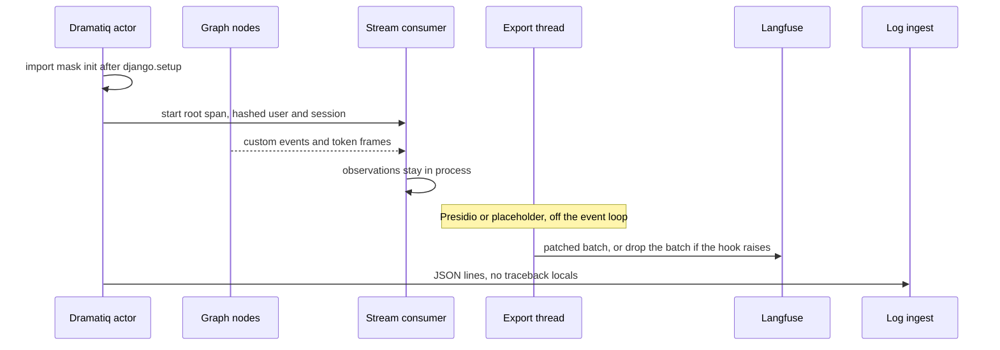

# Langfuse traces with fail-closed masking, and per-environment log ingest

The chat worker records observations with the Langfuse Python SDK. User text is allowed on those observations inside the process. It is not allowed to leave. A `mask_otel_spans` hook runs on the OpenTelemetry export thread and either replaces structured PII or substitutes a placeholder. Process logs go to stdout, stderr, and, when a token is set, to Better Stack. The ingest hostname is chosen per environment before the log handler is built (P34).

Graph streaming, Redis, and SSE live in `langgraph-streaming-chat`. This module is the observation map, the export mask, and the log pipeline. Nodes emit custom events. One consumer in the stream loop turns those events into observations. Do not open Langfuse clients inside a node.

Pinned libraries in the reference: `langfuse` 4.15.2, `presidio-analyzer` 2.2.364, `presidio-anonymizer` 2.2.364, `logtail-python` 0.4.0. The v4 hook replaces an older wrap of private exporter objects. Stay on the public `mask_otel_spans` argument.

## Architecture



Sampling decides which traces are exported. Masking still runs on every trace that is sampled in. A sample rate of 0 is not a substitute for the mask.

## Startup order

Import the init module once, immediately after `django.setup()`, and before any module that calls `get_client()` at import time. The stream module does call `get_client()` at import. The worker imports the init module first.

The Langfuse SDK keeps one client per public key. `get_client()` with no key returns a client rebuilt from that client's resource manager. The mask has to be on the first `Langfuse()` call. A later `Langfuse()` without the hook does not repair an already-created exporter.

```python
def install_masked_client() -> None:
    global _installed
    if _installed:
        return
    try:
        Langfuse(
            mask_otel_spans=mask_otel_spans,
            should_export_span=lambda span: True,
        )
    except Exception:
        # Do not continue with an unmasked exporter.
        os.environ["LANGFUSE_TRACING_ENABLED"] = "false"
        try:
            Langfuse(tracing_enabled=False, mask_otel_spans=mask_otel_spans)
        except Exception:
            logger.error("could not install a non-exporting client")
    _installed = True
```

On failure the reference logs the exception, sets `LANGFUSE_TRACING_ENABLED` to `false`, and tries `Langfuse(tracing_enabled=False, mask_otel_spans=...)`. If that second constructor also throws, the flag is still set, so a later `get_client()` with no existing client constructs a client that does not export. Do not catch the first error and then call `get_client()` with tracing left on.

`should_export_span` returns true for every span. The SDK default exports a span only when it is a Langfuse span, a GenAI span, or a span from a known LLM instrumentor. The reference forces the wide filter so intermediate spans stay in the tree. The mask below only rewrites Langfuse content keys. Do not also enable a GenAI instrumentor that copies prompts into `gen_ai.*` attributes. Those keys are not in the mask list, and the wide filter would export them. The app code does not install an OpenTelemetry instrumentor.

Missing `LANGFUSE_PUBLIC_KEY` or `LANGFUSE_SECRET_KEY` disables the SDK client. Leave both unset in local runs that should not send traces. Do not invent placeholder keys.

The API process imports the actor module, so it runs this init too. Observations are started on the worker, which is where the graph runs. Both processes that import the actor module need the same mask install.

## What the SDK is configured to

Settings copy these onto the process environment at import, because the SDK reads the environment itself.

| Name | Value the reference writes | SDK default if unset |
| --- | --- | --- |
| `LANGFUSE_HOST` | `https://us.cloud.langfuse.com`, always, replacing a value already in the environment | `https://cloud.langfuse.com` via `LANGFUSE_BASE_URL`, then `LANGFUSE_HOST` |
| `LANGFUSE_TIMEOUT` | `20` (the worker also `setdefault`s 20 before Django setup) | `5` |
| `LANGFUSE_SAMPLE_RATE` | clamped to `[0, 1]`. Dev default `1.0`, otherwise `0.2` | `1.0`. The SDK raises `ValueError` outside `[0, 1]` |
| `LANGFUSE_PUBLIC_KEY` | secret store, not written by settings | missing key disables the client |
| `LANGFUSE_SECRET_KEY` | secret store | missing key disables the client |
| `PII_MASKING_ENABLED` | default true. The production settings module then assigns `True` on the Django setting and on the environment | the exporter reads the Django setting |

Read `LANGFUSE_HOST` from the environment and default only when it is empty. The reference assignment always writes the US cloud host, so a self-hosted or other-region host set earlier does not survive settings import. `LANGFUSE_BASE_URL` is the SDK's preferred name and is not set here. After the overwrite, `LANGFUSE_HOST` is what the client uses.

Clamp the sample rate before writing the environment variable. An empty or non-numeric `LANGFUSE_SAMPLE_RATE` uses the dev or non-dev default. Values above 1 become 1. Values below 0 become 0. The deploy variable is optional: when it is empty, the process keeps the non-dev default of 0.2. Set the variable on purpose when production should sample at 1. Do not rely on the SDK default of 1.0, because that is what you get if settings never export the variable.

`PII_MASKING_ENABLED` is a Django setting (`true` / `false` / `1` / `0` / `yes` / `on`). The export hook reads `django.conf.settings`, not the environment, after setup. Changing the environment variable on a running process does nothing. The production settings module forces the setting to true after the base module has read the environment, so a production env value of `false` does not turn pattern masking off.

## Observations the consumer records

All of these go through the export hook. Langfuse calls in the consumer are best-effort: a tracing error must not fail the turn. The generation and tool helpers already catch. `context_node_finished` and the memory observations in the reference do not. Wrap those the same way. An exception there leaves the stream loop and the actor treats the run as failed.

Root, around the actor body, via `propagate_attributes`:

- Span name `agent_run_background:run_agent`. No input body.
- `user_id` and `session_id` are the hashed ids below, not the raw ids.
- Metadata `agent_run_id` is the run UUID. That is not the user id.

| Event | Observation | Payload that can contain user text |
| --- | --- | --- |
| `context_node_finished` | span, then `end`. Level `ERROR` when the event's error string is non-empty | `output` is the results object below |
| `llm_response_started` | generation `llm_streaming`, opened once | `input` is the turn dict below. Model id and parameters from the primary attempt |
| first visible text delta | `update(completion_start_time=...)` | none. Time to first token is this timestamp minus generation start. It excludes context, retrieval, and memory. A thinking block does not stamp it |
| `message-finish` | `update` output `{role: assistant, content}`, `usage_details`, model, then `end` | the accumulated assistant text |
| `tool-started` / `tool-finished` / `tool-error` | tool span `execute_tool.{name}` | tool arguments and the tool output |
| `memory_management_started` | parent span, left open | no input |
| `l1_update_completed`, `l2_update_completed`, `chat_embedding_saved` | child of that parent, ended immediately. Level `ERROR` when `error` is set | the error string only |
| `l3_update_completed` | ends the parent, then a separate span with the same name | the error string only |
| run finished after the generator closes | `agent_run_completed`, `agent_run_stopped_manually`, or `agent_run_failed_outside_streaming` | none on the span. Open this span only after the generator is closed so nested spans have exited |

`context_node_started`, `llm_error`, and `agent_run_completed` are not copied onto Langfuse. `agent_run_completed` still carries the last message content on the in-process event. Do not attach that field to an observation. The generation already has the assistant text.

`tools_timed_out` happens before the memory parent exists. The default branch drops it when that parent is missing. It is not a Langfuse span.

Usage on the generation uses the keys `input`, `output`, and `total`. The stream frame calls them `input_tokens`, `output_tokens`, and `total_tokens`. Map them. If `total_tokens` is missing, store the sum. Langfuse's token columns read the short names.

The model on the finished generation is the model the provider callback recorded after a fallback. The streamed response metadata repeats the configured primary. Write the callback's model when it is present.

Do not call `client.flush()` at the end of the stream. Flush waits for the batch exporter, and that export runs the mask. The batch processor already exports on its schedule. Waiting there blocked the actor after the graph had finished.

### Generation input

The generation input is past conversation only. Retrieval stays on `context_node_finished`.

```python
{
    "prior_user_turns": user_texts[:-1],
    "last_assistant": assistant_texts[-1] if assistant_texts else "",
    "current_user": user_texts[-1] if user_texts else "",
}
```

System messages, tool messages, and the retrieval block inside the system prompt are not in this object. The strings are not cut to 500 characters. The export mask is what runs before they leave.

### Context observation output

| Field | Shape |
| --- | --- |
| `recent_items`, `similar_items` | `title`, `datetime`, optional `content` and the matching profile's note, each text cut at 500 characters plus `"..."`. Linked goals keep `title` and `target_date` only |
| `similar_threads` | `date`, user text and assistant text, each cut at 500 characters plus `"..."` |
| `knowledge_chunks` | each chunk's text cut at 500 characters plus `"..."` |
| `l1` | rendered short-term summary already trimmed for the prompt (over-limit threshold 1024 tokens) |
| `l2` | rendered durable facts already trimmed for the prompt (over-limit threshold 512 tokens, at most 10 store rows) |
| `errors` | only the source names that failed |

The 500-character cut is a size limit. It is not a privacy control. `l1` and `l2` do not go through that cut. Names and free-form prose remain until the export hook. Pattern masking then replaces structured PII and still leaves names in place.

## Export mask (P33)

The SDK calls `mask_otel_spans` from the batch exporter's worker thread, off the asyncio loop. Return sparse patches. A span with no sensitive attributes is omitted and exports unchanged. Deletions on a patch apply before sets. A hook that raises drops the whole batch. An invalid patch drops that span. Both of those SDK behaviors are the safe direction: raw text is not the fallback.

Sensitive attributes:

- Exact keys: `langfuse.observation.input`, `langfuse.observation.output`, `langfuse.trace.input`, `langfuse.trace.output`.
- Any key under `langfuse.observation.metadata.` or `langfuse.trace.metadata.`.

Other attributes (level, model name, usage, unrelated keys) are not patched. Do not log attribute values while masking. A slow batch (200 ms or more) may log span count, attribute count, patch count, and elapsed milliseconds.

```python
_SAFE = "<REDACTED>"
_EXACT = {
    "langfuse.observation.input",
    "langfuse.observation.output",
    "langfuse.trace.input",
    "langfuse.trace.output",
}
_PREFIXES = ("langfuse.observation.metadata.", "langfuse.trace.metadata.")

def mask_otel_spans(*, params):
    patches = {}
    for identifier, span in params.spans.items():
        updated = {}
        for key, value in span.attributes.items():
            sensitive = key in _EXACT or key.startswith(_PREFIXES)
            if not sensitive or value is None:
                continue
            if not settings.PII_MASKING_ENABLED:
                updated[key] = _SAFE
            else:
                updated[key] = mask_attribute(value)  # also returns _SAFE on error
        if updated:
            patches[identifier] = OtelSpanPatch(set_attributes=updated)
    return MaskOtelSpansResult(span_patches=patches)
```

When `PII_MASKING_ENABLED` is false, set every sensitive value to `<REDACTED>` and do not call Presidio. The reference does that in the hook itself, so a bug that throws inside `mask_attribute` cannot run on the disabled path.

When masking is on, `mask_attribute`:

- `None` stays `None` (the hook already skips `None`).
- A string that is JSON is parsed, masked recursively, and dumped with `ensure_ascii=False`.
- Any other string is masked as text.
- Dicts, lists, tuples, and dataclasses are walked. Numbers and booleans pass through. Anything else is round-tripped through `json.dumps(..., default=str)` and walked.
- Any exception replaces the whole attribute with `<REDACTED>`. The replacement must not contain the original text.

Keep `PII_MASKING_ENABLED` explicit in each environment. Production code forces it on. A false flag means full redaction of content attributes, never "send the original".

### Pattern recognizers

Presidio runs regex recognizers only. The NLP engine returns empty token lists so the spaCy model is never loaded. After `load_predefined_recognizers(languages=["en"])`, drop recognizers whose class name is `SpacyRecognizer`, `TransformersRecognizer`, `StanzaRecognizer`, or `GLiNERRecognizer`.

Entities, each replaced with `<ENTITY>` (for example `<EMAIL_ADDRESS>`):

`PHONE_NUMBER`, `EMAIL_ADDRESS`, `US_SSN`, `US_PASSPORT`, `US_DRIVER_LICENSE`, `CREDIT_CARD`, `IBAN_CODE`.

`PERSON` and `LOCATION` are not in the list. Names and place names stay in the exported text. That is a limit of this mask, not an accident. Do not describe the trace store as free of user content.

Point `tldextract` at the bundled suffix snapshot (`suffix_list_urls=()` and `fallback_to_snapshot=True`) before building the analyzer. The email recognizer must not fetch a public suffix list on the worker.

Cache the analyzer and the anonymizer once per process, and cache identical input strings (the reference uses an LRU of 512 on the text function). Tests that need a cold cache clear it.

Presidio's own loggers are noisy at import. Set `presidio_analyzer` and `presidio_anonymizer` to `ERROR`, and drop records whose message contains `registry not provided, creating default.`, `Loaded recognizer:`, `Recognizer not added to registry`, `is not mapped to a Presidio entity`, or `Created NLP engine:`.

### Identifiers

```python
def anonymize_identifier(identifier: str, label: str) -> str:
    digest = hashlib.sha256(f"{label}:{identifier}".encode()).hexdigest()[:24]
    return f"anon_{label}_{digest}"
```

Labels in use are `user` and `session` (the session value is the thread id). The digest is stable and is not an HMAC. It is not keyed with a secret. Do not also attach the raw user id or thread id as metadata. The run id on metadata is a separate UUID.

## Log ingest (P34)

| Name | Role |
| --- | --- |
| `BETTERSTACK_SOURCE_TOKEN` | When empty, do not construct a remote handler. Logs stay on stdout and stderr. |
| `BETTERSTACK_INGESTING_HOST` | Hostname only, no scheme. Required whenever the token is set. Different value in each environment. |

`LogtailHandler` is constructed with `source_token` and `host=f"https://{hostname}"`. It keeps the host it was given. Writing `BETTERSTACK_INGESTING_HOST` afterward, which the base settings module does, does not retarget an existing handler. Set the host before the handler exists, and fail startup when the token is set and the host is empty.

Do not put a hostname literal in the image. The reference base settings default the host to one source, and the production settings module assigns a different literal before importing the base module. A second environment that reuses either string writes into the wrong source. Each log source has its own ingest host. Put that host in the environment for that deploy, not in settings.

Handlers, then `logging.basicConfig(..., force=True)`:

- `StreamHandler(sys.__stdout__)`, filter `levelno < ERROR`.
- `StreamHandler(sys.__stderr__)`, level `ERROR`.
- `LogtailHandler` only when the token and host are both set.

Use `sys.__stdout__` and `sys.__stderr__`. The worker wrapper replaces `sys.stdout` and `sys.stderr` with a pipe that the master drains to stderr, and the platform then labels the whole stream as errors. The worker also assigns `sys.stdout = sys.__stdout__` before Django setup. `force=True` is required because a handler may already be installed; without it `basicConfig` returns and the platform keeps marking info lines as errors.

structlog processors: merge context vars, add log level, positional arguments, an exception renderer with `show_locals=False`, callsite filename, function name, and line number, an ISO timestamp, then wrap for the formatter. `show_locals=False` keeps traceback frames from shipping local variables, which can hold message text. The rendered line can still contain an `error=` string the code passed. Do not pass user text, prompts, or tokens into log events. An exception's own message sometimes quotes that text. Prefer a stable error code on the log line and keep the body off it.

Renderer: console only when the environment is dev and the token is empty. Otherwise JSON. Apply `ProcessorFormatter` to every root handler (foreign pre-chain: level and timestamp, then drop processor meta and render). Logger cache is on.

Level is `DEBUG` when the settings module decided the environment is dev, otherwise `INFO`. That decision is `DJANGO_SETTINGS_MODULE` ending in `settings_production` at import time.

Silence these loggers at `WARNING`: `urllib3`, `httpcore`, `httpx`, `LiteLLM`, `litellm`, `LiteLLM Proxy`, `LiteLLM Router`, `openai`, `openai._base_client`, `mcp`, `mcp.server`. The HTTP stack includes the log shipper's own client.

## Setup

1. Create one Langfuse project per environment. Store the public key and secret key in the secret store. Set `LANGFUSE_HOST` to that project's host before the process imports settings, and do not overwrite it in code.
2. Set `LANGFUSE_SAMPLE_RATE` explicitly for production. Leave it unset only when the 0.2 non-dev default is the rate you want. Keep `PII_MASKING_ENABLED` true in production.
3. Install the pinned SDK and both Presidio packages. Import the mask installer immediately after `django.setup()` and before the stream module.
4. Record observations only in the stream consumer, with the payloads in the table above. Hash user and session ids. Leave the system prompt and the raw last-message field off observations that do not need them.
5. Create one Better Stack source per environment. Set `BETTERSTACK_SOURCE_TOKEN` and `BETTERSTACK_INGESTING_HOST` from that source. Refuse to boot if the token is present and the host is not.
6. Confirm a sampled trace shows `<EMAIL_ADDRESS>` (mask on) or `<REDACTED>` (mask off) and does not show the original address. Confirm two environments do not share an ingest host.

## Tests

- An address and a phone inside a sentence become `<EMAIL_ADDRESS>` and `<PHONE_NUMBER>`. A personal name and a city in the same sentence are unchanged. A card number becomes `<CREDIT_CARD>`. Text with none of the entity types is unchanged.
- A JSON attribute string is parsed, masked, and returned as JSON. A non-JSON string is masked as text. Nested dicts and lists are walked. Numbers and booleans are kept.
- `mask_attribute` with masking disabled returns `<REDACTED>` and does not include the input. A raiser inside the anonymizer also returns `<REDACTED>`.
- The hook patches only the sensitive keys. An unrelated attribute is absent from the patch. With masking disabled, the hook writes `<REDACTED>` and does not call `mask_attribute`. A span with no sensitive keys produces an empty patch map.
- The same identifier and label hash to the same `anon_{label}_` string, and the raw identifier is not a substring.
- Repeating the same input string hits the text cache.
- A process whose token is set and whose host is empty fails startup. Two env files with different hosts build handlers pointed at those hosts. A write to the environment after construction does not change the handler's host.

## Checklist

- The mask installer runs once, after Django setup, before `get_client()`.
- Init failure disables tracing. There is no path that exports without the hook.
- `should_export_span` is explicit. No GenAI instrumentor writes prompts into unmasked keys.
- `PII_MASKING_ENABLED` is true in production. False redacts content attributes to `<REDACTED>`.
- The sample rate is clamped and set in the environment. Production is not left on the SDK default of 1.0 by accident.
- `LANGFUSE_HOST` is the host for that project. Settings do not replace an operator-set host.
- User and session ids on the trace are hashed. The raw user id is not metadata.
- Generation input omits the system prompt. Retrieval text is the capped context payload, then the export mask.
- Langfuse errors in the consumer do not fail the actor. The actor does not call `flush()`.
- `show_locals` is false. Log events do not carry message bodies.
- `BETTERSTACK_INGESTING_HOST` is set per environment before the handler is built, with no hostname literal in the image (P34).
- Stdout and stderr use the real streams, and `basicConfig` is forced.
