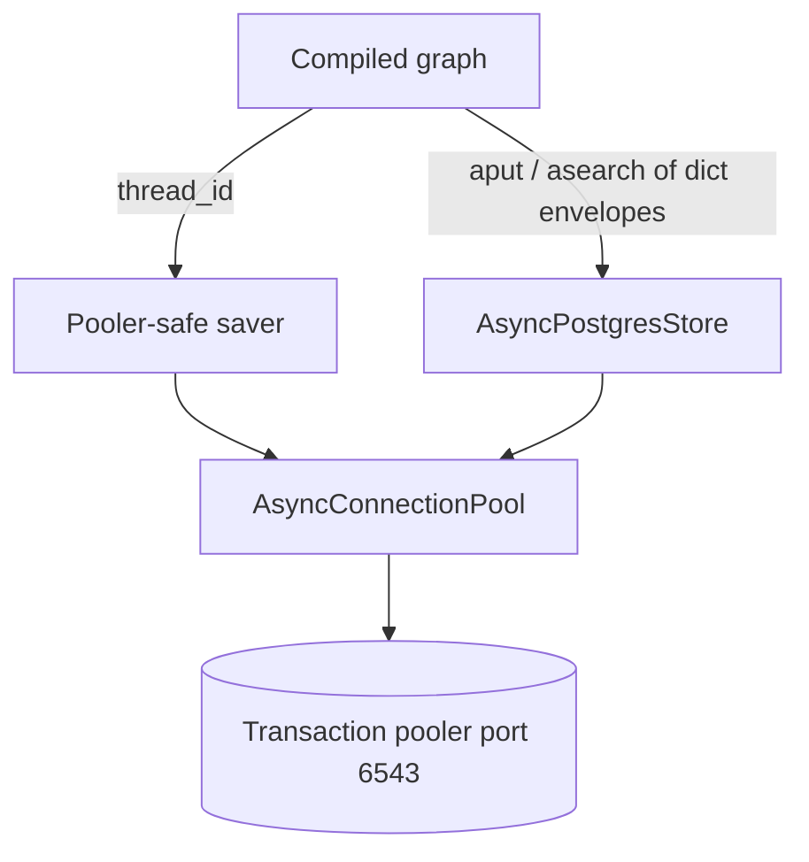

# Encrypted LangGraph checkpointer and store on a transaction pooler

The chat graph keeps two kinds of state, in a pool that is not Django's.

- The checkpointer (`AsyncPostgresSaver`) stores the message list and channel values for a `thread_id`. The next turn replays from there. Blobs are encrypted by a serializer wrapped around `JsonPlusSerializer`.
- The store (`AsyncPostgresStore`) stores hierarchical memory. Values are `jsonb`. The store only round-trips JSON objects, so each value is the dict envelope from `aes-gcm-field-encryption`, written at the call site. The checkpointer serializer does not wrap those rows.

Table creation is `saver.setup()` and `store.setup()`, run once per environment by a management command. It is not a Django migration. LangGraph owns the DDL.

Pinned libraries for this contract: `langgraph` 1.2.x, `langgraph-checkpoint-postgres` 3.1.x, `psycopg` 3.3.x. `astream_events` version `v3` is a separate streaming concern (`langgraph-streaming-chat`).

## Architecture



One pool per process, created lazily under an `asyncio.Lock`. `get_checkpointer` and `get_store` return those singletons. A chat request must not call `pool.close()`. Closing is for the setup command and other one-shot scripts, in a `finally`, before the event loop exits.

Django's pool (`dramatiq-redis-workers`) uses `statement_timeout` 30s and the ORM thread. This pool uses 15s and psycopg's async connections. Do not pass a Django connection into the saver.

## Connection

Prefer `LANGGRAPH_DATABASE_URL` when it is non-empty. Otherwise build a URL from the same fields as `DATABASES["default"]`: user, password, host, port, name, `sslmode`. Default the port to `6543` when it is unset. Quote the user and the password. Add `sslrootcert` only when `sslmode` is `verify-ca` or `verify-full`. If that mode is set and the cert path is empty, use a bundled CA file when the file exists.

```python
query = {"sslmode": sslmode}
if sslrootcert:
    query["sslrootcert"] = sslrootcert
return (
    f"postgresql://{quote(user, safe='')}:{quote(password, safe='')}"
    f"@{host}:{port}/{name}?{urlencode(query)}"
)
```

Missing user, password, or host raises `RuntimeError`. Do not fall back to a local superuser.

### Why `prepare_threshold` is `None`

psycopg 3 prepares a statement after `prepare_threshold` executions. The default is 5. `0` means prepare on first use (`_pg3_0`, `_pg3_1`, …). `None` means do not prepare. PgBouncer in transaction mode does not keep a server session, so a named statement vanishes or collides: `prepared statement "_pg3_N" does not exist` or `already exists` (P09).

```python
{
    "autocommit": True,
    "prepare_threshold": None,
    "row_factory": dict_row,
    "options": "-c statement_timeout=15000",
    "keepalives": 1,
    "keepalives_idle": 30,
    "keepalives_interval": 10,
    "keepalives_count": 3,
    "tcp_user_timeout": 60000,
}
```

`dict_row` is required. The library reads `row["col"]`. `autocommit` is required by the saver and the store. `tcp_user_timeout` 60000 fails a black-holed socket on Linux. Some macOS libpq builds ignore it. Production is Linux.

Set `supports_pipeline = False` on both the saver and the store after construction. On some psycopg versions, pipeline mode prepares `_pg3_N` even when `prepare_threshold` is `None`.

A setup-command docstring that says the session pooler needs `prepare_threshold=0` is stale. `0` prepares immediately. The pool passes `None`. Do not "fix" the pool to match that docstring.

Use the session pooler (port `5432`) only when you truly need named prepares or other session state. Then do not hold those sessions idle (P02 in `dramatiq-redis-workers`). This design uses the transaction pooler and disables prepares.

### Pool size

These are constructor arguments, not connection `kwargs`.

| Key | Value |
| --- | --- |
| `min_size` | `0`. Overnight idle drains to zero. |
| `max_size` | `LANGGRAPH_DB_POOL_MAX_SIZE`, or `8` when unset or not an integer. |
| `timeout` | `10` seconds. This is waiting for a free pool connection, not for the thread lock. |
| `max_idle` | `60` seconds. Closes unused sockets before the pooler drops them silently. |
| `max_lifetime` | `1800` seconds. |
| `check` | `AsyncConnectionPool.check_connection` (`SELECT 1` on checkout). |

Open with `open=False`, then `await pool.open(wait=True)`. `min_size` `0` means `open` does not connect. `warm_persistence` checks out one connection and runs `SELECT 1` so the first chat does not pay for TCP and TLS.

## Checkpointer encryption

`EncryptedSerializer` implements the typed pair and the untyped pair.

```python
def dumps_typed(self, obj):
    type_, payload = self._inner.dumps_typed(obj)
    return type_, self._enc.encrypt_bytes(payload)

def loads_typed(self, data):
    type_, payload = data
    return self._inner.loads_typed((type_, self._enc.decrypt_bytes(payload)))
```

The type tag stays plaintext. Only the payload bytes are encrypted. `encrypt_bytes` / `decrypt_bytes` are the blob format in `aes-gcm-field-encryption` (magic prefix, unique IV). `loads_typed` of a pre-encryption plaintext blob passes through, because decrypt of a blob without the prefix returns the bytes unchanged.

Untyped `dumps` frames the tag so `loads` can recover it: 2-byte big-endian length, UTF-8 type name, then the already encrypted payload.

Checkpoint encryption and store encryption are different. Do not put a bare `encrypt_bytes` blob into the store, and do not put `{"enc": ...}` into the checkpoint blob column.

## Store envelope

`AsyncPostgresStore` persists `value` as `jsonb`. A bare string is sent through `json.loads` on read. `iv:ciphertext:tag` is not JSON, so `asearch` throws before application code decrypts. One bad row fails a batch that also asked for good rows (P08).

Call sites write `encrypt_store_value(obj)`, which is `{"enc": "<ciphertext>"}`, and read with `decrypt_store_value`. Decrypt only after the read returns. Namespaces are tuples. Per-thread memory is `(thread_id, "L1_memory")`. Longer-lived memory is `(user_id, subject_id, "L2_memory")`. The library stores that tuple in `store.prefix`.

## Same-thread overlap

There is no application lock and no second Redis lock (P07). The checkpointer serializes work for one `thread_id`. `statement_timeout=15000` applies to the statement that is waiting:

- Turn A still holds the checkpoint lock after the reply is streamed, while memory nodes run.
- Turn B's `aget` / `aput` waits.
- If A releases within 15 seconds, B's wait ends and B continues.
- If A holds longer, Postgres cancels B with `QueryCanceled`. A is not cancelled. Tell that user the turn failed.

The pool checkout timeout (10 seconds) is a different wait: no free connection. Do not raise it to hide a lock wait, and do not add a Redis lock in front of the checkpointer.

### Nested graphs must not inherit the parent

`create_agent` defaults `checkpointer=None`, which inherits the parent saver, and `store=None`, which inherits the parent store. A nested checkpoint write on the same `thread_id` waits on the parent's lock. The wait is the multi-minute hang this timeout exists to cut short.

Memory extraction uses its own agent:

```python
return create_agent(
    model,
    tools=tools,
    system_prompt=system_prompt,
    checkpointer=False,
    store=InMemoryStore(),
    response_format=ToolStrategy(schema=schema, handle_errors=True),
)
```

Invoke it with a new id, not the chat's `thread_id`:

```python
config = {"configurable": {"thread_id": f"memory-{uuid4()}"}}
```

`checkpointer=False` is the value that disables the saver. `None` does not.

## Stale prepared statements

A truncate, or a pooler that still has an old name, can raise after `prepare_threshold=None` is deployed. Retry once on a fresh checkout. Do not retry unrelated errors. If the caller passed a fallback, return it after the retry fails so an empty memory read does not block the reply. Checkpointer methods do not pass a fallback: a failed `aput` must surface.

Match both the exception class and the message. Classes: `InvalidCachedStatement`, `DuplicatePreparedStatement`, `InvalidSqlStatementName`. Message: `"prepared statement"` and either `"does not exist"` or `"already exists"`.

```python
async def call_store(op, *, fallback=_MISSING, retries=1):
    last = None
    for attempt in range(retries + 1):
        try:
            return await op()
        except Exception as exc:
            last = exc
            if not is_stale_prepared_statement(exc):
                raise
            if attempt >= retries:
                break
    if fallback is not _MISSING:
        return fallback
    raise last
```

Subclass the saver and wrap `aget_tuple`, `aput`, and `aput_writes`. The graph calls those internally, so a helper at the memory call site never sees them.

## Setup and repair

Run the command after migrations, once per environment. It is idempotent.

```python
async def _run() -> None:
    try:
        await setup_persistence()  # saver.setup() then store.setup()
    finally:
        await close_persistence()

asyncio.run(_run())
```

`close_persistence` closes the pool, clears the singletons, and, if the stream module is already imported, drops its compiled graph so the next process does not keep a saver bound to a closed pool.

Repair legacy store rows before serving traffic that searches those namespaces. The reference command counts, then updates, using this pool (not Django's), and always closes in `finally`. `--dry-run` only counts.

```sql
UPDATE store
SET value = jsonb_build_object('enc', value #>> '{}'),
    updated_at = CURRENT_TIMESTAMP
WHERE jsonb_typeof(value) = 'string'
  AND (prefix LIKE '%.L1_memory' OR prefix LIKE '%.L2_memory');
```

Limit the `WHERE` to prefixes this app encrypted. After the update, `decrypt_store_value` sees `{"enc": "<ciphertext>"}`. The same statement is specified in `aes-gcm-field-encryption`. Do not leave a mix of strings and objects in a namespace you search.

## Environment

| Name | Notes |
| --- | --- |
| `LANGGRAPH_DATABASE_URL` | Optional full URL. Wins over the fields below. |
| `LANGGRAPH_DB_POOL_MAX_SIZE` | Integer. Invalid or empty becomes `8`. |
| `SUPABASE_DB_USER` | `app_api` login, not a superuser. |
| `SUPABASE_DB_PASSWORD` | Secret. |
| `SUPABASE_DB_HOST` | Pooler host. |
| `SUPABASE_DB_PORT` | `6543` when using the transaction pooler. |
| `SUPABASE_DB_NAME` | Database name. |
| `SUPABASE_DB_SSLMODE` | `require`, or `verify-ca` / `verify-full` with a cert. |
| `SUPABASE_DB_SSLROOTCERT` | Path. Empty unless the mode verifies the CA. |
| `FIELD_ENCRYPTION_KEY` | 64 hex characters. See `aes-gcm-field-encryption`. |

Do not log the URL or the password.

## Failure prevention

- **P07.** Keep `statement_timeout` at 15 seconds on this pool. Nested agents use `checkpointer=False`, `InMemoryStore()`, and a fresh `memory-{uuid}` thread id. Do not add a Redis lock. Surface the cancelled turn to the user.
- **P08.** Store writes are `{"enc": ...}` dicts. Checkpoint blobs stay on the serializer. Repair string-typed `store.value` rows before search. Decrypt after a successful read.
- **P09.** `prepare_threshold=None`, `supports_pipeline=False`, transaction pooler port `6543`. Retry a stale `_pg3_N` error once. Do not set the threshold to `0`.
- Do not close the shared pool from a request. The worker warmup calls `warm_persistence` (`dramatiq-redis-workers`) and leaves it open.
- `QueryCanceled` on the waiter is a lock timeout, not a dead database. A checkout timeout is a full pool. Log them as different errors.
- A bad encryption key fails closed on checkpoint blobs that carry the magic prefix. Plaintext legacy blobs still load. Store rows use the other envelope. Do not mix the two formats.

## Tests

- The built URL contains `sslmode=verify-full` and a quoted `sslrootcert` when that mode and path are set. The password is quoted.
- `pool_kwargs()["prepare_threshold"] is None`.
- `pool_kwargs()["options"]` contains `statement_timeout=15000`.
- `pool_kwargs()["tcp_user_timeout"]` is `60000`.
- Constructor kwargs: `min_size == 0`, `max_idle == 60.0`, `timeout == 10.0`, `check` is `AsyncConnectionPool.check_connection`.
- Typed serializer round-trip. The ciphertext does not contain the plaintext. Untyped `dumps` / `loads` round-trips. A plaintext blob from `JsonPlusSerializer` still loads.
- `is_stale_prepared_statement` is true for `"_pg3_3" does not exist` and `"_pg3_0" already exists`, and false for `connection refused`.
- `call_store` retries once and then returns the success value. With a fallback, a second stale error returns the fallback. `RuntimeError("disk full")` propagates even when a fallback was passed.
- `get_checkpointer` returns the same object on the second call.
- Repair dry-run does not update. A string `value` becomes an object with key `enc`.

## Checklist

- [ ] `LANGGRAPH_DATABASE_URL` or `SUPABASE_DB_USER`, `SUPABASE_DB_PASSWORD`, and `SUPABASE_DB_HOST` are set. The port is `6543`.
- [ ] Connection kwargs set `prepare_threshold=None`, `autocommit=True`, `dict_row`, and `statement_timeout=15000` (P09, P07).
- [ ] Saver and store set `supports_pipeline = False`.
- [ ] Pool `min_size` is `0`, `max_idle` is `60`, checkout `timeout` is `10`, and `check` runs `SELECT 1`.
- [ ] Checkpoints use `EncryptedSerializer`. Store writes use `encrypt_store_value` (P08).
- [ ] `setup_langgraph_persistence` has been run in this environment and is not a Django migration. The command closes the pool in `finally`.
- [ ] String-typed store rows for this app's prefixes have been repaired, or a dry-run count is zero.
- [ ] Nested agents pass `checkpointer=False`, an in-memory store, and a new thread id (P07).
- [ ] Workers warm the pool at boot and do not close it per job.
- [ ] Tests assert `prepare_threshold is None`, not `== 0`.
