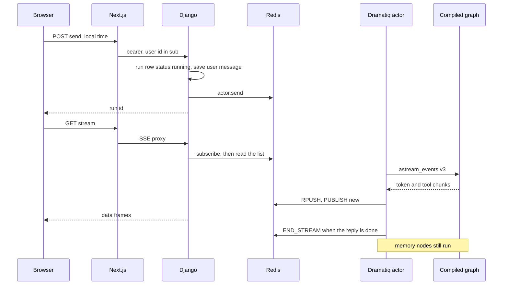
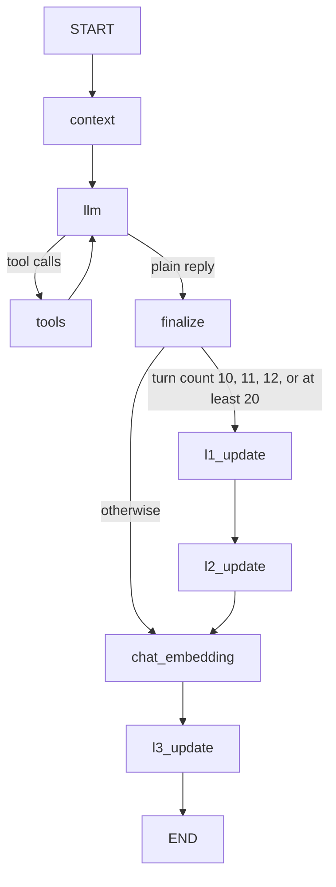

# LangGraph chat stream over Redis and server-sent events

The browser never holds the graph. It posts one user message, receives a run id, and opens a same-origin SSE proxy. A worker drives `astream_events(version="v3")` on a graph compiled once per process. Token frames go to a Redis list. A pub/sub message is only a wake-up. The HTTP handler replays the list, then waits for new indexes.

Pinned libraries: `langgraph` 1.2.x, `langgraph-checkpoint` 4.2.x, `langchain-core` 1.4.x. v3 streaming is the channel protocol this consumer implements. There is no LangGraph `RetryPolicy`.

Persistence, encryption, and the pooler-safe checkpointer are `langgraph-postgres-persistence`. The broker, retries, and the ORM-thread connection release are `dramatiq-redis-workers`. The browser reaches the API with the short-lived bearer from `m2m-jwt-service-auth`.

## Architecture



Three Redis keys per run id:

| Key | Type | Payload |
|---|---|---|
| `agent_run:{id}:responses` | list | JSON chunk, append-only |
| `agent_run:{id}:new_response` | pub/sub | the string `new` |
| `agent_run:{id}:control` | pub/sub | `STOP` or `END_STREAM` |

The list is the stream. The pub/sub channels are signals. A subscriber that misses `new` recovers with `LRANGE` from its last index.

## Graph

`StateGraph` state is `messages` (`add_messages`) and `runs_to_remove` (run ids waiting to be pruned). Runtime fields (user id, companion id, run id, local time, retrieval limits) travel in `astream_events(context=...)`. They are not checkpointed.



Routing functions return the next node name. Nodes return a plain state update. Only error handlers return `Command`. Returning `Command` from `llm` as well as a conditional edge runs both paths.

Do not fan out after `finalize`. A parallel superstep holds the checkpointer lock until every sibling finishes, and the memory nodes need that same database.

| Node | What it does | On failure |
|---|---|---|
| `context` | Load memory and retrieval together, 5s cap. Replace the system message. | Empty prompt context, then `llm` still runs |
| `llm` | Stream one model. Walk the fallback chain in the node. Bind tools until the turn budget is spent. | Remove this turn's messages after the last human, `goto` END |
| `tools` | Prebuilt `ToolNode(handle_tool_errors=True)` | Synthetic error `ToolMessage`s, back to `llm` |
| `finalize` | Stamp this turn with the run id. Emit the reply-done event. | The reply is already saved |
| `l1_update`, `l2_update`, `chat_embedding` | Summaries, durable facts, vector row | Log and continue. The user already has the reply |
| `l3_update` | `RemoveMessage` for pruned turns. Clear `runs_to_remove` only after that prune works | Leave `runs_to_remove` so a later turn can retry |

`context` gathers memory and retrieval under `asyncio.wait_for(..., 5)`. Embedding calls use a 4s request timeout so they fit in that cap. On timeout the system message is built from empty blocks.

The model copy is not the checkpoint. Send the last 10 turns. Trim each message to 300 tokens on that copy. Move every `SystemMessage` to the front of the list sent to the model. `add_messages` leaves a refreshed system message at the end, and a system message after the user turn makes the model close a tool tag instead of answering.

Count `ToolMessage`s after the latest human message. The budget is 3. At the budget, stop calling `bind_tools` and append a short assistant note that the model must answer from the tools it already used.

LiteLLM `fallbacks` do not run when `streaming=True`. Build each model with `use_litellm_fallbacks=False` and invoke the chain yourself: primary, then each configured fallback. `num_retries` (default 2) still applies inside one model. Answer requests time out at 12s. Judge requests, used only by the nested summary agents, time out at 8s. The primary id comes from `AGENT_ANSWER_MODEL` or `AGENT_JUDGE_MODEL` when that provider reads the setting. Record the model that actually returned, not the name hardcoded on the streamed metadata. A success callback is the reliable source after a fallback.

Some models put a tool call in `content` as XML (`<function=...>`, `<parameter ...>`) and also return a native tool call. Strip that markup from the user-visible text. If the markup was the only call, promote it to `tool_calls` before routing. Apply the same filter to streamed deltas so a partial tag is not painted, then flushed, as its own message.

### Timeouts

The graph file is the contract. A design note elsewhere lists older node caps (answer node 15s/5s, memory nodes 10s/8s). Those numbers are stale.

| Surface | Cap |
|---|---|
| Context gather | 5s, then empty prompt context |
| Embedding request | 4s |
| Answer model request | 12s, `num_retries` 2, then the next model |
| Judge model request | 8s |
| Nested summary agent | `wait_for` 8s |
| `llm` node | run 20s, idle 12s, then END |
| `tools` node | run 8s, idle 5s, then error tool messages |
| `l1_update`, `l2_update`, `chat_embedding` | run 15s, idle 8s, then the next node |
| Actor | `time_limit=90_000` ms |
| `recursion_limit` | 20 |

Idle time resets when the node produces output. Token deltas keep the answer node alive. A tool call that sits silent for 5s does not.

### Memory after the reply

Summarize when the checkpoint has 10, 11, or 12 turns, then wait. At 20 turns, drop the oldest 10 even if the summary call fails, and summarize the newest 10. Turns 13 through 19 do not summarize. A failed summary at 20 leaves those 10, so the next tries are 11 and 12 again.

`runs_to_remove` is a union. The summary node adds ids. It does not write `[]` when the model returns nothing. `l3_update` clears the list only after a successful prune. Never prune the current run or the latest human turn.

Nested summary agents use `checkpointer=False`, `InMemoryStore()`, and a fresh `memory-{uuid}` thread id. `store=None` would inherit the parent store batcher. A nested checkpointer on the parent `thread_id` waits on the same lock (`langgraph-postgres-persistence`).

Store searches use the pinned signature. `namespace_prefix` is positional-only. `limit` is keyword-only:

```python
items = await store.asearch((thread_id, "thread_summary"), limit=10)
items = await store.asearch((user_id, companion_id, "durable_facts"), limit=10)
```

`asearch(namespace_prefix=(thread_id, "thread_summary"))` raises `TypeError` on this pin. Decrypt each `item.value` only after that call returns. Values are the dict envelope from `aes-gcm-field-encryption`.

The store helper retries once when the exception is a stale prepared statement, then raises. `TypeError` is not that exception. Do not catch it and replace memory with `[]`. Let it reach the memory node's error handler, which already logs and continues to the next node. A broad `except Exception` inside the node hides a bad call shape as an empty prompt (P32).

Bound tools are a catalog lookup and a "load the earlier turns" expander. The expander takes a store key on the main graph and a run id only inside the summary agent. A web-search function (Tavily, then Exa, then a last-resort fetch) lives next to those tools and is not in the bound list. Leave it unbound unless a product decision adds it. `TAVILY_API_KEY` and `EXA_API_KEY` do nothing on the compiled graph.

Every turn, after the reply, embed the user text plus the assistant text and insert one vector row. That insert is fail-soft. Similarity queries are `pgvector-similarity-search`.

## Send and own the run

`POST /api/messages/send/` requires the bearer, `X-User-Created-At`, and `X-Client-Local-Time`. Body is `content` plus either `thread_id` or a companion id for a new thread. Reject a missing local time with 400 before any insert. The run row stores that timestamp. Recency windows read it. If both the enqueue argument and the row are missing it, the actor raises and the run fails.

Check the entitlement before insert. On denial return 403 with `upgrade_required: true` and do not enqueue. Pass the tier's retrieval limits into the actor as integers. Do not hard-code plan numbers in the graph.

For a new thread, create the thread, the run (`status=running`, `client_local_time` set), and the user message, then enqueue. For an existing thread, load it with the caller's user id, then do the same. Overlap the broker `send` with the message insert (`asyncio.to_thread` on the sync `send`). Return 201:

```json
{"thread": {"thread_id": "..."}, "message": {"message_id": "..."}, "agent_run_id": "...", "status": "running"}
```

The user message is already in the messages table and is the new graph input `{"messages": [{"role": "user", "content": "..."}]}`. Prior turns come from the checkpointer. Do not reload history from the messages table into the graph.

Stream and stop both resolve the run with one join to the thread's user id. A guessed run id is 404. Stop, when status is `running`, sets `stopped` and publishes `STOP`.

The Next send route is a Route Handler, not a server action. It requires a session, mints the bearer, and forwards the two time headers. The stream route calls `connection()` before its `try`, so a prerender bailout is not logged as a stream failure (`nextjs-cache-components`). It proxies bytes. It does not parse SSE.

Response headers on both the API stream and the proxy: `Content-Type: text/event-stream`, `Cache-Control: no-cache, no-transform`, `X-Accel-Buffering: no`.

## Worker

`@dramatiq.actor(time_limit=90_000)`. One run:

1. Subscribe to the control channel before the graph starts. `get_message(ignore_subscribe_messages=True)`.
2. Reload language and profile from the preference row inside the actor. The enqueue passes empty profile strings. Do not trust those kwargs.
3. Compile once per process: checkpointer, store, `transformers=[ToolCallTransformer, CustomTransformer]`. Without the two transformers the `tools` and `custom` channels never appear.
4. `await graph.astream_events(..., version="v3")` returns the v3 stream handle. Use it as `async with await graph.astream_events(...) as stream`, then `async for ev in stream`. Config is `configurable.thread_id`, `recursion_limit` 20, and `run_id` equal to the run id. Leaving the context manager aborts the run. Stay inside it until the iterator is exhausted when memory nodes must still finish. Close it early only for stop and for a failed reply.
5. Map each event to one chunk, persist what must be stored, yield the chunk. Do not observe from inside a node.

`messages` data is `(event, metadata)`. `tools` data is the event dict. If `data[0]` is a dict, unwrap it.

| Wire event | Chunk |
|---|---|
| `content-block-delta` with `text-delta` | Unsaved `assistant` chunk, `stream_status: chunk`. Not a row |
| `message-finish` | Saved `assistant` row of the accumulated text, `stream_status: complete`. `message-finish` has usage and no text |
| `tool-started` / `tool-finished` / `tool-error` | Saved raw `status` row, plus a saved `tool` row. Name is `tool_name`, args are `input`. Coerce a `ToolMessage` output to its `content` before `json.dumps` |
| `agent_run_completed` | Saved raw status `status_type: finish`, `finish_reason: agent_terminated` |
| `llm_error` | No yield yet. After `astream_events` exits, yield `{type: status, status: error}` |

First visible text sets time-to-first-token. A thinking block or a tool-call block does not. Skip an empty assistant row when the turn was only tool calls. Attach a catalog hit to the complete assistant metadata when the tool output's first object has an `id`.

Conversation rows (`user`, `assistant`, `tool`) are encrypted. `status` rows stay plaintext so a finish marker is readable. Reads accept both.

On `{type: status, status: error}`:

- Delete messages for that run except `type=user`.
- Set the run to `failed` and store the error string on the run, not in the transcript.
- `RPUSH` one assistant chunk with `stream_transport_error: true` and a fixed user-facing sentence. Do not insert that sentence.
- Publish `new`.

Do not `DELETE` or replace the list. The HTTP side tracks a list index. Resetting the list moves the fallback to index 0 and a client that already passed that index never sees it. The first `RPUSH` sets a 120s TTL. When the actor leaves, shrink it to 30s so a late subscriber can still drain.

On `finish_reason == agent_terminated`, set `completed`, publish `END_STREAM`, and keep iterating. Memory chunks are not pushed: the push happens only while status is still `running`. The finish chunk itself is also not pushed, because the status flip happens before the push. The browser already has the complete assistant frame. `END_STREAM` is what closes SSE.

`STOP` between chunks sets `stopped` and ends the generator. It does not roll back the user message.

Any other exception uses the same fail path and publishes `END_STREAM`. Retry the status update a few times with backoff. The reference `finally` only expires the list and closes pub/sub. If the loop ends with no finish chunk, or the 90s limit aborts the task without entering `except Exception`, the row stays `running` (P05). In that `finally`, when status is still `running`, write `failed` before returning. Re-raise a limit or cancellation after that write so the broker still records the abort.

Do not flush the tracing client at the end of the generator. A flush waits on the export pipeline and blocks the actor after the graph has finished. The batch exporter runs on its own schedule. Masking rules belong to the tracing module.

## SSE handler

Yield `: connected\n\n` immediately so the first byte is not the first token. The client ignores frames that do not start with `data: `.

Subscribe to the response channel and the control channel before `LRANGE`. Then replay the whole list and remember the last index. Check the run status after that replay. If it is not `running`, return. A finished run still delivers what is buffered, then stops.

```python
async for message in pubsub.listen():
    if not isinstance(message, dict) or message.get("type") != "message":
        continue
    if channel == response_channel and data == "new":
        for chunk in await lrange_after(last_index):
            yield f"data: {json.dumps(chunk)}\n\n"
    elif channel == control_channel and data in {"STOP", "END_STREAM"}:
        for chunk in await lrange_after(last_index):
            yield f"data: {json.dumps(chunk)}\n\n"
        break
```

The first frame from `listen()` is a subscribe acknowledgement (`type` is `subscribe`, `data` is the subscription count). Treating that frame as the end of the channel closes the stream before any token (P06). Ignore every type other than `message`. Decode `bytes` if the client was built without `decode_responses`. Read until `END_STREAM` or `STOP`, drain the list first (the producer pushes the fallback before the control signal), then unsubscribe and close.

A listener that dies yields one transport-error assistant frame and does not change the run. The actor still owns the status write.

The browser splits the buffer on `\n\n`, parses `data: ` payloads, and appends `chunk` text until `complete`. It paints `stream_transport_error` as a temporary bubble. A refresh loads the messages table, which does not contain that sentence.

## Resume

The UI may reattach when it finds a `running` row for the thread. Reattach only if that row is still `running` and `created_at` is within the actor limit (90s). Older `running` rows are dead actors. Do not open SSE for them.

The current read helper filters `status = running`, orders by `created_at` descending, and takes one row. It does not apply the age predicate. Add it before calling the stream route (P05).

A live reattach works because the list is replayed from index 0 and the handler then blocks on `new`. A run that already published `END_STREAM` replays the list and exits because status is no longer `running`.

## Schema

`threads`: id, `user_id`, companion id, encrypted latest user text, timestamps. Summaries are not columns. They live in the store.

`agent_runs`: id, thread id, `status` (`running`, `completed`, `failed`, `stopped`), `error`, `client_local_time`, timestamps.

`messages`: id, thread id, `type` (`user`, `assistant`, `tool`, `status`), `content`, `is_llm_message`, run id, `metadata`, timestamps. Encrypt content and metadata unless `type` is `status`.

Store namespaces are tuples, for example `(thread_id, "thread_summary")` and `(user_id, companion_id, "durable_facts")`.

## Environment

| Name | Role |
|---|---|
| `AGENT_ANSWER_MODEL` | Primary answer model when the provider reads it |
| `AGENT_JUDGE_MODEL` | Primary judge model for nested summary agents |
| `TAVILY_API_KEY` | Unbound search helper only |
| `EXA_API_KEY` | Unbound search helper only |
| `REDIS_URL` | List, pub/sub, and the Dramatiq broker |
| `LANGGRAPH_DATABASE_URL` | Checkpointer and store, or the `SUPABASE_DB_*` fields |

`REDIS_RESPONSE_LIST_RUN_TTL` is 120 seconds. `REDIS_RESPONSE_LIST_DRAIN_TTL` is 30 seconds. They are settings, not secrets.

## Tests

- A `text-delta` yields an unsaved chunk. `message-finish` persists the concatenation, not an empty string, and skips a tool-only turn.
- The first pub/sub frame is `type: subscribe`. The listener yields nothing and stays open until `END_STREAM`.
- An error chunk deletes non-user rows, sets `failed`, and appends the fallback. A client whose cursor is already past 0 still receives it.
- `asearch` is called with a positional tuple. A keyword `namespace_prefix` is asserted to raise, and that `TypeError` is logged at error rather than returned as `[]`.
- Routing: tool calls go to `tools`; a plain reply goes to `finalize`; summarize at 10, 11, 12, and 20; do not summarize at 15.
- After `finalize`, the graph has one next node, not a parallel set.
- The system message is first in the list passed to the model.
- Another user's run id is 404 on stream and on stop.
- A `running` row older than 90s is not resumed.
- `connection()` is invoked on the stream route, and the route is not prerendered.

## Checklist

- Graph compiled once, with the checkpointer, the store, and both stream transformers.
- `astream_events` uses `version="v3"` and `async with await`.
- Answer fallbacks are a loop in the node. LiteLLM fallbacks are off for that loop.
- Node caps match the table above, not the older design note.
- Subscribe acknowledgements are ignored. The loop ends on `END_STREAM` or `STOP`.
- The response list is append-only until the drain TTL.
- `agent_terminated` sets `completed` and does not stop the actor.
- Error, timeout, and cancellation write `failed` before the actor returns. Stop writes `stopped`.
- The error sentence is not inserted into `messages`.
- Resume requires `running` and age under 90s.
- `asearch` gets a positional namespace. `TypeError` is not swallowed as empty memory.
- Nested summary agents do not use the parent checkpointer.
- Stream and stop check thread ownership. The stream route calls `connection()` first.
