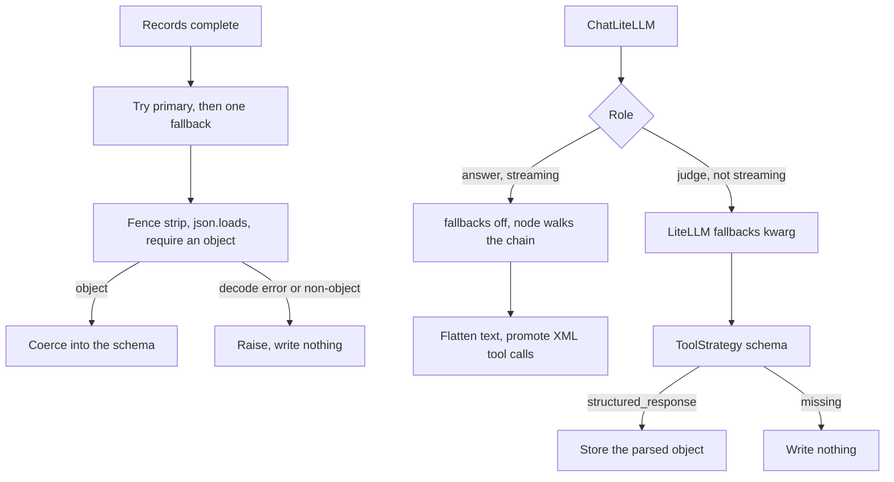

# LiteLLM calls that keep structured output stable

Two clients share the provider switch `LLM_PROVIDER` (`gemini` or `azure`; anything else raises, and the graph factory maps every other value to `gemini`).

The records client calls `litellm.completion` and walks a primary-then-fallback list in process. It does not pass LiteLLM `fallbacks=`. The graph client is `langchain_litellm.ChatLiteLLM` (package `langchain-litellm` 0.7.1, `langchain` 1.4.0). Judge calls may pass `fallbacks=`. Streaming answer calls must not (P43).

Comment and extraction prompts, token caps, and the closed extraction schema are `llm-comment-generation` and `structured-entry-extraction`. This module is the provider call, the schema gate, and the flags that keep reasoning and tool XML out of the stored text.

## Two chains



Each provider config names one primary and one fallback. A Gemini id is prefixed `vertex_ai/` unless it already has that prefix. A leading `gemini/` is stripped first. An Azure deployment is prefixed `openai/` unless it already starts with `openai/` or `azure_ai/`. An `azure/` prefix becomes `openai/`.

Gemini primary overrides: `GEMINI_MODEL` on the records client, `AGENT_ANSWER_MODEL` or `AGENT_JUDGE_MODEL` on the graph when the provider is Gemini. Azure primaries stay the ids in the config dict unless the caller passes `model=`. Duplicate ids are dropped. A multimodal records call (an image review) drops the Azure fallback and stays on the primary.

Records completion timeout is 60 seconds. The graph answer timeout is 12 seconds and the judge timeout is 8 seconds. `ChatLiteLLM` `num_retries` defaults to 2 inside one model, then the chain moves on. Log the model and how many remain. Raise the last exception when the list is empty.

## Reasoning flags

Gemini accepts a top-level `reasoning_effort`. The OpenAI-compatible provider rejects that field on an unknown alias, so Foundry models send `extra_body` only (P43).

| Client | Gemini | GLM in the model id | DeepSeek in the model id |
| --- | --- | --- | --- |
| Records, thinking on | `low` | `extra_body.reasoning_effort=medium` | `extra_body.reasoning_effort=low` |
| Records, thinking off | `disable` | `low` (this family rejects `none`) | `none` |
| Graph answer and judge | `disable` from the role config | `low` | `none` |

The graph role config's `reasoning_effort` is applied only when `gemini` is in the primary id. Foundry flags come from the model id, not from that config string. A GLM reply can still contain a short `reasoning_content` after `low`. Drop it before the next turn (`langgraph-reliability`).

`api_key` and `api_base` are fields on `ChatLiteLLM`. Putting them in `model_kwargs` loses: the client spreads `self.api_key` last, and that value is `None` (P43). Pop them out of the provider kwargs and pass them as constructor arguments. Vertex kwargs (`vertex_location`, `vertex_project`) stay in `model_kwargs`.

The graph factory sets `litellm.modify_params = True` at import.

> NOTE: unverified against current LiteLLM docs in this pass. The flag is set in code so LiteLLM can rewrite parameters a provider would reject.

A success callback records the model that actually answered, on a `ContextVar` installed per run. Streamed response metadata keeps the configured primary. Read the callback when you store the model name.

## JSON that must not become an empty row

Strip a leading markdown fence, then `json.loads`. Require a JSON object for an extraction or an aggregation.

```python
def parse_llm_json(raw: str):
    text = (raw or "").strip()
    if text.startswith("```"):
        text = FENCE_RE.sub("", text).strip()
    return json.loads(text)
```

A comment list must contain at least one object whose `character` is set and whose body is non-empty. The body is the first truthy value among `comment`, `output`, and `text`. Otherwise raise `ValueError("model returned no usable comments")`.

`JSONDecodeError`, a non-object, and that empty comment list are re-raised. The save inserts no row. The worker inserts no comment. Aggregation raises inside the compose step, before the commit. Two lost `updated_at` races can still return empty prose with nothing written. That path is a commit conflict (`structured-entry-extraction`).

Coercion is a separate step and it does store. Unknown enum values fall back to the schema default. Unknown labels are dropped. That normalized object is a success. Do not use the same path for a body that did not parse.

## ToolStrategy for memory

The judge model is wrapped with `create_agent` and `response_format=ToolStrategy(schema=schema, handle_errors=True)`. Current LangChain docs (structured output, tool strategy) match this package: `True` catches the validation error and sends it back as a tool message so the model can call the tool again. `False` lets the exception propagate. `True` does not substitute an empty model.

The nested agent is capped: tool-call middleware `run_limit=3`, one optional expand tool at `run_limit=1`, and `asyncio.wait_for` of 8 seconds. `checkpointer=False`, a private `InMemoryStore`, and a fresh `memory-{uuid}` thread id are `langgraph-postgres-persistence`. Tag the runnable `nostream` so the memory call is not a user-visible token stream.

Read `structured_response`. It is a Pydantic instance. Dump it to a dict before writing.

| Result | Phase index | Durable facts |
| --- | --- | --- |
| Parsed object | Write phases. A continuation flag overwrites the latest key. A new phase inserts a new key. | Write each fact whose key passes the durability check. |
| Parsed object, empty fact list | — | Write nothing. Emit success. The prompt asks for this when nothing durable changed. |
| `structured_response` is `None` | Return `None`. Emit an error (`empty summary`). Write no phase. | Write nothing. |

A missing object is not the empty-list success. The fact node still emits a completion event with an empty error string in that case. The store stays empty, so a reader must not invent facts from the event. Treat a missing `structured_response` as a failure in new code and put the error on the event.

After a successful parse, drop fact keys that contain a session or mood fragment (`emotion`, `feeling`, `mood`, `project_status`, `project_update`, `session`, `anxiety`, `nervous`, after normalizing case, spaces, and hyphens). Log the skip. Do not store them. The prompt also asks for short values. The code does not re-count tokens before the write.

Phase writes happen one key at a time. A later failure does not roll back keys already written. See `langgraph-reliability`.

XML that leaks into `content` is normalized on the model result before the graph treats it as text. Drop tags are `parameter`, `function`, `tool_call`, `tool_response`, and `invoke`. A native `tool_calls` entry is kept and the XML is removed. When `tool_calls` is empty, XML whose name is in the bound tool list is promoted, even if a sentence remains beside it. An unbound name is stripped and not called. Parameter text that starts with `{` or `[` is `json.loads` when that succeeds. `true` and `false` become booleans.

The same filter holds a partial `<` while streaming, including a cut-off close tag with no `>`. That path is `langgraph-reliability`. Flattening also drops `reasoning_content` and non-text blocks so a content list is not sent back to Foundry.

## Environment

| Name | Notes |
| --- | --- |
| `LLM_PROVIDER` | `gemini` (default) or `azure`. |
| `GEMINI_MODEL` | Records Gemini primary. Prefixed `vertex_ai/` if needed. |
| `AGENT_ANSWER_MODEL` | Graph answer primary when the provider is Gemini. |
| `AGENT_JUDGE_MODEL` | Graph judge primary when the provider is Gemini. |
| `VERTEX_AI_SERVICE_ACCOUNT_FILE` | Relative paths are from the repo root. Default file name `service_account.json`. Copied onto `GOOGLE_APPLICATION_CREDENTIALS`. |
| `VERTEX_AI_PROJECT` | Else `project_id` inside the file. |
| `VERTEX_AI_LOCATION` | Used when the model id does not contain `gemini-3`. Default `us-central1`. A `gemini-3` id uses `global`. |
| `AZURE_OPENAI_API_KEY` | Copied to `AZURE_API_KEY`. Also passed as `api_key` on `ChatLiteLLM`. |
| `AZURE_OPENAI_ENDPOINT` | Strip trailing slashes. Append `/openai/v1` unless it already ends with that suffix. Copied to `AZURE_API_BASE` and passed as `api_base`. |

Do not log the key, the endpoint, or the prompt body.

## Failure prevention

- **P43.** Streaming answer models are built with `use_litellm_fallbacks=False`. The node walks `get_model_chain`. Judge calls, which set `streaming=False`, may pass `fallbacks=`.
- **P43.** Foundry reasoning goes in `extra_body`. Gemini uses top-level `reasoning_effort`. `api_key` and `api_base` are client fields.
- **P43.** Normalize leaked XML into `tool_calls` before the message is stored as text. Drop `reasoning_content` and non-text blocks on the model result.
- A JSON decode error, a non-object, or a comment list with no usable item raises. No row is inserted for that failure.
- `ToolStrategy(handle_errors=True)` retries the model with the validation error. It does not store an empty stand-in. A missing `structured_response` writes nothing.
- A valid empty fact list is a success. A missing parse is not, even when the fact node emits an empty error string.
- Multimodal records calls do not use the Azure fallback.
- Exhausting the chain raises. The graph error handler is `langgraph-reliability`.

## Tests

- Invalid model JSON raises the analysis error and does not return a payload.
- A comment array of empty objects raises `no usable comments`.
- A fence-wrapped object parses. A non-object raises.
- The streaming filter drops a `<parameter>` block and a cut-off close tag with no `>`.
- XML-only text becomes a tool call when the name is bound. An unbound name is stripped and `tool_calls` stays empty.
- A content list with a thinking block is flattened before the XML conversion. `reasoning_content` is gone.
- A memory agent invoked with no `structured_response` writes no fact and no phase. The phase event error is `empty summary`.
- An empty fact list writes nothing and the completion error is empty.
- A mood-like key is skipped. A stable key is stored.
- `create_agent` is called with `checkpointer=False` and a store that is not the parent store.

## Checklist

- [ ] `LLM_PROVIDER` is `gemini` or `azure`. Each side has one primary and one fallback, and the Azure image call has no fallback.
- [ ] Streaming answer models set `use_litellm_fallbacks=False` (P43).
- [ ] Foundry models send `extra_body.reasoning_effort`. Gemini sends top-level `reasoning_effort`. Keys are constructor fields (P43).
- [ ] JSON failures raise. Callers do not insert an empty row.
- [ ] Memory reads `structured_response`. `None` writes nothing. An empty fact list is the only empty success.
- [ ] XML tool text is promoted or stripped before the graph routes on the message.
- [ ] The model name stored for a streamed reply comes from the success callback.
