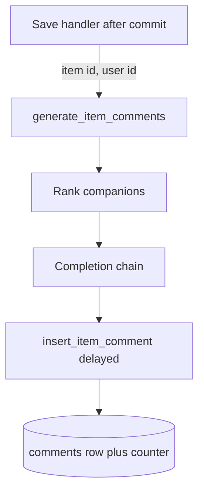

# Delayed companion comments from one completion

The HTTP save returns before any comment exists. A worker actor loads the item, picks companions, calls the LLM once, and enqueues one insert actor per comment with a delay. Edits do not start this actor. A save that skipped extraction does not start it either.

Workers, the Redis broker, `Retries(max_retries=2)`, and `@with_django_connection` are `dramatiq-redis-workers`. Cosine search is `pgvector-similarity-search`. Field ciphertext is `aes-gcm-field-encryption`. This module is the ranking, the prompt budget, the provider chain, and the delay.

## Architecture



Enqueue with `sync_to_async(generate_item_comments.send)` so the publish runs off the event loop. Arguments are the item id and the user id only. The worker loads and decrypts the body. A failed `send` is logged. The save still succeeds. There is no outbox.

Both actors re-raise after logging. The broker retries them twice. A missing item, or a shortlist with nobody on it, returns without raising. Register them as `@dramatiq.actor` above `@with_django_connection`, so the callable the broker runs is the wrapper that returns the database connection.

Restart the worker after any change to these actors, the weights, or the prompt, and confirm the new process is the one consuming `dramatiq:default` (P04). The worker does not reload imported code.

## Provider chain

`LLM_PROVIDER` is `gemini` (default) or `azure`. Anything else raises at client construction. Each provider has one primary and one fallback. Walk the list in process. LiteLLM `fallbacks=` is not used. Log the model and the remaining count, then try the next model. Raise the last exception when the list is exhausted.

| Provider | Primary | Fallback |
| --- | --- | --- |
| gemini | `GEMINI_MODEL`, else `vertex_ai/gemini-3.5-flash` | `vertex_ai/gemini-3-flash-preview` |
| azure | `openai/FW-GLM-5.3-Flash` | `openai/DeepSeek-V4.1-Flash` |

Prefix a Gemini name with `vertex_ai/` unless it already has that prefix. Strip a leading `gemini/`. Prefix an Azure deployment with `openai/` unless it already starts with `openai/` or `azure_ai/`. An `azure/` prefix becomes `openai/`.

Gemini reads `VERTEX_AI_SERVICE_ACCOUNT_FILE` (relative paths are from the repo root) or `service_account.json`, and sets `GOOGLE_APPLICATION_CREDENTIALS` to that path. Project is `VERTEX_AI_PROJECT`, then `VERTEXAI_PROJECT`, then `GOOGLE_CLOUD_PROJECT`, then `project_id` inside the file. Location is `global` when the model name contains `gemini-3`. Otherwise it is `VERTEX_AI_LOCATION` or `VERTEXAI_LOCATION`, default `us-central1`.

Azure reads `AZURE_OPENAI_API_KEY` and `AZURE_OPENAI_ENDPOINT`. Strip the endpoint and append `/openai/v1` unless it already ends with that suffix. Copy the key to `AZURE_API_KEY` and the base to `AZURE_API_BASE` for LiteLLM.

Completion timeout is 60 seconds. Embedding timeout is 4 seconds. Embeddings are 384 floats (`GEMINI_EMBEDDING_MODEL` default `gemini-embedding-001`, or `AZURE_EMBEDDING_DEPLOYMENT` default `text-embedding-3-small`). A vector of any other length raises. Pass `dimensions` on the embedding call.

Thinking is on for comments and off for extraction. Gemini maps that to `reasoning_effort` `low` or `disable`. Foundry GLM uses `extra_body.reasoning_effort` `medium` or `low`. DeepSeek uses `low` or `none`. LiteLLM's OpenAI provider rejects a top-level `reasoning_effort` on these aliases, so Foundry models send `extra_body` only. A multimodal call (image safety review) drops the Azure fallback and stays on the primary. Comments are text, so they keep the fallback.

```python
async def complete(messages, *, max_tokens, temperature, top_p=1.0, enable_thinking=False):
    last_error = None
    for attempt, model_id in enumerate(chain):
        try:
            response = await asyncio.to_thread(
                completion,
                **params_for(model_id, enable_thinking),
                messages=messages,
                max_tokens=max_tokens,
                temperature=temperature,
                top_p=top_p,
            )
            return response.choices[0].message.content or ""
        except Exception as exc:
            last_error = exc
    raise last_error
```

Comment call: `temperature=0.85`, `top_p=1.0`, `max_tokens=8192`, `enable_thinking=True`.

Token budgets use a local counter, not a billed API call. `count_tokens()` with no model uses the answer-role chain: `AGENT_ANSWER_MODEL` when the provider is Gemini, otherwise that role's Azure primary. That id can differ from `GEMINI_MODEL`. Pass the completion model into the counter so the trim matches the call. Gemini counts with LiteLLM's counter. Other names use `deepseek_tokenizer`. If that import fails, the estimate is `len(text) // 4`. `trim_to_tokens` keeps the start of the string.

## Who comments

Load the caller's connected companions, liked ids, and every visible catalog row. Visible means: a platform companion, or a custom companion that is published, not paused, and not deleted, or the caller's own companion that is not paused and not deleted. Comment ranking includes the caller's unpublished rows. Search does not.

Build the query text from title, body, topics, keywords, and people. The scorer currently ignores that string and ranks by cosine only. Pass the embedding anyway so a later hybrid rank can use the same call.

```python
def has_vector(embedding) -> bool:
    return embedding is not None and len(embedding) > 0
```

Materialize the column with `list(value) if value is not None else None` at the ORM boundary. Then use `has_vector`. A pgvector or numpy value has no boolean value. `if embedding` and `if not embedding` raise on it (P12). An empty Python list is safe under `if not embedding` and means "missing". A raw vector is not. Keep the length check at every call site, including the similar-item lookup.

Take the 50 nearest catalog rows, excluding connected ids, ordered by cosine distance, then likes, then comment count, then `created_at`. Score is `1 - distance`. Drop out of the function when the query vector is missing. Re-rank that shortlist:

```text
score = 1.0 * relevance
      + 0.15 * (1 if liked else 0)
      + 0.05 * uniform(0, 1)
      - 0.05 * (1 if they commented on this user in the last 3 days else 0)
```

The 3-day set excludes the current item. Its cutoff is the item's own timestamp, not the server clock. Weights live in settings: `COMMENT_RELEVANCE_WEIGHT`, `COMMENT_LIKED_WEIGHT`, `COMMENT_RANDOM_WEIGHT`, `COMMENT_RECENT_PENALTY`.

`BETA_TESTING` makes `get_user_subscription_tier` return `premium` for every user. Default is false. Only the string `premium` takes the large wave. Any other tier, including `free`, takes the small wave.

A showcase item uses the premium wave and the premium memory limits while the account tier stays what it was. Showcase is the first analyzed item of that local calendar day, written while server `now` is still inside 7×24 hours after signup. The flag stays on the row after the week. Edits never set it.

Premium wave, hard cap 20:

- More than 15 connected: 15 random connected, plus up to 5 random rows from the full re-ranked unconnected list.
- Otherwise: every connected companion, plus the top of a `Normal(10, 3)` sample clipped to `[5, 15]`, and only as many as `20 - connected`.

Free wave: one random connected companion if any exist, plus the first row of that normal sample. If nobody is connected and the sample has at least two rows, take two strangers. If the shortlist is empty, return.

Memory injected into the prompt follows the comment tier, not a separate flag:

| Tier | Recent window | Recent cap | Similar |
| --- | --- | --- | --- |
| free | 7 days | 1 | on, limit 1 |
| premium | 30 days | 5 | on, limit 3 |

Recent rows are `datetime >= item_time - window`, newest first, then sliced to the cap. The current item is removed. Similar rows use cosine similarity `1 - distance >= 0.6`, the tier limit, and no date predicate (`days` left unset). Exclude the recent ids and the current id. On this query, a set `days` means "strictly older than N days", which is the wrong window for comments. Leave it unset.

`reference_now` for those cutoffs is the item's stored timestamp. Reject a null timestamp before computing cutoffs. Do not substitute the server clock.

## Prompt and parse

Cap each past body and the current body at 500 tokens. Cap each companion's description plus personality at 500 tokens: trim personality to what remains after the description, then trim the description if the pair is still over. The prompt sections are the item (title, body, timestamp), a light author profile (nickname, age group, gender, response language; missing fields stay "Not provided"), the recent rows, the similar rows, and one object per companion (`name`, `category`, `function`, `tagline`, `description`, `personality`). Ask for one comment per companion, in `response_language`, with character names unchanged.

Input cap is 16_000 tokens on the user message. While the prompt is over the cap, drop the last similar row, otherwise drop the first recent row (the newest). Stop when either list is empty. Do not drop the current item to fit.

The system text tells the model to return a JSON array only. Parse with a fence stripper (`^```json` / closing fence), then `json.loads`. Keep objects that have a character and a non-empty `comment`, `output`, or `text`. Skip the rest. Raise when nothing usable remains so the broker retries.

Match each character string to a companion by name. The map is built from the full catalog and then the shortlist, so a duplicate name keeps the later row. Skip an unknown name. A rebuild that cannot guarantee unique names should have the model return the companion id and match on that.

## Delays

Index 0 is delay 0 so the first row exists immediately. Pick 1 or 2 of the other indexes (never index 0) as surprises: uniform between `SURPRISE_DELAY_MIN_SECONDS` (6 hours) and `SURPRISE_DELAY_MAX_SECONDS` (12 hours). Every remaining index is a half-normal: `min(300, abs(gauss(0, 120)))` seconds (`NORMAL_DELAY_STD_SECONDS`, `NORMAL_DELAY_MAX_SECONDS`). About 68% of those land within 2 minutes.

Dramatiq `delay` is milliseconds: `int(seconds * 1000)`.

```python
insert_item_comment.send_with_options(
    args=(item_id, companion_id, text),
    delay=int(delay_seconds * 1000),
)
```

The insert actor writes the comment and increments `related_comments_count`. Encrypt the text with the field cipher before insert. Unread is `created_at` later than the item's `last_comment_read_at`, or every comment when that marker is null. Live delivery of the new row is `supabase-realtime-postgres-changes`.

Use one `UPDATE` with `F("related_comments_count") + 1`. A load-add-save loses increments when delayed inserts land together. The reference repository loads the row and saves it. Put the insert and the increment in one transaction. A retry after a successful insert will insert again: there is no unique `(item_id, companion_id)`. Return at the start of generation when that item already has comments, and ignore conflicts on the insert.

## Schema

`item_comments`: uuid id, item id, companion id, encrypted comment text, `created_at`, `updated_at`. No uniqueness on the pair.

`items.last_comment_read_at` is the read marker. `items.showcase` is the first-week flag. `items.embedding` is `vector(384)`.

Companion columns used here: `embedding`, `metadata` (category, function, tagline, description, personality), `likes_count`, `related_comments_count`, `is_custom`, `is_published`, `is_paused`, `is_deleted`, `created_by_user_id`.

## Environment

`LLM_PROVIDER`, `GEMINI_MODEL`, `GEMINI_EMBEDDING_MODEL`, `VERTEX_AI_SERVICE_ACCOUNT_FILE`, `VERTEX_AI_PROJECT`, `VERTEXAI_PROJECT`, `GOOGLE_CLOUD_PROJECT`, `VERTEX_AI_LOCATION`, `VERTEXAI_LOCATION`, `AZURE_OPENAI_API_KEY`, `AZURE_OPENAI_ENDPOINT`, `AZURE_EMBEDDING_DEPLOYMENT`, `AGENT_ANSWER_MODEL`, `REDIS_URL`, `BETA_TESTING`. Delay and weight settings above. No key values in the repo.

## Tests

- A numpy vector fails `if embedding` and passes `is not None` plus `len` (P12).
- An empty shortlist returns and does not call the model.
- Premium with 16 connected and at least 5 unconnected rows yields 20 commenters. Premium with 2 connected stays at or under 20. Free yields at most 2.
- Index 0 is never in the surprise set. Delay 0 becomes `delay=0`.
- A fenced JSON array parses. An empty array raises.
- Primary failure then fallback success returns the fallback text. Both failing raises.
- A vector that is not 384 floats raises.
- Enqueue failure does not change the saved item.
- After a code change, the running worker is a different process (P04).

## Checklist

- [ ] Generation is enqueued only for a new item that was analyzed.
- [ ] Vector guards use `is not None` and length. The ORM boundary stores a Python list (P12).
- [ ] Ranking weights and the 20-comment cap match the tier table. Showcase uses the premium path only.
- [ ] Recent and similar cutoffs use the item timestamp. Similar search does not set `days`.
- [ ] Prompt trims excerpts first, then drops similar rows, then newest recent rows.
- [ ] Completion tries primary, then one fallback, with thinking flags per provider.
- [ ] First insert is immediate. One or two later inserts wait 6–12 hours. Dramatiq delay is milliseconds.
- [ ] Comment text is encrypted. The counter increment is atomic. A second generation does not insert another wave.
- [ ] The worker process was restarted after the actor change (P04).
