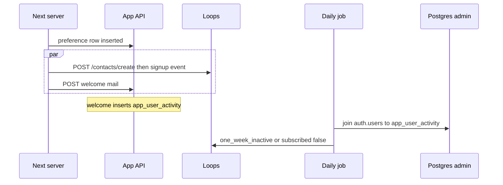

# Loops contacts, signup events, and inactivity

Loops is the campaign tool. The app keeps the clock. A contact is created once, from the server, with `email`, `userId`, `source`, and `subscribed`. Later jobs send events or set `subscribed` to false. The browser never sees `LOOPS_API_KEY`.

The API origin is `https://app.loops.so/api/v1`. Authorize with `Authorization: Bearer <LOOPS_API_KEY>` and `Content-Type: application/json`. Official rate limit on these routes is 10 requests per second per team. HTTP 429 means back off. `POST /events/send` accepts an `Idempotency-Key` header of at most 100 characters. Reusing that key inside 24 hours returns 409.



## HTTP client

Missing key on the web tier skips the call and logs a warning. It does not throw, and it does not block the redirect. The daily job treats a missing key as a hard failure so a silent skip cannot look like a successful scan.

```ts
const LOOPS_API = "https://app.loops.so/api/v1"

type LoopsResult = { ok: true } | { ok: false; status: number; body: string }

async function loops(
  path: string,
  method: "POST" | "PUT",
  body: Record<string, unknown>,
  extraHeaders: Record<string, string> = {},
): Promise<LoopsResult> {
  const apiKey = process.env.LOOPS_API_KEY?.trim() ?? ""
  if (!apiKey) {
    console.warn("LOOPS_API_KEY is not set; skipping CRM call", path)
    return { ok: false, status: 0, body: "missing api key" }
  }
  const response = await fetch(`${LOOPS_API}${path}`, {
    method,
    headers: {
      Authorization: `Bearer ${apiKey}`,
      "Content-Type": "application/json",
      ...extraHeaders,
    },
    body: JSON.stringify(body),
    cache: "no-store",
  })
  if (!response.ok) {
    return { ok: false, status: response.status, body: await response.text() }
  }
  return { ok: true }
}
```

Report a failure to the error tracker at warning, with the action name, the status, and at most 500 characters of the body. Do not attach the bearer token.

`POST /contacts/create` returns 200 with `{ success, id }`. 409 means that email or `userId` already exists. 400 is a bad address. `PUT /contacts/update` upserts: the current OpenAPI says a missing contact is created and does not list 404. Identify the contact with `email` or `userId`. Sending both updates the field that did not match.

`POST /events/send` takes `email`, `eventName`, and in this app also `userId`. 409 on an idempotency key means the event was already accepted. Treat that 409 as success.

## Signup

Run provisioning only when this request inserted the per-user preference row (`user_id` is the primary key, so one insert wins). Trim the email. An empty email returns without calling Loops or the mailer.

```ts
export async function provisionNewUser(input: {
  userId: string
  email?: string | null
}): Promise<void> {
  const email = input.email?.trim()
  if (!email) return
  const results = await Promise.allSettled([
    subscribeNewUser({ email, userId: input.userId }),
    sendWelcomeEmail(input.userId, email),
  ])
  for (const result of results) {
    if (result.status === "rejected") {
      console.error("New-user CRM provisioning failed", result.reason)
    }
  }
}
```

`Promise.allSettled` keeps a mail failure from cancelling the contact write, and the other way around. Swallow the rejection in this function. The dashboard seed must still render.

```ts
const contact = {
  email: input.email,
  userId: input.userId,
  source: "signup",
  subscribed: true,
}

const created = await loops("/contacts/create", "POST", contact)
if (!created.ok && created.status !== 409) {
  report("subscribe_create", created)
  return
}
if (!created.ok) {
  const updated = await loops("/contacts/update", "PUT", contact)
  if (!updated.ok) {
    report("subscribe_update", updated)
    return
  }
}

const event = await loops(
  "/events/send",
  "POST",
  { email: input.email, userId: input.userId, eventName: "signup_completed" },
  { "Idempotency-Key": `signup_completed:${input.userId}`.slice(0, 100) },
)
if (!event.ok && event.status !== 409) report("signup_completed", event)
```

Send `signup_completed` only after create or update succeeded. A 409 from create is the cue to update. A 400 is not. The reference updates on every create failure, including a missing key, which then fails the same way a second time.

The reference does not send `Idempotency-Key`. Add it. A 409 from that header is success.

The reference fires this once, from the preference-insert flag. A failed call is only logged, and the next dashboard load does not retry because the row already exists. Record `crm_contacted_at` on `app_user_activity` after a successful subscribe, and call again while that column is null. The event key makes the retry safe inside 24 hours. After 24 hours the column is what stops a second campaign email.

Welcome mail is a separate HTTP call (`azure-communication-email`). It returns 200 even when delivery fails. That call is also what inserts the activity row below. If it never runs, the daily scan cannot see the user.

## Activity clock

```sql
CREATE TABLE app_user_activity (
  user_id uuid PRIMARY KEY,
  last_activity_at timestamptz NOT NULL,
  crm_subscribed boolean NOT NULL DEFAULT true
);
CREATE INDEX app_user_activity_last_activity_at_idx
  ON app_user_activity (last_activity_at);
```

Enable RLS. Grant nothing to `authenticated`. The request role `app_api` writes this table. It has no grant on `auth.users`.

Signup insert, from the welcome handler, when the JWT subject is present:

```python
await AppUserActivity.objects.aget_or_create(
    user_id=user_id,
    defaults={"last_activity_at": timezone.now(), "crm_subscribed": True},
)
```

`aget_or_create` applies `defaults` only on insert. A retried welcome does not move a timestamp that an item save already wrote.

Item create and item update call `aupdate_or_create` with `defaults={"last_activity_at": now}` and do not pass `crm_subscribed`, so an unsubscribe flag stays false. Log and ignore a failure there. The save itself still succeeds. Soft-delete does not touch the row. `last_activity_at` stays at signup time until the first save.

## Daily scan (P31)

The scan reads email from `auth.users`. `app_api` cannot. Open a short-lived admin connection (`SUPABASE_DB_ADMIN_USER`, `SUPABASE_DB_ADMIN_PASSWORD`, `SUPABASE_DB_ADMIN_HOST`, `SUPABASE_DB_ADMIN_PORT`, `SUPABASE_DB_NAME`). Require the host. The reference defaults the host when the env var is unset. Do not ship that default.

```python
def connect_kwargs() -> dict:
    sslmode = os.environ.get("SUPABASE_DB_SSLMODE", "verify-full")
    kwargs = {
        "dbname": os.environ.get("SUPABASE_DB_NAME", "postgres"),
        "user": os.environ["SUPABASE_DB_ADMIN_USER"],
        "password": os.environ["SUPABASE_DB_ADMIN_PASSWORD"],
        "host": os.environ["SUPABASE_DB_ADMIN_HOST"],
        "port": os.environ.get("SUPABASE_DB_ADMIN_PORT", "5432"),
        "sslmode": sslmode,
        "connect_timeout": 10,
        "row_factory": dict_row,
    }
    cert = os.environ.get("SUPABASE_DB_SSLROOTCERT", "")
    if sslmode in ("verify-ca", "verify-full"):
        if not cert or not Path(cert).is_file():
            raise RuntimeError("SUPABASE_DB_SSLROOTCERT is missing")
        kwargs["sslrootcert"] = cert
    return kwargs
```

The reference defaults the port to `5432`. That is the session pooler. The request path uses the transaction pooler on `6543` (`dramatiq-redis-workers`). This job holds a connection across statements and then writes the flag on a second connection, so it stays on the session pooler. `sslmode` defaults to `verify-full`. The reference attaches the CA only when the file already exists, and otherwise still connects. Fail at startup when the file is missing.

The admin login is the database owner, used by the timer only. The request process stays on `app_api`.

```sql
-- 7-day slice. One day wide, so a missed run never emits the event.
SELECT u.id::text AS user_id, u.email
FROM auth.users u
JOIN app_user_activity a ON a.user_id = u.id
WHERE u.email IS NOT NULL
  AND u.email <> ''
  AND a.crm_subscribed = true
  AND a.last_activity_at < NOW() - INTERVAL '7 days'
  AND a.last_activity_at >= NOW() - INTERVAL '8 days';

-- 14-day tail. Open-ended, so a missed day retries.
-- Paying means status active or trialing and current_period_end still ahead.
SELECT u.id::text AS user_id, u.email
FROM auth.users u
JOIN app_user_activity a ON a.user_id = u.id
WHERE u.email IS NOT NULL
  AND u.email <> ''
  AND a.crm_subscribed = true
  AND NOT EXISTS (
    SELECT 1 FROM app_subscriptions s
    WHERE s.user_id = u.id::text
      AND s.status IN ('active', 'trialing')
      AND s.current_period_end > NOW()
  )
  AND a.last_activity_at < NOW() - INTERVAL '14 days';
```

The 7-day query does not exclude paying users. The 14-day query does. `user_id` on the subscription table is text. `auth.users.id` is uuid. Cast in the SQL.

Read both result sets, close that connection, then talk to Loops with an `httpx.Client(timeout=20.0)`. Sleep 0.2 seconds after each user (5 requests per second, under the 10 per second cap). On 429, back off and retry. The reference counts 429 as a failure and does not read `x-ratelimit-remaining`.

For each 7-day row, `POST /events/send` with `eventName` `one_week_inactive` and `Idempotency-Key` `one_week_inactive:{user_id}:{activity_date}` truncated to 100 characters. The date in the key lets a later idle spell send again. The same calendar day returns 409, which is success. The reference sends no key, so a second run the same day sends the event twice. There is no local "already sent" column.

For each 14-day row, `PUT /contacts/update` with `subscribed: false`. Only after that returns success:

```sql
UPDATE app_user_activity
SET crm_subscribed = false
WHERE user_id = %(user_id)s::uuid
```

Commit that update on its own connection. A later user's failure must not roll back earlier flags. If Loops fails, leave `crm_subscribed` true so the next run retries.

If `failed` is non-zero, raise after the loop. Per-user exceptions are counted and logged with the user id, not the email body. A missing `LOOPS_API_KEY` raises before the HTTP client is built, after the SQL has already run.

The timer runs the CRM job and the deletion job in separate `try` blocks. A CRM exception is recorded, deletion still runs, and the function raises at the end if either name is in the error list. One failed job must not skip the other. The schedule itself belongs to the timer module. This window assumes one successful scan per day.

> NOTE: whether a failed timer invocation is retried before the next schedule is host behavior. This function only raises. The idempotency key is what makes a second call the same day safe.

## Env

| Name | Where |
| --- | --- |
| `LOOPS_API_KEY` | Next server and the timer. Empty on the server skips signup. Empty on the timer fails the scan. |
| `SUPABASE_DB_ADMIN_USER` | Timer. Required. |
| `SUPABASE_DB_ADMIN_PASSWORD` | Timer. Required. |
| `SUPABASE_DB_ADMIN_HOST` | Timer. Required. No default host. |
| `SUPABASE_DB_ADMIN_PORT` | Timer. Session pooler, normally `5432`. |
| `SUPABASE_DB_NAME` | Timer. Default `postgres`. |
| `SUPABASE_DB_SSLMODE` | Timer. Default `verify-full`. |
| `SUPABASE_DB_SSLROOTCERT` | Timer. PEM path. Required when the mode verifies the chain. |

Create the Loops events `signup_completed` and `one_week_inactive` in the project before the first send. The API will accept a send for an event name that has no workflow. The campaign then does nothing.

## Setup

1. Create the Loops events `signup_completed` and `one_week_inactive`, and the workflows that should send mail for them.
2. Set `LOOPS_API_KEY` on the Next server and on the timer. Leave it out of any `NEXT_PUBLIC_` name.
3. Create `app_user_activity` with RLS on and no `authenticated` grant. Confirm `app_api` can insert and update it.
4. Call `provisionNewUser` only from the server, after the preference row is first inserted, and retry while the contact has not been recorded.
5. Insert the activity row from the welcome handler with `get_or_create`. Move `last_activity_at` on item create and update only.
6. Put `SUPABASE_DB_ADMIN_*` on the timer. Require the host and the CA file. Do not give those variables to the request process.
7. Run the scan once a day, then the deletion job, and raise if either failed.

## Failure prevention

- **P31.** Join `auth.users` only on the admin connection, over TLS, from the timer. Signup and item-save writes stay on `app_api`. Do not grant `app_api` access to `auth.users`.
- Require `SUPABASE_DB_ADMIN_HOST`. Do not default it to a pooler hostname baked into the image.
- Fail startup when `verify-full` or `verify-ca` is set and the CA file is missing.
- Skip signup CRM when the key or the email is empty. Raise on the timer when the key is empty.
- On create, branch on 409. Do not send the event if the contact write failed.
- Send `Idempotency-Key` on events. Treat 409 from that header as success.
- Set `crm_subscribed = false` only after the unsubscribe PUT succeeds.
- Stay under 10 requests per second. Retry 429. The reference sleeps 0.2 seconds and does not retry.
- Keep the API key out of logs, client bundles, and `NEXT_PUBLIC_` names.
- Retry a failed signup. The preference-insert flag does not.

## Tests

Assert the 7-day SQL reads `app_user_activity` and `auth.users`, filters `crm_subscribed`, and uses both the 7-day and 8-day intervals. It must not query the item table or a sign-in timestamp.

Assert the 14-day SQL requires `crm_subscribed`, excludes `active` and `trialing` rows whose `current_period_end` is still ahead, and uses a 14-day interval.

Assert the event name is `one_week_inactive`. Assert a missing web key returns status 0 and does not throw. Assert create 409 falls through to update, create 400 does not send the event, and event 409 with an idempotency key is success.

Assert the unsubscribe UPDATE runs only after a successful PUT, on its own connection.

## Checklist

- [ ] `LOOPS_API_KEY` is set on the server and on the timer, and is absent from the browser bundle.
- [ ] Loops has workflows for `signup_completed` and `one_week_inactive`.
- [ ] Signup uses create, then update only on 409, then the signup event with an idempotency key.
- [ ] Provisioning is retried until the contact write succeeds, and a failure does not block sign-in.
- [ ] `app_user_activity` has no `authenticated` grant. Item save moves `last_activity_at` and leaves `crm_subscribed` alone. Delete does not move the clock.
- [ ] The daily scan uses `SUPABASE_DB_ADMIN_*` with `verify-full` and a CA file. The host is required.
- [ ] The 7-day window is one day wide. The 14-day unsubscribe is open-ended and skips paying users.
- [ ] `crm_subscribed` flips false only after Loops accepts the unsubscribe.
- [ ] A CRM failure still lets the deletion job run, and the function raises if either job failed.
