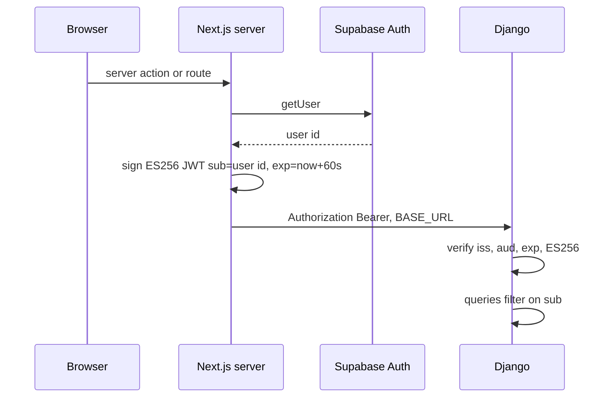

# Short-lived ES256 tokens from the web server to the API

The browser talks to Next.js. Next.js talks to Django. Django never trusts a user id from a JSON body, a query string, or a cookie. It trusts `request.user_id`, which the first middleware sets from a verified JWT `sub`.

`supabase-rls-client-reads` gives the API role a policy of `USING (TRUE)`. This token is the only thing that scopes those queries. `supabase-magic-link-auth` is what produces the Supabase user id that goes into `sub`. Call `getUser()` in the same request that signs the token.

Libraries: `jose` on the Next server (`importPKCS8`, `SignJWT`), `PyJWT` with the crypto extra on Django (`pyjwt[crypto]`). Algorithm is `ES256` only. Lifetime is 60 seconds. No clock leeway is configured.

## Architecture



A second subject, `M2M_SERVICE_SUBJECT`, is a stable non-user string (default `web-service`). It is signed the same way. It is only for shared catalog reads whose handler ignores `request.user_id`. It is not an admin override. A handler that parses `sub` as a UUID returns 400 for it.

## Environment and constants

| Name | Process | Notes |
| --- | --- | --- |
| `M2M_JWT_PRIVATE_KEY` | Next.js server only | PKCS#8 PEM for the ES256 private key. |
| `M2M_JWT_PUBLIC_KEY` | Django | Matching public key. Required when `DJANGO_DEBUG` is false. |
| `M2M_SERVICE_SUBJECT` | Next.js server | Optional. Default `web-service`. Never a person's id. |
| `BASE_URL` | Next.js server | API origin. Local default `http://localhost:8000`. |
| `DJANGO_DEBUG` | Django | `false` in any shared environment. Boot checks run only then. |

Issuer and audience are constants, not environment variables. Both processes must use the same pair. Example values: issuer `web`, audience `api`. The verifier passes them into `jwt.decode` as `issuer` and `audience`.

Generate a P-256 pair and store the PKCS#8 private key and the public key in the secret store:

```bash
openssl ecparam -name prime256v1 -genkey -noout -out private.pem
openssl pkcs8 -topk8 -nocrypt -in private.pem -out private.pkcs8.pem
openssl ec -in private.pem -pubout -out public.pem
```

Secret files often store PEM as one line with the two-character sequence `\n`. Both sides restore real newlines before import:

```ts
function normalizePem(pem: string): string {
  return pem.includes("\\n") ? pem.replace(/\\n/g, "\n") : pem
}
```

The same replace runs in Django when it reads `M2M_JWT_PUBLIC_KEY`. Never put the private key in a `NEXT_PUBLIC_` variable, a cache key, a log line, or the browser.

## Signing

Cache the imported `CryptoKey` in module scope. Reject a blank subject. `sub` is the only custom claim. `iat` and `exp` are unix seconds. `exp` is `iat + 60`.

```ts
import { SignJWT, importPKCS8 } from "jose"

const ISSUER = "web"
const AUDIENCE = "api"
let cached: CryptoKey | null = null

async function privateKey(): Promise<CryptoKey> {
  if (cached) return cached
  const raw = process.env.M2M_JWT_PRIVATE_KEY ?? ""
  if (!raw.trim()) throw new Error("M2M_JWT_PRIVATE_KEY is not configured")
  cached = await importPKCS8(normalizePem(raw.trim()), "ES256")
  return cached
}

export async function signServiceJwt(subject: string): Promise<string> {
  if (!subject.trim()) throw new Error("subject is required")
  const now = Math.floor(Date.now() / 1000)
  return new SignJWT({ sub: subject })
    .setProtectedHeader({ alg: "ES256" })
    .setIssuer(ISSUER)
    .setAudience(AUDIENCE)
    .setIssuedAt(now)
    .setExpirationTime(now + 60)
    .sign(await privateKey())
}

export function serviceSubject(): string {
  return process.env.M2M_SERVICE_SUBJECT?.trim() || "web-service"
}
```

Call `signServiceJwt` with `user.id` from `getUser()` (`supabase-magic-link-auth`). Extra headers that describe the account, such as when the Auth user was created, are copied from that user object in the same server call. They are not taken from the browser form.

```ts
export async function apiHeaders(userId: string): Promise<Record<string, string>> {
  return {
    "Content-Type": "application/json",
    Authorization: `Bearer ${await signServiceJwt(userId)}`,
  }
}
```

`BASE_URL` is joined with a path that already starts with `/`. On a non-2xx response, throw with the status code. Leave the response body out of a message that might be shown to the user when it could echo upstream text. Log the status server-side.

Cache keys use the user id, or no argument for a shared catalog. Sign the token inside the cached function, on a miss. Passing the bearer string in as an argument would put a 60-second secret in the cache key.

```ts
export async function cachedSharedCatalog() {
  "use cache"
  return apiGet(serviceSubject(), "/api/catalog/shared/")
}

export async function cachedItems(userId: string) {
  "use cache"
  return apiGet(userId, "/api/items/")
}
```

## Verifying

Django middleware order:

1. JWT middleware. Sets `request.user_id` and `request.request_id`.
2. Rate limit. The key includes `user_id`, so this runs second.
3. Security headers.
4. CORS, then `CommonMiddleware`.

DRF does not authenticate. `UNAUTHENTICATED_USER` and `UNAUTHENTICATED_TOKEN` are `None`. `DEFAULT_AUTHENTICATION_CLASSES` is empty. `DEFAULT_PERMISSION_CLASSES` is `AllowAny` because the middleware already rejected anonymous calls. `AllowAny` does not make a route public.

The middleware is dual sync/async: if `get_response` is a coroutine function, the inner middleware is `async`. Bind a request id (`X-Request-ID`, or a new UUID) and clear the log context in `finally`.

Exempt paths, and only these in production: `/health/`, `/`, and the signature-verified billing webhook `/api/webhooks/stripe/`. Test settings may add a schema path. Production does not.

Matching rules:

- `path == "/"` is exempt. A `startswith("/")` check would exempt every route.
- For every other entry, strip one trailing slash and match the path exactly or as a prefix plus `/`.

On an exempt path set `request.user_id = None` and call the view. Everywhere else:

| Condition | Status | Body `error` |
| --- | --- | --- |
| No `Authorization` header | 401 | No authentication token provided |
| Header does not start with `Bearer ` | 401 | Invalid authentication header format |
| Empty token after the prefix | 401 | Empty authentication token |
| Public key not configured | 500 | Authentication is not configured |
| Expired | 401 | Token has expired |
| Bad signature, issuer, audience, or algorithm | 401 | Invalid authentication token |
| No `sub` and no `user_id` claim | 401 | Token missing user identifier |

Decode with the public key, `algorithms=["ES256"]`, and the expected audience and issuer. Read `sub`, then `user_id` if `sub` is absent. Store `str(user_id)` on the request. Log the failure class on the server. Do not log the bearer value. Return the generic 401 for invalid tokens so the client cannot tell signature failures from claim failures.

When `DJANGO_DEBUG` is false, refuse to boot if `M2M_JWT_PUBLIC_KEY` is missing, if `DJANGO_SECRET_KEY` is the insecure default, if `DJANGO_ALLOWED_HOSTS` contains `*`, or if `CORS_ALLOWED_ORIGINS` is empty. Browsers do not call Django. The Next server does. The origin list only closes accidental cross-origin browser calls. An empty list on a laptop allows all origins. A deployed process must set the list.

## Using the subject

**P13.** Exempt routes set `request.user_id` to `None`. `UUID(None)` raises `TypeError` and becomes a 500 if the view does not catch it. Keep the exempt list to health checks and signature-verified webhooks. Any handler that needs a user id stops when the id is missing, and catches `TypeError` and `ValueError` from `UUID()`.

```python
from uuid import UUID

def require_user_uuid(request):
    raw = getattr(request, "user_id", None)
    if not raw:
        return None  # caller returns 401
    try:
        return UUID(str(raw))
    except (TypeError, ValueError):
        return "invalid"  # caller returns 400
```

Three handler shapes:

- User-scoped. Require a UUID. Filter every query with it: `Item.objects.filter(user_id=user_uuid)`.
- Shared catalog. Do not read `request.user_id`. Both a user token and the service subject may call it. The response is the same catalog.
- Optional personalization. Call `UUID` only inside `if user_id:`. A non-UUID string, including the service subject, is 400. Do not send the service subject to this route.

**P14.** RLS does not authorize Django. If the body contains `user_id`, it has to equal `str(request.user_id)` or the response is 403. Writes use the request subject:

```python
if str(payload_user_id) != str(request.user_id):
    return JsonResponse({"error": "Cannot act for another user"}, status=403)
await Item.objects.acreate(user_id=user_uuid, title=payload["title"])
```

Lookups include the subject in the same query (`id=item_id, user_id=user_uuid`), so a foreign id 404s instead of returning the row.

The service subject is for `cachedSharedCatalog` above. Sending it to a user-scoped route yields 400, not that user's data.

## Rate limit

Runs after JWT auth. Defaults: enabled, 100 requests per 60 seconds, burst 20 in one second. Exempt the same paths as auth, with the same `/` exact-match rule.

Async (ASGI) uses Redis. Sync (dev WSGI) uses a per-process sliding window. Both fail open: a Redis error or an empty `REDIS_URL` allows the request. A limiter must not take the API down.

Client IP is `TRUSTED_PROXY_COUNT` hops from the right of `X-Forwarded-For` (default 1). Values an attacker prepends sit to the left and are ignored. If the header is missing, use `REMOTE_ADDR`. The Redis key is the SHA-256 of `ip:user_id` when `user_id` is set, otherwise the hash of the IP alone.

One Lua script increments a window key and a burst key and sets each TTL only on the first increment:

```lua
local w = redis.call('INCR', KEYS[1])
if w == 1 then redis.call('EXPIRE', KEYS[1], ARGV[1]) end
local b = redis.call('INCR', KEYS[2])
if b == 1 then redis.call('EXPIRE', KEYS[2], ARGV[2]) end
return {w, b}
```

Window key `rl:w:{hash}:{int(now // 60)}`, TTL 61 seconds. Burst key `rl:b:{hash}:{int(now)}`, TTL 2 seconds. Burst over 20 returns 429 with `Retry-After: 1`. Window over 100 returns 429 with `Retry-After` set to the seconds left in the window. Add `X-RateLimit-Limit` on responses that pass.

## Response headers

On every API response, if the header is not already set: `Content-Security-Policy` of `default-src 'none'; frame-ancestors 'none'; base-uri 'none'; form-action 'none'`, `X-Content-Type-Options: nosniff`, `X-Frame-Options: DENY`, `Referrer-Policy: strict-origin-when-cross-origin`, and a `Permissions-Policy` that disables camera, microphone, geolocation, and payment. Delete a `Server` header. Echo `X-Request-ID`.

Paths that return user content (`/api/items` and similar) get `Cache-Control: no-store, no-cache, must-revalidate, private` when the view did not set one, plus `Pragma: no-cache` and `Expires: 0`.

HTTPS redirect and HSTS sit on the edge proxy, not in Django.

## Tests

Use a generated key pair in the test process. Do not commit it.

- A token signed with the private key verifies, and `request.user_id` equals the subject.
- Expired token, wrong issuer, wrong audience, and a token with `alg` other than ES256 each return 401 and do not call the view.
- Missing header, non-bearer scheme, and empty bearer return 401.
- A payload with no subject returns 401.
- `/health/` and `/` set `user_id` to `None` and return the health body. A handler given `None` returns 401 and does not call `UUID`.
- `UUID("not-a-uuid")` path returns 400, not 500.
- Body `user_id` different from `sub` returns 403. Matching id creates a row with that `user_id`.
- A second user's item id returns 404 for the first user's token.
- Service subject on the shared catalog returns 200. The same token on a UUID-scoped route returns 400.
- A cached function's argument list is the user id or empty. It does not contain the bearer string.
- With `DJANGO_DEBUG` false, an empty public key raises at startup.

## Checklist

- [ ] Private key is only on the Next server. Public key is on the API. Both PEMs restore escaped newlines.
- [ ] Issuer, audience, and `ES256` match on both sides. Lifetime is 60 seconds.
- [ ] `getUser()` runs in the same request that signs, and `sub` is that user id.
- [ ] Cache arguments are user ids. The token is signed inside the cached function.
- [ ] JWT middleware is first. Exempt paths are health, `/`, and the signature-verified webhook.
- [ ] `/` is an exact match. Views reject a missing id before `UUID()` (P13).
- [ ] Queries and creates use `request.user_id`. A body user id that differs is 403 (P14).
- [ ] Service subject is only sent to handlers that do not parse `sub` as a UUID.
- [ ] `DJANGO_DEBUG` false refuses to boot without the public key, and CORS is an explicit list.
- [ ] Rate limit runs after auth, fails open, and takes the client IP from the right of `X-Forwarded-For`.
