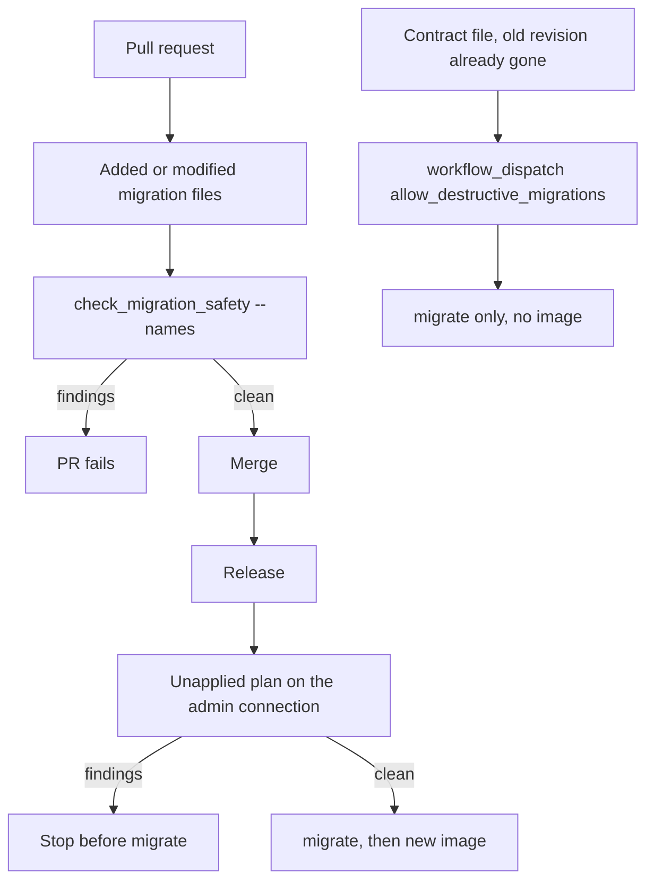

# Expand-only migration checks before deploy

Migrate runs before the new image. During a rollout the previous revision is still serving. That process selects and writes the columns it was built with. An additive change is safe to apply first. A drop or a rename is not: the old code breaks as soon as the column is gone.

Ship those in two steps. The release that still has old and new revisions running applies only expand migrations, then starts the new revision. After that revision is the only one serving, a later migrate applies the contract. The contract job does not build an image.



Django plans migrations from dependency names and applied records in `django_migrations`; those records do not checksum a file's contents. Editing a recorded file does not rerun its new SQL. Losing records can instead replay table creation against existing tables (P11). The checker does not compare live schema or prove history equivalence. The layout and transition checks below address that separate problem.

## What the checker flags

A finding is a contract change. Everything else is allowed through, including `AddField`.

| Operation | Finding |
| --- | --- |
| `RemoveField` | `RemoveField model.field` |
| `RenameField` | `RenameField model.old -> new` |
| `DeleteModel` | `DeleteModel name` |
| `RenameModel` | `RenameModel old -> new` |
| `AlterModelTable` | `AlterModelTable name -> table` |
| `AlterField` | Only when the previous field is null, the new field is not null, and `default` is `NOT_PROVIDED` |
| `RunSQL` | When the SQL matches `DROP TABLE`, `DROP COLUMN`, `RENAME COLUMN`, or `RENAME ... TO` |
| `SeparateDatabaseAndState` | The same checks on `database_operations` only |
| Backwards plan | `backwards/unapply plan is not supported` |

`RunSQL` is tested with this pattern, case-insensitive:

```text
\bDROP\s+(TABLE|COLUMN)\b|\bRENAME\s+(COLUMN\b|TO\b)
```

`GRANT`, `CREATE INDEX`, and `ALTER TABLE ... ADD COLUMN` do not match. A comment or string that contains `RENAME TO` does match. `DROP INDEX`, `DROP CONSTRAINT`, `RunPython`, and `RemoveIndex` are not flagged. Read those by hand. A data migration that deletes rows will pass.

`AlterField` with no previous state returns no finding. The pull-request path replays disk ancestors so the null flag is visible. The release path starts from the applied project state and mutates it as it walks the plan. If the ancestor is not on disk, the NOT NULL tightening is silent.

State-only operations inside `SeparateDatabaseAndState` are ignored. That is right when the database operation is the one that matters. A `RemoveField` placed only in `state_operations` is invisible to the checker and still wrong for the live schema.

```python
def findings_for_operation(op, *, app_label: str, state=None) -> list[str]:
    if isinstance(op, SeparateDatabaseAndState):
        found: list[str] = []
        for inner in op.database_operations:
            found.extend(findings_for_operation(inner, app_label=app_label, state=state))
        return found
    if isinstance(op, RemoveField):
        return [f"RemoveField {op.model_name}.{op.name}"]
    if isinstance(op, RenameField):
        return [f"RenameField {op.model_name}.{op.old_name} -> {op.new_name}"]
    if isinstance(op, DeleteModel):
        return [f"DeleteModel {op.name}"]
    if isinstance(op, RenameModel):
        return [f"RenameModel {op.old_name} -> {op.new_name}"]
    if isinstance(op, AlterModelTable):
        return [f"AlterModelTable {op.name} -> {op.table}"]
    if isinstance(op, AlterField):
        old = _old_field(state, app_label, op.model_name, op.name)
        if old is None:
            return []
        new = op.field
        if getattr(old, "null", True) and not new.null and new.default is NOT_PROVIDED:
            return [f"AlterField {op.model_name}.{op.name} to NOT NULL without a default"]
        return []
    if isinstance(op, RunSQL) and _DROP_OR_RENAME_SQL.search(_sql_as_text(op.sql)):
        return ["RunSQL with DROP TABLE/COLUMN or RENAME"]
    return []
```

`_old_field` looks up `(app_label, model_name.lower())` in `state.models`, then `fields[field_name]`. A missing state, model, or field returns `None`.

`_sql_as_text` accepts a string, or a list of strings, or Django's `(sql, params)` pairs. It joins those with newlines before the regex runs.

The report lists every finding and tells the author to keep additive changes in the migrate-then-deploy release, and to put the drop in a follow-up after the new code is the only running revision. `--allow-destructive` prints that report and exits 0. It does not skip migrate. Without the flag the command raises `CommandError` and the job stops.

## Pull request

The workflow triggers on pull requests to `main`. The migration job checks out with `fetch-depth: 0` and fetches the base SHA again. Python is 3.13, the same as the API, not the function app's 3.11.

It does not start a database. `--names` imports the modules and replays ancestors with `MigrationLoader(connection=None)`.

```bash
git fetch --no-tags origin "$BASE_SHA"
mapfile -t files < <(
  git diff --name-only --diff-filter=AM "$BASE_SHA...HEAD" -- '**/migrations/*.py'
)
names=()
for f in "${files[@]}"; do
  base="$(basename "$f" .py)"
  if [ "$base" = "__init__" ]; then
    continue
  fi
  app="${f%%/*}"
  names+=("${app}.${base}")
done
if [ "${#names[@]}" -eq 0 ]; then
  echo "No migration files added or changed."
  exit 0
fi
python manage.py check_migration_safety --names "${names[@]}"
```

`app="${f%%/*}"` is correct only when the file is `{app_label}/migrations/{name}.py`. A nested path takes the wrong label. `--diff-filter=AM` is added and modified. A rename can show up as `R` and skip the check. Do not rename an applied migration. Deleting a file is not inspected; removing an applied file does not drop the column. A dangling dependency breaks the graph, while a rewritten graph can load and still omit necessary work on existing databases.

`--names items.0008_add_flag` splits on the first dot, imports `{app_label}.migrations.{name}`, and constructs `Migration(name, app_label)`. The ancestor walk skips dependency markers `__setting__`, `__first__`, and `__latest__`, replays the rest into a `ProjectState`, and passes that state in. A spec with no dot is a command error.

Settings for this job are the test settings module. That import does not open Postgres for `--names`. Supply a throwaway `FIELD_ENCRYPTION_KEY` when the settings module requires one to boot. Do not reuse a production key. Do not commit a key into the workflow as a real secret; the reference job uses a fixed test value because this path never connects.

The reference tests run this command on the table snapshot and on the RLS migration. Both print `No destructive migrations.`

## Release

CD runs on a published GitHub Release, and on `workflow_dispatch`. The dispatch input `allow_destructive_migrations` is a boolean, default false. The migrate job always runs, in the `production` environment. The image build and the container update are `if: github.event_name == 'release'`, so dispatch migrates and does not deploy.

```bash
EXTRA=""
if [ "$ALLOW_DESTRUCTIVE" = "true" ]; then
  EXTRA="--allow-destructive"
fi
python manage.py check_migration_safety $EXTRA
python manage.py migrate --noinput
python manage.py check --deploy
python manage.py setup_langgraph_persistence
```

On a release, `github.event.inputs.allow_destructive_migrations` is empty, so `EXTRA` stays empty. A destructive file in the unapplied plan fails the release before `migrate`. Dispatch maps the input `true` to `--allow-destructive`.

Without `--names`, the command uses `MigrationExecutor` against the connected database:

1. `migration_plan` of the leaf nodes.
2. Project state of the already applied nodes. Applied history is not re-checked. A `RemoveField` that is already in `django_migrations` does not fail this run.
3. For each forwards migration, collect findings, then `mutate_state`.
4. A backwards entry is a finding and does not mutate state.

### Admin connection for migrate

Runtime uses `app_api`. Migrate uses the admin login, and only when `SUPABASE_DB_ADMIN_USER` is set. If that variable is set, the password is `SUPABASE_DB_ADMIN_PASSWORD`, the host is `SUPABASE_DB_ADMIN_HOST`, and the port is `SUPABASE_DB_ADMIN_PORT`. If the user is set and the port is omitted, production settings use `6543`. That is the transaction pooler. This job sets the port to `5432` (session pooler). DDL and the LangGraph setup command need that session. Set the port in the workflow every time.

Do not take the admin password when the admin user is unset. That pairs `app_api` with the admin secret. The workflow sets `SUPABASE_DB_PASSWORD` to the same secret while the admin user is selected, so either name resolves. It does not put the admin password on the running container.

The direct database host may be IPv6-only. Set `SUPABASE_DB_ADMIN_HOST` to the session pooler. Do not copy a project ref or a hostname into the module, the image, or a public workflow if you can pass them as environment values. The reference workflow inlines the user and the host and stores the password as a secret. Keep the password as a secret either way.

`sslmode` is `verify-full` when `SUPABASE_DB_ADMIN_SSLMODE` is unset. The CA file is the provider root bundled with the API, applied when the mode is `verify-ca` or `verify-full`. `statement_timeout` on that Django connection is 30 seconds. `CONN_MAX_AGE` is 0.

Production settings require `DJANGO_SECRET_KEY` and `M2M_JWT_PUBLIC_KEY` at import, `DEBUG` false, and no wildcard host. The migrate job sets those two secrets. It does not set `FIELD_ENCRYPTION_KEY`. Base settings are imported while `DEBUG` is still true, so the debug-off guard in the base module does not run on this path. Production then applies its own guards. Do not add the field key to this job unless a command actually encrypts.

`setup_langgraph_persistence` is the graph-table command in `langgraph-postgres-persistence`. It is not a Django migration. It runs as the admin role and then grants `app_api`. A failed safety check never reaches it.

## File layout and history transitions (P11)

Keep applied history stable for ordinary releases: add a successor file rather than editing, deleting, or renaming a recorded migration. The current reference graph has **three files**, represented here by generic names:

| Order | Responsibility | Dependency |
| --- | --- | --- |
| `0001_extensions` | Extensions/schema, roles, auto-RLS/grant event trigger before tables | None in this app |
| `0002_tables` | Session search path, model creation with current fields/indexes/constraints, then conditional Realtime membership | File 1 |
| `0003_rls` | Client grants and policies after tables exist | File 2 |

The table snapshot now includes fields that previously arrived in later additive files: a boolean with `default=False`, stored counters with zero/null defaults, and indexed text labels with empty-string defaults. Those old files are absent. No `replaces` declaration or automatic transition operation accompanies this rewrite. It is a manually coordinated history transition; the current repository cannot prove which schema or records any deployed database has.

The publication SQL runs at the end of file 2, after the target table exists. It adds only that table when the provider publication exists and membership is absent; without that publication it is a no-op. Reverse SQL removes only that membership when present. Faking file 2 skips this SQL too, and a recorded old file 2 will not execute its newly appended SQL. Verify publication membership separately after any history transition. Client delivery and permissions are `supabase-realtime-postgres-changes`.

### Fresh install versus existing database

| Observed state | Consequence / next step |
| --- | --- |
| Empty database and no app history | Run the current three-file graph forward, then verify tables, indexes, RLS/grants and conditional publication membership |
| Old table migration already recorded | Django skips its edited contents; missing fields, indexes or publication membership need an explicit forward repair |
| Existing tables but missing migration records | Normal migrate may issue duplicate `CREATE TABLE`; stop and compare schema/history before changing records |
| Partially upgraded schema or legacy JSON-only labels | A fake cannot supply missing SQL or data work; complete reviewed repairs/backfill before declaring equivalence |

The removed label data migration used to copy JSON keys onto indexed columns while retaining the keys. Current table creation contains no `RunPython` replacement. It does not copy any existing JSON values, and creating a column with an empty default is not a backfill. The generic expand/backfill pattern and its tests are in `django-models-and-queries`.

### Transition procedure

1. Inventory every environment's running revisions, disk graph and applied records. Take a restorable schema/data/history backup and test restoration on a disposable clone. Preserve the old release artifact for comparison.
2. Inspect both old and new operations and dependencies. Compare actual tables, field types, defaults/nullability, indexes/constraints, extension schemas, roles/grants/policies, triggers and publication membership. Separately compare data postconditions such as populated label columns. Model state alone does not represent every `RunSQL` effect.
3. Prefer Django's staged squash workflow for a planned squash: ship replacement metadata alongside old files, upgrade every environment, then remove old files and update dependencies in a later release. The manual three-file reference rewrite does not implement that workflow. See [Django squashing migrations](https://docs.djangoproject.com/en/5.2/topics/migrations/#squashing-migrations).
4. Rehearse fresh install and each supported existing-history path on disposable databases. A matching final model state and a clean checker result are insufficient if SQL/data postconditions differ.
5. For a manual history alignment, define the exact per-environment record changes only after equivalence or required forward repairs are demonstrated. Serialize migration/deploy operations so another runner or an older artifact cannot use the interim history. Never erase the whole migration table as a general cleanup step.
6. Only then, if a specific unrecorded migration's effects already exist, an operator may mark that migration applied with `--fake`. Review its complete dependency plan first. Fake changes history without SQL; it must not skip missing grants, Realtime membership or a data backfill. There is no fake step in reference CI/CD. [Django migrate options](https://docs.djangoproject.com/en/5.2/ref/django-admin/#cmdoption-migrate-fake) distinguish fake history updates from execution; `--fake-initial` checks table names, not full schema equivalence.
7. Verify history, migration plan, actual schema/data and application reads/writes after alignment. Ship the matching code artifact. Rolling back to old migration files after their records were removed can attempt to add already-existing columns; a history transition needs its own tested recovery procedure.

Read-only review commands, using a generic app label and the chosen admin connection:

```bash
python manage.py showmigrations items --plan
python manage.py migrate items --plan
python manage.py sqlmigrate items 0002_tables
```

These commands explain the disk graph/planned SQL. An empty plan does not prove the live schema equals an edited file. The deployed database state was not inspected for this module.

## Contract follow-up

CI will fail a pull request that adds a drop. The release comment says to force-merge that follow-up only after the expand-compatible code is the only running revision, then run `workflow_dispatch` with `allow_destructive_migrations` true. That dispatch migrates. It does not push an image and it does not update the container app. If old code is still running, the flag is the wrong tool: the drop will break it, and the checker will only warn.

The hint string in the checker names the GitHub input `allow_destructive_migrations=true`. The management flag is `--allow-destructive`. The workflow is the translation.

## Tests

Hermetic, no database, against `findings_for_operation` and `check_migration_safety --names`:

- `RemoveField`, `DeleteModel`, and `RenameModel` each produce one finding.
- `AddField` with a default produces none.
- `AlterField` from `null=True` to `null=False` with no default produces one finding when state holds the old field.
- The same alter, when the old field is already `null=False`, produces none.
- `RunSQL` containing `DROP COLUMN` produces one finding. A `GRANT` produces none.
- `SeparateDatabaseAndState` whose database operation is `RemoveField` produces that finding.
- `--names` on the current table snapshot (including conditional publication SQL) and on the RLS migration prints `No destructive migrations.` That result is an operation check, not a history-transition certification.

Add a plan-path test the reference does not have: an unapplied `RemoveField` fails against a database that has not applied it, and the same migration is ignored once it is in `django_migrations`. A backwards plan entry is a finding.

For P11, add disposable-database acceptance tests beyond the reference unit suite: fresh three-file install; already-recorded old table migration with a missing new column; existing tables with missing history; absent/present publication and existing membership; preserved JSON labels needing a separate backfill. Assert real schema/data and membership, not just the recorded leaf. Verify that a fake skips all SQL and that replaying an old deleted additive migration would be unsafe after record removal. No deployed database repair is implied by these tests.

## Checklist

- [ ] Pull requests run `--names` on added and modified `{app}/migrations/*.py` files and fail on any finding.
- [ ] A release runs the unapplied plan as the admin role before `migrate`, with no allow flag.
- [ ] `SUPABASE_DB_ADMIN_USER` is set together with the admin password, the pooler host, and port `5432`.
- [ ] The admin password is not applied when the admin user is unset, and it is not an app setting on the API.
- [ ] `migrate` is followed by `check --deploy` and `setup_langgraph_persistence`.
- [ ] Expand files (add table, add column, NOT NULL with a default, grants, policies) go out with the new image.
- [ ] Drop, rename, and NOT NULL without a default wait until the new revision is the only one, then dispatch with the allow flag and no image update.
- [ ] Ordinary changes add successor files. Any squash/history transition has backups, per-environment schema/data/history comparison, clone rehearsal, serialized deploys, and a matching code artifact (P11).
- [ ] Fake is limited to verified existing effects; missing columns, labels, grants or publication SQL are repaired first. No blanket deletion of history or reliance on table names alone.
- [ ] The current graph has three files. Existing recorded files do not rerun new contents, and the removed label backfill is not claimed to execute.
- [ ] `RunPython`, `DROP CONSTRAINT`, and `DROP INDEX` are reviewed even though the checker allows them.
- [ ] `--allow-destructive` is absent on the release event.
