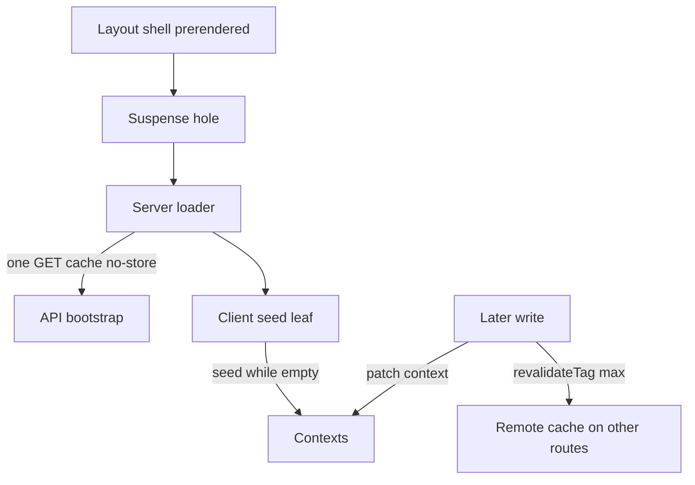

# One server load, then client context

The signed-in layout is a static shell plus one dynamic hole. The hole is a server component inside `<Suspense>`. It authenticates, calls the API once, and renders a client leaf that copies the payload into React context. Later writes patch that context. They do not render the layout again.

Cache rules, `revalidateTag`, and `updateTag` are `nextjs-cache-components`. The token on the API call is `m2m-jwt-service-auth`. The stored counter the home payload displays is `django-models-and-queries`.

## Architecture



The seed leaf is a sibling of the page content. It does not wrap the shell, so the shell can paint while the hole is still pending. The fallback is `null`.

## One uncached load

The loader awaits `cookies()` before it formats a timestamp. With cache components, `new Date()` during prerender needs an earlier uncached read, or the build clock is baked into the HTML (`nextjs-cache-components`, P20). A helper that catches every error returns a fallback only after `unstable_rethrow`, so the prerender bailout is not stored as an empty user.

When there is a user id, one `GET` hits the bootstrap route:

```ts
await fetch(`${baseUrl}/api/dashboard-bootstrap/`, {
  method: "GET",
  cache: "no-store",
  headers: await authHeaders(userId, {
    "X-Client-Local-Time": clientLocalTime,
    ...(createdAt ? { "X-User-Created-At": createdAt } : {}),
  }),
})
```

`cache: "no-store"` keeps this payload out of the host data cache. It is per-user and it changes on the next write. `baseUrl` comes from a server-only module (`BASE_URL`). It is not a `NEXT_PUBLIC_` variable, so the browser bundle does not contain the API origin.

The API builds one object. Each section has its own `try`. A failure logs and leaves that section empty or null. The others still return. Sections:

- Recent threads joined to their profile name and avatar. One row per profile, the latest thread.
- Unread notes.
- Preferences, via get-or-create. `preferences_created` is true only when this request inserted the row. A later seed must not treat that flag as a second signup.
- Entitlement, only when the request included the account created-at header. The status call receives the client-local timestamp.
- Latest acceptance version for the current legal document.
- A watch list: rows new enough to open a live socket, and a longer catch-up list that excludes those rows.
- Home counters: totals, the displayed streak, and the activity grid.

The web loader then reads the current legal document version from the shared cache (`versioned-legal-consent`) and maps the counter payload into the client shape. A missing payload becomes the empty counters, not a throw.

## Seed once

The leaf runs in an effect and calls each context's `seed`. Contexts that the browser mutates must ignore a later payload.

**P40.** Home counters use `prev ?? next`. The first payload fills empty state. A payload that arrives after the browser has already applied a write does not replace it. A new item bumps the count and copies the streak fields from that write's response. A delete replaces the totals and the activity grid and leaves the streak fields alone. A live note increments the comment total in the client. The day key is the stored clock's `YYYY-MM-DD` with the timezone label stripped (`django-models-and-queries`), so the client mark matches the grid the server built. A gap wider than one day is a display value computed on read. The client does not write that zero back.

**P35.** A theme chosen on this page must survive the seed. The picker sets a module-level flag. The leaf applies the stored theme only when that flag is false and a ref says this leaf has not applied one yet. A choice made before the effect runs is left alone. Applying the stored theme on every effect run flips the picker back.

Other seeds:

- The unread list is copied only while a ref says it has never been seeded. A later call still merges the watch lists and opens sockets. It does not replace notes the client already merged.
- Entitlement from the bootstrap is a fast fill. The provider then refetches with the browser's own clock, because usage windows are local days and the loader's timestamp was formatted on the server. Once that refetch settles, further seeds are ignored. If the refetch settles first, the seed is dropped so it cannot overwrite the browser-clock result.
- Identity is replaced on each seed. It is not a value the page edits.
- The recent-thread list is replaced on each seed. A later chat calls `reload()`, which fetches that list again. A second seed after `reload()` would put the old list back.

The legal-version seed assigns on every call. It does not keep a value the client already marked accepted. That is safe only while the loader runs once.

## Tabs

Do not fetch every panel on first paint, and do not fetch a panel by refreshing the layout.

On the long-form page, two panels mount only when their tab is selected. Unmounting them means the request runs at selection, and a hidden tab does not hold a request.

- The goals panel calls the goals server action for the selected status. Changing the status filter fetches again. The list is client state for that mount.
- The recommendations panel calls the recommendations server action once on mount. That read is the remote cache (`nextjs-cache-components`). The panel does not add a second network hop of its own beyond the server action.

The analysis board and the highlights stay in the tree and are hidden with CSS. The prose request runs when the view mounts, for every visit to that page, not when the analysis tab is clicked. Hiding a panel is not the same as skipping its fetch. Mount-on-select is the skip.

## Writes stay on the server

The browser calls a server action or a same-origin route. That code imports the server-only env module, signs the short-lived token (`m2m-jwt-service-auth`), and fetches `BASE_URL`. The browser never calls the API origin, so the web app's origin does not belong in the API's CORS list.

Production CORS is for browser `Origin` checks. `CORS_ALLOW_ALL_ORIGINS` is false. The allowed list is a placeholder, not the web origin. The settings comment states why: server actions and route handlers run on the web host, and that hop is not a browser cross-origin request. A browser `fetch` of `BASE_URL` would need the web origin on that list and would put the API host in client code. This repo does not do that.

The chat send is a same-origin route handler, not a server action. The comment on that route says the handler avoids an extra server-action round trip on the hot path. It still forwards to the API with the same server token. The stream route is the same shape (`vercel-cost-control`).

**P38.** No `router.refresh()` remains. A refresh re-runs the layout loader. The mutation already rendered the layout once, and the refresh rendered it again. The second seed replaces lists the client had just patched. Patch the local list. Expire the shared tag with `revalidateTag(tag, "max")` so the next visit that reads the tag is fresh. That profile does not re-render the current route (`nextjs-cache-components`, P37).

## Failure prevention

- **P40.** Home seed is `prev ?? next`. A delete must not copy streak fields. A create must not recompute the streak in the browser. Use the write response.
- **P35.** Apply a stored preference at most once, and never after a choice made on this page. A module flag set by the picker covers a choice that happens before the seed effect.
- **P38.** Do not call `router.refresh()` to update one list. The loader will run again and a replacing seed will clobber client state. The legal-version seed assigns on every call, so a second run can undo `markAccepted`.
- **P20.** `cookies()` before `new Date()`. `unstable_rethrow` before an empty fallback.
- Bootstrap sections fail independently. One throw must not blank the shell.
- `preferences_created` triggers signup side effects only on the insert. A repeated seed with that flag false must not send them again.
- Entitlement usage that depends on the browser's calendar day is the follow-up fetch, not the server timestamp on the bootstrap.
- Tab panels that are expensive mount when selected. A panel that stays mounted and is only hidden still fetches.
- `BASE_URL` stays in the server-only module. Do not add it as `NEXT_PUBLIC_`.

## Tests

- The loader calls the bootstrap URL once, with `cache: "no-store"`, and does not call it again from a client effect on the home counters.
- Home `seed` leaves an existing object in place. `recordNewEntry` adds one to the count and copies streak fields. `applySaved` changes totals and the grid and leaves streak fields unchanged.
- Theme seed does nothing when the session flag is set, and it does nothing the second time the effect runs.
- Unread `seed` copies the list only on the first call.
- Entitlement `seed` does nothing after the browser-clock refresh has settled.
- A goals panel that is not the selected tab is not mounted. Selecting it calls the goals action. Changing status calls it again.
- A server action's fetch URL starts with `BASE_URL`. No client component imports the server-only env module.
- The web app contains no `router.refresh(`.
- A mutation that should not re-render the current route calls `revalidateTag` with `"max"` and does not call `updateTag`.

## Checklist

- [ ] The signed-in shell is static. The bootstrap is one Suspense hole with `cache: "no-store"`.
- [ ] `cookies()` runs before the client-local timestamp. `unstable_rethrow` runs before a fallback (P20).
- [ ] Home seed is `prev ?? next` (P40). Theme seed runs once and skips a local choice (P35).
- [ ] Unread list and settled entitlement ignore a later seed. Legal version does not, so the loader must run once.
- [ ] Goals and recommendations mount when that tab is selected. Analysis prose runs on page mount.
- [ ] Browser calls stay on the web origin. `BASE_URL` is server-only. CORS does not list the web origin for those hops.
- [ ] No `router.refresh()` (P38). Shared tags use `revalidateTag(tag, "max")` (P37).
