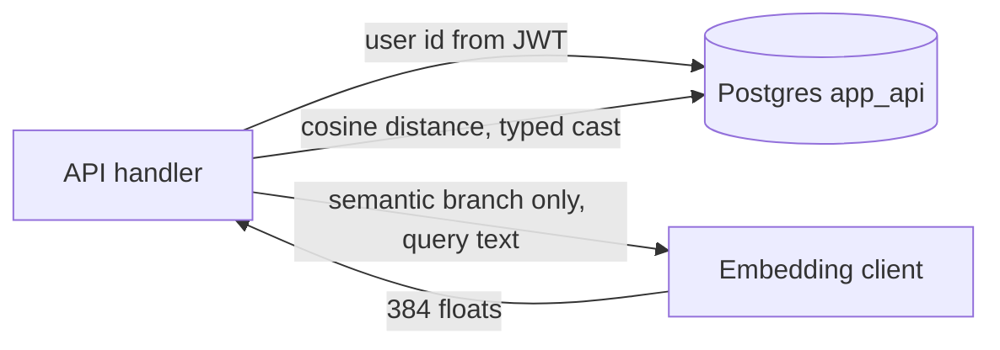

# pgvector cosine search with a typed query vector

Semantic search embeds text with the same model that wrote the stored vectors, then orders rows by cosine distance. The database role is `app_api` from `supabase-rls-client-reads`. That role is not a superuser. A query vector bound as `unknown` makes `<=>` fail for `app_api` and succeed for a superuser. Cast the literal to `extensions.vector` in the SQL expression.

The extension lives in schema `extensions`. The operator stays unqualified and is found because `app_api`'s `search_path` is `public, extensions`. The current migrations create no ANN index. Nearest-neighbor is a sequential scan of the filtered set: `ORDER BY embedding <=> query`.

## Architecture



Writes and reads go through the API as `app_api`. The handler filters on the verified user id (`m2m-jwt-service-auth`). RLS does not isolate that role. Shared catalog rows are visible to every caller; the query still applies the catalog's publish rules in SQL.

Response JSON is built by one serializer per entity. That serializer drops the vector. The browser never receives an embedding column.

## Schema

The reference vector columns are `vector(384)`, nullable. Choose a dimension supported by the selected model and keep the column, client validation, query and corpus consistent. A null means "not embedded yet" and is excluded from search. A matching dimension validates shape, not model compatibility.

| Table | What is embedded | Extra filters |
| --- | --- | --- |
| `items` | Item body only, at save time. The title is not part of the vector | `user_id`, `is_deleted = false`, optional mood and time range |
| `catalog_items` | Name, tagline, description, and personality, truncated to 500 characters, and only after publish | Visibility rules below |
| `chat_turns` | `User: {question}\n{catalog name}: {answer}`, not truncated. Question and answer columns are encrypted | `user_id`, optional catalog id, exclude the current thread |
| `knowledge_chunks` | Chunk text | Optional `source` |
| `curated_items` | The text used to personalize a catalog of recommendations | Category, then cosine against a summary vector |

```sql
CREATE EXTENSION IF NOT EXISTS vector WITH SCHEMA extensions;
GRANT USAGE ON SCHEMA extensions TO app_api;
ALTER ROLE app_api SET search_path TO public, extensions;

ALTER TABLE items ADD COLUMN embedding extensions.vector(384);
```

`GRANT USAGE` is required even for the schema-qualified cast. Moving an extension that was created in `public` is `ALTER EXTENSION vector SET SCHEMA extensions`. A bare `CREATE EXTENSION vector` lands in `public` and the cast `::extensions.vector` then fails.

There is no HNSW or IVFFlat index in the migrations. Add one only after measuring a catalog that is too large for a sequential scan, and build it with the same distance operator the query uses (`vector_cosine_ops`).

## Embedding client

One provider per process, selected by `LLM_PROVIDER` (`gemini` or `azure`). Dimension is a constant, `384`. The client passes `dimensions: 384` and rejects a response whose length is anything else. Do not store a mismatched vector.

| Name | When |
| --- | --- |
| `LLM_PROVIDER` | `gemini` (default) or `azure`. Any other value raises at startup. |
| `GEMINI_EMBEDDING_MODEL` | Default `gemini-embedding-001`. A bare name is prefixed `vertex_ai/`. |
| `VERTEX_AI_SERVICE_ACCOUNT_FILE` | Path to the service-account JSON. Relative paths are from the repo root. Sets `GOOGLE_APPLICATION_CREDENTIALS`. |
| `VERTEX_AI_PROJECT` | Vertex project. If empty, read `project_id` from the service-account file. |
| `VERTEX_AI_LOCATION` | Default `us-central1`. A model id containing `gemini-3` uses `global` instead. |
| `AZURE_EMBEDDING_DEPLOYMENT` | Default `text-embedding-3-small`. Sent as `openai/<deployment>` unless it already has an `openai/` or `azure_ai/` prefix. |
| `AZURE_OPENAI_API_KEY` | Copied to `AZURE_API_KEY` for the client library. |
| `AZURE_OPENAI_ENDPOINT` | Stripped, trailing slash removed, then `/openai/v1` appended when missing. Copied to `AZURE_API_BASE`. |

Call the embedding API with a 4 second timeout. Log elapsed time and the model id. Do not log the input text.

```python
EMBEDDING_DIMENSIONS = 384
QUERY_MAX_CHARS = 500

async def embed(text: str) -> list[float]:
    response = await asyncio.to_thread(embedding, **params, input=text)
    item = response.data[0]
    vector = item["embedding"] if isinstance(item, dict) else list(item.embedding)
    if len(vector) != EMBEDDING_DIMENSIONS:
        raise ValueError(f"Expected {EMBEDDING_DIMENSIONS} dimensions, got {len(vector)}")
    return vector
```

Truncation differs by caller:

- Saving an item embeds the body and not the title. A failure aborts the save. The row is not written with a null vector after a failed embed.
- A search query and a catalog-item embed use `text[:500]`. A search embed that throws is logged and treated as "no vector", so the handler returns no semantic hits.
- A stored chat turn embeds `User: {question}\n{catalog name}: {answer}` with no 500-character cap. Skip the write when either side is missing. Retrieval embeds a different string, capped at the last 4000 characters: the first turn is the latest user message; a later turn is the previous user message, the previous reply, and the latest user message, each on its own line with a `user:` or `assistant:` prefix. When that text is empty, reuse the newest stored vector for the thread and do not call the provider.
- A curated-item query either embeds a summary string truncated to 500 characters, or reuses the newest item vector and does not call the provider.
- A catalog item is embedded only when it is published. The text is name, tagline, description, and personality joined by spaces. Category, function, and avatar paths are left out. A blank string stores null. An embed error on catalog write is best-effort: the row can exist with a null vector and stay out of vector search.
- Unpublished custom catalog rows stay at null until publish.

A test process (`ENV=test`) skips the provider and returns `[0.01] * 384`. Seed data uses that same constant so cosine search still hits the database. Production must not set `ENV=test`.

Re-embed missing catalog vectors with the joined text, truncated to 500 characters, in batches, with a dry-run. Skip rows whose joined text is empty. A narrower command that embeds only the description field will disagree with search. Use the joined text.

## Distance expression

`pgvector.django.CosineDistance` binds the query as text (`unknown`). Superusers coerce that. `app_api` cannot, and Postgres reports `extensions.vector <=> unknown`. Build the literal from floats and cast it.

```python
from django.db.models import FloatField, Func, Value

def vector_literal(embedding: list[float] | str) -> str:
    if isinstance(embedding, str):
        return embedding
    return "[" + ",".join(str(float(x)) for x in embedding) + "]"

class CastToVector(Func):
    arity = 1
    template = "(%(expressions)s)::extensions.vector"

class CosineDistance(Func):
    output_field = FloatField()
    arity = 2
    function = ""
    arg_joiner = " <=> "
    template = "(%(expressions)s)"

    def __init__(self, expression, embedding, **extra):
        super().__init__(
            expression,
            CastToVector(Value(vector_literal(embedding))),
            **extra,
        )
```

`float(x)` is what keeps user text out of the SQL literal. Pass a sequence of numbers, or a bracket literal you already validated. Similarity is `1 - distance`; higher is closer. Cosine similarity can be negative and is not a probability. The [pgvector query documentation](https://github.com/pgvector/pgvector#querying) defines the distance operator and conversion. The reference maps a null distance to `0`, which its positive floors exclude; an adaptation allowing nonpositive floors should explicitly exclude null distances.

## Queries

Scope every user-owned query with the JWT subject. Order by distance ascending. Keep rows at or above the threshold. Return at most `limit`.

Because similarity is `1 - distance`, taking the nearest `limit` rows and then dropping those under the threshold returns the same set as filtering in SQL and then limiting. Item search and chat search do the filter in Python after the slice. Catalog search filters `vector_score >= threshold` in SQL, then paginates. Both are safe only while the score stays monotonic with distance.

Keep semantic-search policy at the task boundary. The public search service passes a fixed floor and cap for each collection, independently of repository defaults. Its request `limit` bounds keyword hits; the semantic branch uses the service cap, which can exceed a smaller requested limit. The API still parses and forwards `threshold`, but the service does not use it. Accepting a field does not make it an effective ranking control.

RAG callers have a separate policy: the reference item/chat/knowledge repositories default to `0.5`, and the context caller explicitly passes that value for past-chat retrieval. Public search overrides repository defaults; a catalog repository fallback such as `VECTOR_MIN_SCORE` is not the public search contract. These observed values are not quality targets for another embedding model. In a new implementation, pass a validated task policy explicitly, and document whether the request limit also bounds semantic results.

Fresh generic policy shape, populated from evaluation rather than copied scores:

```python
from dataclasses import dataclass

@dataclass(frozen=True)
class RetrievalPolicy:
    embedding_profile: str
    min_similarity: float
    max_results: int

    def __post_init__(self):
        if not self.embedding_profile:
            raise ValueError("embedding profile is required")
        if not -1 <= self.min_similarity <= 1 or self.max_results < 1:
            raise ValueError("invalid retrieval policy")
```

`embedding_profile` is a proposed deployment identifier for model/version/dimension and preprocessing; the reference rows do not currently store this identifier. A repository would receive `threshold=policy.min_similarity` and `limit=policy.max_results` only after confirming corpus/query profile compatibility.

```python
def has_embedding(embedding) -> bool:
    return embedding is not None and len(embedding) > 0

async def find_similar_items(user_id, embedding, *, limit, threshold, mood, start, end, days, reference_now):
    if not has_embedding(embedding):
        return []
    qs = Item.objects.filter(user_id=user_id, is_deleted=False, embedding__isnull=False)
    if days is not None:
        if reference_now is None:
            raise ValueError("reference_now is required for a recency cutoff")
        qs = qs.filter(occurred_at__lt=reference_now - timedelta(days=days))
    qs = apply_mood_and_range(qs, mood, start, end)
    hits = []
    async for row in qs.annotate(distance=CosineDistance("embedding", embedding)).order_by("distance")[:limit]:
        similarity = 1 - row.distance if row.distance is not None else 0
        if similarity >= threshold:
            hits.append(row)
    return hits
```

`days` means "older than this many days", measured from the client clock `reference_now`. Server `now()` is the wrong clock for that window.

Chat search adds a catalog-item id (the entity this thread is with) and `exclude(thread_id=current)`. When retrieval text is empty, the reference reuses the newest stored vector for that thread instead of calling the embedding provider:

```python
row = await ChatTurn.objects.filter(
    thread_id=thread_id, user_id=user_id, embedding__isnull=False
).order_by("-created_at").only("embedding").afirst()
if row is None or row.embedding is None:
    return None
return list(row.embedding)
```

Catalog visibility, applied before the score filter:

- Default: platform rows (`is_custom = false`) plus custom rows that are published, not paused, and not deleted.
- Community-only: custom, published, not paused, not deleted.
- An unpublished row the caller created stays out of search. A ranking job that must see it opts in with a separate flag.

Catalog vector search returns `[], 0` when the query vector is missing. Hybrid search can still rank on text; that path is `lexical-search`.

Routing shared with `lexical-search`: count non-stopword tokens. One to three tokens try the keyword ranker first. Positive hits return without generating a query vector. A miss or a longer query embeds once, then runs this vector path with the task floor/cap. Item keyword search loads that user's decrypted rows into memory; catalog keyword search uses only the stored `tsvector` and a positive full-text rank. The optional hybrid repository helper is not called by the current public search service. Blank input is rejected by the API; a nonblank zero-token query skips keyword and reaches the semantic branch.

## Setup and calibration (P46)

1. Install the extension and app-role privileges from `supabase-rls-client-reads`, then create the vector columns. Verify a typed query using the app role before loading a corpus.
2. Define an embedding profile: provider, resolved model/version, dimension, document preprocessing/truncation, query preprocessing and any paired query/document task settings. Record it with the corpus or deployment. Use one compatible space for writes, backfills and queries. Matching vector lengths do not make different models interchangeable. Google's [embedding migration guidance](https://aistudio.google.com/docs/embeddings#migration) gives an explicit incompatible-space example requiring re-embedding.
3. Prepare labeled queries and relevant row ids per corpus/task, including short names, paraphrases, multilingual text and queries with no relevant answer. Use synthetic or authorized evaluation data. Keep evaluation inputs out of public examples and logs.
4. For each candidate model/version/dimension, embed the corpus and queries consistently. First compare top-k rankings with no score floor: measure recall@k and a ranking metric such as MRR or nDCG. Then sweep floors at the intended cap, measuring relevant results retained, precision, empty-result rate and latency on held-out queries. Evaluate each collection and RAG task separately.
5. Select and version the task floor/cap against that profile and labeled evaluation. Compare rankings and recall across models, not raw cosine magnitudes. A larger dimension or a larger score does not establish better relevance; lowering a floor cannot repair incompatible vectors.
6. On a model/version/dimension or preprocessing change, re-embed consistently into a separate collection/column or isolate rows by profile. Backfill and verify coverage before switching the query encoder and corpus together. Keep the previous compatible pair available for rollback. The reference has no automatic profile isolation or coordinated model-switch mechanism.
7. Monitor result counts, empty-result rates, latency and embedding failures by task/profile without logging private queries. Re-evaluate on corpus drift. Constant test vectors check plumbing only; they cannot validate relevance or a production cutoff.

## Wire format

`asdict` on the domain object includes `embedding` and the internal timestamp. Every item, catalog, and curated-item response goes through one function that removes them.

```python
def serialize_item(entry, score=None):
    item = asdict(entry)
    item["id"] = str(entry.id)
    item["occurred_at"] = (
        entry.occurred_at_.strftime("%Y-%m-%d %H:%M:%S") if entry.occurred_at_ else None
    )
    item.pop("occurred_at_", None)
    item.pop("embedding", None)
    if score is not None:
        item["search_score"] = score
    return item
```

Catalog serialization also drops `embedding` and the owner id, and adds a boolean for "created by the caller". Curated items list the public fields and omit the vector. Chat-turn entities used inside the server decrypt text fields and do not copy `embedding` onto the object that leaves the repository, except the explicit "latest vector for this thread" helper, which stays on the server.

A list endpoint and a detail endpoint both call the same function. A second mapper that forgets `pop("embedding")` puts the full 384 floats, and the raw timestamp field, on the wire.

## Failure prevention

- **P10.** Cast with `::extensions.vector`. Install `vector` in `extensions`, `GRANT USAGE ON SCHEMA extensions` to `app_api`, and set `search_path` to `public, extensions`. Reproduce the query as `app_api`, not as a superuser. A superuser success hides the `unknown` bind.
- **P12.** A vector from the ORM or from NumPy has no boolean value. `if embedding` raises. Test `embedding is not None` and then `len(embedding) > 0`. Use that helper before similarity search and before any job that reads a stored vector. A Python `list[float] | None` from the embed client is safe to length-check the same way.
- **P23.** One serializer per entity. Strip `embedding` and the internal timestamp there. Clients never see vector columns. Review any new `asdict` or `values()` response before it ships.
- Filter user-owned tables on the JWT subject. `app_api` can read every row.
- **P46.** Recalibrate cutoffs per model/version/dimension and corpus/task with labeled ranking/recall evaluation. Never mix embedding spaces, even at equal dimensions. Re-embed or isolate versions before switching readers and writers.
- Reject a vector whose length differs from the configured dimension (384 in the reference). A dimension mismatch fails; an equal-length vector from the wrong model can silently produce irrelevant rankings.
- Keep the query literal numeric. Build it with `float(x)` or pass a bound parameter that is still cast with `::extensions.vector`.
- Item save: if embed throws, fail the save. A stored body with a null vector cannot be found later.
- Search embed: if the provider throws, return an empty semantic result. Do not fail the whole request when a keyword result was already empty and the provider is down.
- Pass `reference_now` whenever a day window is applied.

## Tests

Run the SQL as `app_api`.

- A stored vector of 384 times `0.5` and a query of 384 times `0.5` returns similarity `1` and is included at threshold `0.6`.
- A stored vector of 384 times `-0.9` against a query of 384 times `0.9` is excluded at threshold `0.6`.
- `LIMIT` keeps the nearest rows. A second user's rows are absent even when their vector matches.
- The SQL contains `::extensions.vector`. The same statement run as a role without `USAGE` on `extensions` fails.
- `has_embedding(None)` is false. `has_embedding([])` is false. A NumPy array of 384 floats does not get used as a boolean.
- `embed` raises when the provider returns a length other than 384.
- `ENV=test` returns the constant vector and does not call the provider.
- Serializer output has no `embedding` key and no internal timestamp field. A catalog payload has no owner id.
- A query of four tokens does not call the keyword ranker. A query of two tokens with positive keyword hits calls neither embedding nor vector search. A miss generates one embedding and uses the service-owned floor/cap, regardless of a legacy request threshold.
- Repository defaults and service overrides are tested independently. A smaller request limit still leaves the reference semantic cap unchanged; document this behavior explicitly.
- A proposed profile guard rejects same-dimension vectors from another model/version; the reference dimension check alone does not. A model-switch rehearsal verifies full backfill coverage and paired rollback.
- A labeled evaluation reports recall@k before and after the floor, a ranking metric and empty-result rate per task/profile. Unit tests with identical vectors do not substitute for this evaluation (P46).

## Checklist

- [ ] `vector` is in schema `extensions`. `app_api` has `USAGE` and `search_path` `public, extensions` (P10).
- [ ] Columns are `vector(384)`, nullable. The client rejects any other length.
- [ ] Distance uses `CastToVector` / `::extensions.vector`, including queries that used to call `pgvector.django.CosineDistance`.
- [ ] User-owned searches filter on the JWT subject. Catalog searches apply the publish rules.
- [ ] Task floors/caps are calibrated and versioned with the embedding profile (P46). Public search overrides, RAG defaults and the unused legacy request threshold are distinguished.
- [ ] Query and corpus use compatible model/version/dimension/preprocessing; model changes re-embed or isolate rows and switch the pair together.
- [ ] Short keyword hits skip embedding; semantic request-limit behavior is documented.
- [ ] Item save embeds the body only and aborts on failure. Search and catalog embeds truncate to 500 characters. Chat-turn vectors use the labeled question and answer with no cap.
- [ ] Vector checks use `is not None` and `len` (P12).
- [ ] Every response serializer drops the vector and the internal timestamp (P23).
- [ ] Tests run as `app_api`. `ENV=test` is off in production.
