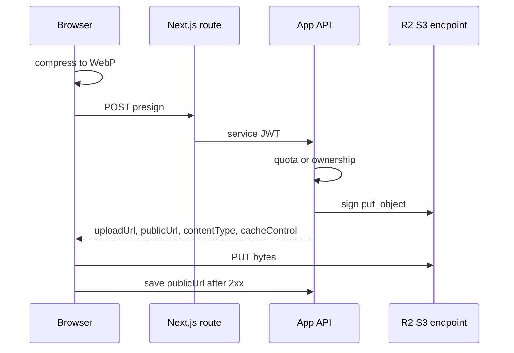

# Presigned uploads to Cloudflare R2

The browser compresses a photo to WebP. The Next.js server checks the session and asks the API for a presigned PUT. The API signs one object key. The browser PUTs the bytes to the R2 S3 endpoint. The public URL is stored only after that PUT returns success. Later reads use a custom domain, which is a different host from the endpoint that accepted the PUT.

`content-security-policy` has to allow both hosts. The signing credentials stay on the API.

## Architecture



Offline catalog imports use the same client and `put_object` from a script. They are not this browser path. The browser never receives the access key, and it never chooses the object key.

## Client

One process-wide S3 client. R2's account endpoint is `https://<accountid>.r2.cloudflarestorage.com`. The bucket name goes in the path (`addressing_style: path`), the signature is `s3v4`, and the region is `auto`.

boto3's default `request_checksum_calculation` is `when_supported`. For `PutObject` that default adds a CRC32 checksum to the signature. A browser `fetch` PUT does not send that checksum header, so the signature check fails. Set both checksum switches to `when_required`. boto3 then adds a checksum only when the operation requires one. `PutObject` does not. The same pair is in the boto3 configuration guide (`when_required` versus `when_supported`).

```python
from functools import lru_cache

import boto3
from botocore.config import Config

PRESIGN_EXPIRES_SECONDS = 300
OBJECT_CACHE_CONTROL = "public, max-age=31536000, immutable"
AVATARS_PREFIX = "avatars"

_BOTO_CONFIG = Config(
    signature_version="s3v4",
    s3={"addressing_style": "path"},
    request_checksum_calculation="when_required",
    response_checksum_validation="when_required",
)


class StorageConfigError(RuntimeError):
    pass


@lru_cache(maxsize=1)
def storage_client():
    endpoint = (settings.R2_ENDPOINT_URL or "").rstrip("/")
    access_key = settings.R2_ACCESS_KEY_ID or ""
    secret_key = settings.R2_SECRET_ACCESS_KEY or ""
    if not endpoint or not access_key or not secret_key:
        raise StorageConfigError("object storage is not configured")
    return boto3.client(
        "s3",
        endpoint_url=endpoint,
        aws_access_key_id=access_key,
        aws_secret_access_key=secret_key,
        region_name="auto",
        config=_BOTO_CONFIG,
    )


def presign_put(*, key: str, content_type: str) -> str:
    return storage_client().generate_presigned_url(
        "put_object",
        Params={
            "Bucket": bucket_name(),
            "Key": key,
            "ContentType": content_type,
            "CacheControl": OBJECT_CACHE_CONTROL,
        },
        ExpiresIn=PRESIGN_EXPIRES_SECONDS,
    )
```

`ContentType` and `CacheControl` are part of the signature. The PUT must send those two headers with those exact values and no checksum header. A different `Content-Type`, a missing `Cache-Control`, or an added `x-amz-checksum-*` header fails the signature.

The cache header is `public, max-age=31536000, immutable` because the key is new for every upload. Replacing a photo writes a new key and deletes the old object. It does not overwrite a cached URL.

`lru_cache` keeps the first client. Rotating a key or an endpoint requires a process restart.

Require `R2_PUBLIC_BASE_URL` and `R2_BUCKET_NAME`. A hardcoded public host in the fallback sends every environment at the wrong site and breaks the CSP origin.

> NOTE: the reference falls back to a fixed bucket name and a fixed public host when those two settings are empty.

## Presign

```python
def presign_avatar_upload() -> dict[str, str]:
    file_name = f"{uuid4()}.webp"
    key = f"{AVATARS_PREFIX}/{file_name}"
    upload_url = presign_put(key=key, content_type="image/webp")
    return {
        "uploadUrl": upload_url,
        "publicUrl": f"{public_base_url()}/{key}",
        "contentType": "image/webp",
        "cacheControl": OBJECT_CACHE_CONTROL,
    }
```

The HTTP handler returns those four fields. The helper can keep `key` for logs on the server. It does not need to be in the JSON. Missing configuration is HTTP 500. Any other signing error is HTTP 502. Do not log the presigned URL. The query string is the signature.

The route is authenticated with the service JWT (`m2m-jwt-service-auth`). Reject a missing user id before `UUID()`, because `UUID(None)` raises `TypeError` and a `ValueError` handler will not catch it (P13 in that module).

Two gates:

- No profile id: this is a new custom profile. Check the create quota with the account creation time and the client-local timestamp. Over the cap is HTTP 403 with `upgrade_required`. See `subscription-entitlements`.
- A profile id: load it and require a custom profile owned by this user. Anything else is HTTP 404. An edit does not spend the create quota.

The Next route in front of this checks the session, requires `user.created_at` and the `X-Client-Local-Time` header, and forwards both plus the bearer token. It copies `audience_id` through when the body has one. It does not accept a file.

## Browser compress, then PUT

Compress before asking for a URL. The URL lives for 300 seconds. A slow compress after the presign burns that window.

Limits for the file the user picks and the bytes that are PUT:

| Limit | Value |
| --- | --- |
| Source file | `image/*`, at most 5 MiB (`5 * 1024 * 1024`) |
| Longest side | 1024 CSS pixels, aspect ratio kept, minimum side 1 |
| Encode | `image/webp`. Flatten onto white first so a transparent PNG does not turn black |
| Quality | start at `0.82`. While the blob is over 200 KiB and quality is still above `0.4`, subtract `0.08` and encode again. The last encode can land at `0.34` |
| PUT body | at most 200 KiB (`200 * 1024`) |
| Skip re-encode | already `image/webp`, already under 200 KiB, and already within 1024 |

`canvas.toBlob` quality is 0–1. A value of `82` is the Pillow scale and is wrong here. If the canvas cannot encode WebP, stop and ask for another browser. If the blob is still over 200 KiB at the quality floor, stop. This path does not scale the canvas down further.

```ts
const presign = await fetch("/api/media/avatar", {
  method: "POST",
  headers: {
    "Content-Type": "application/json",
    "X-Client-Local-Time": clientLocalTime,
  },
  body: JSON.stringify(profileId ? { profile_id: profileId } : {}),
})

const put = await fetch(uploadUrl, {
  method: "PUT",
  headers: {
    "Content-Type": contentType,
    "Cache-Control": cacheControl,
  },
  body: compressed,
})
```

Persist `publicUrl` only after `put.ok`. A failed PUT does not create an object, so there is nothing to delete.

A local preview uses `URL.createObjectURL`. `img-src` needs `blob:` for that preview. `content-security-policy` already allows it.

## Public object names

The read host is world-readable. Anyone who can guess the key can fetch the object. The key is the only unguessable part of the URL.

Browser uploads mint the key on the server. The presign helper calls `uuid4()` and does not read a key from the request body:

```text
avatars/{uuid4()}.webp
```

The prefix names the kind of object. It is not an account. The key does not contain a user id, an email, a display name, or a counter.

A replacement photo is a new key. The previous object is deleted after the new URL is stored. The PUT is signed with `Cache-Control: public, max-age=31536000, immutable` because that URL will not be reused for different bytes. The browser must send that exact header; it is part of the signature.

Two hosts, two jobs:

| Name | Role |
| --- | --- |
| `R2_ENDPOINT_URL` | S3 API. `generate_presigned_url` targets this host. The browser PUTs here |
| `R2_PUBLIC_BASE_URL` | Read host. `public_url_for_key` joins this base and the key. No trailing slash |

The public host is not the presign host. `NEXT_PUBLIC_MEDIA_BASE_URL` is the same origin as `R2_PUBLIC_BASE_URL`. Both belong in the CSP. Require the public base from the environment. A hardcoded fallback sends every environment at one site.

Offline catalog imports are not this path. Profile portraits in the seed use `avatars/{profile_id}.webp`, a stable id for a catalog row. Catalog covers use a second type prefix plus a slug of the category and the file stem (`recommendations/{category}/{stem}.webp`). Those keys still must not contain a user id or an email. They are guessable on purpose so a re-seed hits the same object. They reuse the immutable cache header, so a replaced catalog object can stay stale in caches until `max-age`. Browser uploads avoid that by minting a new uuid.

## Public URL and SSRF

Store the public URL. When the server must read the bytes back (a safety check) or delete the object, parse a key and then build the URL from the configured public base. Never `GET` the host the caller sent.

Accept a URL when:

- it starts with `R2_PUBLIC_BASE_URL` and the remainder is a key under `avatars/` with no `..` segment, or
- it contains the legacy marker `/object/public/avatars/<file>`, in which case the key is `avatars/<file>` after the same checks.

A path that starts with `/images/` is a local placeholder. Parsing returns nothing, and the download returns nothing. Any other host returns nothing.

> NOTE: the reference returns any remainder of the public base, including keys outside `avatars/`. Restrict the prefix.

Download with a 10 second timeout and `follow_redirects` off, so a redirect cannot leave the public host. Reject an empty body. Reject a body over 5 MiB. Sniff the magic bytes for the safety-check MIME: PNG (`\x89PNG`), JPEG (`\xff\xd8`), otherwise `image/webp`.

> NOTE: the reference client follows redirects.

Delete is best-effort and runs off the request thread (`sync_to_async(..., thread_sensitive=False)`). A missing object or a missing R2 config is logged and does not fail the profile save.

Delete the new object when the save that follows the PUT does not commit. Delete the previous object when a successful replace stores a different URL. Soft-deleting the profile should delete its object too.

> NOTE: the reference deletes the new object only for quota, validation, unsafe-content, and safety-unavailable errors. An error from the insert leaves the object. Soft-delete does not delete the object.

## Offline encoder

Catalog imports do not use the browser. Pillow opens the file, flattens RGBA, LA, and P onto white, and writes WebP with `method=6`.

- Catalog portraits: resize to 975×1300, quality 85, key `avatars/{profile_id}.webp`.
- A server-side custom encoder exists with a longest side of 2048, quality starting at 82, stepping down by 8 while quality is still above 40, then scaling by 0.85 until the payload is under 200 KiB. The request path does not call it. User uploads are already bounded by the browser.

Pillow quality is 0–100. Keep that scale out of the canvas code.

## CSP (P21)

The PUT origin and the read origin are different.

| Host | Directive |
| --- | --- |
| `https://*.r2.cloudflarestorage.com` | `connect-src` (the presigned PUT) |
| `NEXT_PUBLIC_MEDIA_BASE_URL` origin | `img-src`, `media-src`, `connect-src` |

`NEXT_PUBLIC_MEDIA_BASE_URL` and `R2_PUBLIC_BASE_URL` are the same origin, with no trailing slash. The shell is cached, so this list is fixed at process start. See `content-security-policy`.

## Bucket CORS

The PUT is cross-origin. The bucket needs a CORS rule that allows the app origin, method `PUT`, and request headers `Content-Type` and `Cache-Control`.

> NOTE: unverified against a live bucket. No CORS rule is in the repo. The client comment says bucket CORS is configured outside this module.

## Env

| Name | Where |
| --- | --- |
| `R2_ENDPOINT_URL` | API. Account endpoint, no path |
| `R2_ACCESS_KEY_ID` | API |
| `R2_SECRET_ACCESS_KEY` | API |
| `R2_BUCKET_NAME` | API |
| `R2_PUBLIC_BASE_URL` | API. Custom domain, no trailing slash |
| `NEXT_PUBLIC_MEDIA_BASE_URL` | Browser and CSP. Same origin as the public base |

`CORS_ALLOWED_ORIGINS` on Django limits browser calls to the API. The bucket has its own CORS rule for the PUT. The browser sends the file to R2.

## Setup

1. Create the bucket and attach the custom domain that `R2_PUBLIC_BASE_URL` names.
2. Create an access key that can `PutObject` and `DeleteObject` on that bucket. Put the secret only in the API env.
3. Set the checksum config and path-style addressing before the first presign.
4. Add the bucket CORS rule for the app origin.
5. Put both origins in the CSP. Restart the Next process so `headers()` rebuilds.
6. Apply the browser size limits and the "compress, then presign, then PUT" order.
7. Confirm a profile save stores the public URL only after HTTP 200 from R2, and that a rejected save deletes the new key.

## Failure prevention

- **P21.** Allow the storage API host on `connect-src` and the public media origin on `img-src` and `media-src`. The presigned host and the image host are different origins.
- Sign with `when_required` checksums. The default `when_supported` CRC32 is not a header the browser will send.
- Send the signed `Content-Type` (`image/webp`) and `Cache-Control` on the PUT, and no other checksum header.
- Compress first. The URL expires in 300 seconds.
- Let the server pick `avatars/{uuid}.webp`. Ignore any key the client sends.
- Build download and delete URLs from the parsed key plus the configured public base.
- Keep `blob:` on `img-src` for the local preview.
- Leave the access key and the presigned query string out of logs and out of `NEXT_PUBLIC_` names.
- Reject a missing user id before `UUID()`.

## Tests

Stub `generate_presigned_url` and assert the params: bucket, key ending in `.webp` under `avatars/`, `ContentType` `image/webp`, the immutable cache header, expiry 300. The key matches `avatars/<uuid>.webp` and does not contain the user id or an email. A body field named `key` does not change it. Assert the client config uses `s3v4`, path addressing, and `when_required` for both checksum settings. A missing endpoint raises the config error and the route returns 500. `publicUrl` uses `R2_PUBLIC_BASE_URL`, and `uploadUrl` is the presigned host.

Parse tests: a public-base URL yields `avatars/<file>`; a legacy `/object/public/avatars/<file>` URL yields the same key and the download uses the configured host; `/images/...` and a foreign host yield nothing; a key with `..` is rejected.

Browser: a 4000×3000 image fits inside 1024 with the aspect ratio kept; a non-image and a file over 5 MiB fail before the canvas; a WebP that is already small and already within 1024 is returned as-is; the quality loop stops once quality is no longer above 0.4, and a still-too-large blob throws.

API: no user is 401; a create over the quota is 403; a profile id the user does not own is 404; the JSON has the four public fields.

## Checklist

- [ ] Endpoint, keys, bucket, and public base are set. No hardcoded host fallback.
- [ ] Client uses path style, `s3v4`, region `auto`, and `when_required` checksums.
- [ ] Bucket CORS allows PUT with `Content-Type` and `Cache-Control` from the app origin.
- [ ] CSP lists the R2 API host and the media origin.
- [ ] Browser keys are `avatars/{uuid}.webp`. No user id, email, or client-supplied key. Catalog keys use a stable asset path and still omit account ids.
- [ ] `R2_PUBLIC_BASE_URL` and `R2_ENDPOINT_URL` are different hosts. The immutable cache header is on the signed PUT.
- [ ] Browser caps are 5 MiB in, 1024 px, WebP, 200 KiB out.
- [ ] PUT uses the signed headers. The public URL is saved only after HTTP 200.
- [ ] Downloads use the configured host. Deletes are best-effort and cover a rejected save.
- [ ] Presigned URLs and the secret key are not logged.
