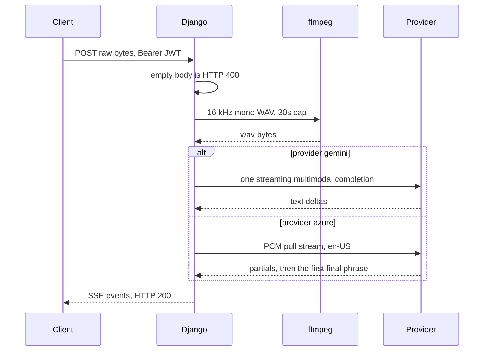

# Server-sent speech transcription

One HTTP request carries one audio clip. The API buffers the body, converts it to 16 kHz mono WAV with a bundled ffmpeg, and streams JSON events as `text/event-stream`. The provider is Vertex Gemini (default) or Azure Speech. Nothing persists the audio or the transcript.

The handler is not reachable. The URL conf comments out `api/transcribe/` with a note to bring it back later. The web app has no recorder and no caller of that path. Register the route, and add a client, before treating this as a feature. Unit tests cover the service with the SDKs mocked. A load-test note says the path is not mounted.

Load `m2m-jwt-service-auth` before mounting it. Leave the path off `AUTH_EXEMPT_PATHS`. The handler does not read `request.user_id`. The middleware still has to reject a missing Bearer token so an anonymous client cannot upload audio.

## Architecture



The body is fully buffered before the first event. This is not a live microphone socket. Azure's "continuous" recognizer runs over that one buffer and stops at the first final phrase.

## Configuration

Read these in process setup. The reference calls `load_dotenv` inside the service modules. Do not. An import-time dotenv load races with the process environment.

| Name | Role |
| --- | --- |
| `SPEECH_PROVIDER` | `gemini` (default) or `azure`. Anything else raises at construction. |
| `GEMINI_AUDIO_MODEL` | Bare Gemini model id. Default `gemini-3-flash-preview`. |
| `VERTEX_AI_SERVICE_ACCOUNT_FILE` | JSON key file for Vertex. Required for Gemini. |
| `VERTEX_AI_PROJECT` | GCP project. Falls through `VERTEXAI_PROJECT`, then `GOOGLE_CLOUD_PROJECT`, then the key file's `project_id`. |
| `VERTEX_AI_LOCATION` | Region for models whose name does not contain `gemini-3`. Falls through `VERTEXAI_LOCATION`, then `us-central1`. |
| `AZURE_SPEECH_KEY` | Speech resource key. Required when the provider is `azure`. |
| `AZURE_SPEECH_REGION` | Speech resource region. Required with the key. |
| `AZURE_SPEECH_AUDIO_LOGGING` | Provider-side audio logging. Default off. |

`GEMINI_API_KEY` is not read on this path. A test sets it and the constructor ignores it. Gemini here is Vertex via LiteLLM, using `GOOGLE_APPLICATION_CREDENTIALS`.

Pins from the lockfile: `azure-cognitiveservices-speech==1.51.2`, `litellm[proxy]==1.95.0` (the call is `litellm.completion`; the proxy extra is what the lockfile installs), `imageio-ffmpeg==0.6.0`.

Django upload caps, both `20 * 1024 * 1024`:

- `DATA_UPLOAD_MAX_MEMORY_SIZE`
- `FILE_UPLOAD_MAX_MEMORY_SIZE`

A compose nginx file sets `client_max_body_size 20M` and `client_body_timeout 12`. That file is the compose proxy. Container Apps ingress is a different front door. Keep the deployed body cap at 20 MiB.

## Provider selection

```python
provider = explicit or os.environ.get("SPEECH_PROVIDER", "gemini")
if provider == "azure":
    service = AzureSpeech()
elif provider == "gemini":
    service = GeminiSpeech()
else:
    raise ValueError(f"Unsupported speech provider: {provider}")
```

The constructor docstring says the default is `azure`. The `getenv` default is `gemini`. Trust the code. An explicit argument wins. An empty string is falsy and falls through to the env var.

The HTTP factory calls `TranscriptionService()` once and caches it on the process. Changing `SPEECH_PROVIDER` needs a restart. A second factory method always constructs the Azure client and is not what the handler calls. Do not point the route at that method: an empty Azure key raises `ValueError` there even when Gemini is the selected provider.

Import the selected provider inside the factory. The reference imports the Azure module at the top of the transcription module, and that module imports `azure.cognitiveservices.speech` at import time. A missing Speech wheel then breaks Gemini as well.

## HTTP contract

`POST` the raw clip as the body (`application/octet-stream`). An empty body returns HTTP 400 `{"error": "No audio data provided"}` before any stream. A body over the upload cap is rejected by Django when `request.body` is read.

Success and in-stream failure are `StreamingHttpResponse` with:

- `Content-Type: text/event-stream`
- `Cache-Control: no-cache`
- `Connection: keep-alive`
- `X-Accel-Buffering: no`

Each yield is `data: ` + `json.dumps(event)` + `\n\n`. The HTTP status stays 200 once the stream starts. Clients must branch on `type`. An exception outside the generator returns HTTP 500 `{"error": "Internal server error"}` and logs the exception server-side.

Orchestrator events:

| `type` | When | Fields |
| --- | --- | --- |
| `partial` | `is_final` is false | `text`, `timestamp`, `confidence`, `provider` |
| `final` | `is_final` is true | same |
| `error` | `ImportError` inside `transcribe_audio` | `error` (`"{Provider} Speech SDK not available"`), `details`, `suggestion` |
| `error` | `ValueError` inside `transcribe_audio` | `error` (`"{Provider} Speech Service credentials not configured"`), `details` |
| `error` | any other exception inside `transcribe_audio` | `error` (`str(exception)`), `provider` |

`timestamp` is `datetime.isoformat()`. The reference uses naive `datetime.now()`. Emit aware UTC.

Suggestions: Azure `"Install azure-cognitiveservices-speech package"`, Gemini `"Install litellm package"`.

The generator's own `except` turns a factory failure into `{"type":"error","error":"Transcription failed"}` with no `details`. Azure's missing key raises in `__init__`, which runs inside that generator, so the client sees the generic event rather than the credentials event. The credentials event happens only when `transcribe_audio` itself raises `ValueError`. Gemini wraps conversion and API failures as `Exception("Transcription failed: ...")`, so they take the generic orchestrator branch and the client receives that string.

Send the client a fixed error code. Keep `str(exception)` in the server log. The reference puts `str(exception)` on the orchestrator error event.

`provider` on a success event is `gemini` or `azure`. `confidence` is JSON `null` when the entity leaves it as `None`.

## Content type

The view ignores the request `Content-Type`. It picks a container from the `User-Agent`:

```python
ua = user_agent.lower()
content_type = (
    "audio/mp4"
    if "safari" in ua and "chrome" not in ua
    else "audio/webm"
)
```

A desktop Chrome UA contains both `chrome` and `safari`, so it stays `webm`. An empty UA stays `webm`. An iOS Chrome UA (`CriOS`, plus `Safari`, without the substring `chrome`) is classified as `mp4`. The temp-file suffix is `content_type.split("/")[-1]`, so a codec parameter would land in the filename.

Accept only `audio/webm` or `audio/mp4`, taken from a header the client sets to the container it recorded. Do not infer the container from the UA.

## ffmpeg

`imageio_ffmpeg.get_ffmpeg_exe()` returns the bundled binary. Do not call a `PATH` ffmpeg.

Shared arguments: `-i` input, `-ar 16000`, `-ac 1`, `-f wav`, `-y` output. Gemini also passes `-sample_fmt s16`. Azure does not. Pass `-sample_fmt s16` for both so the WAV matches the pull stream.

`subprocess.run(..., capture_output=True, text=True, timeout=30)`. A non-zero return raises with `stderr`. `TimeoutExpired` is caught by the broad `except` and rewrapped as `Audio conversion failed: ...`.

Temp files use `NamedTemporaryFile(..., delete=False)`. The reference unlinks them only after a successful read. An ffmpeg error, a timeout, or a read error leaves both files. Unlink both paths in `finally`.

Do not log the WAV bytes or `stderr` if it might echo input. Log the return code.

## Gemini

Normalize the model, then prefix `vertex_ai/`:

1. Strip a leading `vertex_ai/` or `gemini/`.
2. Map `gemini-2.5-flash` and `gemini-3-flash` to `gemini-3-flash-preview`.
3. Prefix `vertex_ai/`.

Location: if `gemini-3` is in the normalized name (the default is), use `global`. Otherwise `VERTEX_AI_LOCATION`, then `VERTEXAI_LOCATION`, then `us-central1`. The default model therefore ignores `VERTEX_AI_LOCATION`.

Credentials: require `VERTEX_AI_SERVICE_ACCOUNT_FILE`, expand the user path, and refuse a missing file. The reference falls back to a `service_account.json` at the repo root and still assigns `GOOGLE_APPLICATION_CREDENTIALS` when the file is absent. That assignment is process-wide and redirects every other Google client in the process. Set the env var once at startup, only when the file exists.

Project: the env chain above, then `project_id` from the JSON. A missing project omits `vertex_project` and the call fails later.

Convert to WAV, base64-encode, and send one user message:

- text: `Please transcribe the following audio recording. Provide only the transcribed text without any additional commentary or formatting.`
- file: `file_data` = `data:audio/wav;base64,{audio}`

`completion(model=..., messages=..., vertex_location=..., temperature=0.0, stream=True, vertex_project=...)`. The reference runs that sync call in the default executor via `get_event_loop().run_in_executor`, then iterates the returned generator on the event-loop thread. That iteration blocks the loop. Consume the sync iterator on the worker thread and hand text chunks to an `asyncio.Queue`.

Skip deltas whose content is missing or empty. Each yielded partial is the concatenation so far, `is_final=False`, `confidence=None`. If the concatenation is non-empty, one final event follows with `confidence=1.0`. That `1.0` is a constant, not a recognizer score. An empty transcription yields no final event.

## Azure

`__init__` raises `ValueError` when the key or the region is empty. Recognition language is the literal `en-US`. There is no auto-detect.

`AZURE_SPEECH_AUDIO_LOGGING` defaults to `false`. After `.lower()`, the property `SpeechServiceConnection_EnableAudioLogging` is `true` only for `1`, `true`, `yes`, or `on`. Leave it off. The audio is still sent to the recognizer either way. This flag is extra provider-side logging.

Convert to WAV, then walk the WAV for the `data` chunk:

- Shorter than 44 bytes: invalid.
- Bytes `0:4` must be `RIFF` and bytes `8:12` must be `WAVE`.
- From offset 12, read a 4-byte id and a little-endian size. Return the bytes of the `data` chunk.
- The walker does not add the pad byte an odd chunk size requires. Keep ffmpeg output even, or advance one extra byte when `chunk_size` is odd.

Feed the PCM to `PullAudioInputStream` with `AudioStreamFormat(samples_per_second=16000)`. The reference does not pass bit depth or channel count. Pass `bits_per_sample=16` and `channels=1` so the stream matches the WAV. The pull callback copies into the SDK buffer and returns the count. At the end it returns 0. `close` is a no-op.

`start_continuous_recognition`, then poll every 0.1 s. The `recognizing` callback appends a partial when `text` is non-empty. The poll yields only `results[-1]` when the list grew, so hypotheses that arrived during the same sleep are dropped. `recognized` stores one final result and sets the done event, which ends the loop. The first final phrase stops the session. Later phrases in the same clip are not transcribed. `canceled` stores an exception and sets done. `session_stopped` sets done.

After the loop, `stop_continuous_recognition` runs on the event-loop thread. Yield the final result when it exists. If there is no final and the canceled handler stored an error, raise it. A stop with no text and no error yields nothing further. Partials already sent stay partials.

The callbacks run on an SDK thread and append to a plain list while the loop reads `len(results)`. Use a `queue.Queue` (or `call_soon_threadsafe` into an `asyncio.Queue`). The reference does not.

Azure partials and finals leave `confidence` as `None`. The entity requires `text` to be `str` and `is_final` to be `bool`.

## Failure prevention

- Register `api/transcribe/` and keep it off `AUTH_EXEMPT_PATHS`. A commented path is a 404. An exempt path accepts anonymous audio.
- The handler ignores `request.user_id`. Still require the JWT from `m2m-jwt-service-auth`. Do not parse a missing id.
- Default provider is `gemini`. The docstring that says `azure` is stale.
- Import only the selected SDK. Cache the service for the process lifetime.
- Allow-list `audio/webm` and `audio/mp4` from the client. The UA heuristic mis-labels `CriOS` as `mp4`.
- Unlink temp files in `finally`. Cap ffmpeg at 30 s. Always pass `-sample_fmt s16`.
- Require the Vertex key file. Set `GOOGLE_APPLICATION_CREDENTIALS` once at startup.
- Do not read `GEMINI_API_KEY` for this path. Gemini 3 uses location `global`.
- Iterate the LiteLLM stream off the event loop. Gemini's final `confidence` of `1.0` is not a score.
- Azure: explicit 16-bit mono format, a thread-safe queue, and a decision about multi-phrase audio. The reference stops at the first final phrase.
- Keep `AZURE_SPEECH_AUDIO_LOGGING` off.
- Log exceptions on the server. SSE error events use a fixed string. Do not log the clip.
- Compose nginx matches `location /api/` (buffering on, 90 s read, 10 requests/s, burst 20), not `^/api/stream-` (buffering off, 300 s). `X-Accel-Buffering: no` is the per-response override. The Container Apps ingress does not use that file. Turn buffering off for this route on the proxy you actually deploy, and set the read timeout above the 30 s ffmpeg cap plus the provider call.

## Tests

Hermetic. Patch both provider classes at the transcription module so construction does not touch a network or a key file.

- No env and no argument selects `gemini` and does not construct Azure.
- `SPEECH_PROVIDER=azure` selects Azure. An explicit argument beats the env var.
- An unknown provider raises `ValueError` matching `Unsupported speech provider`.
- A final entity becomes `type=final` with `text`, `confidence`, `provider`, and the ISO timestamp.
- A partial then a final preserves order.
- UA containing `safari` and not `chrome` calls the provider with `audio/mp4`. A UA containing `chrome` and `safari` uses `audio/webm`.
- `ValueError` from the provider becomes the credentials event with `details`.
- `ImportError` becomes the SDK event. Gemini's suggestion is `Install litellm package`. Azure's suggestion contains `azure-cognitiveservices-speech`.
- Any other exception becomes `type=error` with `error` equal to `str(exception)` and `provider` set. Prefer a fixed client string in the product, and keep this test pointed at the server log.

Gemini, with ffmpeg and `completion` patched:

- Default model is `vertex_ai/gemini-3-flash-preview` and location is `global`.
- `GEMINI_AUDIO_MODEL=gemini-2.0-flash` plus `VERTEX_AI_PROJECT` stores `vertex_ai/gemini-2.0-flash` and that project. A cleared env falls back to a key-file path whose name is `service_account.json`. Replace that fallback with a hard failure.
- WAV conversion passes `-ar`, `16000`, `-ac`, and `1`. A non-zero ffmpeg return raises `FFmpeg error`.
- Deltas `Hello` and ` World` produce a final whose text contains both, `is_final` true, `confidence` `1.0`.
- A conversion exception surfaces as `Transcription failed`.
- Empty or missing deltas are skipped. A completion `RuntimeError` propagates out of the stream method.

Azure, with the key and region patched to non-secret test strings:

- Empty key, empty region, or only one of them raises `ValueError` matching `credentials not configured`.
- A hand-built RIFF/WAVE with a `data` chunk of `0123456789` returns those bytes. Shorter than 44 bytes, a bad header, and a missing `data` chunk raise the matching errors.
- The pull callback reads a prefix, then a short tail, then returns 0. `close` does not raise.
- ffmpeg success unlinks both paths. An ffmpeg failure raises before the unlink. Add a `finally` test that both paths are removed.

Route, once mounted: empty body is 400. A missing `Authorization` header is 401 from the JWT middleware. A stream error is HTTP 200 with `type=error`.

## Checklist

- [ ] `api/transcribe/` is registered and is not in `AUTH_EXEMPT_PATHS`.
- [ ] The web client exists and posts the container it recorded, `audio/webm` or `audio/mp4`.
- [ ] `SPEECH_PROVIDER` is `gemini` or `azure`. The process was restarted after a change.
- [ ] Gemini has a real key file, project, and model. `GOOGLE_APPLICATION_CREDENTIALS` is set once. Gemini 3 uses location `global`.
- [ ] Azure has key and region. Language is `en-US` unless you change it on purpose. Audio logging is off.
- [ ] ffmpeg is the `imageio-ffmpeg` binary, 16 kHz, mono, `s16`, 30 s cap, temp files always deleted.
- [ ] Body cap is 20 MiB. The deployed proxy does not buffer this response.
- [ ] SSE errors are fixed strings. Clips and transcripts are not logged.
- [ ] Azure uses a thread-safe queue. You have decided whether one clip may contain more than one final phrase.
