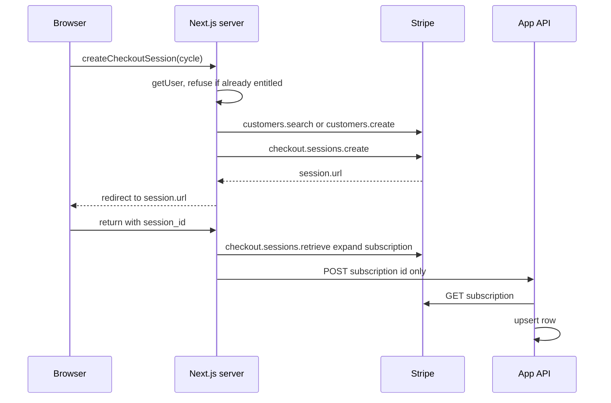

# Hosted Stripe Checkout for a subscription

The browser never sees the secret key and never tokenizes a card. A server action looks up the signed-in user (`supabase-magic-link-auth`), finds or creates a Stripe Customer, and creates a Checkout Session in `subscription` mode. The browser navigates to `session.url`. Stripe hosts the payment page. The return URL brings the user back with the session id. A second server action checks that the session belongs to this user and asks the API to write the subscription. The billing page also compares the local row with Stripe on every visit, so a missed webhook does not leave the page stale.

Webhook signature checks, refunds, and the period-field shape are `stripe-webhooks-refunds`. Whether the row grants access is `subscription-entitlements`. This module is the Customer, the session, the return, and the portal.

## Architecture



Pin both clients to the same API version. The Node SDK in this integration (`stripe` package whose `ApiVersion` export is `2025-08-27.basil`) sends that version when the constructor omits `apiVersion`. The API's HTTP client sends the same string in `Stripe-Version`. Do not let one side float to the account default.

Construct `new Stripe(secret)` inside the action, from `STRIPE_SECRET_KEY` read at call time. A client built at module import freezes whatever the key was on first load, including an empty string.

`NEXT_PUBLIC_STRIPE_PUBLISHABLE_KEY` is not used. Hosted Checkout does not load Stripe.js.

## Managed Payments

The create call sets `managed_payments: { enabled: true }` and does not set `automatic_tax` or `payment_method_types`.

Stripe's clover changelog (2026-02-25) adds `managed_payments` as a public preview: Stripe is the merchant of record, and the account must accept the Managed Payments terms before the parameter works. Stripe Tax docs say a session with Managed Payments enables automatic tax on its own. `automatic_tax.enablement_details.source` is `managed_payments`, which does not depend on a separate Tax integration configuration.

The pinned basil SDK does not type the field. Intersect the params type so the extra key is still serialized:

```ts
const params: Stripe.Checkout.SessionCreateParams & {
  managed_payments: { enabled: boolean }
} = {
  mode: "subscription",
  customer: customerId,
  client_reference_id: userId,
  line_items: [{ price: priceId, quantity: 1 }],
  metadata: { userId },
  subscription_data: { metadata: { userId } },
  success_url: `${origin}/billing?session_id={CHECKOUT_SESSION_ID}`,
  cancel_url: `${origin}/billing`,
  managed_payments: { enabled: true },
}
```

> NOTE: the changelog that introduces the field is clover, and this client pins basil `2025-08-27`. The create call sends the field anyway. Confirm the account's terms and a test-mode session before relying on tax behavior.

Do not also pass line-item `tax_rates`. Explicit tax rates conflict with Stripe Tax.

## Customer

Search before create.

1. Latest local row for this user with a non-null `stripe_customer_id`.
2. Else `customers.search` with `metadata['userId']:'<id>'` and `limit: 1`.
3. Else `customers.create` with `email` and `metadata: { userId }`.

The id is a UUID, so it has no quotes to break the search query. Do not interpolate an arbitrary string into that query.

Checkout requires an email on the auth user. Missing email returns an error and does not create a session.

Refuse a new session when either side already has a live subscription: the local entitled row (`subscription-entitlements`), or `subscriptions.list({ customer, status: "all", limit: 10 })` containing `active` or `trialing`. Send that user to the billing portal. A second session on the same customer creates a second subscription.

## Session metadata and the intro code

Session `metadata` is not copied onto the Subscription. `customer.subscription.created` will not see a user id that exists only on the session (P16). Set all three to the same user id:

- `client_reference_id`
- `metadata.userId`
- `subscription_data.metadata.userId`

`client_reference_id` max length is 200 characters. A UUID fits.

A Checkout Session accepts `discounts` or `allow_promotion_codes`, not both (P16). The SDK describes `discounts` as at most one entry. Set exactly one of the two flags.

Apply the intro code only when all of these are true:

- the cycle is monthly
- `STRIPE_INTRO_PROMOTION_CODE` is non-empty after trim
- the user has zero rows in `app_subscriptions` (any status, not only entitled)

Then `promotionCodes.list({ code, active: true, limit: 1 })`. If a row comes back, set `discounts: [{ promotion_code: promo.id }]`. If the code is missing or inactive, set `allow_promotion_codes: true` so checkout still opens. Yearly checkout, and any user who already has a row, gets `allow_promotion_codes: true` and does not get the intro code pre-applied. A canceled row still counts. The intro offer is once per user, not once per live subscription.

Price ids come from public env: monthly vs yearly. An empty price id or an empty secret returns an error before any Stripe call.

`success_url` must contain the literal `{CHECKOUT_SESSION_ID}`. Stripe substitutes it. `cancel_url` has no session id. Origin is `NEXT_PUBLIC_SITE_URL`, then the request `Origin` header, then `http://localhost:3000`. Set the site URL in every environment, including local and preview. A production site URL on a local server sends the payer back to production.

If `session.url` is missing, return an error. Do not redirect to an empty string.

## Return and reconcile

`completeCheckoutSession` runs when the billing page is opened with `session_id`.

1. Require a session user.
2. `checkout.sessions.retrieve(sessionId, { expand: ["subscription"] })`.
3. Owner is `client_reference_id`, else `metadata.userId`. If it is not the session user, return `not_found`. Do not sync and do not describe why.
4. Subscription id is the string, or the expanded object's `id`.
5. When `status` is `complete` and the id is present, `POST /api/subscription-sync/` with `{ stripe_subscription_id }` and the user JWT (`m2m-jwt-service-auth`). A sync failure is reported and does not change the returned session status.
6. Return `complete`, `open`, `expired`, or `not_found`. A thrown retrieve becomes `not_found`.

`loadBillingSubscription` uses that path when a session id is present. If the status is `complete` and the entitled row is already readable, return it. Every other visit, including a complete session whose row is not visible yet, calls reconcile.

Reconcile:

1. Load the latest local row for the user, any status.
2. Customer id is that row's customer, else the search above. No customer: return the local row only when it is entitled.
3. List up to 10 subscriptions, `status: "all"`.
4. Pick the first `active` or `trialing`. Else the one whose id matches the local row. Else the first element. None: if the local row is entitled, sync that id (a missing Stripe subscription is canceled by the API) and re-read the entitled row.
5. Map the remote subscription with the item-period mapper below. If there is no local row, or status, price, cancel flag, or period differs, sync the remote id and re-read.
6. Periods match when the unix seconds differ by at most 2. That covers timestamp rounding, not a different period.

On any thrown error, report it and fall back to the entitled local read. The page still renders.

The mapper lives in a module that is not `"use server"` (P17). Next treats value exports from a `"use server"` file as server actions, and a type-only export is erased, so a client that imports it gets `undefined` at runtime.

```ts
export function toSubscriptionPayload(subscription: Stripe.Subscription, now = Date.now()) {
  const item = subscription.items.data[0]
  const customer =
    typeof subscription.customer === "string"
      ? subscription.customer
      : subscription.customer.id
  const nowSeconds = Math.floor(now / 1000)
  return {
    stripe_customer_id: customer,
    stripe_subscription_id: subscription.id,
    status: subscription.status,
    price_id: item?.price?.id ?? "",
    quantity: item?.quantity ?? 1,
    cancel_at_period_end: subscription.cancel_at_period_end,
    canceled_at: subscription.canceled_at,
    current_period_start: item?.current_period_start ?? nowSeconds,
    current_period_end: item?.current_period_end ?? nowSeconds,
  }
}
```

Read the period from the subscription item. On basil it is not on the Subscription. A missing period falls back to now so the payload is complete. That fallback does not grant access: the end is not in the future. The API re-reads Stripe on sync and applies its own mapping (`stripe-webhooks-refunds`). This mapper only decides whether the local row already matches.

## Billing portal

`billingPortal.sessions.create({ customer, return_url })` with the same origin and `/billing`. No customer yet returns an error. The call does not pass a portal configuration id. Enable invoice history, payment-method updates, and cancel-at-period-end in the Stripe Dashboard. Canceling there updates the subscription. The webhook stores `cancel_at_period_end`. Access lasts until `current_period_end` (`subscription-entitlements`). This module does not refund.

## Schema

The browser reads its own rows through Supabase. RLS is `SELECT` for `authenticated` with `auth.uid()::text = user_id` (`supabase-rls-client-reads`). The API writes the row. The browser does not insert it.

`app_subscriptions`: `id` uuid, `user_id` text, `stripe_customer_id` text, `stripe_subscription_id` text unique, `status`, `price_id`, `quantity`, `cancel_at_period_end`, `canceled_at` nullable, `current_period_start`, `current_period_end`, `created_at`, `updated_at`. Index `user_id`, `status`, `stripe_customer_id`, `current_period_end`.

The entitled read is `user_id` equal, `status` in `active` and `trialing`, `current_period_end` greater than now, newest `created_at`, limit 1. The reconcile read is the newest row of any status.

## Environment

| Name | Where |
| --- | --- |
| `STRIPE_SECRET_KEY` | server only |
| `STRIPE_INTRO_PROMOTION_CODE` | server only; empty disables the intro code |
| `NEXT_PUBLIC_STRIPE_MONTHLY_PRICE_ID` | price id, public |
| `NEXT_PUBLIC_STRIPE_YEARLY_PRICE_ID` | price id, public |
| `NEXT_PUBLIC_SITE_URL` | return origin |
| `NEXT_PUBLIC_STRIPE_PUBLISHABLE_KEY` | unused by hosted Checkout |

The webhook secret belongs to `stripe-webhooks-refunds`. Do not put it in a `NEXT_PUBLIC_` name.

## Setup

1. Create the Product and two recurring Prices in the same Stripe mode as the secret key. Test and live keys do not share customers, prices, or promotion codes.
2. Accept Managed Payments terms if that preview is what should calculate tax.
3. Create the intro promotion code. Restrict it in Stripe (first-time, product) as well as in the zero-row check. The app check is not a Stripe redemption limit.
4. Configure the Customer Portal. Set the return URL you will pass at runtime.
5. Point `success_url` and `cancel_url` at the billing route on `NEXT_PUBLIC_SITE_URL`.
6. Create the table and the SELECT policy before the first checkout. The return path reads the row as the user.
7. Deploy the sync route from `stripe-webhooks-refunds` before sending users to Checkout. The return path calls it.

## Failure prevention

- Write `userId` on the session, on `subscription_data`, and in `client_reference_id` (P16). The webhook's subscription events only see the subscription metadata.
- Never send `discounts` and `allow_promotion_codes` on the same session (P16).
- Count every local row, including canceled, before applying the intro code. A second checkout after cancel must not get it again. If the count query errors, `count` is null and a missing check treats that as zero. Check the error and skip the intro code when the count is unknown.
- If the intro code does not list as active, open checkout with `allow_promotion_codes` instead of failing the action.
- Refuse checkout when Stripe already has `active` or `trialing`, even if the local row is missing. The portal changes the existing subscription.
- Treat a session whose owner is not the signed-in user as `not_found`.
- Put mappers and shared types in a normal module. Import them with `import type` from client components (P17).
- Read periods from `items.data[0]`. Do not read `subscription.current_period_end`.
- Set `NEXT_PUBLIC_SITE_URL` per environment so the return does not leave the environment that created the session.
- Compare periods with a 2-second tolerance before skipping sync. An exact equality check re-syncs on rounding. A multi-minute tolerance hides a real period change.
- Do not log the secret key, the session URL query, or the raw Stripe error body if it echoes a card. The action returns `error.message` to the signed-in user. That is a Stripe message, not a stack trace.

## Tests

Use a test key and a stub, not live objects. Assert the create params: both metadata copies, `client_reference_id`, `managed_payments.enabled`, and exactly one of `discounts` or `allow_promotion_codes`. Monthly with zero rows and an active promo sets `discounts`. Monthly with a canceled row, yearly, and a missing promo set `allow_promotion_codes`. An entitled local row and a remote `active` subscription each return an error and do not create a session. A retrieved session owned by someone else returns `not_found` and does not POST. `toSubscriptionPayload` reads the item period and, when the item period is absent, uses the injected `now`. A client component test imports the mapper from the non-server module and expects a function, not `undefined`.

## Checklist

- [ ] Secret key is server-only and read inside the action.
- [ ] Node SDK and API client both pin `2025-08-27.basil`.
- [ ] Managed Payments terms accepted, or the flag removed until they are.
- [ ] `userId` set on the session, the subscription, and `client_reference_id`.
- [ ] Intro code only for monthly users with zero subscription rows, and never combined with `allow_promotion_codes`.
- [ ] Existing `active` or `trialing` subscription opens the portal instead of a new session.
- [ ] Return handler ignores a session id that belongs to another user.
- [ ] Period mapper uses the subscription item and lives outside `"use server"`.
- [ ] `NEXT_PUBLIC_SITE_URL` matches the environment.
- [ ] Browser policy is SELECT-own-rows. The API writes the row.
