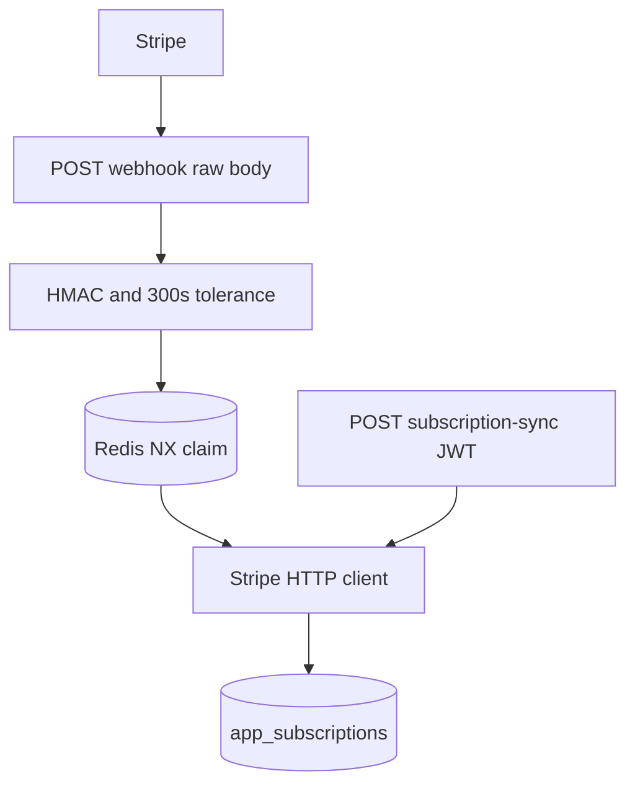

# Stripe webhooks, sync, and refund cancellation

Stripe is the source of truth for status and period. The browser never posts a status. It posts a subscription id, and the API retrieves the object. The webhook does the same retrieve or trusts the signed event. Both paths call one upsert.

`stripe-checkout` creates the session and the Customer metadata. `subscription-entitlements` decides access from the row this module writes. This module is the signature, the event switch, the HTTP client, and the refund cancel.

Pin `Stripe-Version` to `2025-08-27.basil` on every call, the same version the Checkout SDK sends. Basil removed `current_period_start` and `current_period_end` from the Subscription and removed `payment_intent` from the Invoice (P15). Read the period from the subscription item. Resolve a refund's invoice through `invoice_payments`, then the charge or payment intent on that payment. Do not read the removed attributes.

## Architecture



The webhook route is exempt from the user JWT and from the rate limit (`m2m-jwt-service-auth` exempt list). The signature is the authentication. The sync route is not exempt. It requires the user JWT and checks the subscription metadata against `sub`.

Answer 200 only after the handler finishes. Answer 500 on a processing error so Stripe retries. Answer 400 on a bad signature or bad JSON. Answer 500 when `STRIPE_WEBHOOK_SECRET` is empty. Do not answer 200 for a misconfigured endpoint. Stripe would stop retrying.

## Signature

Read `request.body` bytes. Do not parse JSON first and do not re-serialize. Frameworks that parse the body change bytes and the HMAC fails. Stripe's docs: the signed payload is the exact UTF-8 body, and the libraries' default tolerance is 5 minutes. A tolerance of 0 in Stripe's libraries disables the recency check. This implementation does the opposite: `tolerance_seconds` of 0 rejects every event that is not in the current second. Keep 300.

Header shape is `t=<unix>,v1=<hex>,v0=<hex>`. Ignore unknown keys. Require `t` and at least one `v1`.

```python
def verify_stripe_signature(payload: bytes, header: str, secret: str, tolerance: int = 300) -> bool:
    values: dict[str, list[str]] = {}
    for item in header.split(","):
        if "=" not in item:
            continue
        key, value = item.split("=", 1)
        values.setdefault(key, []).append(value)
    timestamp = (values.get("t") or [None])[0]
    signatures = values.get("v1") or []
    if not timestamp or not signatures:
        return False
    try:
        event_time = int(timestamp)
    except ValueError:
        return False
    if abs(time.time() - event_time) > tolerance:
        return False
    signed = f"{timestamp}.{payload.decode('utf-8')}".encode("utf-8")
    expected = hmac.new(secret.encode("utf-8"), signed, hashlib.sha256).hexdigest()
    return any(hmac.compare_digest(expected, sig) for sig in signatures)
```

`compare_digest` on every `v1`. Stripe can send more than one during a secret roll. Reject when the absolute difference from `time.time()` exceeds 300 seconds, so a captured payload cannot be replayed later and a far-future timestamp cannot be reused. Sync the host clock with NTP. Stripe issues a new `t` and signature on each retry. Verify before `json.loads`.

## Idempotency

Two Redis claims, both `SET key 1 NX EX 3600`.

| Key | When |
| --- | --- |
| `stripe:evt:<event id>` | Start of every webhook event |
| `stripe:substate:<sub id>:<status>:<cancel 0 or 1>:<period end epoch>` | Before the upsert |
| `stripe:substate:<sub id>:deleted` | Before the deleted-status update |

A failed claim on the event key returns 200 `{"received": true, "duplicate": true}` and does not touch Stripe. Release the event key if processing throws, then return 500 so the retry can claim it.

A failed claim on the state key returns the existing row when one exists and skips the write. If the key is claimed but the row is missing, fall through and write. Release the state key if the write throws.

Redis errors fail open: log and return claimed. A Redis outage must not block a real subscription write. Duplicate writes then rely on `update_or_create` by `stripe_subscription_id`.

The state fingerprint includes status, the cancel flag, and the period-end epoch. A renewal is a different key. The same state delivered by `checkout.session.completed` and `customer.subscription.updated` writes once.

## Events

| Type | Action |
| --- | --- |
| `checkout.session.completed` | If `mode` is `subscription` and `subscription` is set, retrieve that subscription and upsert. Fallback user id: subscription `metadata.userId`, else session `client_reference_id`, else session `metadata.userId`. |
| `customer.subscription.created` | Upsert the event object. |
| `customer.subscription.updated` | Upsert the event object. |
| `customer.subscription.deleted` | Mark the local row canceled. Do not require items or a price id. |
| `invoice.payment_succeeded` | If a subscription id is on the invoice, set `active` and copy the first line's `period` when present. Do not insert a row. |
| `invoice.payment_failed` | Set `past_due` on the existing row. Do not insert. |
| `refund.created` | Cancel immediately when the refund asks for it. See below. |

Ignore other types with 200. Log the event id and type. Do not log the full object. It can contain an email and a payment method.

Unknown event types still consume the event idempotency key. That is fine. A later new handler needs a deploy before those events are useful, and Stripe will not replay a 200.

### Record mapping

Accept either a compact sync payload or a Stripe Subscription.

- User id: explicit fallback, else `metadata.userId`. Required for an upsert. A missing user id raises. The webhook returns 500, and Stripe retries until it stops. Fix the subscription metadata, then replay the event. A retry alone does not invent the user id.
- Customer: string or expanded `{id}`.
- Price and quantity: first `items.data` entry. Price id is required for an upsert.
- Period: payload `current_period_start` / `current_period_end` if the caller already resolved them, else the same fields on the first item (P15). Convert unix seconds to a timezone-aware datetime. `None` becomes now.
- `cancel_at_period_end`: the boolean, or true when `cancel_at` is set. The portal can cancel by setting `cancel_at` alone.
- `canceled_at`: converted when present, else null on the upsert. The deleted path uses the payload timestamp or now.

Required on upsert: `user_id`, `stripe_customer_id`, `stripe_subscription_id`, `price_id`. Missing fields raise `ValueError`. The webhook turns that into 500. The sync route turns it into 400.

After every successful upsert, delete, past-due mark, or invoice activation, recompute plan allowance (`subscription-entitlements`).

### Invoice subscription id

Basil invoices often omit top-level `subscription`. Look in this order:

1. `invoice.subscription`
2. `invoice.parent.subscription_details.subscription`
3. Each `lines.data[].parent.subscription_item_details.subscription`

Stop at the first hit. Log and skip when none exist. Do not guess from the customer.

### Refund cancellation

`refund.created` cancels only when `reason` is `requested_by_customer` and `status` is `succeeded`. Dashboard reason "Other" leaves `reason` empty. `duplicate` and a `pending` refund do not cancel.

1. Find the invoice with `invoice_for_refund`. Prefer `payment_intent` on the refund, else `charge`. Query `GET /invoice_payments` with `payment[type]` and `payment[payment_intent]` or `payment[charge]`, `limit` 1. Then `GET /invoices/<id>`. No payment reference, or no invoice payment, means there is nothing to cancel. Log and return.
2. Extract the subscription id as above.
3. Retrieve the subscription. If status is not `canceled`, `DELETE /subscriptions/<id>`. That cancels immediately. It is not cancel-at-period-end.
4. A 404 on retrieve or delete means Stripe already removed it. Synthesize `{id, status: canceled}` and continue.
5. `sync_deleted` sets local status to the payload status or `canceled`, stores `canceled_at`, and recomputes allowance.

`refund_latest_paid_invoice` is implemented and has no production caller. It lists the newest paid invoice (`status=paid`, `limit=1`), skips when `amount_paid` is 0, lists paid `invoice_payments`, and posts `/refunds` with `reason=requested_by_customer` and idempotency key `money-back:<subscription id>:<invoice id>`. A payment of type `payment_intent` sends `payment_intent`. Type `charge` sends `charge`. No refundable payment raises. Do not read `invoice.payment_intent` (P15).

`is_money_back_cancellation` is also unused by the webhook. It is true only when `previous_attributes` shows a new `cancel_at_period_end` or `cancel_at`, status is `active` or `trialing`, the first item's price interval is `year`, and the UTC calendar-day gap from the item's `current_period_start` is at most 14. The cancel UI computes the same window for a support request (`subscription-entitlements`). Nothing in the request path refunds automatically. If you wire the helper, the `refund.created` handler above is what ends the subscription. Do not also delete it in the money-back branch.

## Sync route

`POST /api/subscription-sync/` with the user JWT. Body is `{ stripe_subscription_id }` only. Ignore any status or period the client sends.

1. Retrieve the subscription with the HTTP client.
2. Stripe 404: if this user already owns that id, run the deleted sync and return the row. If they do not own it, return 400. A guessed id must not cancel someone else's row, and a 404 for an unknown id must not create one.
3. Other Stripe errors return 500.
4. If `metadata.userId` is non-empty and differs from the JWT subject, return 400.
5. If `metadata.userId` is empty, require an existing row owned by the subject. Otherwise 400. A brand-new subscription must carry the metadata `stripe-checkout` writes.
6. Upsert with `fallback_user_id` set to the subject, so a metadata miss on an owned row still has a user id.

The complete Checkout return calls this route when it has a subscription id. Ordinary billing-page loads only read local entitlement; no page-load reconciliation calls it. The webhook may write the same state first. The state key makes a repeated equivalent sync a no-op.

## HTTP client

`https://api.stripe.com/v1`, timeout 20 seconds, a new `httpx` client per call. Header `Authorization: Bearer <STRIPE_SECRET_KEY>` and `Stripe-Version: 2025-08-27.basil`. GET and DELETE send `params` as the query string. POST sends `data` as form fields, which is what Stripe's nested bracket keys expect (`payment[type]`). Optional `Idempotency-Key`. Status 400 or above raises with `error.message` and the status code. An empty secret raises before the request.

Do not use the Stripe Python SDK beside this client. One version pin, one mapping.

## Schema

Same `app_subscriptions` row as `stripe-checkout`. Unique on `stripe_subscription_id`. `update_or_create` keys on that column and overwrites the rest, including `user_id`. Do not attach a subscription to a second user by replaying an old id. The metadata check on the sync route is what stops that. The webhook trusts the signed metadata.

Status values stored: `active`, `canceled`, `incomplete`, `incomplete_expired`, `past_due`, `paused`, `trialing`, `unpaid`. Default `incomplete`.

## Environment

| Name | Role |
| --- | --- |
| `STRIPE_SECRET_KEY` | retrieve, cancel, refund |
| `STRIPE_WEBHOOK_SECRET` | HMAC secret for this endpoint only |

The webhook secret is per endpoint. A CLI forwarding secret is not the deployed endpoint's secret. Roll the endpoint secret in Stripe and deploy the new value together. Both `v1` signatures verify during the roll only if you check every `v1`, which this function does, but only against the one configured secret. During a roll, Stripe signs with the new secret. Put the new secret in the environment when you roll.

Register at least the seven event types in the table. The path is the exempt webhook path.

## Setup

1. Deploy the exempt POST route and the JWT sync route.
2. Set both secrets. Confirm the version header on a test retrieve matches the Checkout SDK.
3. Create the endpoint in the same Stripe mode as the secret key. Subscribe the seven types.
4. Send a fixture with a bad signature and expect 400. Send a stale `t` and expect 400. Send a valid signature and expect one row.
5. Replay the same event id and expect `duplicate: true` and no second write.
6. Point Checkout's return path at the sync route before enabling the pay button.

## Failure prevention

- Verify the raw body. Do not run a JSON parser before the HMAC (Stripe's signature docs).
- Keep the tolerance at 300 seconds. Do not pass 0.
- Read periods from the subscription item, and refund targets from `invoice_payments` (P15).
- Put `userId` on the subscription at Checkout time. The webhook cannot invent it.
- Claim the event key before work and release it on failure. A 500 without a release makes every retry a duplicate for an hour.
- Fail open only when Redis itself errors. A duplicate key is not an error.
- `invoice.payment_succeeded` and `invoice.payment_failed` update. They do not insert. The subscription events insert.
- `DELETE` the subscription only for a succeeded `requested_by_customer` refund. Portal cancellation stays cancel-at-period-end and arrives as `customer.subscription.updated`.
- On sync, a 404 cancels a row only when the JWT user owns that id.
- Compare metadata `userId` to the JWT subject before writing.
- Do not log the raw body. Log event id, type, and subscription id.
- Exempt the webhook from the user rate limit so Stripe's retries are not throttled into 429s that Stripe treats as failures.

## Tests

Build the signature in the test: `t` is the current unix time, HMAC-SHA256 of `t + "." + body` with the test secret, header `t=...,v1=...`. Assert 400 for a flipped bit, a missing header, a timestamp 301 seconds old, and a timestamp 301 seconds ahead. Assert a second `v1` of the valid digest passes. Assert `past_due` and `pending` refunds do not cancel, and `requested_by_customer` plus `succeeded` calls delete once. Assert the refund lookup uses `/invoice_payments` and never reads `payment_intent` on the invoice. Assert the period written to the row equals the item's `current_period_end`, not a top-level field. Assert two concurrent deliveries of one event id produce one upsert. Assert sync with another user's `metadata.userId` returns 400.

## Checklist

- [ ] Webhook path is JWT-exempt and rate-limit-exempt. Sync is not.
- [ ] Signature uses the raw body, every `v1`, and a 300-second absolute window.
- [ ] `STRIPE_WEBHOOK_SECRET` empty returns 500.
- [ ] API version header is `2025-08-27.basil` on every call.
- [ ] Period comes from the subscription item. Invoice subscription id uses the parent and line fallbacks.
- [ ] Refunds resolve `invoice_payments`, then cancel only for `requested_by_customer` and `succeeded`.
- [ ] Event key and state key are claimed before writes and released on failure.
- [ ] Redis failure fails open. A duplicate event returns 200.
- [ ] Sync ignores client-supplied status and checks `metadata.userId` against the JWT.
- [ ] Money-back refund helper stays unwired unless `refund.created` is the only cancel path.
