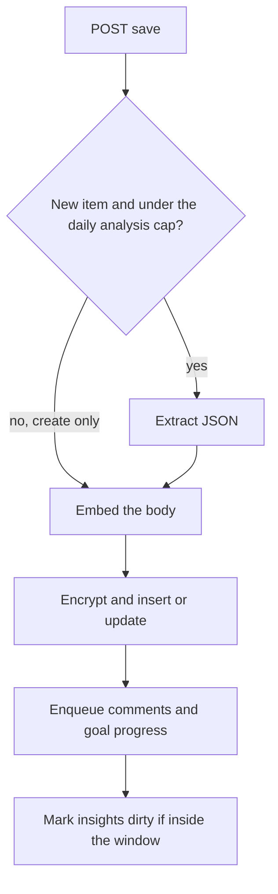

# Structured extraction, goal progress, and a five-week insights cache

The save handler streams progress events and persists one item. Extraction, the embedding, and goal links happen before the response finishes. Companion comments are `llm-comment-generation` and run only after a new analyzed row commits. Goal progress is a second actor. Charts and the written insights cache use a five-week window that starts on Monday, not "since the newest item".

Completions, embeddings, the token counter, and the fence-stripping JSON parser come from `llm-comment-generation`. Ciphertext for title, body, topics, keywords, people, analysis, goal text, and the insights blob is `aes-gcm-field-encryption`. Workers are `dramatiq-redis-workers`.

## Save stream

The client sends `X-Client-Local-Time: YYYY-MM-DD HH:MM:SS` and, on a create, `X-User-Created-At` as ISO-8601. A missing or malformed header is 400. Never invent a clock.

Parse the item timestamp the same way and label it UTC without shifting the digits. Those digits are the author's wall clock. Recency, quotas, and the insights window all compare against that labeled value.



SSE events are `progress`, then `success` with the item id, or `error`. Analysis failure stops before the embedding and writes nothing. Embedding failure stops before the write. The client can save again.

Creates check the analysis quota. Updates always extract. The free cap is one analyzed item per local calendar day. Premium is unbounded. The count is rows for that user whose stored timestamp falls on that local day and whose `sentiment_score` is not null. Over the cap, the create still embeds and saves, with extraction skipped. Skipped extraction means empty topics, keywords, people, and analysis, a null sentiment, no comment job, and no goal links.

Showcase, for comment tier only: a new analyzed save by a non-premium account, server `now` still inside 7×24 hours after signup, and no other item already stored on that local calendar day. The check is existence, then the flag is stored on the row.

Resolve the row before the model call. A create with a blank title uses the first readable line of the body: strip tags, collapse whitespace, 60 characters, ellipsis if cut, or "Untitled" when nothing remains. An update keeps the stored calendar day. Its title becomes the incoming title, else the stored title, else that same fallback. The model may replace the title later.

Active goals are loaded by status `active`. Match keys are lowercased titles. Response language is loaded for the goal actor and for comments. The extractor does not interpolate it.

## Extraction

User-prompt cap is 8_000 tokens. The counter is the one in `llm-comment-generation` (answer-role model unless you pass the completion model). If the prompt is over the cap, trim the body from the start-preserving trimmer by the overflow and rebuild. If it is still over, trim once more by the new overflow. Do not drop the goal list or the taxonomy to fit. Do not halve the text.

Call `complete` at `temperature=0.2`, `top_p=1.0`, `max_tokens=4096`, thinking off. The system line requires a JSON object and English for every user-facing string except person aliases. The user prompt also requires `title` in the item's language.

Ask only for signals grounded in the text. Absent signals are null or 0. Closed sets:

| Field | Allowed values | Fallback |
| --- | --- | --- |
| needs.autonomy, competence, relatedness | satisfied, neutral, frustrated | neutral |
| relationships.pattern | demand_withdraw, blame_defend, supportive, conflict, neutral | neutral |
| narrative.sequence | redemption, contamination, neutral | neutral |
| narrative.ending | resolved, unresolved, meaning_made | unresolved |
| people.role | spouse, family, friend, colleague, public_figure, stranger, unknown | unknown |
| topics | the taxonomy below, case-insensitive | drop unknown |
| goals | active goal titles, case-insensitive | drop unknown |

Taxonomy, in order: Relationships, Emotions, Daily Routine, Health, Self-Improvement, Work, School, Hobbies, Travel, Reflections, Finances, Aspirations, Challenges, Gratitude, Events, Occasions, Nature, Technology, Identity, Planning, Spirituality, Learning, Home, Creativity.

Numeric clamps: valence and relationship sentiment on `[-1, 1]` default 0; arousal, granularity, and cognitive markers on `[0, 1]` default 0; dominance default 0.5; temporal `present` default 1; pronoun `i` default 1 and `we` default 0. `causal_words` and `insight_words` are integers at least 0. Keywords are trimmed to 8 non-empty strings. A person may be a string or `{name, aliases, role}`. Canonicalize the name through a small alias table (surface form to a stable English name) before storage. Keep original spellings in `aliases`.

Stored object:

```json
{
  "emotion": {
    "valence": 0.0,
    "arousal": 0.0,
    "dominance": 0.5,
    "primary": "unspecified",
    "secondary": null,
    "granularity": 0.0,
    "mixed": false
  },
  "cognitive": {
    "rumination": 0.0,
    "mind_reading": 0.0,
    "catastrophizing": 0.0,
    "should_statements": 0.0,
    "personalization": 0.0,
    "labeling": 0.0
  },
  "needs": {"autonomy": "neutral", "competence": "neutral", "relatedness": "neutral"},
  "relationships": [{"person": "Alex", "pattern": "neutral", "sentiment": 0.0, "summary": ""}],
  "trigger_chain": {"event": null, "interpretation": null, "emotion": null, "behavior": null},
  "narrative": {"sequence": "neutral", "ending": "unresolved"},
  "language": {
    "temporal_focus": {"past": 0.0, "present": 1.0, "future": 0.0},
    "pronoun_ratio": {"i": 1.0, "we": 0.0},
    "causal_words": 0,
    "insight_words": 0
  },
  "topics": [],
  "keywords": [],
  "people": [{"name": "Alex", "aliases": [], "role": "unknown"}],
  "goals": []
}
```

`sentiment_score` is an integer 0–100 with a check constraint. If the raw object has `sentiment`, clamp that. Otherwise map valence with `round((valence + 1) * 50)`. Primary emotion falls back to `"unspecified"`. An empty trigger chain is four nulls. A non-object payload raises, which the save turns into an error event and no row.

Generated title comes from the raw object, collapsed whitespace, 60 characters. It replaces the placeholder when present. Detect language with `langid` on the body for later keyword tokenization. On failure log a warning and leave language null.

Copy denormalized `topics`, `keywords`, and `people` names onto the row as well as the full object. Encrypt those JSON values and the title and body. Leave `sentiment_score`, the vector, language, and `showcase` as plain columns.

Embed the raw body, not the JSON. A wrong dimension raises and the save stops. Guard the stored vector with `is not None` and `len` before any later similarity call (P12). Do not use the vector as a boolean.

Link goals only through the active-title map. The model cannot create a goal by naming one. Set the many-to-many to that id list. On update, pass the list even when it is empty so removed links clear.

After the row commits:

- New and analyzed: enqueue comment generation. A send error is logged. The success event still fires.
- One goal-progress message per linked id, on create and on update, carrying the decrypted title and body. Those strings sit in Redis until the actor runs. Keep the broker private and do not log the message.
- If the stored timestamp is inside the insights window for `X-Client-Local-Time`, mark the cache dirty. A failure here is logged and the save still succeeds.

A soft delete uses the same window test and marks dirty after the delete. That path does not swallow the flag error: a failure returns 500 even though the row may already be hidden.

## Goal progress actor

The actor loads the goal for that user, including decrypted linked items (title, timestamp, body), newest first. A missing goal returns. Previous `summary` and `feedback` are read from the stored object when it is a dict.

Input cap is 8_000 tokens minus the system text. Related items are newest first, so overflow keeps that prefix. If the prompt with no related items is still over the cap, trim the new body and send that. Otherwise add whole items until the next one does not fit, then trim that item's body to the remainder. Rebuild, and if still over, trim the last kept body by the overflow. Do not halve.

`complete` at `temperature=0.6`, `top_p=1.0`, `max_tokens=2000`, thinking off. User-facing strings use the preference language. Keys stay English. Shape:

```json
{
  "summary": "",
  "feedback": {"score": 0, "feedback": "", "suggestions": []}
}
```

Score is an integer 0–10. Replace `ai_analysis` with the object. Do not merge onto the previous dict. Encrypt on write.

Parse with the shared fence stripper, then require a dict that contains `summary` and `feedback` before writing. The reference actor calls `json.loads` on the raw string and writes the value through. A fenced payload fails that call and the broker retries. A JSON array would be stored. Use the shared parser and the shape check, and re-raise so a bad payload retries instead of wiping the previous analysis.

The actor re-raises on other errors. It does not set `time_limit`. Restart the worker after changing it (`dramatiq-redis-workers`, P04).

A new goal starts as `{"summary": "", "feedback": {"score": 0, "feedback": "", "suggestions": []}}`.

## Insights window

`ANALYSIS_WEEK_COUNT = 5` on the server and in the browser. The start is Monday 00:00 of the week four complete weeks before the current week: take the reference civil date, move to that week's Monday, subtract 28 days. Python `weekday()` is Monday=0. JavaScript `getDay()` is Sunday=0, so map 0 to 7 and subtract `weekday - 1`. Both use the client wall clock. The server clock as "today" moves the boundary for anyone not on UTC.

An item is inside the window when its stored timestamp is greater than or equal to that start. Align naive and aware values before comparing. Chart code compares with timezones stripped. The dirty check uses the same start.

Charts do not call a model. The stats route requires `X-Client-Local-Time` and returns counts, scores, and refs (`id`, title, timestamp). It does not return bodies. It is not premium-gated. The browser recomputes the same window from items it already holds. Share the week count and the Monday start. The two payloads are not field-identical: the server keeps 8 topics and 12 people, and leaves a missing topic empty; the browser chart helper does not apply that topic cap and substitutes a fallback topic label.

Server chart keys: `entriesInRange`, `emotionHabitat`, `topicLandscape`, `peopleBubbles`, `attentionSeries`, `selfFocus`, `insightRate`, `cognitiveAverages`, `needsWeekly`, `needsCurrent`, `needsFrustrated`, `relationshipCards` (4), `triggerChainCount`, `narrativeSplit`. Only rows with `analysis.emotion` are analyzed. Habitat, topics, and people ignore the rest. Word counts strip tags. Lifetime streaks and a 21-day grid are a different route. They do not use this window.

The written cache is a separate row per user: encrypted JSON, `insights_dirty`, `source_window_start`, `updated_at`.

GET returns the cache when `generated_at` is set, the dirty flag is clear, and `source_window_start` equals the current window start. Otherwise the response is empty prose with `stale` and `has_cache`. Old ciphertext stays in the row until a commit lands. Do not treat that empty body as "no patterns".

POST regenerates. Read `updated_at`, compose, then update only where `updated_at` still matches. Clear dirty and store the window start in that same update. Two attempts. If both miss, return empty prose with `stale: true` and `has_cache: true`. Marking dirty sets the flag and moves `updated_at`, which is what makes an in-flight commit miss. Create the row when it does not exist. On a unique-constraint race, update the existing row.

Compose loads items from `reference_now` back across the span of the window (`(reference_now - start).days + 1`), then keeps timestamps at or after the start. Premium uses every row in that set. A free account whose signup is still inside 7×24 hours generates with showcase rows only. After that week, GET is an empty locked payload and POST is 403. Chart numbers stay available.

Each model row is an index, timestamp, title, a 1200-character body excerpt, and the structured fields. The prompt tells the model to work from that payload. The excerpt is still in the payload. Input cap is 32_000 tokens. While over the cap and more than one row remains, drop the front row and rebuild. The window list is newest-first, so that drop removes the newest excerpt and keeps older rows. `complete` at `temperature=0.3`, `max_tokens=4096`, thinking off, English strings. Clip after parse: narrative reading 45 words, cognitive reading 32, each relationship note 30, at most 8 notes. Empty window stores empty strings plus `generated_at` and does not call the model.

Cache keys: `summary`, `feedback`, `rumination_loops`, `trigger_groups` (`events`, `emotions`, `behaviors`), `trigger_flows`, `narrative_reading`, `cognitive_reading`, `relationship_notes`, `generated_at`, `source_max_datetime`.

## Environment

Same LLM variables as `llm-comment-generation`. `REDIS_URL` for the goal actor. `BETA_TESTING` changes the tier that selects the analysis cap and the insights gate, because tier resolution returns premium for every user when it is true. Headers: `X-Client-Local-Time`, `X-User-Created-At`.

## Tests

- A vector used as a boolean raises. `is not None` and `len` accept the same value (P12).
- Over the free daily cap, a create saves with null sentiment and does not enqueue comments. An update still extracts.
- A goal title the user does not have is dropped. Matching is case-insensitive.
- A fenced extraction object parses. A non-object becomes an error event and no row.
- The goal prompt over 8_000 tokens keeps the newest related items and trims from the end of a body, never by half.
- Window start for a Wednesday is the Monday four weeks before this week's Monday. A timestamp on the previous Monday is inside. One second earlier is outside.
- A save inside the window sets dirty and moves `updated_at`. A commit that still has the old timestamp writes. A commit after the bump does not, and the second miss returns `stale`.
- GET while dirty returns empty prose and leaves the stored blob in place.
- Showcase-only generation excludes non-showcase rows. A free account outside the 7-day window gets 403 on POST.

## Checklist

- [ ] Client local time is required and stored as labeled wall-clock digits.
- [ ] Analysis failure and embedding failure leave no new row. A skipped analysis still embeds.
- [ ] Topics, roles, needs, and goals are closed sets. Sentiment is 0–100 from the raw field or from valence.
- [ ] JSON columns and the body are encrypted. The vector is a Python list before any boolean test (P12).
- [ ] Comments enqueue only for a new analyzed item. Goal progress enqueues per linked id and replaces `ai_analysis` only after the shape check.
- [ ] Insights use five Monday-start weeks on the client clock, on the server and in the browser.
- [ ] Dirty bumps `updated_at`. The commit is conditional on that timestamp. Stale reads do not pretend the cache is empty of history.
- [ ] The goal worker was restarted after an actor change.
