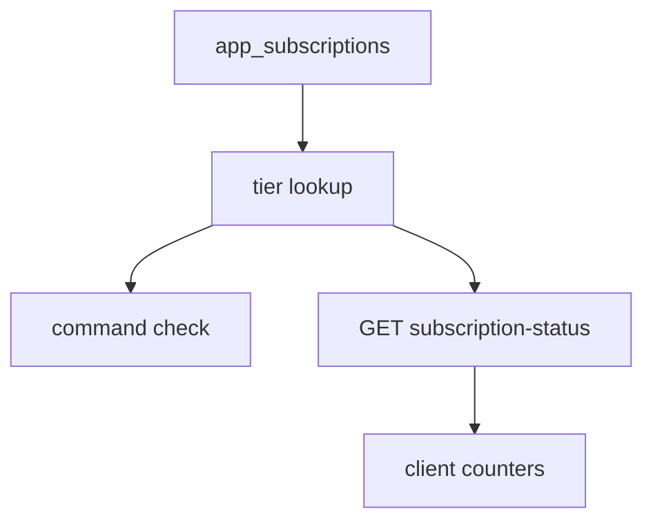

# Plan entitlement, quotas, and cancel policy

Access is a row in `app_subscriptions`, written by `stripe-webhooks-refunds`. The paid tier is `active` or `trialing` and `current_period_end` still in the future. `cancel_at_period_end` does not remove access. `past_due`, `canceled`, `unpaid`, `incomplete`, `incomplete_expired`, and `paused` are the free tier. A missing row is the free tier.

The browser may hide buttons. The API still checks. Checkout success is not entitlement. The row is.

The client and the server each keep a copy of the numbers. The status route returns tier and usage counts. It does not return the caps. The client applies its copy for display and for optimistic buttons. The server applies its copy inside each command.

## Architecture



After every subscription upsert, delete, past-due mark, or invoice activation, recompute allowance for that user. Paid tier restores plan-paused records. Free tier freezes the extras.

A closed-beta flag on the API (`BETA_TESTING`) returns the paid tier before the row lookup. A separate public flag (`NEXT_PUBLIC_BETA_TESTING`) overwrites the status payload to paid after the fetch. Set both or neither. One flag makes the UI and the API disagree.

## Who is paid

```python
def is_paid(row, now) -> bool:
    if row is None or row.status not in ("active", "trialing"):
        return False
    return row.current_period_end > now
```

The API lookup is that filter, then any matching row. Order does not matter: one qualifying row is enough. On a database error, return the free tier. Do not fail open into the paid tier.

The browser's entitled read is the same predicate, newest `created_at` first, limit 1 (`stripe-checkout`).

`past_due` from `invoice.payment_failed` drops access immediately. It does not wait for the period end. A later `invoice.payment_succeeded` sets `active` and can move the period forward from the invoice line. Until that event, the user is on the free tier even if `current_period_end` is still ahead.

## Limits

Both copies use these numbers. The client stores the four uncapped paid counters as `null`. The server stores them as infinity and returns before comparing, so the infinity values are not the branch that allows the action. Retrieval caps stay finite on the paid tier.

| Cap | Free | Paid |
| --- | --- | --- |
| Analyzed items per local day | 1 | uncapped |
| Messages per local day | 5 | uncapped |
| Active goals | 1 | uncapped |
| Custom profiles | 1 | uncapped |
| Memory days | 7 | 30 |
| Recent items injected | 1 | 5 |
| Similar items | 1 | 3 |
| Knowledge chunks | 1 | 3 |
| Similar chats | 1 | 3 |
| Include similar items | yes | yes |
| Analytics window days | 30 | 30 |

`analytics_days` is 30 on both tiers and is not read by the quota methods. Do not invent a 30-day analytics gate from it.

Saving an item is always allowed. Analysis is gated. Choosing a catalog profile is always allowed. The client lock helper returns false, and the locked-name list is empty.

The chat send check takes an optional tier. When the caller already resolved it, do not query the row again. The paid tier skips the message count. The free tier counts. Do not call the full status method on that path. Status also counts items, goals, and profiles, and the send path does not need them.

## Local day

The browser sends `X-Client-Local-Time: YYYY-MM-DD HH:MM:SS` from the wall clock, no offset. The server parses those digits and labels them UTC. It does not convert zones. A missing or malformed header is 400. Do not substitute the server clock. A server-rendered snapshot may seed the UI before this fetch returns. Once the browser-clock fetch has settled, ignore later seeds. A server clock is the wrong day near midnight.

Analyzed items: the user's non-deleted items whose timestamp falls in `[local midnight, next local midnight)` and whose analysis field is non-null. The analysis field is whatever extraction writes. An unanalyzed save does not consume the daily cap.

Messages: user-authored messages whose run stored that same local timestamp, and whose date equals the header's date.

`X-User-Created-At` is the auth user's ISO-8601 `created_at`. The status route requires it. Account age is whole months (`years * 12 + months`) against that timestamp. Age is returned on the status payload. No quota in this module depends on it. The status route does not start a trial from account age.

Status response:

```json
{
  "tier": "free",
  "is_premium": false,
  "account_age_months": 3,
  "usage": {
    "daily_analyzed_count": 0,
    "daily_message_count": 1,
    "total_message_count": 4,
    "active_goals_count": 1,
    "custom_profiles_count": 0
  }
}
```

`is_premium` is true when `tier` is `premium`. The public beta flag overwrites both fields to the paid values after the fetch. The wire values stay `free` and `premium`. The client treats `is_premium` as the paid boolean.

A separate `GET` returns only today's message count, for a thread switch that should not reload goals and profiles. Same local-time header. Same JWT.

## Commands

Each check returns `(allowed, message)`.

| Action | Free rule |
| --- | --- |
| Save item | Always allowed. |
| Analyze item | `daily_analyzed_count` is below 1. |
| Send message | Today's user messages are below 5. |
| Create goal | Active goals are below 1. |
| Select catalog profile | Always allowed. |
| Create custom profile | Non-paused custom profiles are below 1. |

The paid tier skips those comparisons. Messages say which cap was hit. The client increments its local counter only after the command succeeds, so a rejected command does not burn a displayed slot. Refresh today's message count from the count route when switching threads. The optimistic counter drifts if a send fails after the increment. Decrement or refetch on failure.

## Freeze and restore

Freezing keeps one goal and one custom profile, which is the free cap. The implementation keeps index 0 and freezes the rest. Raising the cap in the limits dict without changing that slice still freezes everything after the first.

Goals, newest activity first (`updated_at`, then `created_at`): the rest become `terminated` with `paused_by_plan` true.

Custom profiles, newest first (`created_at`, then id), not deleted: the rest get `is_paused` true and `is_published` false. Delete the user's membership rows for those ids. The count of custom profiles ignores paused and deleted rows, so a paused profile does not fill the free slot.

Restore, when the tier becomes paid: goals with `paused_by_plan` go back to `active` and the flag clears. Paused, non-deleted custom profiles clear `is_paused`. Leave `is_published` false. Publishing is a separate action.

Skip the allowance change when the user id is not a UUID. Log it. The subscription row may still store that id. Goal and profile foreign keys are UUIDs.

Run this after the row write, on the webhook and on the sync route. A user who cancels at period end stays paid until `current_period_end`, so nothing freezes at cancel time. The freeze runs when a later event stores `canceled` or `past_due`, or when the period end is in the past and something recomputes the tier. `get_user_subscription_tier` does not freeze by itself. Call the allowance function from the writers. A period that elapses with no Stripe event leaves the old goals in place until the next sync. The billing-page reconcile (`stripe-checkout`) is what pulls that update when the user next opens billing. Command checks already see the free tier because they compare `current_period_end` to now. They do not wait for the freeze.

## Cancel policy

The Customer Portal cancels at period end (`stripe-checkout`). The local flag is `cancel_at_period_end` or a non-null `cancel_at` (`stripe-webhooks-refunds`). Entitlement ignores the flag and honors `current_period_end`.

The support refund window is 14 UTC calendar days, inclusive. Day 0 is the period-start date. Day 14 still qualifies. Day 15 does not. Compare start-of-UTC-day values, not elapsed hours. A yearly price is the one whose id equals `NEXT_PUBLIC_STRIPE_YEARLY_PRICE_ID`. Anything else, including an empty price id, is monthly. Monthly cancel has no support-refund deadline. Yearly cancel inside the window can ask support for a refund. The UI does not call the refund API.

The server predicate `is_money_back_cancellation` uses the Stripe price interval `year` and the item's `current_period_start`, and it is not called from the webhook. Keep the constant 14 on both sides. A wrong yearly price id makes the UI and the interval predicate disagree. The refund, if support issues one with reason `requested_by_customer`, cancels immediately through `refund.created` (`stripe-webhooks-refunds`). That is a different path from cancel-at-period-end.

## Setup

1. Put the limit dict in server settings and the same numbers in client config. Paid uncapped counters are `null` on the client.
2. Gate analyze, send, goal create, and custom-profile create on the server methods. Leave save and catalog select open.
3. Send `X-Client-Local-Time` from `formatLocalDateTime` on the browser, including the status fetch that overrides the server seed.
4. Call the allowance function at the end of each subscription writer.
5. Teach the cancel screen the 14-day yearly window. Point the button at the billing portal, not at a refund call.
6. Leave `BETA_TESTING` and `NEXT_PUBLIC_BETA_TESTING` unset in production.

## Failure prevention

- Treat `cancel_at_period_end` as still paid until `current_period_end`.
- Treat `past_due` as free even when the period end is in the future.
- On a tier lookup error, return free.
- Do not substitute the server clock when the local-time header is missing.
- Ignore a server-rendered usage seed after the browser-clock fetch has settled.
- Keep the freeze slice equal to the free cap. The cap in the dict is not what the slice reads.
- Restore does not republish a custom profile.
- Do not enforce quotas only in the client. The optimistic counters are a display.
- Do not load the full status payload on the chat send path.
- Set both beta flags or neither.
- Keep `YEARLY_MONEY_BACK_DAYS` at 14 in the client policy and the server predicate.
- Do not refund from the cancel button. A refund with reason `requested_by_customer` ends the period immediately.
- Do not read plan numbers from a marketing page. These tables are the ones the checks use.

## Tests

A row with `status=active`, `cancel_at_period_end` true, and `current_period_end` one minute ahead is paid. The same row one minute behind is free. `past_due` with a future period end is free. A thrown query is free. The sixth user message on a local day is rejected. The first is allowed. A save with a null analysis field does not increment the analyzed count. After a downgrade, one goal and one custom profile remain active, extras are terminated or paused, and a return to paid restores goals and clears `is_paused` without setting `is_published`. Day 14 of a yearly period offers the support window. Day 15 and any monthly period do not. With the public beta flag on, the client status is paid. With only the server flag on, a command is paid and the client status is not. Assert that case in a test so the two flags stay paired.

## Checklist

- [ ] Paid means `active` or `trialing` and `current_period_end` in the future.
- [ ] Caps match the table on the server and the client. Paid counters are `null` in the client.
- [ ] Analyze, send, goal create, and custom-profile create are checked on the server.
- [ ] Save and catalog select are always allowed.
- [ ] Local-time header is required and is not converted across zones.
- [ ] Browser-clock fetch wins over the server seed.
- [ ] Freeze keeps one goal and one profile, and restore does not republish.
- [ ] Cancel-at-period-end keeps access. A customer-requested refund does not.
- [ ] Yearly support window is 14 UTC calendar days and does not call the refund API.
- [ ] Both beta flags are off in production.
