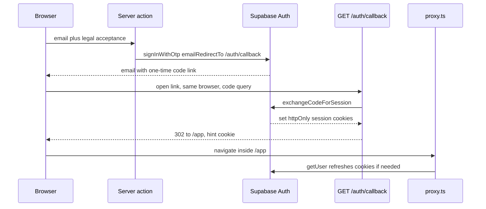

# Supabase magic-link and OAuth sessions in Next.js

The browser never stores the Supabase session in `localStorage`. `@supabase/ssr` writes it into httpOnly cookies. Identity checks call `getUser()` so the Auth server validates the token. A separate non-httpOnly hint cookie only tells the marketing page that a session cookie might exist. It is not a credential.

Packages in use: `@supabase/ssr` 0.6.x, `@supabase/supabase-js` 2.x, Next.js 16. The session-refresh entry is the root `proxy.ts` file (`proxy` plus `config.matcher`).

## Architecture

| Piece | Role |
| --- | --- |
| Server actions | Send the magic link or start Google OAuth after a legal-acceptance check. |
| `GET /auth/callback` | Exchange the `code` query param for a session, then redirect to a fixed path. |
| Server Supabase client | Reads and writes auth cookies. Forces `httpOnly`, `secure` in production, `sameSite=lax`. |
| `proxy.ts` | Refreshes the session on the app shell and the invite routes. The marketing page does a local cookie read and makes no Auth call. |
| Session helpers | `getUser()` once per render via React `cache()`. `getSession()` only to read an access token for a later RLS client. |
| Browser Supabase client | Realtime only. `persistSession`, `autoRefreshToken`, and `detectSessionInUrl` are all false. |

Publishing the terms text is separate from sign-in. This flow only stamps a short-lived cookie before the email or OAuth redirect and posts that version after a successful code exchange.

## Data flow



Google uses the same callback. `signInWithOAuth` returns a provider URL. The click handler assigns `window.location` only after that URL comes back. The PKCE code verifier is stored in a cookie during the server action, so the user must finish the flow in the same browser profile. Supabase's SSR guide documents that verifier cookie. The redirect URL has to be on the project's redirect allow list.

## Environment

Set both pairs to the same project. The server client uses the server names. The marketing-page cookie check and the Realtime client use the public names. If the hosts differ, the cookie name will not match the session.

| Name | Where |
| --- | --- |
| `NEXT_PUBLIC_SUPABASE_URL` | Browser and the local cookie-name check |
| `NEXT_PUBLIC_SUPABASE_ANON_KEY` | Browser Realtime client |
| `SUPABASE_URL` | Server client |
| `SUPABASE_ANON_KEY` | Server client |
| `NEXT_PUBLIC_SITE_URL` | Public origin used to build `/auth/callback`. Example: `https://example.com` |

`SUPABASE_SERVICE_ROLE_KEY` is not part of sign-in. Keep it off any `NEXT_PUBLIC_` name and off the cookie client.

In the Supabase project (dashboard, not env files):

1. Enable the email provider. This app calls `signInWithOtp` with `shouldCreateUser: true`, so a new address creates a user.
2. Add the callback to the redirect allow list, including the local origin you actually use (`https://example.com/auth/callback`, `http://localhost:3000/auth/callback`). `emailRedirectTo` and OAuth `redirectTo` are rejected when they are absent from that list.
3. Enable the Google provider only if the button is shown. Identity linking for the same email is a project setting. The code does not configure it. It sends `access_type=offline` and `prompt=consent`.
   > NOTE: unverified whether a given hosted project has automatic linking turned on.

## Cookie shapes

Auth cookie name: `sb-` + the first label of the project URL hostname + `-auth-token`. A host `abcd.example.com` yields `sb-abcd-auth-token`. Large sessions are split into `sb-abcd-auth-token.0`, `.1`, and so on. The value is either raw JSON or the prefix `base64-` plus base64url JSON of `{ access_token, refresh_token, expires_at }`.

Flags forced on every cookie the server client writes:

- `httpOnly: true`
- `secure: true` when `NODE_ENV` is `production`
- `sameSite: "lax"`
- Library options (`path`, `maxAge`) are kept

Hint cookie (not a secret): name `app_signed_in`, value `1`, `httpOnly: false`, `sameSite: "lax"`, `secure` in production, `path: "/"`, `maxAge` one year. Cleared with `maxAge: 0` on sign-out and when `getUser()` fails on a protected route.

Legal-acceptance cookie, set before the email is sent, deleted on the callback response: `httpOnly: true`, `sameSite: "lax"`, `secure` in production, `path: "/"`, `maxAge` 24 hours. JSON body `{ "version": "<published terms version>", "acceptedAt": "<ISO timestamp>" }`.

## Setup

1. Install `@supabase/ssr` and `@supabase/supabase-js`. Put the env names above in the server and public env. Set `NEXT_PUBLIC_SITE_URL` in every deployed environment.
2. Add the callback URL to the Auth redirect allow list before sending the first email.
3. Create the server client. `setAll` is wrapped because a Server Component cannot write cookies. The proxy performs the refresh those writes would have done. Server actions can write, and that write is what stores the PKCE verifier.

```ts
import { createServerClient } from "@supabase/ssr"
import { cookies } from "next/headers"

export async function createClient() {
  const cookieStore = await cookies()
  return createServerClient(
    process.env.SUPABASE_URL!,
    process.env.SUPABASE_ANON_KEY!,
    {
      cookies: {
        getAll: () => cookieStore.getAll(),
        setAll(toSet) {
          try {
            for (const { name, value, options } of toSet) {
              cookieStore.set(name, value, {
                ...options,
                httpOnly: true,
                secure: process.env.NODE_ENV === "production",
                sameSite: "lax",
              })
            }
          } catch {
            // Server Component render. proxy.ts refreshes the session.
          }
        },
      },
    },
  )
}
```

4. Send the magic link from a server action. Build `emailRedirectTo` from `NEXT_PUBLIC_SITE_URL`, and use the request `Origin` only when that env is empty (local). Require the legal checkbox, a non-empty email, and a basic `local@domain` shape before calling Auth.

```ts
"use server"

import { cookies, headers } from "next/headers"

export async function sendMagicLink(formData: FormData) {
  const email = formData.get("email")?.toString() ?? ""
  if (formData.get("legal_acceptance") !== "true") {
    return { ok: false, message: "Accept the terms to continue." }
  }
  if (!/^[^\s@]+@[^\s@]+\.[^\s@]+$/.test(email)) {
    return { ok: false, message: "Enter a valid email address." }
  }
  const site = process.env.NEXT_PUBLIC_SITE_URL || (await headers()).get("origin") || ""
  const cookieStore = await cookies()
  cookieStore.set(
    "legal_acceptance",
    JSON.stringify({ version: currentTermsVersion(), acceptedAt: new Date().toISOString() }),
    {
      httpOnly: true,
      sameSite: "lax",
      secure: process.env.NODE_ENV === "production",
      maxAge: 60 * 60 * 24,
      path: "/",
    },
  )
  const supabase = await createClient()
  const { error } = await supabase.auth.signInWithOtp({
    email,
    options: { emailRedirectTo: `${site}/auth/callback`, shouldCreateUser: true },
  })
  if (error) return { ok: false, message: error.message }
  return { ok: true, message: "Check your email for a sign-in link." }
}
```

`currentTermsVersion()` returns the published terms date. If that lookup fails, return the compiled fallback version and still send the email. Google runs the same legal check, sets the same cookie, then calls `signInWithOAuth`.

5. Google uses the same origin and the same callback. Return `data.url` to the client. Assign it from the click handler.

```ts
const { data, error } = await supabase.auth.signInWithOAuth({
  provider: "google",
  options: {
    redirectTo: `${site}/auth/callback`,
    queryParams: { access_type: "offline", prompt: "consent" },
  },
})
```

6. Callback route. Ignore every redirect query parameter. A successful exchange lands on `/app`. A missing code, an Auth error, or a missing user lands on `/sign-in?error=link_expired`. Map that one code to fixed copy. Any other `error` value renders nothing, so the URL cannot inject text. Delete the legal cookie on every outcome. Set the hint cookie only after success. Recording consent is best-effort: a failed POST still signs the user in.

```ts
const FAILED = "link_expired"

export function callbackRedirect(origin: string, failed = false): string {
  if (failed) return `${origin}/sign-in?error=${FAILED}`
  return `${origin}/app`
}

export function callbackErrorMessage(error: string | null | undefined): string | null {
  if (error !== FAILED) return null
  return "This sign-in link is invalid or has expired. Request a new one."
}
```

Parse the legal cookie before the POST. Missing or blank is null (nothing to record). Valid JSON keeps `version` and `acceptedAt`. A missing `version` uses the current terms version. Malformed JSON uses that version and omits the timestamp.

```ts
export async function GET(request: NextRequest) {
  const url = new URL(request.url)
  const code = url.searchParams.get("code")
  const origin = process.env.NEXT_PUBLIC_SITE_URL || url.origin
  let failed = !code
  if (code) {
    try {
      const supabase = await createClient()
      const { data, error } = await supabase.auth.exchangeCodeForSession(code)
      if (error || !data?.user) failed = true
      else await recordConsent(data.user.id, request.cookies.get("legal_acceptance")?.value)
    } catch {
      failed = true
    }
  }
  const response = NextResponse.redirect(callbackRedirect(origin, failed))
  response.cookies.delete("legal_acceptance")
  if (!failed) {
    response.cookies.set("app_signed_in", "1", {
      path: "/",
      maxAge: 60 * 60 * 24 * 365,
      httpOnly: false,
      secure: process.env.NODE_ENV === "production",
      sameSite: "lax",
    })
  }
  return response
}
```

`recordConsent` no-ops when the cookie parses to null. Otherwise it POSTs `{ consent_type: "terms_privacy", version, metadata: { accepted_at_client, source: "auth_callback" } }` with the API bearer from `m2m-jwt-service-auth`. Swallow and log a failed POST. Log the Auth error on the server and leave it out of the redirect.

7. Session helpers. One `getUser()` per server render. Server actions are new requests and call it again before they sign an API token (see `m2m-jwt-service-auth`).

```ts
import { cache } from "react"

export const getVerifiedUser = cache(async () => {
  const supabase = await createClient()
  const { data: { user } } = await supabase.auth.getUser()
  return user ?? null
})

export async function getAccessToken(): Promise<string> {
  const supabase = await createClient()
  const { data: { session } } = await supabase.auth.getSession()
  if (!session?.access_token) throw new Error("Not authenticated")
  return session.access_token
}
```

`getUser()` is the identity check. `getSession()` only reads the access token already in the cookie so a cookie-free data client can send it. PostgREST checks that token when it applies RLS. Do not treat `getSession()` as proof of who the user is.

8. Proxy. Matcher is only `/`, `/app`, `/app/:path*`, `/invite`, and `/invite/:path*`. Other pages, static files, and `/api` do not enter it. Route handlers that need a user call `getUser()` themselves.

- Path `/`: read cookies locally. If `hasUsableAuthSession` is true, redirect to `/app`. Otherwise continue. No network.
- `/app` and `/invite`: build a server client on the request/response cookie pair, call `getUser()`, and redirect to `/sign-in` when it errors. Clear the hint cookie on that redirect so the marketing page cannot loop.
- If an invite gate is enabled, run it only after `getUser()` succeeds. A thrown lookup on a protected path redirects to sign-in.

The proxy's `setAll` copies each cookie onto the request, then rebuilds the response and writes the same cookies there, forcing `httpOnly`, `secure` in production, and `sameSite=lax`. Copying onto the request is what lets later code in the same turn see the refreshed token.

```ts
export async function proxy(request: NextRequest) {
  if (request.nextUrl.pathname === "/") {
    const pairs = request.cookies.getAll().map(({ name, value }) => ({ name, value }))
    if (!hasUsableAuthSession(pairs, process.env.NEXT_PUBLIC_SUPABASE_URL ?? "")) {
      return NextResponse.next()
    }
    return NextResponse.redirect(new URL("/app", request.url))
  }
  return updateSession(request)
}

export const config = {
  matcher: ["/", "/app", "/app/:path*", "/invite", "/invite/:path*"],
}
```

The browser client is for Realtime, not for sign-in. Session detection in the URL would race the callback route.

```ts
createClient(url, anonKey, {
  auth: { persistSession: false, autoRefreshToken: false, detectSessionInUrl: false },
})
```

9. Local usability check, used only for the marketing redirect. Join chunk cookies in index order. Decode a `base64-` prefix as base64url. The session is usable when `access_token` is a non-empty string and either `refresh_token` is a non-empty string or the expiry is still in the future. Expiry is `expires_at` when it is a number, otherwise the numeric `exp` claim in the access token payload. Any parse failure, a missing cookie, or the hint cookie alone returns false. A refresh token counts even when the access token is already expired, because the next `/app` navigation runs `getUser()` and refreshes it.

10. Sign out: `auth.signOut()`, set the hint cookie to empty with `maxAge: 0`, redirect to `/sign-in`.

11. The sign-in form is a client component. Pass the initial error string in from the server page, using `callbackErrorMessage`. Keep the first render identical on the server and the client.

## Failure prevention

- **P25.** Render the same tree on the server and the client. Read `window` after mount, inside the event handler that starts the OAuth redirect. Branching on `typeof window` during the first render mismatches the HTML.
- Build `emailRedirectTo` from `NEXT_PUBLIC_SITE_URL`. An empty site URL falls back to the request `Origin`, which the caller controls. The allow list still blocks unknown hosts, and the email then points at the wrong place.
- Land on a fixed path after the callback. The vendor sample that honors a `next` query param is not this design. A return path, if you add one later, is a relative path on an allow list.
- Show the fixed expired-link sentence for `link_expired` only.
- Start OAuth and magic-link from a server action, where `cookies().set` runs, so the PKCE verifier is stored. The empty `catch` around `setAll` is for Server Component renders. The proxy's `getUser()` is what refreshes the session when that write is skipped.
- Open the email link in the same browser that requested it. The verifier cookie is not in the email.
- Treat `app_signed_in` as a hint. Protected routes call `getUser()` and clear the hint when that call fails.
- Call `getUser()` before signing an API token or trusting `user.id`. Use `getSession()` only to copy `access_token` into a data client.
- Keep `persistSession: false` on the browser client. Turning persistence on would put the session outside the httpOnly cookies.
- Record consent after the exchange. A failure there is logged and reported. It does not fail sign-in, and the legal cookie is still deleted.

## Tests

Pure helpers, no network:

- Consent cookie: missing or blank returns null. Valid JSON keeps `version` and `acceptedAt`. Missing `version` uses the current terms version. Malformed JSON uses that version and omits the timestamp.
- `callbackRedirect` always returns `{origin}/app` on success and `{origin}/sign-in?error=link_expired` on failure.
- `callbackErrorMessage` returns copy for that code and null for anything else.
- Cookie name from `http://localhost:8055` is `sb-localhost-auth-token`. Empty URL returns null.
- Usable when the access token expiry is in the future. Usable when it is expired and a refresh token is present. Unusable when it is expired and there is no refresh token. Chunks `.0` and `.1` join. The hint cookie and a `base64-` value that is not JSON are unusable.

Action tests with the Auth client mocked: missing legal acceptance and a bad email never call `signInWithOtp`. A configured site URL is the redirect host.

## Checklist

- [ ] Public and server project URL and anon key match. Service role is server-only.
- [ ] `NEXT_PUBLIC_SITE_URL` is set in deployed environments.
- [ ] `/auth/callback` is on the Auth redirect allow list for each origin.
- [ ] Server client forces httpOnly, production `secure`, and `lax`.
- [ ] Callback ignores redirect query params and uses one error code.
- [ ] Proxy matcher includes the marketing page, the app shell, and invite. `getUser()` runs on the protected ones.
- [ ] Marketing redirect uses the local cookie parse only.
- [ ] Sign-in UI does not branch on `window` during render (P25).
- [ ] Sign-out clears the Supabase session and the hint cookie.
- [ ] Browser client does not persist a session.
