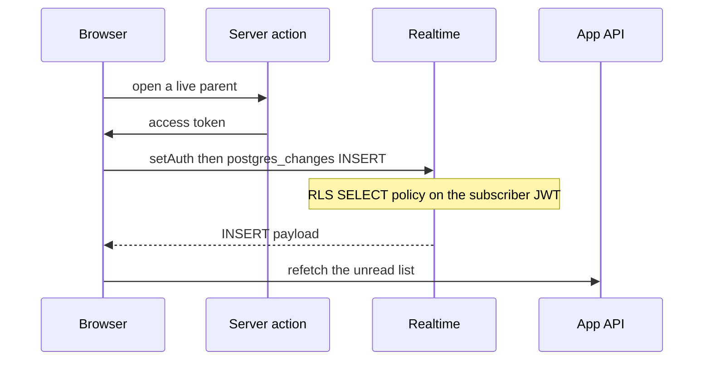

# Supabase Realtime postgres_changes with an httpOnly session

The browser client does not persist a Supabase session. Realtime still needs the user access token, or `postgres_changes` never arrives for rows protected by RLS. A server action reads that token from the httpOnly cookie and the browser passes it only to `realtime.setAuth`. The socket is a wake-up signal. The row the user sees is loaded again from the application API.

Packages: `@supabase/supabase-js` 2.x. The session cookie client is the one from `supabase-magic-link-auth`.

## Architecture

| Piece | Role |
| --- | --- |
| Publication `supabase_realtime` | Postgres only sends changes for member tables. App migrations do not add the table. |
| `authenticated` SELECT policy | Realtime delivers an INSERT only when this role could `SELECT` the new row. |
| `app_api` | Inserts the row. Its `USING (TRUE)` policy does not widen what the browser receives. |
| Server token action | Returns `session.access_token` after the cookie client has run. Never returns the refresh token. |
| Browser client | `persistSession`, `autoRefreshToken`, and `detectSessionInUrl` are false. |
| Channel map | One channel per parent id, closed when the live window ends. |



## Environment

| Name | Default | Where |
| --- | --- | --- |
| `NEXT_PUBLIC_SUPABASE_URL` | Required | Browser client. Same project as `SUPABASE_URL`. |
| `NEXT_PUBLIC_SUPABASE_ANON_KEY` | Required | Browser client. The anon key is not a user session. |
| `NEXT_PUBLIC_COMMENT_LIVE_SECONDS` | `300` | How long after the parent was created the socket stays open. |
| `NEXT_PUBLIC_COMMENT_CATCHUP_HOURS` | `12` | After this, focus stops refetching. The socket is already closed. |

Non-finite or non-positive values fall back to those defaults. Both names are public because the browser enforces the windows. They are durations, not secrets.

Local Auth config sets `jwt_expiry` to 3600 seconds. Keep the live window shorter than the access token that was handed over, or refresh the token and call `setAuth` again before `exp`. The open path fetches a token only when a channel starts. It does not refresh a channel that is already joined.

`connect-src` must allow the `wss:` origin of the project host. A blocked socket looks like a timeout, not a CORS error. See `content-security-policy`.

## Database

Hosted Supabase already has the publication `supabase_realtime`. Membership is separate from `CREATE TABLE`. A catalog of the app migrations shows that publication with an empty table list, so a database built only from those migrations will accept the client subscribe and deliver nothing.

Add the child table. Do not drop the publication: a reset removes every other member.

```sql
ALTER PUBLICATION supabase_realtime ADD TABLE public.item_notes;

SELECT schemaname, tablename
FROM pg_publication_tables
WHERE pubname = 'supabase_realtime';
```

The same membership is the Database → Publications toggle. Confirm with the query above. Dashboard state is not in the migrations.

> NOTE: unverified whether a hosted project was toggled in the dashboard outside the migrations. The client still requires the table to be a member.

`authenticated` needs `SELECT` on `item_notes` and on the parent it joins. Writes stay with `app_api`. Full role setup is `supabase-rls-client-reads`. The child table has no `user_id`; the policy follows the parent.

```sql
ALTER TABLE public.item_notes ENABLE ROW LEVEL SECURITY;

GRANT SELECT ON TABLE public.item_notes, public.items TO authenticated;

CREATE POLICY item_notes_own_parent_rows
  ON public.item_notes
  FOR SELECT
  TO authenticated
  USING (
    EXISTS (
      SELECT 1 FROM public.items
      WHERE items.id = item_notes.item_id
        AND items.user_id::text = auth.uid()::text
    )
  );
```

Supabase applies that SELECT policy to `postgres_changes`. An insert made by `app_api` is published, then filtered per subscriber. `anon` has no grant, so a client that skipped `setAuth` receives nothing.

This feed subscribes to `INSERT` only. Default replica identity is enough. `REPLICA IDENTITY FULL` fills `payload.old` on update and delete. With RLS enabled, official Realtime notes say `payload.old` is still only the primary key. Do not turn on `FULL` for this INSERT feed.

## Browser client

```ts
import { createClient } from "@supabase/supabase-js"

export function createBrowserRealtimeClient() {
  const url = process.env.NEXT_PUBLIC_SUPABASE_URL
  const anonKey = process.env.NEXT_PUBLIC_SUPABASE_ANON_KEY
  if (!url || !anonKey) {
    throw new Error("Missing NEXT_PUBLIC_SUPABASE_URL or NEXT_PUBLIC_SUPABASE_ANON_KEY")
  }
  return createClient(url, anonKey, {
    auth: {
      persistSession: false,
      autoRefreshToken: false,
      detectSessionInUrl: false,
    },
  })
}
```

One client per provider. `setAuth` replaces the token for that client, which is correct when every channel belongs to the same user. Turning persistence back on would put the session in `localStorage` beside the httpOnly cookie.

## Token action

The action runs on the server. `getUser()` is the refresh and identity check from `supabase-magic-link-auth`. `getSession()` only then copies `access_token`. Return `null` when there is no session so the browser skips subscribe. Log the failure. Do not log the token.

```ts
"use server"

export async function getRealtimeAccessToken(): Promise<string | null> {
  try {
    const user = await getVerifiedUser()
    if (!user?.id) return null
    return await getAccessToken()
  } catch (error) {
    console.error("Error fetching realtime access token:", error)
    return null
  }
}
```

> NOTE: unverified whether `getSession()` alone refreshes a near-expiry cookie. The shipping helper calls `getSession()` only. Call `getUser()` in the same action first so the cookie client runs its refresh before the token is copied out.

The token stays in memory for `setAuth`. It is not written to `localStorage`, a cache key, or the unread API. The unread API uses the separate service JWT from `m2m-jwt-service-auth`.

## Subscribe

Validate the parent id before it is interpolated into the filter. The filter string is `item_id=eq.<uuid>`.

```ts
const ITEM_ID = /^[0-9a-f]{8}-[0-9a-f]{4}-[1-8][0-9a-f]{3}-[89ab][0-9a-f]{3}-[0-9a-f]{12}$/i

export function isItemId(value: string): boolean {
  return ITEM_ID.test(value)
}
```

Open steps, in order:

1. Ignore a parent already opening, or already joined and not `closed`, `errored`, or `leaving`.
2. If `createdAt + liveMs <= now`, close any channel for that id and return.
3. Bump an attempt counter for that id. A later forget or reopen makes this attempt stale.
4. Fetch the token. Abort if the attempt changed or the parent was forgotten.
5. Abort when the token is null. Log the parent id only.
6. `await supabase.realtime.setAuth(token)`.
7. Abort again if the attempt changed.
8. Subscribe, then store a timer for the remaining live window.

```ts
await supabase.realtime.setAuth(token)
const channel = supabase
  .channel(`item-notes-${itemId}-${crypto.randomUUID()}`)
  .on(
    "postgres_changes",
    {
      event: "INSERT",
      schema: "public",
      table: "item_notes",
      filter: `item_id=eq.${itemId}`,
    },
    (payload) => {
      const row = payload.new && typeof payload.new === "object" ? payload.new : {}
      const parentId = "item_id" in row && row.item_id != null ? String(row.item_id) : null
      void refreshUnread()
      listeners.forEach((listener) => listener({ item_id: parentId }))
    },
  )
  .subscribe((status, err) => {
    if (status === "SUBSCRIBED") return
    if (status === "CHANNEL_ERROR" || status === "TIMED_OUT") {
      reportChannelFailure(status, itemId, err)
    }
  })
```

The random suffix avoids reusing a name that is still leaving. A second parent gets its own channel. Starting the same parent twice does not open a second channel. Forget bumps the attempt, deletes the parent from the map, and calls `removeChannel` on that channel only.

The timer calls the same close when the live window elapses. Unmount clears every timer and removes every channel.

`CHANNEL_ERROR` and `TIMED_OUT` are reported. The next focus, `online`, or visibility recovery calls the opener again, and a channel in `closed`, `errored`, or `leaving` is replaced.

## Focus and catch-up

While the newest parent's channel is joined and `now` is still inside the live window, focus does not refetch. Outside that window, focus refetches until one catch-up has landed at or after `newestCreatedAt + catchupMs`. No newest parent means there is nothing to catch.

```ts
export function shouldFetchUnread(input: {
  now: number
  newestCreatedAtMs: number | null
  unreadCaughtUpAtMs: number | null
  newestChannelJoined: boolean
  liveMs: number
  catchupMs: number
}): boolean {
  const { now, newestCreatedAtMs, unreadCaughtUpAtMs, newestChannelJoined, liveMs, catchupMs } =
    input
  if (newestCreatedAtMs == null) return false
  if (unreadCaughtUpAtMs != null && unreadCaughtUpAtMs >= newestCreatedAtMs + catchupMs) {
    return false
  }
  if (now < newestCreatedAtMs + liveMs && newestChannelJoined) return false
  return true
}
```

Seed the watch list from parents that are still inside the live window. A parent older than the window is remembered for catch-up and does not get a channel. A parent the user just saved uses `Date.now()` as its created time and opens immediately.

## Payload is a signal

`payload.new` can contain ciphertext and columns the API serializer strips. Read `item_id`, then refetch the unread list from the API. Render that response.

Per-user detail that changes when a note is inserted is not a `"use cache"` entry. A cache that outlives the insert shows the pre-insert page when the user opens the row from the notification. Detail and list reads stay request-time. See `nextjs-cache-components` (P18).

## Failure prevention

- **P22.** Session cookies are httpOnly, so the anon Realtime client has no user JWT until `setAuth(token)`. Persistence stays off.
- **P18.** The INSERT handler refetches. It does not serve a cached detail document, and it does not render `payload.new` as the note body.
- Empty publication. Subscribe only after `pg_publication_tables` lists `item_notes`.
- Filter string. Reject any parent id that is not a UUID before building `item_id=eq.${itemId}`.
- Stale open. The attempt counter drops a token fetch that finished after forget or a newer open.
- Shared token lifetime. Live window stays under the remaining access-token lifetime, or `setAuth` runs again with a new token.
- Logs. Parent id and channel status are safe. The access token is not.

## Tests

Mock the server action and a channel object that records `setAuth`, the filter, and `removeChannel`.

- `setAuth` receives the server token before the INSERT handler is registered.
- An INSERT calls the unread refetch and the listener. The unread count follows the API response, not the payload body.
- A second parent leaves the first channel open, with filter `item_id=eq.<second>`.
- A second start for the same parent does not create another channel.
- A parent older than the live window never opens a channel.
- Forget closes only that parent's channel.
- Focus while the newest channel is joined does not refetch.
- Focus after the live window does refetch, until catch-up passes the deadline.
- A channel opened with a few milliseconds of life closes itself.
- `CHANNEL_ERROR` is reported with the status and parent id.
- A null token skips subscribe.
- The hook throws when it is used outside the provider.

## Checklist

- [ ] `item_notes` is in `supabase_realtime` (`pg_publication_tables`), and the publication was not dropped.
- [ ] `authenticated` has `SELECT` and an own-parent policy. `anon` has no grant. Inserts go through `app_api`.
- [ ] Browser client refuses session persistence, refresh, and URL detection.
- [ ] The token action calls `getUser()` then returns only `access_token`. Refresh token stays in the cookie.
- [ ] `setAuth(token)` finishes before `subscribe`. A null token skips the channel.
- [ ] Filter uses a validated UUID. Channel name has a random suffix.
- [ ] One channel per parent. Forget and the live-window timer remove that channel only.
- [ ] INSERT refetches the API list. Detail is uncached (P18).
- [ ] Live window is shorter than `jwt_expiry` (3600 in local Auth config) unless a joined channel refreshes `setAuth`.
- [ ] Focus uses `shouldFetchUnread`. Catch-up stops at `newestCreatedAt + catchup`.
- [ ] CSP `connect-src` includes the project `wss:` origin.
- [ ] Tests cover token, filter, second parent, expired window, forget, focus, timer, and `CHANNEL_ERROR`.
