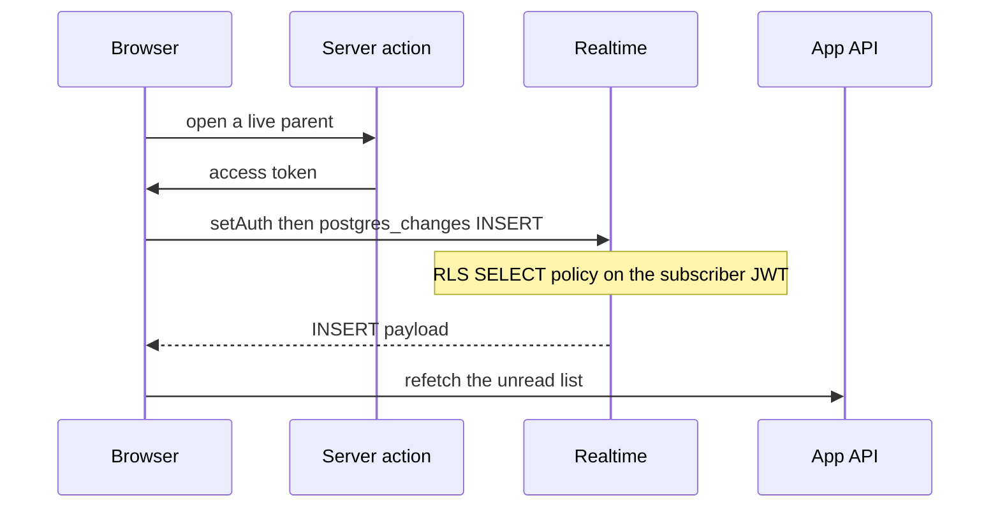

# Supabase Realtime postgres_changes with an httpOnly session

The browser client does not persist a Supabase session. Realtime still needs the user access token, or `postgres_changes` never arrives for rows protected by RLS. A server action reads that token from the httpOnly cookie and the browser passes it only to `realtime.setAuth`. The socket is a wake-up signal. The row the user sees is loaded again from the application API.

Packages: `@supabase/supabase-js` 2.x. The session cookie client is the one from `supabase-magic-link-auth`.

## Architecture

| Piece | Role |
| --- | --- |
| Publication `supabase_realtime` | A conditional migration adds the child table after creation when the publication exists. Verify membership on the target database. |
| `authenticated` SELECT policy | Realtime delivers an INSERT only when this role could `SELECT` the new row. |
| `app_api` | Inserts the row. Its `USING (TRUE)` policy does not widen what the browser receives. |
| Server token action | Returns `session.access_token` after the cookie client has run. Never returns the refresh token. |
| Browser client | `persistSession`, `autoRefreshToken`, and `detectSessionInUrl` are false. |
| Channel map | One channel per parent id, closed when the live window ends. |



## Environment

| Name | Default | Where |
| --- | --- | --- |
| `NEXT_PUBLIC_SUPABASE_URL` | Required | Browser client. Same project as `SUPABASE_URL`. |
| `NEXT_PUBLIC_SUPABASE_ANON_KEY` | Required | Browser client. The anon key is not a user session. |
| `NEXT_PUBLIC_COMMENT_LIVE_SECONDS` | `300` | How long after the parent was created the socket stays open. |
| `NEXT_PUBLIC_COMMENT_CATCHUP_HOURS` | `12` | Deadline measured from parent creation. A successful catch-up at or after it removes that parent from the watch map. |

Non-finite or non-positive values fall back to those defaults. Both names are public because the browser enforces the windows. They are durations, not secrets.

Local Auth config sets `jwt_expiry` to 3600 seconds. Keep the live window shorter than the access token that was handed over, or refresh the token and call `setAuth` again before `exp`. The open path fetches a token only when a channel starts. It does not refresh a channel that is already joined.

`connect-src` must allow the `wss:` origin of the project host. A blocked socket looks like a timeout, not a CORS error. See `content-security-policy`.

## Database

Membership is separate from `CREATE TABLE`. The current reference table migration ends with conditional publication SQL, after all model creation and constraints. It adds the child table only when `supabase_realtime` exists and that schema/table is not already a member. Plain local Postgres without the provider publication takes no action; this migration does not create the publication or a Realtime service. Supabase documents both the dashboard toggle and SQL membership in [Postgres Changes setup](https://supabase.com/docs/guides/realtime/postgres-changes).

Generic forward SQL, placed after `CreateModel` for `item_notes`:

```sql
DO $publication$
BEGIN
  IF EXISTS (
    SELECT 1 FROM pg_publication WHERE pubname = 'supabase_realtime'
  ) AND NOT EXISTS (
    SELECT 1 FROM pg_publication_tables
    WHERE pubname = 'supabase_realtime'
      AND schemaname = 'public' AND tablename = 'item_notes'
  ) THEN
    ALTER PUBLICATION supabase_realtime ADD TABLE public.item_notes;
  END IF;
END
$publication$;
```

Its reverse removes only that table's membership when present:

```sql
DO $publication$
BEGIN
  IF EXISTS (
    SELECT 1 FROM pg_publication_tables
    WHERE pubname = 'supabase_realtime'
      AND schemaname = 'public' AND tablename = 'item_notes'
  ) THEN
    ALTER PUBLICATION supabase_realtime DROP TABLE public.item_notes;
  END IF;
END
$publication$;
```

`ADD TABLE` and `DROP TABLE` preserve other members. Avoid `SET TABLE`, which replaces membership, and never drop/recreate the publication as a single-table repair. Run this as an authorized migration role: changing the publication requires ownership, and adding the table also requires table ownership. See [PostgreSQL ALTER PUBLICATION](https://www.postgresql.org/docs/current/sql-alterpublication.html).

The reverse does not track whether forward SQL added the membership or found it already present. It removes the target membership in either case. Review that effect before rollback; unapplying the whole table migration also reverses model creation and is not a membership repair.

### Database setup and verification

1. Apply extension/role setup, then table creation followed by the conditional membership SQL, then client grants/RLS. Keep these dependencies explicit.
2. On an existing database, inspect membership and migration history. An already-recorded edited migration will not run its appended SQL; `--fake` also skips it (P11, `migration-safety`). Add a reviewed successor migration to repair missing membership rather than replaying table creation.
3. If the publication is created after a local install, the earlier no-op does not rerun automatically. Apply a membership migration once the publication exists.
4. Verify actual membership, grants and own-parent policies before testing subscriber delivery:

```sql
SELECT schemaname, tablename
FROM pg_publication_tables
WHERE pubname = 'supabase_realtime';
```

Expect `public.item_notes` on the provider database. A successful migration or `SUBSCRIBED` status alone does not prove delivery. The current graph expresses intended membership; no deployed dashboard state or database history is inferred from it.

`authenticated` needs `SELECT` on `item_notes` and on the parent it joins. Writes stay with `app_api`. Full role setup is `supabase-rls-client-reads`. The child table has no `user_id`; the policy follows the parent.

```sql
ALTER TABLE public.item_notes ENABLE ROW LEVEL SECURITY;

GRANT SELECT ON TABLE public.item_notes, public.items TO authenticated;

CREATE POLICY item_notes_own_parent_rows
  ON public.item_notes
  FOR SELECT
  TO authenticated
  USING (
    EXISTS (
      SELECT 1 FROM public.items
      WHERE items.id = item_notes.item_id
        AND items.user_id::text = auth.uid()::text
    )
  );
```

Supabase applies that SELECT policy to `postgres_changes`. An insert made by `app_api` is published, then filtered per subscriber. `anon` has no grant, so a client that skipped `setAuth` receives nothing.

This feed subscribes to `INSERT` only. Default replica identity is enough. `REPLICA IDENTITY FULL` fills `payload.old` on update and delete. With RLS enabled, official Realtime notes say `payload.old` is still only the primary key. Do not turn on `FULL` for this INSERT feed.

## Browser client

```ts
import { createClient } from "@supabase/supabase-js"

export function createBrowserRealtimeClient() {
  const url = process.env.NEXT_PUBLIC_SUPABASE_URL
  const anonKey = process.env.NEXT_PUBLIC_SUPABASE_ANON_KEY
  if (!url || !anonKey) {
    throw new Error("Missing NEXT_PUBLIC_SUPABASE_URL or NEXT_PUBLIC_SUPABASE_ANON_KEY")
  }
  return createClient(url, anonKey, {
    auth: {
      persistSession: false,
      autoRefreshToken: false,
      detectSessionInUrl: false,
    },
  })
}
```

One client per provider. `setAuth` replaces the token for that client, which is correct when every channel belongs to the same user. Turning persistence back on would put the session in `localStorage` beside the httpOnly cookie.

## Token action

The action runs on the server. `getUser()` is the refresh and identity check from `supabase-magic-link-auth`. `getSession()` only then copies `access_token`. Return `null` when there is no session so the browser skips subscribe. Log the failure. Do not log the token.

```ts
"use server"

export async function getRealtimeAccessToken(): Promise<string | null> {
  try {
    const user = await getVerifiedUser()
    if (!user?.id) return null
    return await getAccessToken()
  } catch (error) {
    console.error("Error fetching realtime access token:", error)
    return null
  }
}
```

> NOTE: unverified whether `getSession()` alone refreshes a near-expiry cookie. The shipping helper calls `getSession()` only. Call `getUser()` in the same action first so the cookie client runs its refresh before the token is copied out.

The token stays in memory for `setAuth`. It is not written to `localStorage`, a cache key, or the unread API. The unread API uses the separate service JWT from `m2m-jwt-service-auth`.

## Subscribe

Validate the parent id before it is interpolated into the filter. The filter string is `item_id=eq.<uuid>`.

```ts
const ITEM_ID = /^[0-9a-f]{8}-[0-9a-f]{4}-[1-8][0-9a-f]{3}-[89ab][0-9a-f]{3}-[0-9a-f]{12}$/i

export function isItemId(value: string): boolean {
  return ITEM_ID.test(value)
}
```

Open steps, in order:

1. Ignore a parent already opening, or already joined and not `closed`, `errored`, or `leaving`.
2. If `createdAt + liveMs <= now`, close any channel for that id and return.
3. Bump an attempt counter for that id. A later forget or reopen makes this attempt stale.
4. Fetch the token. Abort if the attempt changed or the parent was forgotten.
5. Abort when the token is null. Log the parent id only.
6. `await supabase.realtime.setAuth(token)`.
7. Abort again if the attempt changed.
8. Subscribe, then store a timer for the remaining live window.

```ts
await supabase.realtime.setAuth(token)
const channel = supabase
  .channel(`item-notes-${itemId}-${crypto.randomUUID()}`)
  .on(
    "postgres_changes",
    {
      event: "INSERT",
      schema: "public",
      table: "item_notes",
      filter: `item_id=eq.${itemId}`,
    },
    (payload) => {
      const row = payload.new && typeof payload.new === "object" ? payload.new : {}
      const parentId = "item_id" in row && row.item_id != null ? String(row.item_id) : null
      void mergeParentUnread(itemId)
      listeners.forEach((listener) => listener({ item_id: parentId }))
    },
  )
  .subscribe((status, err) => {
    if (status === "SUBSCRIBED") return
    if (status === "CHANNEL_ERROR" || status === "TIMED_OUT") {
      reportChannelFailure(status, itemId, err)
    }
  })
```

The random suffix avoids reusing a name that is still leaving. A second parent gets its own channel. Starting the same parent twice does not open a second channel. Forget bumps the attempt, deletes the parent from the map, and calls `removeChannel` on that channel only.

The timer expires that parent: invalidate pending opens, remove it from the live map, close its channel and remember it in the catch-up map. Unmount clears every timer and removes every channel. The reference computes the timer duration before awaiting token/setup, so slow setup can extend the effective window; recompute the remaining duration before subscribing when a strict deadline matters.

`CHANNEL_ERROR` and `TIMED_OUT` are reported. The next focus, `online`, or visibility recovery calls the opener again, and a channel in `closed`, `errored`, or `leaving` is replaced.

## Focus and catch-up

Track each parent independently rather than letting one newest row decide recovery for every row. Keep creation timestamps in two maps, separate from the open-channel map:

```ts
type WatchSeed = {
  live: Array<{ id: string; created_at: string }>
  catchup: Array<{ id: string; created_at: string }>
}

const live = new Map<string, number>()
const catchup = new Map<string, number>()
```

Seed the unread list once, then merge valid watch timestamps. A live parent opens its own channel; a catch-up parent has no socket. A just-saved parent uses `Date.now()` and moves to live without closing other parents. Forget removes that id from both maps, invalidates pending opens and closes only its channel.

On focus, `online`, or becoming visible, the reference first requests catch-up ids, then checks live parents. Expired live parents move to catch-up; remaining live parents reopen only missing/failed channels. A parent moved during that second step is fetched on a later recovery, because the catch-up request already took its id snapshot. Recovery does not poll healthy live parents for unread rows.

Catch-up uses one in-flight guard and `getUnreadItems(ids)`, then merges incoming rows by their stable child ids rather than replacing the entire unread list. Only after success does it remove watch entries whose creation time plus catch-up duration has passed. A failed request leaves entries for the next recovery; a parent already past its deadline still gets one successful final fetch. There is no background polling timer for catch-up.

The reference prunes the current catch-up map after success, not just the requested snapshot. A parent added while that request is pending can therefore be removed if its deadline has passed without being part of that fetch. An adaptation should prune only fetched ids with the same recorded timestamp, and test late-added/forgotten parents and responses arriving after deletion or mark-read. These race protections are recommendations, not existing guarantees.

INSERT recovery is targeted too: `mergeParentUnread(itemId)` fetches only the subscribed parent's unread rows and merges them, while notifying detail listeners with the payload parent id. The separate full refresh replaces the list. Do not confuse a targeted merge with a complete server snapshot.

## Payload is a signal

`payload.new` can contain ciphertext and columns the API serializer strips. Read `item_id`, then refetch the unread list from the API. Render that response.

Per-user detail that changes when a note is inserted is not a `"use cache"` entry. A cache that outlives the insert shows the pre-insert page when the user opens the row from the notification. Detail and list reads stay request-time. See `nextjs-cache-components` (P18).

## Failure prevention

- **P22.** Session cookies are httpOnly, so the anon Realtime client has no user JWT until `setAuth(token)`. Persistence stays off.
- **P18.** The INSERT handler refetches. It does not serve a cached detail document, and it does not render `payload.new` as the note body.
- Missing membership. Conditional SQL follows table creation; it is a no-op without the publication. Verify `pg_publication_tables`, including after history alignment or a late publication setup (P11).
- Scoped rollback. Remove only the target membership. Reverse SQL also removes a membership that predated forward execution; preserve other tables and review rollback ownership.
- Filter string. Reject any parent id that is not a UUID before building `item_id=eq.${itemId}`.
- Stale open. The attempt counter drops a token fetch that finished after forget or a newer open.
- Shared token lifetime. Live window stays under the remaining access-token lifetime, or `setAuth` runs again with a new token.
- Logs. Parent id and channel status are safe. The access token is not.

## Tests

On disposable databases, test publication setup separately from browser mocks:

- Publication absent: forward and reverse SQL succeed without creating it.
- Publication present, target absent: forward adds `public.item_notes` and preserves another member; a second forward is a no-op.
- Target already present: forward is a no-op; reverse removes the target, preserves another member, and a second reverse is a no-op. This also demonstrates the rollback ownership limitation.
- Fresh migration graph: target creation precedes publication SQL, then grants and own-parent RLS are applied. A recorded older table migration does not execute appended SQL; a successor repair supplies the missing membership.
- With subscriber A's JWT, an insert under A's parent produces an event and an insert under B's parent does not. Browser mocks cannot prove this database/RLS boundary.

Mock the server action and a channel object that records `setAuth`, the filter, and `removeChannel`.

- `setAuth` receives the server token before the INSERT handler is registered.
- An INSERT fetches only that parent's unread rows and calls the listener. Merging preserves other parents; note bodies come from the API, not the payload.
- A second parent leaves the first channel open, with filter `item_id=eq.<second>`.
- A second start for the same parent does not create another channel.
- A parent older than the live window never opens a channel.
- Forget closes only that parent's channel.
- A healthy live parent is not polled on focus; a different catch-up parent is still fetched.
- Focus after live expiry moves that parent to catch-up; the next recovery includes it. A failed catch-up retains the watch entry; success at or after its deadline removes it.
- Targeted INSERT/catch-up responses merge by child id and preserve other parents. A full refresh replaces the list.
- Test overlapping focus/online events with one catch-up in flight, and late-added/forgotten ids. Snapshot-scoped pruning is an adaptation acceptance case, not an implemented guarantee.
- A channel opened with a few milliseconds of life closes itself.
- `CHANNEL_ERROR` is reported with the status and parent id.
- A null token skips subscribe.
- The hook throws when it is used outside the provider.

## Checklist

- [ ] Conditional publication SQL follows table creation; local databases without the publication safely skip it.
- [ ] `pg_publication_tables` lists `public.item_notes` on the provider database. Recorded/faked migration history is not proof of membership (P11).
- [ ] Forward/reverse preserve other members. Reverse removes only the target, including a pre-existing membership; table-migration rollback is reviewed separately.
- [ ] `authenticated` has `SELECT` and an own-parent policy. `anon` has no grant. Inserts go through `app_api`.
- [ ] Browser client refuses session persistence, refresh, and URL detection.
- [ ] The token action calls `getUser()` then returns only `access_token`. Refresh token stays in the cookie.
- [ ] `setAuth(token)` finishes before `subscribe`. A null token skips the channel.
- [ ] Filter uses a validated UUID. Channel name has a random suffix.
- [ ] One channel per parent. Forget and the live-window timer remove that channel only.
- [ ] INSERT refetches the API list. Detail is uncached (P18).
- [ ] Live window is shorter than `jwt_expiry` (3600 in local Auth config) unless a joined channel refreshes `setAuth`.
- [ ] Recovery uses per-parent live/catch-up maps and targeted merge; deadlines are pruned only after successful catch-up. Late-add/forget races are reviewed.
- [ ] CSP `connect-src` includes the project `wss:` origin.
- [ ] Tests cover token, filter, second parent, expired window, forget, focus, timer, and `CHANNEL_ERROR`.
