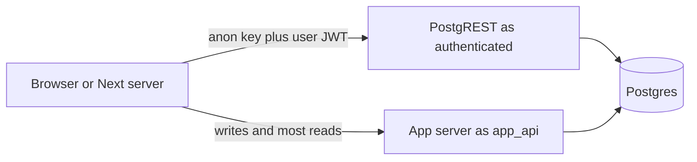

# Supabase RLS for client reads and an API role that is not isolated

Two different database roles reach the same tables.

- `authenticated` is the Supabase role for a signed-in user JWT. It has `SELECT` on user-facing tables and no write grants. Policies keep each user on their own rows, plus a few shared catalog rows.
- `app_api` is the login the application server uses. It is `NOBYPASSRLS`, but its policy is `FOR ALL ... USING (TRUE) WITH CHECK (TRUE)`. RLS does not isolate users for that role. Every API query filters on the user id from the verified token (`m2m-jwt-service-auth`).
- `anon` has no grants on application tables.
- `service_role` is `BYPASSRLS`. A server-only admin client may use it for tables the user role cannot read. It is the wrong client for a user's own rows.

The migration enables RLS. It does not set `FORCE ROW LEVEL SECURITY`. The table owner still bypasses RLS. The API connection must be `app_api`, not the owner and not a superuser.

## Architecture



Client reads that do hit PostgREST still add `.eq("user_id", user.id)` after `getUser()`. That filter is extra. The policy is what stops a forgotten filter. The API cannot rely on the same thing: `app_api` sees every row.

A cookie-free data client is allowed inside a cache helper that must not touch cookies. It is `createClient(url, anonKey)` with `Authorization: Bearer <access token>` from `getSession()`. PostgREST still evaluates the token as `authenticated`. Identity for an API call remains `getUser()`, not this client.

The service-role client sets `persistSession: false` and `autoRefreshToken: false`, uses `SUPABASE_SERVICE_ROLE_KEY`, and is imported only from server code. In this layout it is how a server reads a table that was revoked from `authenticated` (an invite-code table). User-owned rows stay on the user JWT or on `app_api` plus a `user_id` filter.

## Roles and extensions

Run this before application tables exist, as a role that can create roles and extensions. On a hosted project, `anon`, `authenticated`, `service_role`, and `auth.uid()` already exist. The statements below create them only when missing, so a local Postgres can boot. Do not replace a hosted `auth.uid()`.

```sql
CREATE SCHEMA IF NOT EXISTS extensions;

-- vector and pgcrypto live in extensions. A bare CREATE EXTENSION
-- lands in public; move it so schema-qualified casts keep working.
DO $ext$
DECLARE
  ext_name text;
  ext_schema text;
BEGIN
  FOREACH ext_name IN ARRAY ARRAY['vector', 'pgcrypto']
  LOOP
    IF EXISTS (SELECT 1 FROM pg_extension WHERE extname = ext_name) THEN
      SELECT n.nspname INTO ext_schema
      FROM pg_extension e
      JOIN pg_namespace n ON n.oid = e.extnamespace
      WHERE e.extname = ext_name;
      IF ext_schema IS DISTINCT FROM 'extensions' THEN
        EXECUTE format('ALTER EXTENSION %I SET SCHEMA extensions', ext_name);
      END IF;
    ELSE
      EXECUTE format('CREATE EXTENSION %I WITH SCHEMA extensions', ext_name);
    END IF;
  END LOOP;
END
$ext$;

DO $roles$
BEGIN
  IF NOT EXISTS (SELECT 1 FROM pg_roles WHERE rolname = 'anon') THEN
    CREATE ROLE anon NOLOGIN;
  END IF;
  IF NOT EXISTS (SELECT 1 FROM pg_roles WHERE rolname = 'authenticated') THEN
    CREATE ROLE authenticated NOLOGIN;
  END IF;
  IF NOT EXISTS (SELECT 1 FROM pg_roles WHERE rolname = 'service_role') THEN
    CREATE ROLE service_role NOLOGIN BYPASSRLS;
  END IF;
  CREATE SCHEMA IF NOT EXISTS auth;
  IF to_regprocedure('auth.uid()') IS NULL THEN
    CREATE FUNCTION auth.uid()
    RETURNS uuid LANGUAGE sql STABLE AS
      $uid$SELECT NULLIF(current_setting('request.jwt.claim.sub', true), '')::uuid$uid$;
  END IF;
END
$roles$;

DO $app_api$
BEGIN
  IF NOT EXISTS (SELECT 1 FROM pg_roles WHERE rolname = 'app_api') THEN
    CREATE ROLE app_api
      LOGIN NOSUPERUSER NOCREATEDB NOCREATEROLE NOREPLICATION NOBYPASSRLS;
  ELSE
    BEGIN
      ALTER ROLE app_api WITH LOGIN;
    EXCEPTION
      WHEN insufficient_privilege THEN
        RAISE NOTICE 'app_api exists; LOGIN was not changed';
    END;
  END IF;
END
$app_api$;

GRANT USAGE ON SCHEMA public TO app_api;
GRANT USAGE ON SCHEMA extensions TO app_api;
ALTER ROLE app_api SET search_path TO public, extensions;
GRANT USAGE, SELECT ON ALL SEQUENCES IN SCHEMA public TO app_api;
```

**P10.** `GRANT USAGE ON SCHEMA extensions` is required even for a schema-qualified cast. `search_path` `public, extensions` is what makes unqualified extension operators visible. A superuser can coerce an unbound parameter. `app_api` cannot. Similarity search then fails until the SQL casts the bound parameter to `extensions.vector`. Leave these grants in place when you add that query.

Set the password out of band. Never put it in a migration:

```sql
ALTER ROLE app_api PASSWORD '<from the secret store>';
```

`ALTER DEFAULT PRIVILEGES IN SCHEMA public` granting DML on future tables to `app_api` applies to objects created by the role that runs it. The event trigger below also grants DML on each new public table, which is the path that actually fires during later migrations. If default privileges fail on a hosted project, log and continue. The trigger still covers new tables.

## Event trigger

On `ddl_command_end` for `CREATE TABLE`, `CREATE TABLE AS`, and `SELECT INTO`, for `public` tables only: enable RLS, grant DML to `app_api`, and create `app_api_all_rows_on_<table>` as `FOR ALL TO app_api USING (TRUE) WITH CHECK (TRUE)`.

The function is `SECURITY DEFINER` with `search_path` set to `pg_catalog`, so it does not follow a caller-controlled path. Failures on one table are logged and do not abort the rest of the trigger. Drop any older trigger of the same job before creating this one.

```sql
CREATE OR REPLACE FUNCTION public.auto_enable_rls_and_app_api()
RETURNS event_trigger
LANGUAGE plpgsql
SECURITY DEFINER
SET search_path TO 'pg_catalog'
AS $fn$
DECLARE
  cmd record;
  relname text;
  policy_name text;
BEGIN
  FOR cmd IN
    SELECT * FROM pg_event_trigger_ddl_commands()
    WHERE command_tag IN ('CREATE TABLE', 'CREATE TABLE AS', 'SELECT INTO')
      AND object_type IN ('table', 'partitioned table')
  LOOP
    IF cmd.schema_name IS DISTINCT FROM 'public' THEN
      CONTINUE;
    END IF;
    BEGIN
      EXECUTE format('ALTER TABLE IF EXISTS %s ENABLE ROW LEVEL SECURITY', cmd.object_identity);
      IF EXISTS (SELECT 1 FROM pg_roles WHERE rolname = 'app_api') THEN
        EXECUTE format(
          'GRANT SELECT, INSERT, UPDATE, DELETE, TRUNCATE, REFERENCES, TRIGGER ON TABLE %s TO app_api',
          cmd.object_identity
        );
        SELECT c.relname INTO relname FROM pg_class c WHERE c.oid = cmd.objid;
        IF relname IS NOT NULL THEN
          policy_name := 'app_api_all_rows_on_' || relname;
          EXECUTE format('DROP POLICY IF EXISTS %I ON %s', policy_name, cmd.object_identity);
          EXECUTE format(
            'CREATE POLICY %I ON %s FOR ALL TO app_api USING (TRUE) WITH CHECK (TRUE)',
            policy_name, cmd.object_identity
          );
        END IF;
      END IF;
    EXCEPTION WHEN OTHERS THEN
      RAISE LOG 'auto_enable_rls_and_app_api failed on %: %', cmd.object_identity, SQLERRM;
    END;
  END LOOP;
END;
$fn$;

CREATE EVENT TRIGGER ensure_rls_and_app_api
  ON ddl_command_end
  WHEN TAG IN ('CREATE TABLE', 'CREATE TABLE AS', 'SELECT INTO')
  EXECUTE FUNCTION public.auto_enable_rls_and_app_api();
```

Reversing the migration drops the trigger and the function. It leaves the `app_api` role in place and only flips it to `NOLOGIN`, because the role may still own or be granted objects.

## Client policies

After the tables exist, a second migration:

1. `REVOKE ALL` on application tables from `anon` and from `authenticated`.
2. `GRANT ALL` on those tables to `postgres` and `service_role` (owner and bypass role).
3. `GRANT SELECT` to `authenticated` on every user-facing table. Omit backend-only tables such as an activity log.
4. For internal tables that may not exist yet (checkpoint storage, migration bookkeeping, an invite-code table), `REVOKE INSERT, UPDATE, DELETE, TRUNCATE` from `authenticated` only when `to_regclass` finds them.
5. `ENABLE ROW LEVEL SECURITY` again on each application table. The trigger usually did this already. Repeating it covers tables created before the trigger.
6. Create `FOR SELECT TO authenticated` policies. Drop the previous policy name first so the migration can be re-applied in development.

Policy shapes that are actually used:

```sql
-- Own rows. user_id is uuid. Vendor docs recommend the select wrapper
-- so auth.uid() is planned once per statement. Shipped policies call
-- auth.uid() directly; the wrapper is equivalent and preferred for new ones.
CREATE POLICY items_own_rows ON public.items
  FOR SELECT TO authenticated
  USING ((SELECT auth.uid()) = user_id);

-- user_id stored as text. Compare text to text.
CREATE POLICY accounts_own_rows ON public.accounts
  FOR SELECT TO authenticated
  USING ((SELECT auth.uid())::text = user_id::text);

-- Child row visible when the parent belongs to the caller.
CREATE POLICY item_notes_own_rows ON public.item_notes
  FOR SELECT TO authenticated
  USING (
    EXISTS (
      SELECT 1 FROM public.items
      WHERE items.id = item_notes.item_id
        AND items.user_id = (SELECT auth.uid())
    )
  );

-- Shared catalog: signed-in users may read published rows and their own drafts.
-- There is still no INSERT/UPDATE/DELETE grant.
CREATE POLICY catalog_visible_rows ON public.catalog_entries
  FOR SELECT TO authenticated
  USING (
    is_shared = TRUE
    OR owner_id = (SELECT auth.uid())
  );

-- Fully shared reference data.
CREATE POLICY reference_read ON public.reference_docs
  FOR SELECT TO authenticated
  USING (TRUE);
```

`activity_events` is enabled for RLS and granted to `app_api` by the trigger. It gets no `authenticated` policy and no `SELECT` grant. A child that needs two parents (a link table) uses two `EXISTS` checks, one per parent, both equal to `auth.uid()`.

Prefer `uuid` columns and `auth.uid() = user_id`. Cast both sides to text only when the column is already text. Casting a uuid column to text in the policy hides index use.

## How the app connects

The request path uses `app_api` through the transaction pooler. Persistent connections are incompatible with that pooler.

| Setting | Value |
| --- | --- |
| Engine | PostgreSQL |
| User | `app_api` |
| Password | `SUPABASE_DB_PASSWORD` |
| Host, port, database, ssl | `SUPABASE_DB_HOST`, `SUPABASE_DB_PORT`, `SUPABASE_DB_NAME`, `SUPABASE_DB_SSLMODE` |
| SSL root | `SUPABASE_DB_SSLROOTCERT` when the host requires a custom CA. Empty uses the default. |
| `sslmode` | `require` |
| `connect_timeout` | 10 seconds |
| Session startup | `-c statement_timeout=30000` |
| `CONN_MAX_AGE` | `0` |
| Process pool | `min_size` 0, `max_size` 10, `timeout` 10 |

On the hosted pooler, transaction mode is port `6543` and session mode is port `5432`. Point the API at transaction mode. Migrations and `ALTER ROLE` run as a separate admin login (`SUPABASE_DB_ADMIN_USER`, `SUPABASE_DB_ADMIN_PASSWORD`, `SUPABASE_DB_ADMIN_HOST`, `SUPABASE_DB_ADMIN_PORT`, `SUPABASE_DB_ADMIN_SSLMODE`) on session mode. Do not put the admin password in the API container's `SUPABASE_DB_PASSWORD`.

The reference settings keep host, user, name, and port as deploy constants and read the password from the environment. A new product should read all of them from the environment so a project host never lands in git.

Django's ORM then filters explicitly:

```python
item = await Item.objects.aget(id=item_id, user_id=user_id)
notes = ItemNote.objects.filter(item__user_id=user_id)
```

`user_id` is the verified subject, never a field from the JSON body. See `m2m-jwt-service-auth`.

A direct client read, after `getUser()`:

```ts
const { data, error } = await supabase
  .from("items")
  .select("id, title")
  .eq("user_id", user.id)
  .maybeSingle()
```

Writes go to the API. The `authenticated` role has no write grant, so a client `insert` fails even if a policy is missing.

## Failure prevention

- **P14.** `NOBYPASSRLS` plus `USING (TRUE)` means a handler that trusts `body.user_id` returns another user's rows. Take the id from the verified JWT `sub`. Scope every query with it. Give `authenticated` `SELECT` on its own rows and no write grants. Cross-user jobs (deletion, backfill) use the admin login, not `app_api`.
- **P10.** Keep `USAGE` on `extensions` and `search_path` `public, extensions` on `app_api`. A query that works as a superuser and fails as the app role is almost always an unqualified extension operator or an uncast parameter.
- Enable RLS in the same migration that creates the role, before tables. A table created earlier needs an explicit `ENABLE` in the policy migration.
- Keep `app_api` off `BYPASSRLS` and off table ownership. `ENABLE ROW LEVEL SECURITY` does not apply to the owner unless you also `FORCE` it. This schema does not force it, so connecting as the owner skips every policy.
- Revoke `anon` on every application table. A missing user JWT must not see rows.
- Grant `SELECT` to `authenticated` only on tables that have a policy. A grant without a policy, while RLS is enabled, returns zero rows. A policy without a grant returns a permission error. Both are easy to misread as an empty list.
- Leave activity and other backend-only tables off the `authenticated` grant list.
- Use the service-role client for shared server tables that users must not read. Using it for `items` bypasses the own-row policy.
- Re-apply client policies when a column type changes between `uuid` and `text`. A mismatch makes `auth.uid() = user_id` fail to match any row.

## Tests

Run as each role, not as a superuser.

- `authenticated` with a JWT whose `sub` is user A: `SELECT` on A's item returns the row. The same query for B's id returns no row. `INSERT` is permission denied.
- A child row is visible only when the parent `user_id` is A. A link row that fails either parent check is hidden.
- A catalog row with `is_shared = true` is visible to A and to B. A's private draft is hidden from B.
- `anon` `SELECT` on `items` is permission denied.
- `authenticated` `SELECT` on `activity_events` is permission denied.
- `app_api` can `SELECT` B's row. That result is the proof the API must filter. It is not a bug in RLS.
- Creating a new `public` table as the migration role enables RLS and adds `app_api_all_rows_on_<table>`.
- `SHOW search_path` for `app_api` is `public, extensions`. `has_schema_privilege('app_api', 'extensions', 'USAGE')` is true.

## Checklist

- [ ] `vector` and `pgcrypto` are in schema `extensions`.
- [ ] `app_api` is `LOGIN`, `NOSUPERUSER`, `NOBYPASSRLS`, with `search_path` `public, extensions` and `USAGE` on `extensions` (P10).
- [ ] Password is set out of band. The API secret is the app-role password, not the admin password.
- [ ] Event trigger enables RLS and the `USING (TRUE)` policy on new public tables.
- [ ] `anon` has no grants. `authenticated` has `SELECT` only, on tables that have policies.
- [ ] Own-row, parent-exists, and shared-catalog policies match the column types.
- [ ] Backend-only tables have no `authenticated` grant.
- [ ] API queries filter on the JWT subject (P14). Client reads also filter, and still go through the user JWT.
- [ ] `CONN_MAX_AGE` is 0 on the transaction pooler. `statement_timeout` is 30 seconds.
- [ ] Service-role key stays on the server and off user-owned table access.
