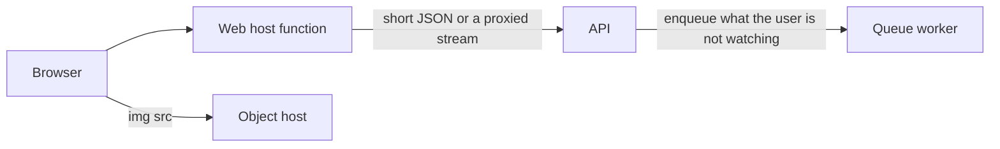

# Keep heavy work off the web host

The web process authenticates, renders a shell, and forwards a few calls. Model completions, embeddings, and delayed inserts run on the API and the queue worker. Shared reads that many instances would otherwise repeat sit in the remote cache. Images are bytes on the object host, fetched by the browser.

There is no `vercel.json`. The app reads `VERCEL_ENV` and `NEXT_PUBLIC_VERCEL_ENV` and does not declare a project id here. Do not invent one.

## Where the work runs

A server action or a route handler imports a module marked `server-only`. `BASE_URL` is read there. It is not a `NEXT_PUBLIC_` name, so the client bundle cannot call the API. Mutable per-user fetches pass `cache: "no-store"` (the bootstrap, the item page, the item detail). Those bodies must not fill the host data cache. The one-load shell is `nextjs-rsc-context-data-loading`.

Follow-up generation the user is not watching is a queue actor (`dramatiq-redis-workers`, `llm-comment-generation`). The web function ends when the response it is proxying ends. It does not stay open for that actor.

`cacheComponents` prerenders the layout shell. The signed-in seed is a Suspense hole, so the shell does not wait on the API. Fonts are `next/font` and the content-security policy allows `font-src 'self'`. They are part of the deployment, not a runtime font request.

Navigation links that should not warm another route set `prefetch={false}`. The shell nav does. The default prefetch requests that route's payload before the click.

## Shared reads

**P39.** Plain `"use cache"` stores the entry on one server process. The next instance misses and calls the API again. That repeat is the bill. Shared published content and derived lists use `"use cache: remote"` plus `cacheLife` and `cacheTag`. Arguments are part of the key. The handler name, the `"max"` profile, and what must stay uncached are `nextjs-cache-components`.

The configured `forever` profile is 31536000 seconds for stale, revalidate, and expire. A year-long entry is not refreshed on a timer. A write expires the tag. There is no `export const revalidate`, no `unstable_cache`, and no Open Graph image route. Do not add a route-segment revalidate to keep a page fresh. That is a second cache in front of the remote handler, and it refetches on a clock the tag already controls.

A non-ok upstream response must throw inside the cached function. An empty fallback stored for a year is a year of skipped API work that is also the wrong body (`nextjs-cache-components`).

## Images

One component renders a native image element. Nothing in the app imports `next/image`. `next.config` has no `images` block. The component comment says this avoids the host's image-transform meter and the edge-request meter that an optimizer URL would add.

The component accepts `src`, `alt`, `width`, `height`, `fill`, `className`, `priority`, and `style`. When `fill` is set it drops width and height and uses an absolute inset class. `priority` sets `fetchPriority` to `high` and `loading` to `eager`. Otherwise `loading` is `lazy` and `decoding` is `async`. The `sizes` and `unoptimized` props on the type are not forwarded. There is no optimizer for them to configure.

The `src` is a URL on the public object host (`r2-presigned-uploads`). The browser requests that host. The web function does not read the bytes. The content-security policy `img-src` must include that origin. A unit-test mock of `next/image` is not a usage. A generated image-types reference in `next-env.d.ts` is not a usage either.

> NOTE: unverified against the host's current pricing page. The meter names above are the component comment's. The code fact is that no component renders `next/image`.

## Streams stay proxied

The API ingress is internal (`cloudflare-tunnel`, `azure-container-apps-and-cicd`). The browser cannot open it. A browser-direct stream to the API is not in this repo. Do not add a public API origin to shorten the web function. That origin would be a hostname this repo does not have, and it would bypass the internal ingress.

The chat stream is a thin same-origin proxy. The browser sends `GET /api/agent/stream?agentRunId=`. The handler awaits `connection()` before `try`, so a prerender bailout is not logged as a stream failure. It then fetches the API with the server token and pipes the response body.

The response headers are `Content-Type: text/event-stream`, `Cache-Control: no-cache, no-transform`, `Connection: keep-alive`, and `X-Accel-Buffering: no`. `no-cache, no-transform` tells a cache not to store a transformed copy of the event stream. The function stays open until the upstream body ends. That duration is the cost of the internal ingress. The send that starts the run is a separate short POST to a same-origin route, so the long hold is only the stream route. That send is not a server action. Its comment says the route avoids an extra server-action round trip.

The item-create route is the same proxy. The browser posts to the web origin, the handler forwards to the API, and it relays the event stream. Work the user is not watching on that stream belongs on the worker, not in a longer function.

## What not to add

- `next/image`, an `images` config, or a loader that fetches the object host from the web function.
- A `NEXT_PUBLIC_` copy of `BASE_URL`, or a browser event source pointed at the API.
- `export const revalidate` or `unstable_cache` beside `"use cache: remote"`.
- Plain `"use cache"` for a value a second instance must reuse (P39).
- `router.refresh()` after a write. It re-runs the layout fetch (`nextjs-rsc-context-data-loading`, P38).
- Prefetch on links the user rarely opens. The shell sets `prefetch={false}`.

## Failure prevention

- **P39.** Shared entries are `"use cache: remote"`. A process-local entry misses on the next instance and calls the API again.
- The model call runs in the API or the worker. A route handler that calls the provider directly bills the web function for the completion and skips the worker scale rule (`aca-performance-tuning`).
- Per-user JSON uses `cache: "no-store"`. A cached bootstrap is a stale shell and a data-cache write of a private payload.
- `connection()` on the stream route is the first line, outside `try`.
- Do not publish the API to remove the proxy. Ingress stays internal. The proxy is the stream this repo has.
- `Cache-Control: no-cache, no-transform` on the event stream. A transformed or cached body is not a live stream.
- Object URLs go straight to the image element. Do not route them through the web host.
- `BASE_URL` stays server-only.

## Tests

- No file under the app or components imports `next/image`. The image component renders a native image and sets `loading="lazy"` unless `priority` is set.
- Shared list helpers contain `"use cache: remote"` and do not contain a bare `"use cache"` directive.
- Bootstrap, item page, and item detail fetches pass `cache: "no-store"`.
- The stream route calls `connection()` before `try` and returns `Content-Type: text/event-stream` with `Cache-Control: no-cache, no-transform`.
- No client module reads `BASE_URL` or imports the server-only env module.
- Shell links that are not the current page pass `prefetch={false}`.
- `next.config` sets `cacheComponents` and the `forever` profile and does not set an `images` key.

## Checklist

- [ ] Completions and delayed inserts run on the API or the worker, not in a web route.
- [ ] Shared reads use `"use cache: remote"` (P39). Mutable reads use `cache: "no-store"`.
- [ ] No `export const revalidate` and no `unstable_cache` next to the remote handler.
- [ ] Images are a native image element pointed at the object host. No `next/image`.
- [ ] The chat stream is a same-origin proxy because ingress is internal. There is no browser-direct API stream.
- [ ] The stream handler calls `connection()` outside `try` and sets `no-cache, no-transform`.
- [ ] `BASE_URL` is server-only. Shell links that should stay cold use `prefetch={false}`.
