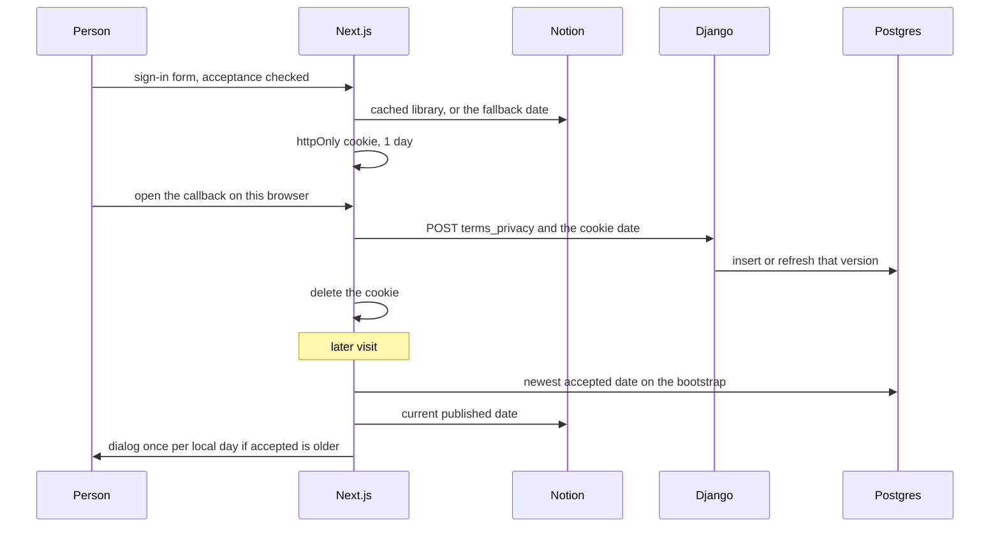

# Versioned terms and privacy consent

Two dates matter. The published version is the later Ready date among the privacy page and the terms page. The accepted version is the newest `YYYY-MM-DD` row stored for that person with type `terms_privacy` and `withdrawn_at` null. Sign-in writes a row through a short-lived cookie. A later publish shows a dialog at most once per local day until a new row exists.

Session cookies and the auth callback are `supabase-magic-link-auth`. The CMS body uses the `forever` cache and the `legal-content` tag from `nextjs-cache-components`. This module is the version rule, the consent row, and the dialog schedule.

Other policy pages (cookies, and any extra statements) use the same CMS shape and do not move the acceptance version.

## Architecture



## Published documents

`NOTION_API_KEY` is the only secret. The Notion API version header is `2022-06-28`. Each document is a parent page. Each published version is a child page whose title matches `^\d{4}-\d{2}-\d{2}$`. List children with `GET /v1/blocks/{id}/children`, `page_size` 100, following `next_cursor`. A non-OK response throws. Do not catch that throw inside the cached loader.

A child is Ready when its markdown contains `**Status:** Ready for site` or `Status: Ready for site`. Drop those lines from the body, and drop a line that is only `**Effective:** YYYY-MM-DD` or `Effective: YYYY-MM-DD`. Keep the intro and the sections. Do not cut the body at the first heading. That cut belongs to the article helper, not to legal pages.

```ts
function selectVersion(dates: string[], requested?: string): string | null {
  const valid = [...new Set(dates.filter((d) => /^\d{4}-\d{2}-\d{2}$/.test(d)))].sort()
  if (!valid.length) return null
  if (requested && valid.includes(requested)) return requested
  return valid[valid.length - 1]
}
```

The cached library keeps one body per document: the newest Ready child. Walk dated children newest-first and stop at the first Ready body. Older dated children stay in the CMS and are not stored. A newer child that is not Ready is skipped, so an older Ready child can still be the one stored. The public page renders that stored body. It does not choose among a list of dates.

`selectVersion` still returns the latest date in a list, or the requested date when that child is in the list. The loader does not call it.

The acceptance version is still the later of the two current dates, privacy and terms, compared as strings. `YYYY-MM-DD` sorts in calendar order. Do not store a localized display date as the version.

Display a version with `Intl.DateTimeFormat("en-US", { timeZone: "UTC", month: "long", day: "numeric", year: "numeric" })`.

Rewrite links that start with the configured site origin to a path. The reference compares against two hardcoded hosts. Read the origin from configuration.

### Cache (P20)

The library loader is `"use cache: remote"`, `cacheLife("forever")`, and `cacheTag("legal-content")`. Profiles and the revalidate route are `nextjs-cache-components`. Plain `"use cache"` is one process (P39). Shared legal bodies use the remote handler.

| Outcome | What the cache stores |
| --- | --- |
| Notion HTTP error | Nothing. The throw leaves the function. |
| Newest Ready child | `{ date, markdown }` for that document only. Older dated children are not stored. |
| Newer child not Ready | That child is skipped. The walk continues to the next older dated child. |
| No Ready child | The document is absent from the library. |
| `NOTION_API_KEY` empty | `{}`. That empty object is cached for the `forever` profile. |

An empty library makes the current version null. Sign-in then uses the fallback date, and the dialog stays closed (`needsUpdate` is false when the current date is missing). After the key is set, revalidate `legal-content` or the empty result keeps serving. Publishing a new Ready child also requires that revalidate. Until then the dialog and the public page keep the previous library.

The loader does not read cookies. Do not add a `try/catch` inside it that returns `{}` on every error. That stores the empty library and swallows a prerender bailout (P20). The dashboard seeder, which does read cookies, calls `unstable_rethrow` before it substitutes null. A catch without that rethrow turns the bailout into "no current version", hides the dialog, and fails the build later with a worse error.

## Consent row

Table `app_user_consent`. The API role is the one in `supabase-rls-client-reads`: it can see every row, so the handler filters on the JWT subject. `authenticated` has `SELECT` only, `USING (auth.uid()::text = user_id::text)`. The subject column is text, not uuid, because that comparison is text on both sides. The handler still requires the subject to parse as a UUID.

| Column | Shape |
| --- | --- |
| `id` | UUID primary key |
| `user_id` | text, indexed. The JWT `sub`. |
| `consent_type` | text. Only `terms_privacy` is accepted. |
| `version` | text, `YYYY-MM-DD`. Indexed. |
| `accepted_at` | timestamp, default now. Not taken from the client clock. |
| `withdrawn_at` | timestamp, null. A repeat accept sets it back to null. |
| `metadata` | JSON object. A non-object is stored as `{}`. |
| `created_at`, `updated_at` | timestamps |

Unique on `(user_id, consent_type, version)`. A new publish inserts a new row. History stays. The column default for `version` is an older date than the API fallback and is not the published version. Always pass `version` on insert.

The newest accepted version is the max dated string among rows with `withdrawn_at` null. Non-date versions are ignored. There is no withdraw endpoint. The deletion job leaves these rows in place. The export payload includes them.

`POST /api/legal-consents/` is not on the auth-exempt list. `user_id` is the JWT `sub`, never a body field.

```python
DATE = re.compile(r"^\d{4}-\d{2}-\d{2}$")

def record(request):
    user_id = request.user_id
    if not user_id:
        return error(400, "missing subject")
    try:
        UUID(user_id)
    except (ValueError, TypeError):
        return error(400, "invalid subject")
    consent_type = request.data.get("consent_type") or "terms_privacy"
    if consent_type != "terms_privacy":
        return error(400, "unsupported type")
    version = request.data.get("version")
    if not isinstance(version, str) or not DATE.fullmatch(version):
        return error(400, "unsupported version")
    row, created = update_or_create(
        user_id=user_id,
        consent_type=consent_type,
        version=version,
        defaults={"metadata": metadata if isinstance(metadata, dict) else {}, "withdrawn_at": None},
    )
    return {"id": str(row.id), "created": created, "version": version}, 201 if created else 200
```

The reference catches only `ValueError`. `UUID(None)` raises `TypeError` and becomes a 500. Reject a missing subject before `UUID()` (the same rule as `m2m-jwt-service-auth`). The route is authenticated, so this is defense in depth.

The API checks the date shape only. It does not check that the date is a Ready page. A well-formed date is stored. The update action re-reads the current version on the server and sends that. The auth callback sends the cookie. The cookie is httpOnly, so page scripts cannot set it. The correct check on the callback is to ignore the cookie date when it is not the current published date, and store the published date instead. The reference stores the cookie date after the shape check.

Metadata written by the app:

| Source | Fields |
| --- | --- |
| Auth callback | `source: auth_callback`, `accepted_at_client` when the cookie had a timestamp |
| Update dialog | `source: legal_update_dialog` |

## Sign-in cookie

The sign-in actions in `supabase-magic-link-auth` gain one gate. If the form field `legal_acceptance` is not the string `true`, return an error and do not start the magic link or the OAuth redirect. The reference copy also asks the person to confirm an age threshold and the two documents. Keep that copy in the form. The server checks the flag, not the sentence.

After the flag passes, and before `signInWithOtp` or `signInWithOAuth`:

```ts
const version = (await getCurrentVersion()) ?? FALLBACK_VERSION
cookieStore.set("legal_ack", JSON.stringify({
  version,
  acceptedAt: new Date().toISOString(),
}), {
  httpOnly: true,
  sameSite: "lax",
  secure: isProd,
  maxAge: 60 * 60 * 24,
  path: "/",
})
```

`FALLBACK_VERSION` is a `YYYY-MM-DD` used only when the CMS returns null. It is duplicated in the web app and the API. Keep the two strings equal, and do not move either ahead of a Ready page. A newer fallback makes `accepted < current` false once the CMS loads, and the dialog never opens for that gap.

The callback, after a successful code exchange:

1. Missing cookie: record nothing.
2. JSON `{ version, acceptedAt }`. A missing `version` uses the fallback. Malformed JSON uses the fallback and no timestamp.
3. POST the consent API with the bearer from `m2m-jwt-service-auth`. The reference does not check `response.ok`. Check it, and do not treat a 4xx or a network error as recorded.
4. Delete `legal_ack` on the redirect whether or not the POST succeeded.

The cookie is on the browser that submitted the form. Opening the magic link on another device has no cookie, so no row is written. The dialog is the backstop. Do not put the version only in the email link and skip the row.

A failed POST still signs the person in. The next dashboard load sees no accepted date. If the current date loaded, the dialog is due.

## When the dialog is due

```ts
function needsUpdate(accepted: string | null, current: string | null): boolean {
  if (!current || !/^\d{4}-\d{2}-\d{2}$/.test(current)) return false
  if (!accepted || !/^\d{4}-\d{2}-\d{2}$/.test(accepted)) return true
  return accepted < current
}
```

Equal dates are not an update. A missing current date does not nag. A missing or non-date accepted value does, but only after the provider has been seeded. Before seed, `ready` is false and the dialog stays closed, including on the server render.

The dashboard seeder runs inside Suspense, reads cookies first, then loads the bootstrap. The bootstrap's legal section is independent: a failure leaves the accepted version null and logs the error. The seeder then passes null plus the current date, so `needsUpdate` is true. That looks like "never accepted". The write is idempotent, so showing the dialog is safe. Do not catch the read and substitute the current date. That would hide a real gap.

The client seed effect writes both versions. It also seeds other dashboard state, and it runs again when any of those values change. A repeat seed with the bootstrap's accepted version overwrites an acceptance just saved in this session, because the bootstrap is still the pre-accept payload. If memory already holds an accepted date and the seed is null or older, keep the in-memory date. The reference replaces both values unconditionally.

The dialog is not a hard gate. A local record `{ day, version, shownAt }` is keyed by the user id. `day` is the browser's local `YYYY-MM-DD`, not UTC.

- Show when seeded, a user id exists, a current date exists, `needsUpdate` is true, and the stored record is not this version on this local day.
- Write the record when the dialog is shown. A storage failure still shows it for this visit. The next visit tries again.
- While it is open there is no close control. Escape and an outside click do nothing.
- Refreshing or leaving after the record is written hides it until the next local day, even if they did not agree. The reference dialog copy says it keeps showing until they accept. The schedule is once per local day.
- A new current version does not match the stored version, so it shows again the same day.
- Agree is disabled until the checkbox is checked. The action re-reads the current version. It does not trust a date from the browser. Failure shows an error and leaves the dialog up. Success sets the in-memory accepted version to the returned date and deletes the local record.
- Links to the terms and privacy pages open in a new tab so the dashboard state stays put.

`markAccepted` alone is not the audit row. The POST has to succeed first. Clearing the local record without a successful POST would show the dialog again immediately, which is what you want.

## Setup

1. Create a parent page per document. Add a child titled with the effective date. Include the Ready status line. Set `NOTION_API_KEY`. Revalidate `legal-content`.
2. Add `app_user_consent` with the unique key and the `authenticated` select policy. Point the API at the non-bypass role and filter on `sub`.
3. Set the same fallback date in the web app and the API, equal to a Ready privacy or terms date.
4. Set the httpOnly cookie only after the acceptance flag, on both the magic-link action and the OAuth action. Record it in the callback, then delete it.
5. Seed accepted and current versions from the bootstrap and the cached library. Schedule the dialog once per local day. Re-read the version in the accept action.

## Tests

- `needsUpdate("2026-01-01", "2026-01-01")` is false. An older accepted date is true. Null accepted with a current date is true. Null current is false. A non-date on either side follows those two null rules.
- `selectVersion` returns the latest date, or the requested date when that child exists. A title that is not `YYYY-MM-DD` is ignored. A page without the Ready line is ignored. The body has no status line and no effective line, and still has the intro.
- The cached library stores the newest Ready version of each document. Older dated children are not stored. The current version is the later of those two dates, privacy and terms. A cookies page with a later date does not change it.
- The consent API returns 201 on the first insert and 200 on the same triple, with `withdrawn_at` cleared. A non-date version and any other `consent_type` are 400. A missing subject is 400, not 500.
- The prompt record hides the dialog for the rest of the local day, shows it the next local day, shows it the same day when the version string changes, and is removed after a successful accept.
- A cookie that is missing records nothing. Malformed JSON posts the fallback date. The callback deletes the cookie. A failed POST is not treated as success.
- A prerender bailout in the seeder is rethrown. A Notion HTTP error is not stored under `legal-content`.

## Checklist

- Privacy and terms Ready dates are the only inputs to the acceptance version. Comparison is string order on `YYYY-MM-DD`.
- The library is `"use cache: remote"` with `legal-content`, and it stores only the newest Ready body per document (P39). HTTP errors throw. An empty key result is revalidated after the key exists (P20).
- Seeders call `unstable_rethrow` before a null fallback.
- The sign-in action refuses to start auth without `legal_acceptance=true`, then sets an httpOnly cookie for one day.
- The callback posts `terms_privacy` with the user id from the JWT, checks the response, and deletes the cookie.
- The API rejects a missing subject before `UUID()`, allows only `terms_privacy`, and allows only a date-shaped version.
- Repeat accepts update the same row. A new date inserts a new row. Deletion does not remove the table. Export includes the rows.
- The dialog is once per local day per browser, non-dismissable while open, and closes in memory only after the POST returns the new version.
- A later seed does not overwrite a newer accepted version already stored in this session.
- The fallback date is the same in both processes and is not newer than a Ready page.
- Site links are rewritten from the configured origin, not from a hardcoded host list.
